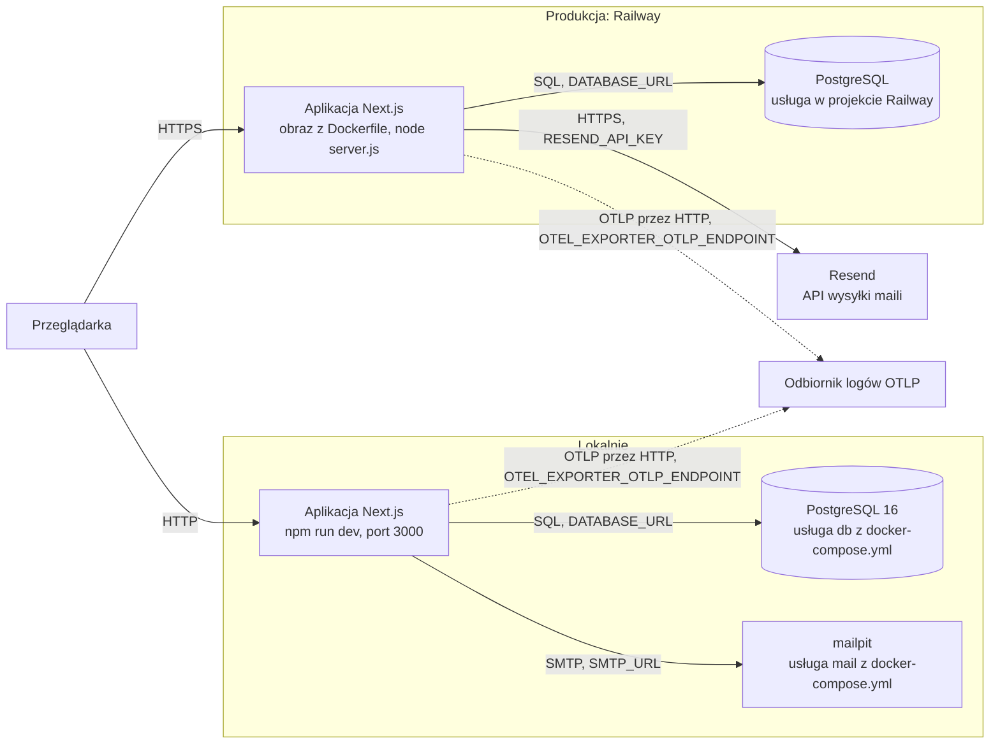
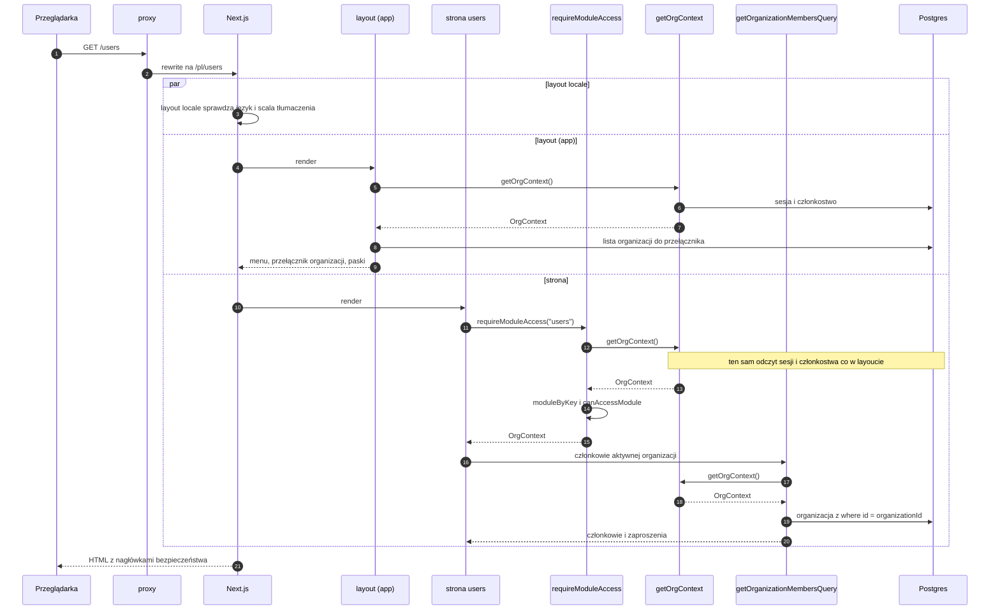
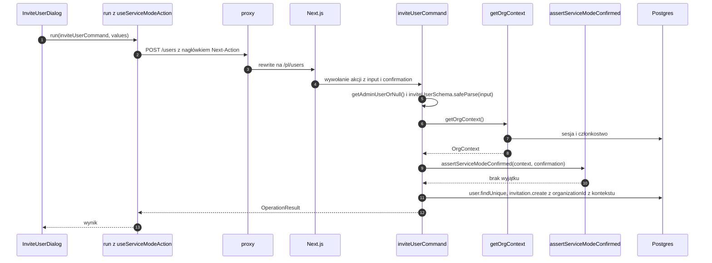

# Architektura kitu

Po przeczytaniu będziesz wiedzieć:

- na jakich zasadach opiera się kit i gdzie znaleźć ich uzasadnienie;
- z jakich usług składa się aplikacja lokalnie i na Railway;
- gdzie w repozytorium leży każdy rodzaj kodu i z czego składa się feature;
- jak żądanie przechodzi od przeglądarki do bazy i w których miejscach kod sprawdza sesję, uprawnienia i tryb serwisowy.

Zweryfikowano z kodem: 734391b, 2026-11-04 (punkt „Usługi modułów” w [Usługach i połączeniach](#uslugi)); pozostałe sekcje: 8d97b78, 2026-10-30

Źródła:

- `src/proxy.ts`
- `src/__tests__/proxy-matcher.test.ts`
- `src/i18n/`
- `src/app/[locale]/layout.tsx`
- `src/app/[locale]/(app)/`
- `src/app/[locale]/(auth)/`
- `src/app/[locale]/accept-invitation/`
- `src/app/[locale]/no-organization/`
- `src/app/api/`
- `src/shared/lib/auth/*.ts`
- `src/shared/lib/modules/`
- `packages/env/src/*.ts`, `src/env.ts`
- `src/shared/lib/prisma.ts`
- `src/shared/lib/mailer.ts`
- `src/shared/lib/logger.ts`, `packages/observability/src/*.ts`
- `src/shared/lib/audit.ts`
- `src/shared/lib/security-headers.ts`
- `src/shared/components/app-sidebar.tsx`
- `src/shared/components/service-mode/`
- `src/shared/utils/error-handling.ts`
- `src/instrumentation.ts`
- `src/features/*/module.ts`
- `src/features/uploads/services/storage-env.ts`
- `src/features/users/components/invite-user-dialog.tsx`
- `src/features/users/components/users-manager.tsx`
- `src/features/users/services/commands/`
- `src/features/users/services/queries/`
- `src/features/auth/services/commands/change-password-command.ts`
- `src/features/organizations/services/`
- `src/__tests__/server-entrypoints-guard.test.ts`
- `prisma/schema/`
- `kit/kit.json`
- `kit/modules/`
- `packages/gato-cli/package.json`
- `.wa/kit.json`
- `docker/`
- `ci/`
- `next.config.ts`
- `package.json`
- `package-lock.json`
- `.gitignore`
- `docker-compose.yml`
- `Dockerfile`
- `railway.toml`
- `components.json`
- `.github/workflows/`
- `README.md`

<a id="kit-rdzen-moduly"></a>

## Kit, rdzeń i moduły

Repozytorium wa-kit (dalej: kit) to działająca aplikacja Next.js 16, z której kopiuje się kod do projektów klientów. Ten plik używa kilku pojęć. Krótkie definicje są też w [rejestrze decyzji](decyzje.md#pojęcia), a pełny słownik w [README.md](README.md).

- **Rdzeń**: część, którą ma każdy projekt: logowanie, organizacje, użytkownicy, konto i dashboard.
- **Feature**: katalog `src/features/<x>/` z kodem jednej funkcji. Rdzeń ma pięć feature: `auth`, `organizations`, `users`, `account` i `dashboard`.
- **Moduł** (moduł kitu): jednostka, którą CLI kopiuje do projektu i z niego usuwa. Opisuje go manifest `kit/modules/<nazwa>.json`, czyli lista plików modułu, jego zależności npm i tego, co moduł dokłada do plików rdzenia (zmienne środowiskowe, relacje w schemacie bazy, usługi Dockera, kroki CI). Manifest jest kopiowany do `.wa/kit.json`: w kicie przez `wa kit sync`, w projekcie przy instalacji modułu. Moduł może obejmować kilka feature. Kit ma cztery moduły: `core`, który obejmuje cały rdzeń, oraz opcjonalne `audit-logs`, `api-keys` i `uploads` ([12-moduly-kitu.md](12-moduly-kitu.md)).
- **Moduł projektu**: funkcja napisana w projekcie, z samym manifestem w `projectModules` w `.wa/kit.json`. Generator rejestruje ją tak jak moduł kitu, a CLI jej nie kopiuje ani nie usuwa ([D36](decyzje.md#d36)).
- **Definicja modułu**: plik `src/features/<x>/module.ts` z `defineModule(...)`. Mimo nazwy opisuje jeden feature: jego klucz, pozycje w menu i reguły dostępu.
- **Rejestr modułów**: tablice w `src/modules.generated.ts` i `src/modules.client.generated.ts`, z których aplikacja dowiaduje się, jakie feature istnieją.
- **Szew**: miejsce, w którym rdzeń dowiaduje się o modułach. Są dwa rodzaje: plik generowany (oba pliki rejestru i `src/i18n/locales.generated.ts`) i region, czyli fragment pliku między liniami z `wa:<nazwa>:start` i `wa:<nazwa>:end`. Oba przepisuje generator `wa generate`, opisany w [02b-rejestr-i-generator.md](02b-rejestr-i-generator.md).
- **Punkt wejścia**: kod rdzenia, z którego korzysta (który importuje) moduł kitu albo moduł projektu, na przykład `trackAudit` z `src/shared/lib/audit.ts`, oraz deklaracje w `defineModule` (`auditActions`, `apiScopes`, `uploadPurposes`). Działa w każdym projekcie, także bez modułu, który go obsługuje ([12-moduly-kitu.md](12-moduly-kitu.md#punkty-wejscia)).
- **Guard**: funkcja, która sprawdza sesję albo uprawnienia, zanim kod sięgnie do danych, na przykład `getOrgContext()` albo `requireModuleAccess()`.
- **Kontekst organizacji** (`OrgContext`): wynik `getOrgContext()`, czyli `{ userId, organizationId, orgRole, userRole, serviceMode }` dla zalogowanego użytkownika i jego aktywnej organizacji. Szczegóły: [03-dane-i-organizacje.md](03-dane-i-organizacje.md).

CLI kitu (`wa`) tworzy projekt z kitu (`create`), dodaje i usuwa moduły (`add`, `remove`), wypisuje je (`list`) i odświeża pliki generowane (`generate`), a w repozytorium kitu przepisuje manifesty do `.wa/kit.json` (`kit sync`). Użycie w projekcie opisuje [16-cli-wa.md](16-cli-wa.md), pracę nad kitem (manifesty, bundel, wydanie) [16b-rozwoj-kitu.md](16b-rozwoj-kitu.md), a drogę modułu od manifestu do aplikacji [12-moduly-kitu.md](12-moduly-kitu.md#warstwa-szwow). Nie przenosi poprawek między kitem a projektem: te wysyła się jako pull request ([D39](decyzje.md#d39)). Co dokumentacja świadomie pomija, opisuje [README.md](README.md).

<a id="zasady-kitu"></a>

## Zasady kitu

Kit opiera się na kilku decyzjach. Każda ma w [rejestrze decyzji](decyzje.md) kontekst, odrzucone alternatywy i opis tego, co pilnuje jej przestrzegania. Tutaj jest tylko tyle, ile trzeba, żeby zrozumieć resztę pliku. Gdy dwa wymagania się wykluczają, rozstrzyga [kolejność priorytetów z AGENTS.md](../AGENTS.md#kolejność-priorytetów).

- **Kod kitu staje się kodem projektu.** Rdzeń i moduły kopiuje się do repozytorium projektu, a nie instaluje jako paczki npm. Projekt może je zmieniać bez forka i bez publikowania paczek, a poprawkę przydatną innym projektom wysyła jako pull request do `webamigos/wa-kit` ([D39](decyzje.md#d39)).
- **Kit to jedna aplikacja referencyjna.** Leży w katalogu głównym repozytorium, z takim samym układem katalogów jak projekt klienta, więc rozwija się ją i testuje jak zwykłą aplikację. Do którego modułu należy każdy plik i każda zależność npm, zapisuje manifest modułu w `kit/modules/<nazwa>.json`, a test własności w bramce CLI sprawdza, że każdy plik kitu ma dokładnie jednego właściciela. `wa kit sync` przepisuje manifesty do `.wa/kit.json` ([D38](decyzje.md#d38)).
- **Moduł tylko dodaje pliki.** Nie zmienia plików rdzenia, a rdzeń dowiaduje się o nim wyłącznie przez szwy. W drugą stronę moduł korzysta z rdzenia przez punkty wejścia i deklaracje w `defineModule` ([D39](decyzje.md#d39)). Gdyby moduł edytował pliki rdzenia, każde dodanie, usunięcie albo aktualizacja modułu kończyłyby się scalaniem cudzych zmian w tych samych plikach ([D03](decyzje.md#d03)).
- **Pliki generowane są w repozytorium.** Dzięki temu projekt buduje się, testuje i wdraża bez CLI kitu (obraz z `Dockerfile` go nie buduje). CI sprawdza, że ich treść jest dokładnie taka, jaką zapisuje generator ([D04](decyzje.md#d04)).
- **Definicja modułu to same dane.** Czyta ją guard stron na serwerze i menu w przeglądarce, więc `module.ts` nie może importować kodu serwerowego. Oba miejsca rozstrzygają dostęp tą samą funkcją `canAccessModule`, więc menu pokazuje dokładnie to, przez co guard wpuszcza ([D05](decyzje.md#d05)).
- **Moduł przynosi własny schemat, a feature własne teksty.** Modele Prismy moduł dodaje we własnym pliku w `prisma/schema/` ([D14](decyzje.md#d14)), a feature trzyma tłumaczenia w `src/features/<x>/i18n/`, pod namespace równym nazwie katalogu ([D27](decyzje.md#d27)). Moduł nie edytuje plików schematu ani tłumaczeń rdzenia: relacje zwrotne w modelach rdzenia trafiają do regionu `wa:relations`.
- **Dane i dostęp sprawdza serwer, nie interfejs.** Każde zapytanie o dane domenowe filtruje po `organizationId` z `getOrgContext()` ([D07](decyzje.md#d07)), każda strona feature w `(app)` woła `requireModuleAccess(key)`, a każda akcja serwerowa sprawdza uprawnienia sama ([D11](decyzje.md#d11)). Ukrycie pozycji w menu niczego nie chroni, bo adres strony można wpisać ręcznie.
- **Logi i ślady idą przez OpenTelemetry.** `logger` z `src/shared/lib/logger.ts` (`createLogger` z pakietu `@gatojs/observability`) wysyła wpisy przez API logów OpenTelemetry, `withSpan` z `createTelemetry` otwiera ślady, a eksport do zewnętrznego odbiornika włącza `OTEL_EXPORTER_OTLP_ENDPOINT` ([D15](decyzje.md#d15)).

<a id="uslugi"></a>

## Usługi i połączenia

Aplikacja to jeden proces Node.js z Next.js. better-auth (logowanie i sesje), Prisma (dostęp do bazy) i next-intl (tłumaczenia) to biblioteki działające w tym procesie, a nie osobne usługi. Lokalnie aplikację uruchamia `npm run dev`, a bazę i serwer pocztowy `docker compose up -d` ([01-uruchomienie.md](01-uruchomienie.md)). Na Railway aplikacja działa z obrazu Docker.

Diagram pokazuje oba środowiska dla projektu z samym rdzeniem. Linia przerywana oznacza połączenie opcjonalne. Usługi modułów opisuje ostatni punkt listy pod diagramem.



- **Przeglądarka → aplikacja.** Przeglądarka pobiera strony, wywołuje akcje serwerowe (żądania POST pod adres bieżącej strony) i endpoint better-auth `/api/auth/*` (`src/app/api/auth/[...all]/route.ts`). Endpoint `/api/healthcheck` (`src/app/api/healthcheck/route.ts`) wykonuje na bazie `SELECT 1` i służy Railway jako healthcheck.
- **Aplikacja → PostgreSQL.** Prisma łączy się przez adapter `@prisma/adapter-pg` i pulę połączeń `pg` pod adresem z `DATABASE_URL` (`src/shared/lib/prisma.ts`). W tej samej bazie better-auth trzyma konta i sesje (`prismaAdapter` w `src/shared/lib/auth/index.ts`). Model danych opisuje [03-dane-i-organizacje.md](03-dane-i-organizacje.md).
- **Aplikacja → poczta.** `src/shared/lib/mailer.ts` wysyła przez SMTP, gdy ustawiono `SMTP_URL` (lokalnie wskazuje mailpit). W przeciwnym razie wysyła przez API Resend, gdy ustawiono `RESEND_API_KEY`, a bez obu tylko zapisuje wpis w logu. Na produkcji walidacja zmiennych wymaga `RESEND_API_KEY` ([D18](decyzje.md#d18), [07-i18n-mail-env.md](07-i18n-mail-env.md)).
- **Aplikacja → odbiornik logów.** Gdy ustawiono `OTEL_EXPORTER_OTLP_ENDPOINT`, funkcja `register()` z `src/instrumentation.ts`, którą Next.js wywołuje przy starcie serwera, włącza wysyłkę logów i śladów protokołem OTLP przez HTTP pod `<endpoint>/v1/logs` i `<endpoint>/v1/traces`. Działa tak samo lokalnie i na produkcji. Bez endpointu na produkcji wpisy z `logger` nigdzie nie trafiają ([D15](decyzje.md#d15)).
- **Railway.** Buduje obraz z `Dockerfile` (Next.js z `output: "standalone"` w `next.config.ts`), przed każdym wdrożeniem uruchamia `npx prisma migrate deploy`, a jako healthcheck ma ustawione `/api/healthcheck` (`railway.toml` albo ustawienia usługi, bo nowa usługa nie czyta `railway.toml`, [10-wdrozenie.md](10-wdrozenie.md#config-as-code)). Wdrożenie opisuje [10-wdrozenie.md](10-wdrozenie.md).
- **Usługi modułów.** Moduł `uploads` zapisuje pliki według `STORAGE_PROVIDER`: domyślnie w katalogu na dysku serwera (`local`, lokalnie `volumes/uploads`), a przy `s3` w magazynie zgodnym z S3 (zmienne `S3_*`). Na Railway jest to wolumen usługi aplikacji albo Railway Bucket ([10-wdrozenie.md](10-wdrozenie.md#pliki-uploads)). Lokalnym magazynem S3 jest MinIO: usługi `minio` i `minio-init` z profilem Compose `s3` trafiają do `docker-compose.yml` przez region `wa:services` z pliku `docker/uploads.compose.yml`, a uruchamia je dopiero `docker compose --profile s3 up -d` ([15-modul-uploads.md](15-modul-uploads.md#provider)). Moduły dokładają też własne trasy API: `uploads` trasy `/api/uploads` i `/api/uploads/[id]`, a `api-keys` trasę `/api/v1/organization` dla żądań z kluczem API ([14-modul-api-keys.md](14-modul-api-keys.md)).

<a id="mapa-repozytorium"></a>

## Mapa repozytorium

| Ścieżka | Co zawiera | Więcej |
| --- | --- | --- |
| `src/app/` | Trasy Next.js (App Router). Segment `[locale]` to jeden z języków projektu z pola `locales` w `.wa/kit.json` (w kicie `pl` i `en`); język domyślny `pl` dopisuje wewnętrznie proxy. W nim grupy tras, których nazwa w nawiasie nie trafia do adresu: `(app)` ze stronami po zalogowaniu (`dashboard`, `users`, `account`) i wspólnym layoutem aplikacji oraz `(auth)` ze stronami logowania, rejestracji i haseł. Obok grup są strony `accept-invitation/[id]` i `no-organization`. Poza `[locale]` leżą endpointy `api/auth/[...all]` i `api/healthcheck`, szablony maili w `emails/` i teksty rdzenia w `messages/`. Moduły dokładają strony w `(app)` (`api-keys`, `audit-log`) i trasy w `api/` (`uploads`, `v1/organization`). | [05-moduly-rdzenia.md](05-moduly-rdzenia.md), [12-moduly-kitu.md](12-moduly-kitu.md) |
| `src/features/` | Feature: pięć w rdzeniu i po jednym w modułach `api-keys`, `audit-logs` i `uploads`. | [Anatomia feature](#anatomia-feature), [12-moduly-kitu.md](12-moduly-kitu.md) |
| `src/shared/` | Kod wspólny dla wszystkich feature. W `lib/` są auth i guardy, `env.ts`, `prisma.ts`, `mailer.ts`, `logger.ts`, `audit.ts` (punkt wejścia `trackAudit`) oraz `modules/` z `defineModule` i nawigacją. W `components/` są menu boczne i komponenty trybu serwisowego. Do tego `config/project.ts` (nazwa i slug projektu), `types/`, `utils/` i `constants/`. | [03-dane-i-organizacje.md](03-dane-i-organizacje.md), [04-auth-i-role.md](04-auth-i-role.md), [06-wzorce-kodu.md](06-wzorce-kodu.md) |
| `src/components/ui/` | Komponenty shadcn/ui oparte na base-ui (konfiguracja w `components.json`). | [05-moduly-rdzenia.md](05-moduly-rdzenia.md) |
| `src/i18n/` | Konfiguracja next-intl: języki (`config.ts`), routing (`routing.ts`), ładowanie i scalanie tekstów (`request.ts`, `merge-messages.ts`) oraz plik generowany `locales.generated.ts` z językami projektu. | [07-i18n-mail-env.md](07-i18n-mail-env.md) |
| `src/proxy.ts`, `src/instrumentation.ts` | Pliki konwencji Next.js. Proxy działa przed żądaniami pasującymi do jego `matcher`, a `register()` raz przy starcie serwera. | [Proxy i język](#proxy) |
| `src/modules.generated.ts`, `src/modules.client.generated.ts` | Rejestr modułów, pliki generowane (trzeci plik generowany leży w `src/i18n/`). | [02b-rejestr-i-generator.md](02b-rejestr-i-generator.md#rejestr-modulow) |
| `src/generated/prisma/` | Klient Prismy z `prisma generate`, który uruchamia `postinstall`. Katalog jest w `.gitignore`. | [03b-schemat-i-migracje.md](03b-schemat-i-migracje.md#schemat) |
| `src/__tests__/`, `src/test/`, `src/types/` | Test architektury punktów wejścia serwera i test `matcher` proxy, pomocniki testów, deklaracje typów. | [08-testy.md](08-testy.md) |
| `prisma/schema/` | Schemat w wielu plikach: `base.prisma` (generator i źródło danych), `auth.prisma`, `organizations.prisma` oraz po jednym pliku na moduł (`api-keys.prisma`, `audit-logs.prisma`, `uploads.prisma`). | [03b-schemat-i-migracje.md](03b-schemat-i-migracje.md#schemat) |
| `scripts/` | `admin-create.ts` (`npm run admin:create`) i `mutation-gate.ts` (`npm run test:mutation:gate`), logika obu w `lib/`. | [04-auth-i-role.md](04-auth-i-role.md), [08-testy.md](08-testy.md), [08b-testy-adwersarialne.md](08b-testy-adwersarialne.md#bramka) |
| `e2e/` | Testy Playwright i ich przygotowanie (`global-setup.ts`). | [08-testy.md](08-testy.md) |
| `packages/gato-cli/` | CLI `wa`: źródła, testy i własna bramka (`npm run verify --prefix packages/gato-cli`). Bundel `.wa/bin/wa.mjs`, zapisany w repozytorium, powstaje przez `npm run build --prefix packages/gato-cli`; projekt uruchamia go jako `npm run wa -- <komenda>`. | [16-cli-wa.md](16-cli-wa.md), [16b-rozwoj-kitu.md](16b-rozwoj-kitu.md#bundel), [02b-rejestr-i-generator.md](02b-rejestr-i-generator.md#wa-generate) |
| `kit/kit.json`, `kit/modules/` | Opis kitu (wersja, repozytorium, pliki tylko dla kitu, placeholdery, pliki generowane i zarządzane) i manifesty modułów kitu. Tylko w kicie, do projektu nie trafiają. | [16b-rozwoj-kitu.md](16b-rozwoj-kitu.md#kit-a-projekt) |
| `kit/CLAUDE.md`, `kit/README.md` | Reguły pracy nad kitem i opis CLI dla użytkowników. | [16b-rozwoj-kitu.md](16b-rozwoj-kitu.md) |
| `.wa/kit.json` | Stan kitu: wersja i źródło kitu, projekt, języki, moduły kitu z manifestami i hashami plików oraz moduły projektu. | [02b-rejestr-i-generator.md](02b-rejestr-i-generator.md#kit-json) |
| `docker/`, `ci/` | Pliki modułów wskazane w polach `compose` i `ciSteps` manifestu (`docker/uploads.compose.yml`, `ci/uploads.integration-steps.yml`), które generator kopiuje do regionów. | [02b-rejestr-i-generator.md](02b-rejestr-i-generator.md#regiony) |
| `.claude/` | Konfiguracja Claude Code: hooki w `hooks/`, agenci testów w `agents/`, `settings.json`. | [11-praca-z-kitem.md](11-praca-z-kitem.md) |
| `.github/workflows/` | CI: `ci.yml`, `e2e.yml`, `mutation.yml`, `security-audit.yml`, `security-secret-scan.yml`, `workflow-lint.yml`, a tylko w kicie `kit.yml` (bramka CLI i składanie projektów z modułami) i `kit-mutation.yml`. | [08-testy.md](08-testy.md), [10-wdrozenie.md](10-wdrozenie.md), [11-praca-z-kitem.md](11-praca-z-kitem.md), [16b-rozwoj-kitu.md](16b-rozwoj-kitu.md#ci-kitu) |
| `docs/` | Ta dokumentacja. W `docs/superpowers/` leżą specyfikacje, plany i notatki procesu. | [README.md](README.md) |
| katalog główny | Konfiguracja narzędzi: `next.config.ts`, `prisma.config.ts`, `docker-compose.yml`, `Dockerfile`, `railway.toml`, Vitest, Playwright, Stryker, `mutation-gate.json`, `turbo.json`, ESLint, Prettier, husky i commitlint. | [01-uruchomienie.md](01-uruchomienie.md), [08-testy.md](08-testy.md), [08b-testy-adwersarialne.md](08b-testy-adwersarialne.md#stryker), [10-wdrozenie.md](10-wdrozenie.md) |

<a id="anatomia-feature"></a>

## Anatomia feature

Feature to katalog `src/features/<x>/`. Nazwa katalogu `<x>` staje się namespace tłumaczeń feature, a menu szuka etykiet pod `key` z definicji modułu, dlatego `key` musi być równy nazwie katalogu ([D27](decyzje.md#d27)). Strony feature leżą poza tym katalogiem, w `src/app/[locale]/(app)/<trasa>/page.tsx`, bo w App Router trasy wyznacza katalog `src/app/`. Strona importuje komponenty i query z feature.

Układ katalogu feature:

```text
src/features/<x>/
├── module.ts            definicja modułu: defineModule({...})
├── components/          komponenty React
├── contracts/           typy i schematy Zod
├── services/
│   ├── commands/        zapisy; akcje serwerowe mają "use server"
│   ├── queries/         odczyty
│   └── *.ts             serwisy wołane z innego kodu serwerowego
├── i18n/
│   ├── pl.json
│   └── en.json
├── env.ts               opcjonalnie: envSchema, schemat Zod zmiennych feature
├── auth.ts              opcjonalnie: authPlugin, plugin better-auth po stronie serwera
├── auth-client.ts       opcjonalnie: authClientPlugin, plugin better-auth po stronie przeglądarki
└── audit-sink.ts        opcjonalnie: auditSink, ujście zdarzeń z trackAudit
```

Testy leżą w katalogach `__tests__/` obok kodu, który sprawdzają ([08-testy.md](08-testy.md)).

Generator czyta z feature tylko `module.ts`, `env.ts`, `auth.ts`, `auth-client.ts`, `audit-sink.ts` i `i18n/<locale>.json` dla języków projektu. Co z nich trafia do rejestru i kto to czyta, opisuje [02b-rejestr-i-generator.md](02b-rejestr-i-generator.md#rejestr-modulow). Pozostałe katalogi (`components/`, `contracts/`, `services/`) są zwykłym kodem, który importują strony i inne pliki.

W `services/commands/` są dwa rodzaje plików:

- **Akcje serwerowe**, czyli pliki z dyrektywą `"use server"`. To punkty wejścia wywoływane bezpośrednio z przeglądarki, więc każda sama sprawdza sesję. Komendy na danych organizacji, czyli akcje wołające `getOrgContext()` albo `requireModuleAccess()` (na przykład `invite-user-command.ts`), przyjmują `(input, confirmation?)`, wołają `assertServiceModeConfirmed` przed Prismą i zwracają `OperationResult` ([06-wzorce-kodu.md](06-wzorce-kodu.md)). Inne akcje mają własne sygnatury, na przykład `changePasswordCommand(currentPassword, newPassword)` albo bezargumentowe `logImpersonationStartCommand()`.
- **Funkcje wewnętrzne** bez `"use server"`, które woła tylko inny kod serwera. Przykład: `signup-membership.ts` podczas rejestracji woła `createOrganizationWithOwnerCommand` z `organization-commands.ts` i `joinOrganizationCommand` z `member-commands.ts`. Takiej funkcji nie da się wywołać z przeglądarki, więc nie sprawdza sesji sama.

<a id="droga-zadania"></a>

## Droga żądania

Ta sekcja pokazuje dwa przebiegi na przykładach z rdzenia: wyświetlenie strony `/users` (żądanie GET) i zaproszenie użytkownika (akcja serwerowa, żądanie POST). Przed oboma działa proxy.

<a id="proxy"></a>

### Proxy i język

`src/proxy.ts`

```ts
import createMiddleware from "next-intl/middleware";
import { routing } from "./i18n/routing";

export default createMiddleware(routing);

export const config = {
  matcher: ["/((?!api(?:/|$)|_next|_vercel|.*\\..*).*)"],
};
```

Proxy to plik konwencji Next.js 16 (w starszych wersjach Next.js ta konwencja nazywała się middleware), który działa przed każdym żądaniem pasującym do `matcher`. Kit używa go tylko do ustalenia języka: proxy nie sprawdza sesji ani uprawnień. To robią layout, strona i akcja, opisane niżej.

**Które ścieżki obsługuje.** `matcher` pomija ścieżkę `/api` i wszystko pod `/api/`, każdą ścieżkę, której część po pierwszym `/` zaczyna się od `_next` albo `_vercel`, oraz każdą ścieżkę z kropką. Dlatego endpointy `/api/auth/*`, `/api/healthcheck` i trasy API modułów oraz pliki statyczne omijają proxy. Ścieżka, która tylko zaczyna się od `api`, na przykład strona `/api-keys` modułu `api-keys`, przechodzi przez proxy jak każda strona. Obie listy sprawdza test `src/__tests__/proxy-matcher.test.ts`. Strona feature pod `/api/...` albo z kropką w adresie działałaby tylko z prefiksem języka (`/en/...`): bez prefiksu proxy nie dopisze języka i Next.js zwróci 404. Trasa feature nie może więc być `/api`, leżeć pod `/api/` ani zawierać kropki.

**Jak ustala język.** Proxy wywołuje middleware next-intl z konfiguracją z `src/i18n/routing.ts`: języki projektu z `locales` w `.wa/kit.json` przez `src/i18n/locales.generated.ts` (w kicie `pl` i `en`), domyślny `pl`, `localePrefix: "as-needed"`. Adres z prefiksem `/en/...` jest angielski. Adres bez prefiksu proxy przepisuje wewnętrznie (rewrite) na `/pl/...`, chyba że next-intl wykryje angielski, najpierw z ciasteczka `NEXT_LOCALE`, a bez niego z nagłówka `Accept-Language`. Wtedy przekierowuje (307) na `/en/...`, bo `routing.ts` nie wyłącza wykrywania języka (opcja `localeDetection`). Szczegóły: [07-i18n-mail-env.md](07-i18n-mail-env.md).

### Wyświetlenie strony

Przykład: właściciel organizacji otwiera `/users` (w menu „Członkowie”) przy `MULTI_ORG=true`, czyli w trybie z wieloma organizacjami ([01-uruchomienie.md](01-uruchomienie.md#tryby-uruchomienia)). Konto ma rolę globalną `user`, więc strona pokazuje członków organizacji.

Oba layouty i stronę renderuje Next.js. Layout nie decyduje, czy strona się wykona, a przy przejściach między stronami aplikacji wspólny layout nie renderuje się ponownie. Tak opisuje to dokumentacja Next.js dołączona do paczki: `node_modules/next/dist/docs/01-app/02-guides/authentication.md`, sekcja „Layouts and auth checks”.

Diagram pokazuje to blokiem `par`: gałęzie wykonują się niezależnie od siebie, a layout `(app)` i strona sprawdzają sesję każde osobno.



| Krok | Kod |
| --- | --- |
| 1 | `config.matcher` w `src/proxy.ts`: ścieżka `/users` nie jest wykluczona. |
| 2 | `createMiddleware(routing)` w `src/proxy.ts`, `routing` z `src/i18n/routing.ts`. |
| 3 | `LocaleLayout` w `src/app/[locale]/layout.tsx`: `notFound()`, gdy segment nie jest językiem z `routing.locales`, potem `getMessages()`. Teksty rdzenia i `moduleMessages` scala `src/i18n/request.ts` ([D27](decyzje.md#d27)). |
| 4 | `AppLayout` w `src/app/[locale]/(app)/layout.tsx`. |
| 5–7 | `resolveOrgContext` w layoucie woła `getOrgContext()` z `src/shared/lib/auth/org-context.ts`. Ta czyta sesję przez `auth.api.getSession` z `disableCookieCache: true` i członkostwo przez `prisma.member.findFirst`. |
| 8 | `getSwitchableOrganizationsQuery()` (`prisma.member.findMany`, dla superadmina `prisma.organization.findMany`). Layout pobiera też użytkownika z sesji przez `getCurrentUserWithImpersonation()` z `src/shared/lib/auth/helpers.ts` i bez użytkownika przekierowuje na `/sign-in`. |
| 9 | `ServiceModeProvider`, `ServiceModeBanner`, `ImpersonationBanner`, `AppSidebar` z `accessContext` i `OrgSwitcher`. |
| 10 | `UsersPage` w `src/app/[locale]/(app)/users/page.tsx`. |
| 11–13 | `requireModuleAccess("users")`, w środku `resolveOrgContext` z `src/shared/lib/auth/require-module-access.ts`. |
| 14 | `moduleByKey` i `canAccessModule` z `src/shared/lib/auth/permissions.ts` na `clientModules`, z `env.MULTI_ORG`. |
| 15 | `requireModuleAccess` zwraca kontekst. Bez dostępu woła `notFound()`. |
| 16 | `getOrganizationMembersQuery()`, gdy `isGlobalAdmin(userRole)` jest fałszem. Dla `admin` i `superadmin` strona woła `getUserAccountsQuery()`. |
| 17–18 | `getOrgContext()` na początku `getOrganizationMembersQuery` w `organization-queries.ts`. |
| 19 | `prisma.organization.findUniqueOrThrow` z `where: { id: organizationId }`. |
| 20 | Zwrot danych, które strona przekazuje do `OrganizationMembers`. |
| 21 | Odpowiedź Next.js z nagłówkami z `headers()` w `next.config.ts` (`securityHeaders` z `src/shared/lib/security-headers.ts`). |

Kontekst organizacji pobierają osobno layout, strona i query. Skąd `getOrgContext()` bierze dane i dlaczego pomija pamięć podręczną sesji w ciasteczku, opisuje [03-dane-i-organizacje.md](03-dane-i-organizacje.md). Co się dzieje, gdy któryś warunek nie jest spełniony, zbiera tabela [Kto co sprawdza](#kto-co-sprawdza).

### Akcja serwerowa

Przykład: admin globalny wysyła formularz „Zaproś użytkownika” na stronie `/users`. Formularz (`InviteUserDialog`) jest tylko w widoku `UsersManager`, który `users/page.tsx` pokazuje kontom z rolą globalną `admin` albo `superadmin`.



| Krok | Kod |
| --- | --- |
| 1 | `onSubmit` w `src/features/users/components/invite-user-dialog.tsx`: `serviceModeAction.run(inviteUserCommand, values)`. |
| 2 | `run` w `src/shared/components/service-mode/use-service-mode-action.tsx` wywołuje `action(input)` albo `action(input, { serviceModeConfirmed: true, organizationId })`. `inviteUserCommand` pochodzi z pliku z `"use server"`, więc Next.js wysyła żądanie POST pod adres strony. `config.matcher` w `src/proxy.ts` go nie wyklucza. |
| 3 | `createMiddleware(routing)` w `src/proxy.ts`. |
| 4 | Next.js wywołuje `inviteUserCommand(input, confirmation)` z `src/features/users/services/commands/invite-user-command.ts`. |
| 5 | `getAdminUserOrNull()` z `src/shared/lib/auth/helpers.ts`: bez sesji przekierowanie na `/sign-in`, bez roli globalnej `admin` lub `superadmin` wynik `{ success: false, error: "Brak uprawnień" }`. Potem `inviteUserSchema.safeParse(input)`. |
| 6–8 | `getOrgContext()`, jak w wyświetlaniu strony. |
| 9–10 | `assertServiceModeConfirmed` z `src/shared/lib/auth/service-mode.ts`. |
| 11 | `prisma.user.findUnique`, `prisma.invitation.create` z `organizationId: context.organizationId`. |
| 12–13 | Komenda zwraca `OperationResult`, `run` przekazuje go do `onSubmit`. |

Akcja serwerowa to funkcja eksportowana z pliku z `"use server"`. Next.js wywołuje ją bezpośrednio, a layout i strona nie wykonują się przed nią, więc ich sprawdzenia akcji nie chronią. Dlatego `inviteUserCommand` sama sprawdza rolę, waliduje wejście, pobiera kontekst organizacji i potwierdza tryb serwisowy, zanim sięgnie do Prismy ([D11](decyzje.md#d11)). Ten sam kontrakt obowiązuje każdą komendę na danych organizacji ([06-wzorce-kodu.md](06-wzorce-kodu.md)).

Tryb serwisowy dotyczy tylko superadmina: `run` pokazuje wtedy przed wysłaniem dialog potwierdzenia, po „Anuluj” zwraca `null` bez wywołania komendy, a komenda w trybie serwisowym bez potwierdzenia aktywnej organizacji zwraca `{ success: false, error: "Potwierdź zmianę w trybie serwisowym" }` (przebieg z dialogiem: [04b-superadmin-i-tryb-serwisowy.md](04b-superadmin-i-tryb-serwisowy.md#run)).

<a id="kto-co-sprawdza"></a>

### Kto co sprawdza

| Miejsce | Plik | Sprawdza | Gdy warunek nie jest spełniony |
| --- | --- | --- | --- |
| Proxy | `src/proxy.ts` | Tylko język. | Nie blokuje żądania, najwyżej przekierowuje na wersję językową. |
| Layout `[locale]` | `src/app/[locale]/layout.tsx` | Czy segment `[locale]` to jeden z języków projektu z `locales` (w kicie `pl` i `en`). | 404. |
| Layout `(app)` | `src/app/[locale]/(app)/layout.tsx` | Sesję i aktywną organizację przez `getOrgContext()`. | Brak sesji: przekierowanie na `/sign-in`. Brak aktywnej organizacji albo członkostwa: `NoOrganizationError` i przekierowanie na `/no-organization`. |
| Strona feature w `(app)` | `page.tsx` w `src/app/[locale]/(app)/` | `requireModuleAccess(key)`: sesję, aktywną organizację i dostęp do definicji modułu. | Jak w layoucie, a przy braku dostępu do definicji modułu albo nieznanym kluczu `notFound()`, czyli 404. |
| Komenda na danych organizacji | plik z `"use server"`, który woła `getOrgContext()` albo `requireModuleAccess()` | Własny guard, walidację wejścia, `assertServiceModeConfirmed` przed Prismą. | `OperationResult` z `success: false` albo przekierowanie z guardu. |
| Query | `services/queries/` w feature | Własny guard sesji przed Prismą. | Zależnie od guardu: przekierowanie, 404 albo wyjątek. |
| Zapytanie do bazy | query i komenda | Filtr `organizationId` z kontekstu, wpisany ręcznie w każde zapytanie: Prisma nie filtruje automatycznie ([D07](decyzje.md#d07)). | Brakującego filtra nic nie zatrzyma w działaniu aplikacji. Wychwytują go tylko testy izolacji ([08-testy.md](08-testy.md)). |
| Endpoint better-auth | `src/app/api/auth/[...all]/route.ts` | Reguły better-auth i hooki z `src/shared/lib/auth/index.ts`. | Błąd zwrócony przez better-auth. |
| Każde miejsce | — | Błąd spoza powyższych, na przykład niedostępna baza. | W layoucie i stronie nie jest połykany i kończy się błędem strony (test „inne błędy nie są połykane” w `layout.test.tsx`). W akcji przechwytuje go `handleCommandError` (`src/shared/utils/error-handling.ts`), który zapisuje go w logu i zwraca ogólny komunikat. |

Superadmin bez członkostwa w aktywnej organizacji nie dostaje `NoOrganizationError`, jeśli ta organizacja istnieje (`organizationExists` w `org-context.ts`). Dostaje wtedy kontekst z `serviceMode: true`, a layout pokazuje pasek trybu serwisowego ([04b-superadmin-i-tryb-serwisowy.md](04b-superadmin-i-tryb-serwisowy.md#pasek)).

To, że każda eksportowana funkcja w pliku z `"use server"` i w `services/queries/` woła guard przed Prismą, sprawdza test architektury `src/__tests__/server-entrypoints-guard.test.ts`, z wyjątkami z listy `UNGUARDED_ALLOWED` w tym teście ([D24](decyzje.md#d24)). To, że nowa strona woła `requireModuleAccess`, jest tylko konwencją.

<a id="definicja-modulu"></a>

## Definicja modułu

Feature potrzebuje `module.ts`, żeby mieć pozycję w menu albo stronę chronioną przez `requireModuleAccess`. W rdzeniu ma go każdy z pięciu feature. Przykład:

`src/features/users/module.ts`

```ts
import { defineModule } from "@/shared/lib/modules/define-module";

export default defineModule({
  key: "users",
  nav: [
    {
      href: "/users",
      labelKey: "nav",
      multiOrgLabelKey: "nav-members",
      icon: "users",
      order: 80,
    },
  ],
  routePrefixes: ["/users"],
  adminOnly: true,
  multiOrgRoles: ["owner", "admin"],
});
```

`defineModule` z `src/shared/lib/modules/define-module.ts` zwraca przekazany obiekt bez zmian. Służy tylko do tego, żeby TypeScript sprawdził obiekt z typem `ModuleDef` i zachował jego dokładny typ. Wszystkie pola opisuje [Referencja](#referencja-moduledef). W rdzeniu definicję czytają dwa miejsca, oba z `clientModules` w rejestrze ([02b-rejestr-i-generator.md](02b-rejestr-i-generator.md#rejestr-modulow)). Pola `auditActions`, `apiScopes` i `uploadPurposes` czytają nie te miejsca, tylko moduły kitu ([Punkty wejścia](12-moduly-kitu.md#punkty-wejscia)):

- **Guard stron.** `requireModuleAccess(key)` szuka w rejestrze pierwszej definicji z tym `key` (`moduleByKey`). Gdy jej nie ma, kończy się 404. Gdy jest, sprawdza dostęp przez `canAccessModule(definicja, { userRole, orgRole, multiOrg })`, z rolami z kontekstu organizacji i `MULTI_ORG` z env. Rola globalna `admin` i `superadmin` ma dostęp do każdej definicji modułu. Dla pozostałych kont rozstrzygają pola `public`, `adminOnly` z `multiOrgRoles` i `roles`, w kolejności opisanej w [D05](decyzje.md#d05). Pełną macierz dostępu podaje [04-auth-i-role.md](04-auth-i-role.md).
- **Menu boczne.** Layout `(app)` przekazuje `AppSidebar` kontekst `{ userRole, orgRole, multiOrg }`. `getNavEntries` z `src/shared/lib/modules/nav.ts` zostawia definicje, do których `canAccessModule` daje dostęp, bierze ich pozycje `nav` i sortuje je po `order`, wspólnie dla wszystkich feature. Etykieta to tłumaczenie spod ścieżki `<key>.<labelKey>`, na przykład `dashboard.nav`. Gdy `MULTI_ORG=true`, a konto ma rolę globalną `user`, zamiast `labelKey` brane jest `multiOrgLabelKey`, jeśli definicja je ma. Dlatego przy `MULTI_ORG=true` owner organizacji widzi w menu „Członkowie”, a admin globalny „Użytkownicy”.

<a id="pulapki-definicji"></a>

Dwa pola nie działają tak, jak sugeruje ich nazwa:

- **`routePrefixes`** jest wymagane przez typ, ale czytają je tylko `moduleForPath` i `canAccessPath` z `src/shared/lib/auth/permissions.ts`, których kod produkcyjny nie wywołuje. Pole nie chroni żadnej trasy.
- **`public: true`** nie oznacza strony bez logowania. Daje dostęp każdej roli, ale strona z `requireModuleAccess` i tak wymaga sesji i aktywnej organizacji, bo guard zaczyna od `getOrgContext()`. Mają je definicje `auth` i `organizations`, które nie mają pozycji w menu, a ich strony (`(auth)`, `accept-invitation`, `no-organization`) nie wołają `requireModuleAccess`.

`module.ts` nie może importować kodu serwerowego. `src/shared/components/app-sidebar.tsx` jest komponentem klienckim (`"use client"`) i importuje `nav.ts`, a przez niego `clientModules` i wszystkie definicje, więc każdy import z `module.ts` trafia do paczki przeglądarki ([D05](decyzje.md#d05)).

<a id="referencja"></a>

## Referencja

<a id="referencja-moduledef"></a>

### `ModuleDef`

Typ z `src/shared/lib/modules/define-module.ts`. `OrgRole` to `"owner" | "admin" | "member"` (`src/shared/lib/auth/roles.ts`).

| Pole | Typ | Wymagane | Czyta | Działanie |
| --- | --- | --- | --- | --- |
| `key` | `string` | tak | `moduleByKey`, `getNavEntries` | Identyfikator przekazywany do `requireModuleAccess(key)` i początek ścieżki etykiety w menu. Musi być równy nazwie katalogu feature. |
| `nav` | `ModuleNavItem[]` | tak, może być `[]` | `getNavEntries` | Pozycje menu bocznego. |
| `routePrefixes` | `string[]` | tak | `moduleForPath`, `canAccessPath` | Nie chroni tras ([wyżej](#pulapki-definicji)). |
| `roles` | `OrgRole[]` | nie | `canAccessModule` | Zawęża dostęp do wymienionych ról w organizacji. Bez pola dostęp ma każda rola. Pomijane, gdy `adminOnly: true`. |
| `public` | `boolean` | nie | `canAccessModule` | `true` daje dostęp bez sprawdzania ról, ale nie bez logowania ([wyżej](#pulapki-definicji)). |
| `adminOnly` | `boolean` | nie | `canAccessModule` | `true` daje dostęp roli w organizacji tylko przy `MULTI_ORG=true` i tylko rolom z `multiOrgRoles`. |
| `multiOrgRoles` | `OrgRole[]` | nie | `canAccessModule` | Działa tylko razem z `adminOnly: true`. Bez pola lista jest pusta. |
| `auditActions` | `{ action, labelKey }[]` | nie | moduł `audit-logs`: `audit-action-labels.ts`, widok `/audit-log`, `<AuditTrail>` | Akcje modułu z kluczem etykiety w jego tłumaczeniach. Same dane: bez `audit-logs` nic ich nie czyta. |
| `apiScopes` | `{ key, labelKey }[]` | nie | moduł `api-keys`: `knownApiScopes` w `api-scopes.ts`, etykiety i formularz klucza | Zakresy, które moduł udostępnia kluczom API. Same dane: bez `api-keys` nic ich nie czyta. |
| `uploadPurposes` | `{ key, mimeTypes, maxBytes, visibility, resizeImage? }[]` | nie | moduł `uploads`: `listUploadPurposes` w `upload-purposes.ts` | Cele przesyłania plików modułu: dozwolone typy MIME, limit rozmiaru, widoczność (`public` albo `organization`) i opcjonalne skalowanie obrazu. Same dane: bez `uploads` nic ich nie czyta. |

Rola globalna `admin` i `superadmin` ma dostęp do każdej definicji niezależnie od pól. Kolejność sprawdzeń: [D05](decyzje.md#d05).

<a id="referencja-modulenavitem"></a>

### `ModuleNavItem`

| Pole | Typ | Wymagane | Działanie |
| --- | --- | --- | --- |
| `href` | `string` | tak | Adres bez prefiksu języka, na przykład `/users`. Menu renderuje go przez `Link` z `@/i18n/routing`, który dodaje prefiks. Pozycja jest podświetlona, gdy bieżąca ścieżka to `href` albo leży pod nim, chyba że inna pozycja pasuje dłuższym `href` (`isActiveEntry`). |
| `labelKey` | `string` | tak | Klucz tłumaczenia w namespace feature. Etykieta to tłumaczenie spod `<key>.<labelKey>`. |
| `multiOrgLabelKey` | `string` | nie | Klucz używany zamiast `labelKey`, gdy `MULTI_ORG=true`, a konto ma rolę globalną `user`. |
| `icon` | `string` | tak | Nazwa ikony lucide, na przykład `layout-dashboard`. Renderuje ją `DynamicIcon` z `lucide-react/dynamic`, a nieznana nazwa daje puste miejsce. |
| `order` | `number` | tak | Pozycja w menu, rosnąco i wspólnie dla wszystkich feature. W rdzeniu: `dashboard` 10, `users` 80, `account` 90. |
