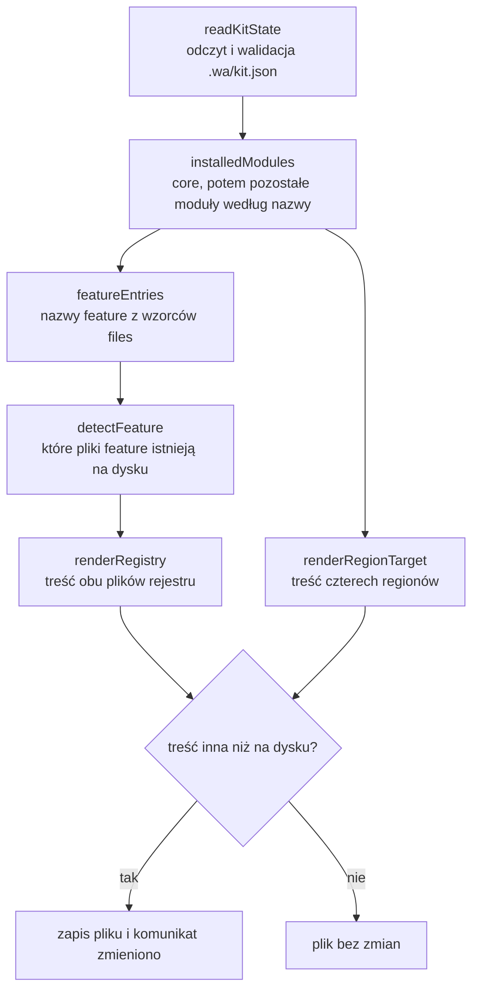

# Rejestr modułów i generator

Po przeczytaniu będziesz wiedzieć:

- co zawierają pliki rejestru modułów i kto je czyta;
- co opisuje `.wa/kit.json` i których pól używa generator;
- jak `wa generate` wykrywa feature i co zapisuje w plikach generowanych i regionach `wa:*`;
- kiedy uruchomić generator i jak CI sprawdza, że pliki generowane są aktualne;
- jak rozpoznać typowe błędy przy dodawaniu feature do rejestru.

Zweryfikowano z kodem: d416599, 2026-10-28

Źródła:

- `kit/cli/package.json`
- `kit/cli/tsconfig.json`
- `kit/cli/src/` (kod CLI, testy i fikstury)
- `src/modules.generated.ts`
- `src/modules.client.generated.ts`
- `.wa/kit.json`
- `src/shared/lib/env.ts`
- `src/shared/lib/auth/index.ts`
- `src/shared/lib/auth/client.ts`
- `src/shared/lib/auth/permissions.ts`
- `src/shared/lib/auth/require-module-access.ts`
- `src/shared/lib/modules/nav.ts`
- `src/i18n/request.ts`
- `src/i18n/merge-messages.ts`
- `src/app/messages/pl.json`
- `prisma/schema/auth.prisma`
- `prisma/schema/organizations.prisma`
- `.env.example`
- `docker-compose.yml`
- `package.json`
- `.gitignore`
- `.prettierignore`
- `.lintstagedrc.json`
- `eslint.config.mjs`
- `vitest.config.ts`
- `turbo.json`
- `.github/workflows/ci.yml`

Ten plik uzupełnia [02-architektura.md](02-architektura.md). Pojęcia feature, moduł, definicja modułu, rejestr modułów i szew wyjaśnia sekcja [Kit, rdzeń i moduły](02-architektura.md#kit-rdzen-moduly), a zasady, z których wynika generator, sekcja [Zasady kitu](02-architektura.md#zasady-kitu).

<a id="rejestr-modulow"></a>

## Rejestr modułów

Rejestr to dwa pliki, które zapisuje `wa generate`. Plik kliencki w całości, bez pierwszej linii z nagłówkiem:

`src/modules.client.generated.ts`

```ts
// …
import accountModule from "@/features/account/module";
import authModule from "@/features/auth/module";
import dashboardModule from "@/features/dashboard/module";
import organizationsModule from "@/features/organizations/module";
import usersModule from "@/features/users/module";

export const authClientPlugins: never[] = [];
export const clientModules = [accountModule, authModule, dashboardModule, organizationsModule, usersModule];
```

Każdy z pięciu plików, które generator czyta z feature, trafia do innej tablicy:

| Plik feature | Eksport | Tablica w rejestrze | Plik rejestru | Kto czyta |
| --- | --- | --- | --- | --- |
| `module.ts` | domyślny: `defineModule({...})` | `modules` | `src/modules.generated.ts` | nikt w kodzie aplikacji |
| `module.ts` | domyślny: `defineModule({...})` | `clientModules` | `src/modules.client.generated.ts` | `src/shared/lib/auth/permissions.ts` (guard stron) i `src/shared/lib/modules/nav.ts` (menu) |
| `env.ts` | `envSchema` | `moduleEnvSchemas` | `src/modules.generated.ts` | `src/shared/lib/env.ts`, który łączy go ze schematem rdzenia przez `z.intersection` |
| `auth.ts` | `authPlugin` | `authPlugins` | `src/modules.generated.ts` | lista `plugins` w `src/shared/lib/auth/index.ts` |
| `auth-client.ts` | `authClientPlugin` | `authClientPlugins` | `src/modules.client.generated.ts` | lista `plugins` w `src/shared/lib/auth/client.ts` |
| `i18n/pl.json`, `i18n/en.json` | treść JSON | `moduleMessages.pl`, `moduleMessages.en`: lista `{ key, load }`, gdzie `key` to nazwa katalogu feature | `src/modules.generated.ts` | `src/i18n/request.ts`, który przez `mergeMessages` umieszcza teksty pod namespace `key` |

- Feature trafia do każdej tablicy osobno, według plików, które ma. Feature z samymi tłumaczeniami pojawi się w `moduleMessages`, ale nie w `modules` ani `clientModules`. Żaden feature rdzenia nie ma `env.ts`, `auth.ts` ani `auth-client.ts`, dlatego `moduleEnvSchemas`, `authPlugins` i `authClientPlugins` są puste.
- Rejestr importuje pliki feature, a nie kopiuje ich treści. Zmiana wewnątrz `module.ts`, `env.ts` albo pliku tłumaczeń nie wymaga więc ponownego uruchomienia generatora. Wymaga go dopiero dodanie albo usunięcie takiego pliku.
- Są dwa pliki, bo plik kliencki trafia do paczki przeglądarki (przez menu boczne i klienta better-auth), więc importuje tylko `module.ts` i `auth-client.ts`. Plik serwerowy importuje schematy env, pluginy serwerowe better-auth i loadery tłumaczeń, które w przeglądarce nie są potrzebne. Plik kliencki czyta też guard na serwerze, więc menu i guard zawsze widzą te same definicje.
- Kolejność: najpierw feature modułu `core`, potem feature pozostałych modułów w kolejności nazw modułów. W obrębie modułu feature są ułożone według nazwy katalogu. Kolejność nie wpływa na menu, które sortuje po `order`.

Nazwa katalogu feature z tłumaczeniami musi pasować do wzorca `^[a-z][a-zA-Z0-9-]*$` (na przykład `my_feature` nie pasuje) i nie może być równa namespace rdzenia: `common`, `errors`, `sidebar` ani `serviceMode`. Inaczej `mergeMessages` z `src/i18n/merge-messages.ts` rzuca przy ładowaniu tłumaczeń błąd `Nieprawidłowy klucz namespace i18n: <key>` albo `Kolizja namespace i18n: <key>` i strona się nie wyrenderuje ([D27](decyzje.md#d27)).

<a id="kit-json"></a>

## `.wa/kit.json`

Plik opisuje, z jakich modułów kitu składa się projekt. W repozytorium kitu wygląda tak:

`.wa/kit.json`

```json
{
  "kitVersion": "0.0.0",
  "modules": {
    "core": {
      "version": "0.0.0",
      "manifest": {
        "name": "core",
        "version": "0.0.0",
        "description": "Rdzen WA Kit: auth, organizacje, uzytkownicy, konto, dashboard",
        "requires": [],
        "files": [
          "src/features/auth/**",
          "src/features/organizations/**",
          "src/features/users/**",
          "src/features/account/**",
          "src/features/dashboard/**",
          "src/shared/**",
          "src/components/ui/**",
          "src/app/**",
          "src/i18n/**",
          "prisma/schema/base.prisma",
          "prisma/schema/auth.prisma",
          "prisma/schema/organizations.prisma"
        ],
        "dependencies": {},
        "devDependencies": {},
        "env": [],
        "schemaRelations": [],
        "compose": null,
        "workspaces": []
      },
      "files": {}
    }
  },
  "projectModules": {}
}
```

- `modules` to słownik: klucz to nazwa modułu, a wartość to wersja, manifest i mapa `files`. W kicie jest jeden moduł, `core`; w projekcie dochodzą moduły wybrane przy `wa create` lub dodane przez `wa add`, a `files` zawiera hashe plików.
- `projectModules` to słownik funkcji napisanych w projekcie: klucz to nazwa modułu, a wartość ma tylko `manifest`, bez wersji i hashy plików. Generator czyta go tak samo jak `modules` i rejestruje moduły projektu po modułach kitu, alfabetycznie. W repozytorium kitu jest pusty ([Krok 3 tutorialu](09-nowy-modul.md#krok-3)).
- `manifest.files` to wzorce plików należących do modułu. Generator czyta z nich tylko wzorce zaczynające się od `src/features/<x>/`, żeby wykryć feature ([Wykrywanie feature](#wykrywanie-feature)). Pozostałe wzorce (`src/shared/**`, `src/app/**` i inne) są tylko zapisem własności. Nic nie sprawdza, czy obejmują wszystkie pliki rdzenia ani czy plik nie należy do dwóch modułów ([D02](decyzje.md#d02)).
- `env`, `schemaRelations` i `compose` wypełniają regiony `wa:*`. W `core` są puste, więc wszystkie regiony w repozytorium są puste.
- Pozostałych pól generator nie używa. Pełną listę z typami i wartościami domyślnymi podaje [Referencja](#referencja-manifest).

`readKitState` w `kit/cli/src/manifest/kit-state.ts` sprawdza plik schematem Zod i przy błędzie przerywa generator. Pól, których schemat nie zna, nie zgłasza: literówka w nazwie pola (na przykład `schemaRelation` zamiast `schemaRelations`) przechodzi bez błędu, a pole dostaje wartość domyślną.

Feature, którego nie obejmuje żaden wzorzec w `.wa/kit.json`, nie trafia do rejestru: nie ma pozycji w menu, `requireModuleAccess` z jego kluczem kończy się 404, a jego tłumaczenia się nie ładują. Dotyczy to także funkcji projektu klienta: jej wzorzec `src/features/<x>/**` należy wpisać w manifeście w `projectModules` ([Krok 3 tutorialu](09-nowy-modul.md#krok-3)).

<a id="wa-generate"></a>

## `wa generate`

<a id="uruchomienie"></a>

### Uruchomienie

```bash
npm run wa -- generate
```

- `npm run wa -- generate` uruchamia skrypt `wa` z `package.json`, czyli `node .wa/bin/wa.mjs`, z argumentem `generate`. Plik `.wa/bin/wa.mjs` to bundel CLI (esbuild) zapisany w repozytorium, więc nie trzeba go budować na świeżym klonie. Po zmianie kodu CLI w `kit/cli/src` odśwież go przez `npm run build --prefix kit/cli`. Generator pracuje na katalogu bieżącym procesu (`process.cwd()` w `kit/cli/src/bin.ts`). npm uruchamia skrypt w katalogu najbliższego `package.json` nad bieżącym katalogiem, więc z katalogu głównego i z podkatalogów takich jak `src/` generator działa na całym repozytorium. W `kit/cli/` najbliższy jest `package.json` CLI, który nie ma skryptu `wa`, i komenda kończy się błędem npm.
- Wynik to `Bez zmian` albo po jednej linii `zmieniono <plik>` dla każdego zapisanego pliku.

Pierwsza linia plików rejestru to nagłówek „generated by wa — nie edytuj” z inną komendą niż powyższa. Używaj komendy z tej sekcji, takiej samej jak w `AGENTS.md` ([D04](decyzje.md#d04)).

Generator uruchom po:

- zmianie `.wa/kit.json`;
- dodaniu albo usunięciu w feature pliku `module.ts`, `env.ts`, `auth.ts`, `auth-client.ts` albo `i18n/<locale>.json`;
- dodaniu, usunięciu albo zmianie nazwy katalogu feature;
- zmianie treści pliku wskazanego w polu `compose` manifestu, bo generator kopiuje ją do `docker-compose.yml`.

Wynik commitujesz razem ze zmianą, która go wywołała.

### Przebieg

Generator najpierw przygotowuje treść wszystkich plików, a zapisuje dopiero na końcu. Błąd na którymkolwiek etapie przerywa więc przebieg, zanim zmieni się jakikolwiek plik.



Wszystkie etapy są w `kit/cli/src/generate/index.ts` (`generate`), a funkcje pomocnicze w `kit/cli/src/manifest/kit-state.ts`, `kit/cli/src/generate/registry.ts` i `kit/cli/src/generate/targets.ts`.

<a id="wykrywanie-feature"></a>

### Wykrywanie feature

`kit/cli/src/generate/index.ts`

```ts
const LOCALES = ["pl", "en"];
const FEATURE_GLOB = /^src\/features\/([^/*]+)\//;
```

1. Generator przechodzi po modułach (najpierw `core`) i po wzorcach z ich `files`. Jeśli wzorzec zaczyna się od `src/features/<x>/`, a `<x>` nie zawiera `/` ani `*`, `<x>` staje się kandydatem na feature. Reszta wzorca nie ma znaczenia.
2. Dla każdego kandydata sprawdza, czy na dysku istnieje `module.ts`, `env.ts`, `auth.ts`, `auth-client.ts`, `i18n/pl.json` albo `i18n/en.json` w katalogu `src/features/<x>/`.
3. Feature trafia do rejestru, gdy istnieje co najmniej jeden z tych plików. W przeciwnym razie generator pomija go bez komunikatu.
4. Nazwa, która pojawia się w kilku modułach, liczy się raz.

| Wzorzec w `files` | Wynik |
| --- | --- |
| `src/features/<x>/**` | Feature `<x>`. |
| `src/features/<x>/module.ts` | Feature `<x>`: liczy się tylko początek wzorca. |
| `src/features/{a,b}/**` | Pominięty bez błędu: generator szuka katalogu o nazwie `{a,b}`. Każdy feature potrzebuje osobnego wzorca. |
| `src/features/**`, `src/features/*/module.ts` | Pominięty: zaraz po `src/features/` jest `*`. |
| `src/features/<x>/**`, gdy katalogu nie ma na dysku | Pominięty, więc manifest może wymieniać feature z wyprzedzeniem. |
| Każdy wzorzec spoza `src/features/` | Nie wpływa na generator. |

<a id="regiony"></a>

### Regiony `wa:*`

Region to fragment pliku między linią z `wa:<marker>:start` a linią z `wa:<marker>:end`. Generator zastępuje wszystko między tymi liniami, a same linie z markerami zostawia. Składnię komentarza (`//` albo `#`) wyznacza plik, a generator szuka tylko tekstu markera. Cztery regiony wymienia stała `regionTargets`:

`kit/cli/src/generate/targets.ts`

```ts
export const regionTargets: RegionTarget[] = [
  { file: "prisma/schema/auth.prisma", marker: "relations", body: relationsBody("User") },
  { file: "prisma/schema/organizations.prisma", marker: "relations", body: relationsBody("Organization") },
  { file: ".env.example", marker: "modules", body: envBody },
  { file: "docker-compose.yml", marker: "services", body: composeBody },
];
```

| Plik | Marker | Co trafia do środka | Źródło w manifeście |
| --- | --- | --- | --- |
| `prisma/schema/auth.prisma` (w modelu `User`) | `// wa:relations:start`, `// wa:relations:end` | Po jednej linii na relację z `model: "User"`: wartość `field` z wcięciem dwóch spacji. | `schemaRelations` |
| `prisma/schema/organizations.prisma` (w modelu `Organization`) | `// wa:relations:start`, `// wa:relations:end` | To samo dla `model: "Organization"`. | `schemaRelations` |
| `.env.example` (na końcu pliku) | `# wa:modules:start`, `# wa:modules:end` | Dla każdego modułu innego niż `core`, który ma zmienne: linia `# <nazwa modułu>` i linie `NAZWA=example`. Bloki modułów rozdziela pusta linia. | `env` (`name`, `example`) |
| `docker-compose.yml` (pod `services:`) | `# wa:services:start`, `# wa:services:end` | Treść pliku wskazanego w `compose`, bez końcowych pustych linii, z każdą niepustą linią wciętą o dwie spacje. | `compose` (ścieżka względem katalogu projektu) |

Zmiennych modułu `core` region w `.env.example` nie obejmuje, bo są wpisane w ten plik na stałe. Relacja z innym modelem niż `User` i `Organization` nie trafia do żadnego regionu i generator tego nie zgłasza.

Przykład z testu „generuje wszystkie cele” w `kit/cli/src/generate/__tests__/generate.test.ts`. Fikstura `minimal` ma moduł `demo` z polami manifestu jak w lewej kolumnie:

| Pole manifestu `demo` | Treść regionu po przebiegu |
| --- | --- |
| `schemaRelations: [{ model: "User", field: "demos Demo[]" }]` | `wa:relations` w `auth.prisma`: linia `demos Demo[]` z wcięciem dwóch spacji. Region w `organizations.prisma` zostaje pusty. |
| `env: [{ name: "DEMO_TOKEN", example: "changeme" }]` | `wa:modules` w `.env.example`: linie `# demo` i `DEMO_TOKEN=changeme`. |
| `compose: "src/features/demo/compose.yml"` | `wa:services` w `docker-compose.yml`: treść tego pliku (`demo:`, `image: demo:latest`, `ports:`), wcięta o dwie spacje. |

Reguły regionów:

- W pliku musi być dokładnie jedna linia z markerem początku i jedna z markerem końca, a koniec musi być niżej niż początek, więc oba markery nie mogą stać w jednej linii. Treść regionu nie może zawierać markera tego samego regionu. Jeśli plik ma gdziekolwiek końce linii CRLF, cały wynik ma końce CRLF. Tego pilnuje `replaceRegion` w `kit/cli/src/generate/regions.ts`.
- Plik docelowy, którego nie ma na dysku, jest pomijany bez błędu (`renderRegionTarget`), a brak pliku z pola `compose` przerywa generator (`composeBody`). Obie funkcje są w `kit/cli/src/generate/targets.ts`.

Komunikaty błędów podaje [Referencja](#referencja-komunikaty).

### Idempotencja i kontrola w CI

Generator zapisuje tylko pliki, których treść różni się od wyniku, więc drugi przebieg bez zmian wypisuje `Bez zmian` i niczego nie dotyka (test „drugie uruchomienie nic nie zmienia” w `generate.test.ts`). Na tym opiera się kontrola w CI. Job `verify` uruchamia generator i sprawdza, czy pliki śledzone przez git się nie zmieniły:

`.github/workflows/ci.yml`

```yaml
      - name: Regenerate wa files
        run: npm run wa -- generate

      - name: Generated files are up to date
        run: git diff --exit-code
```

Zarówno ręczna zmiana pliku generowanego albo regionu, jak i zmiana feature bez przebiegu generatora dają różnicę w ostatnim kroku, więc job pada przed `npm run verify`. `git diff` nie widzi plików nieśledzonych, ale wszystkie pliki, które zapisuje generator, są w repozytorium. Pliki rejestru są wpisane w `.prettierignore` i w `globalIgnores` w `eslint.config.mjs`, żeby `lint-staged` nie przeformatował ich przy commicie i nie rozjechał z wyjściem generatora ([D04](decyzje.md#d04)).

Samo CLI ma własną bramkę (`npm run verify --prefix kit/cli`), uruchamianą w osobnym workflow kitu. Root ESLint (`kit/**` w `globalIgnores`) i root Vitest (`kit/**` w `exclude` w `vitest.config.ts`) pomijają katalog `kit/`.

### Objawy typowych błędów

| Objaw | Przyczyna | Co zrobić |
| --- | --- | --- |
| Feature nie ma pozycji w menu, a jego strona zwraca 404. | Brak wzorca `src/features/<x>/...` w `.wa/kit.json`, wzorzec z `{}` albo `*` po `src/features/`, albo generator nie został uruchomiony. | Dodaj osobny wzorzec dla feature, uruchom generator i sprawdź, czy `src/modules.client.generated.ts` importuje `@/features/<x>/module`. |
| Pozycja w menu nie ma przetłumaczonej etykiety. | `key` w `module.ts` różni się od nazwy katalogu feature albo w `i18n/<locale>.json` brakuje klucza z `labelKey`. | Ustaw `key` równy nazwie katalogu ([D27](decyzje.md#d27)) i dodaj brakujący klucz. |
| Strona feature w języku domyślnym zwraca 404, a pod `/en/...` działa. | Trasa zaczyna się od `api` albo zawiera kropkę, więc proxy jej nie obsługuje. | Zmień trasę ([Proxy i język](02-architektura.md#proxy)). |
| CI pada na kroku „Generated files are up to date”. | Plik generowany albo region zmieniony ręcznie albo zmiana feature bez przebiegu generatora. | Uruchom generator i zacommituj wynik. |
| Generator kończy się błędem. | Uszkodzony `.wa/kit.json`, marker regionu albo brak pliku. | Znajdź komunikat w [Referencji](#referencja-komunikaty). |

<a id="referencja"></a>

## Referencja

<a id="referencja-manifest"></a>

### `.wa/kit.json` i manifest modułu

Schematy `kitStateSchema` i `moduleManifestSchema` z `kit/cli/src/manifest/schema.ts`. Kolumna „Generator” mówi, czy `wa generate` używa pola. Pola, których schemat nie zna, są pomijane bez błędu.

`kitStateSchema` (cały plik):

| Pole | Typ | Domyślnie | Generator |
| --- | --- | --- | --- |
| `kitVersion` | `string` | wymagane | nie |
| `modules` | słownik: nazwa modułu → obiekt niżej | wymagane | tak: `core` pierwszy, potem pozostałe według nazwy |
| `modules.<nazwa>.version` | `string` | wymagane | nie |
| `modules.<nazwa>.manifest` | manifest modułu | wymagane | tak |
| `modules.<nazwa>.files` | słownik `string` → `string` | wymagane | nie |

`moduleManifestSchema` (pole `manifest`):

| Pole | Typ | Domyślnie | Generator |
| --- | --- | --- | --- |
| `name` | `string`, co najmniej 1 znak | wymagane | tak: `core` jest pomijany w regionie `.env.example`, pozostałe nazwy trafiają do nagłówka `# <name>` |
| `version` | `string`, co najmniej 1 znak | wymagane | nie |
| `description` | `string` | wymagane, może być pusty | nie |
| `requires` | `string[]` | `[]` | nie |
| `files` | `string[]` | `[]` | tak: tylko wzorce `src/features/<x>/…` |
| `dependencies` | słownik `string` → `string` | `{}` | nie |
| `devDependencies` | słownik `string` → `string` | `{}` | nie |
| `env` | lista `{ name, example, required? }`: `name` co najmniej 1 znak, `example` napis, `required` wartość logiczna | `[]` | tak: `name` i `example`; `required` nie |
| `schemaRelations` | lista `{ model, field }`, oba co najmniej 1 znak | `[]` | tak: tylko `model` równy `User` albo `Organization` |
| `compose` | `string` albo `null` | `null` | tak: ścieżka do pliku względem katalogu projektu |
| `workspaces` | `string[]` | `[]` | nie |

<a id="referencja-pliki-generowane"></a>

### Pliki generowane

| Plik | Co zawiera | Kto generuje |
| --- | --- | --- |
| `src/modules.generated.ts` | `modules`, `moduleEnvSchemas`, `authPlugins`, typ `MessageLoader`, `moduleMessages` | `wa generate` |
| `src/modules.client.generated.ts` | `authClientPlugins`, `clientModules` | `wa generate` |
| region `wa:relations` w `prisma/schema/auth.prisma` | relacje zwrotne modelu `User` | `wa generate` |
| region `wa:relations` w `prisma/schema/organizations.prisma` | relacje zwrotne modelu `Organization` | `wa generate` |
| region `wa:modules` w `.env.example` | zmienne modułów innych niż `core` | `wa generate` |
| region `wa:services` w `docker-compose.yml` | usługi Dockera modułów | `wa generate` |
| `src/generated/prisma/` | klient Prismy, w `.gitignore` | `prisma generate` (`postinstall`, `npm run db:generate`), nie `wa generate` |

Nazwy w plikach rejestru powstają z nazwy katalogu feature: znaki `-`, `_` i `.` znikają, a następna litera staje się wielka, i dochodzi przyrostek. Katalog `my-feature` daje `myFeatureModule`, `myFeatureEnvSchema`, `myFeatureAuthPlugin` i `myFeatureAuthClientPlugin`. Pusta tablica ma postać `export const <nazwa>: never[] = [];`. W `moduleMessages` pole `key` to nazwa katalogu bez zmian.

<a id="referencja-komunikaty"></a>

### Komunikaty `wa generate`

| Sytuacja | Komunikat | Kod wyjścia |
| --- | --- | --- |
| Żaden plik się nie zmienił | `Bez zmian` | 0 |
| Pliki zapisane | `zmieniono <plik>`, po jednej linii na plik | 0 |
| Brak komendy albo komenda inna niż `generate` | `Użycie: wa generate` | 1 |
| Brak `.wa/kit.json` | `Brak .wa/kit.json w <katalog> — to nie jest projekt wa-kit` | 1 |
| `.wa/kit.json` nie jest poprawnym plikiem JSON | komunikat parsera JSON, na przykład `Expected property name or '}' in JSON at position 1 (line 1 column 2)` | 1 |
| `.wa/kit.json` niezgodny ze schematem | lista błędów Zod w formacie JSON, z polami `path` i `message` | 1 |
| Brakujący, podwójny albo odwrócony marker regionu | `<plik>: uszkodzony region wa:<marker>` | 1 |
| Treść regionu zawiera jego marker | `<plik>: treść regionu wa:<marker> zawiera znacznik regionu` | 1 |
| Brak pliku z pola `compose` | `ENOENT: no such file or directory, open '<ścieżka>'` | 1 |

Przy każdym błędzie z tej tabeli żaden plik nie zostaje zmieniony.
