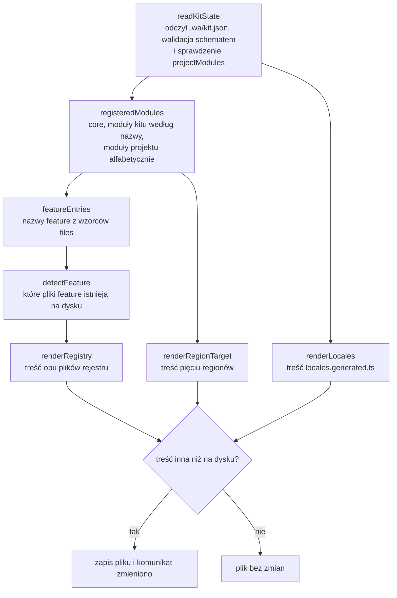

# Rejestr modułów i generator

Po przeczytaniu będziesz wiedzieć:

- co zawierają pliki generowane i kto w aplikacji je czyta;
- co opisuje `.wa/kit.json` i których pól używa generator;
- jak `wa generate` wykrywa feature i co zapisuje w plikach generowanych i regionach `wa:*`;
- kiedy uruchomić generator i jak CI sprawdza, że pliki generowane są aktualne;
- jak rozpoznać typowe błędy przy dodawaniu feature do rejestru i co znaczy każdy komunikat generatora.

Zweryfikowano z kodem: 206ca2e, 2026-11-10 (wersja `uploads` we fragmencie pliku w sekcji [`.wa/kit.json`](#kit-json)); pozostałe sekcje: 734391b, 2026-11-04

Źródła:

- `kit/cli/package.json`
- `kit/cli/tsconfig.json`
- `kit/cli/src/` (kod CLI, testy i fikstury; generator w `generate/`, schemat i odczyt stanu w `manifest/`, komunikat użycia w `bin.ts`)
- `kit/kit.json`
- `kit/modules/core.json`, `kit/modules/audit-logs.json`, `kit/modules/api-keys.json`, `kit/modules/uploads.json`
- `.wa/kit.json`
- `src/modules.generated.ts`
- `src/modules.client.generated.ts`
- `src/i18n/locales.generated.ts`
- `src/i18n/config.ts`
- `src/shared/lib/env.ts`
- `src/shared/lib/audit.ts`
- `src/shared/lib/auth/index.ts`
- `src/shared/lib/auth/client.ts`
- `src/shared/lib/auth/permissions.ts`
- `src/shared/lib/auth/require-module-access.ts`
- `src/shared/lib/modules/nav.ts`
- `src/test/core-modules.ts`
- pliki modułów, które czytają rejestr: `src/features/api-keys/services/api-scopes.ts`, `src/features/api-keys/components/api-keys-manager.tsx`, `src/features/uploads/services/upload-purposes.ts`, `src/features/audit-logs/components/audit-trail.tsx`, `src/features/audit-logs/components/audit-log-view.tsx`
- `src/i18n/request.ts`
- `src/i18n/merge-messages.ts`
- `src/app/messages/pl.json`
- `src/proxy.ts`
- `prisma/schema/auth.prisma`
- `prisma/schema/organizations.prisma`
- `.env.example`
- `docker-compose.yml`
- `docker/uploads.compose.yml`
- `ci/uploads.integration-steps.yml`
- `package.json`
- `.gitignore`
- `.prettierignore`
- `.lintstagedrc.json`
- `eslint.config.mjs`
- `vitest.config.ts`
- `turbo.json`
- `.github/workflows/ci.yml`

Ten plik uzupełnia [02-architektura.md](02-architektura.md). Pojęcia feature, moduł, definicja modułu, rejestr modułów i szew wyjaśnia sekcja [Kit, rdzeń i moduły](02-architektura.md#kit-rdzen-moduly), a zasady, z których wynika generator, sekcja [Zasady kitu](02-architektura.md#zasady-kitu). Drogę modułu od manifestu do działającej funkcji, z tym, co dzieje się z każdym szwem bez modułu, opisuje [12-moduly-kitu.md](12-moduly-kitu.md#warstwa-szwow). Ten plik opisuje sam generator: co czyta, co zapisuje i jakie zwraca błędy.

<a id="rejestr-modulow"></a>

## Rejestr modułów

Rejestr to dwa pliki, które zapisuje `wa generate`. Plik kliencki w kicie w całości, bez pierwszej linii z nagłówkiem:

`src/modules.client.generated.ts`

```ts
// …
import accountModule from "@/features/account/module";
import authModule from "@/features/auth/module";
import dashboardModule from "@/features/dashboard/module";
import organizationsModule from "@/features/organizations/module";
import usersModule from "@/features/users/module";
import apiKeysModule from "@/features/api-keys/module";
import auditLogsModule from "@/features/audit-logs/module";
import uploadsModule from "@/features/uploads/module";

export const authClientPlugins: never[] = [];
export const clientModules = [accountModule, authModule, dashboardModule, organizationsModule, usersModule, apiKeysModule, auditLogsModule, uploadsModule];
```

Każdy z plików, które generator czyta z feature, trafia do innej tablicy:

| Plik feature | Eksport | Tablica w rejestrze | Plik rejestru | Kto czyta |
| --- | --- | --- | --- | --- |
| `module.ts` | domyślny: `defineModule({...})` | `modules` | `src/modules.generated.ts` | Rdzeń nie czyta. Moduły czytają z niego deklaracje innych feature: `knownApiScopes` w `src/features/api-keys/services/api-scopes.ts`, `listUploadPurposes` w `src/features/uploads/services/upload-purposes.ts` i `<AuditTrail>` w `src/features/audit-logs/components/audit-trail.tsx`. |
| `module.ts` | domyślny: `defineModule({...})` | `clientModules` | `src/modules.client.generated.ts` | Rdzeń: `src/shared/lib/auth/permissions.ts` (guard stron), `src/shared/lib/modules/nav.ts` (menu) i filtr testów rdzenia `src/test/core-modules.ts`. Moduły: `audit-log-view.tsx` (`audit-logs`) i `api-keys-manager.tsx` (`api-keys`). |
| `env.ts` | `envSchema` | `moduleEnvSchemas` | `src/modules.generated.ts` | `src/shared/lib/env.ts`, który łączy go ze schematem rdzenia przez `z.intersection` |
| `auth.ts` | `authPlugin` | `authPlugins` | `src/modules.generated.ts` | lista `plugins` w `src/shared/lib/auth/index.ts` |
| `auth-client.ts` | `authClientPlugin` | `authClientPlugins` | `src/modules.client.generated.ts` | lista `plugins` w `src/shared/lib/auth/client.ts` |
| `audit-sink.ts` | `auditSink` | `auditSinks` | `src/modules.generated.ts` | `trackAudit` w `src/shared/lib/audit.ts`, który woła po kolei każde ujście ([D40](decyzje.md#d40)) |
| `i18n/pl.json`, `i18n/en.json` | treść JSON | `moduleMessages.pl`, `moduleMessages.en`: lista `{ key, load }`, gdzie `key` to nazwa katalogu feature | `src/modules.generated.ts` | `src/i18n/request.ts`, który przez `mergeMessages` umieszcza teksty pod namespace `key` |

- Feature trafia do każdej tablicy osobno, według plików, które ma. Feature z samymi tłumaczeniami pojawi się w `moduleMessages`, ale nie w `modules` ani `clientModules`. Żaden feature rdzenia nie ma `env.ts`, `auth.ts`, `auth-client.ts` ani `audit-sink.ts`, więc w projekcie z samym rdzeniem te tablice są puste. W kicie `moduleEnvSchemas` dostaje schematy z `api-keys` i `uploads`, a `authPlugins` i `auditSinks` po jednym wpisie z `audit-logs`. Żaden moduł kitu nie ma `auth-client.ts`.
- Co dzieje się z każdą tablicą, gdy modułu w projekcie nie ma, zbiera tabela [Szwy generowane](12-moduly-kitu.md#szwy-generowane) w 12. Deklaracje `auditActions`, `apiScopes` i `uploadPurposes`, które moduły czytają z `modules` i `clientModules`, opisuje [Punkty wejścia](12-moduly-kitu.md#punkty-wejscia).
- Rejestr importuje pliki feature, a nie kopiuje ich treści. Zmiana wewnątrz `module.ts`, `env.ts` albo pliku tłumaczeń nie wymaga więc ponownego uruchomienia generatora. Wymaga go dopiero dodanie albo usunięcie takiego pliku.
- Są dwa pliki, bo plik kliencki trafia do paczki przeglądarki (przez menu boczne i klienta better-auth), więc importuje tylko `module.ts` i `auth-client.ts`. Plik serwerowy importuje schematy env, pluginy serwerowe better-auth, ujścia audytu i loadery tłumaczeń, które w przeglądarce nie są potrzebne. Plik kliencki czyta też guard na serwerze, więc menu i guard zawsze widzą te same definicje.
- Kolejność: najpierw feature modułu `core`, potem feature pozostałych modułów kitu w kolejności nazw modułów, a na końcu feature modułów projektu z `projectModules`, alfabetycznie (`registeredModules` w `kit/cli/src/manifest/kit-state.ts`). W obrębie modułu feature są ułożone według nazwy katalogu. Kolejność nie wpływa na menu, które sortuje po `order`.

Nazwa katalogu feature z tłumaczeniami musi pasować do wzorca `^[a-z][a-zA-Z0-9-]*$` (na przykład `my_feature` nie pasuje) i nie może być równa namespace rdzenia: `common`, `errors`, `sidebar` ani `serviceMode`. Inaczej `mergeMessages` z `src/i18n/merge-messages.ts` rzuca przy ładowaniu tłumaczeń błąd `Nieprawidłowy klucz namespace i18n: <key>` albo `Kolizja namespace i18n: <key>` i strona się nie wyrenderuje ([D27](decyzje.md#d27)).

Trzeci plik generowany, `src/i18n/locales.generated.ts`, nie należy do rejestru modułów. Zawiera stałą `locales` z językami z pola `locales` w `.wa/kit.json`, którą importuje `src/i18n/config.ts` ([D33](decyzje.md#d33)).

<a id="kit-json"></a>

## `.wa/kit.json`

Plik opisuje, z jakich modułów kitu składa się projekt i jakie ma funkcje własne. W repozytorium kitu zapisuje go `wa kit sync` z manifestów w `kit/modules/` ([16b](16b-rozwoj-kitu.md#kit-sync)), a w projekcie `wa create`, `wa add` i `wa remove` ([16](16-cli-wa.md)). Wpisy w `projectModules` dopisuje ręcznie zespół projektu. W kicie plik wygląda tak (skrócony; manifest modułu `uploads` ze skróconą listą `env`):

`.wa/kit.json`

```json
{
  "kitVersion": "0.1.0",
  "kitRepo": "https://github.com/webamigos/wa-kit.git",
  "project": {
    "name": "WA App",
    "slug": "wa-app"
  },
  "locales": [
    "pl",
    "en"
  ],
  "modules": {
// …
    "core": {
      "version": "0.5.0",
      "manifest": {
        "name": "core",
        "version": "0.5.0",
        "description": "Rdzen WA Kit: auth, organizacje, uzytkownicy, konto, dashboard",
        "requires": [],
        "files": [
          ".claude/agents/test-reviewer.md",
// …
        "env": [],
        "schemaRelations": [],
        "compose": null,
        "ciSteps": null,
        "workspaces": []
      },
      "files": {}
    },
    "uploads": {
      "version": "0.2.2",
      "manifest": {
        "name": "uploads",
        "version": "0.2.2",
        "description": "Pliki organizacji na dysku albo w magazynie S3",
        "requires": [],
        "files": [
          "prisma/schema/uploads.prisma",
          "src/features/uploads/**",
          "src/app/api/uploads/**",
          "docker/uploads.compose.yml",
          "ci/uploads.integration-steps.yml"
        ],
        "dependencies": {
          "@aws-sdk/client-s3": "^3.1159.0",
          "file-type": "^22.3.0",
          "sharp": "^0.35.5"
        },
        "devDependencies": {},
        "env": [
          {
            "name": "STORAGE_PROVIDER",
            "example": "local",
            "required": false
          },
          {
            "name": "STORAGE_LOCAL_PATH",
            "example": "./volumes/uploads",
            "required": false
          },
          {
            "name": "S3_ENDPOINT",
            "example": "http://localhost:9000",
            "required": false
          },
// …
          {
            "name": "S3_BUCKET",
            "example": "{{projectSlug}}-uploads",
            "required": false
          },
// …
        ],
        "schemaRelations": [
          {
            "model": "User",
            "field": "uploads Upload[]"
          },
          {
            "model": "Organization",
            "field": "uploads Upload[]"
          }
        ],
        "compose": "docker/uploads.compose.yml",
        "ciSteps": "ci/uploads.integration-steps.yml",
        "workspaces": []
      },
      "files": {}
    }
  },
  "projectModules": {}
}
```

- `kitVersion` i `kitRepo` to wersja i adres kitu, z którego powstał projekt. Generator ich nie czyta. Czytają je `wa add` i `wa list`, żeby pobrać kit w tej samej wersji ([16](16-cli-wa.md#zrodlo-kitu)).
- `project` to nazwa wyświetlana i slug projektu. Generator wstawia je w miejsce `{{projectName}}` i `{{projectSlug}}` w przykładowych wartościach zmiennych modułów, na przykład `S3_BUCKET=wa-app-uploads` w kicie ([Regiony](#regiony)).
- `locales` to języki projektu. Generator zapisuje je w `src/i18n/locales.generated.ts` i tworzy loadery tłumaczeń tylko dla nich ([D33](decyzje.md#d33)).
- `modules` to słownik modułów kitu: klucz to nazwa modułu, a wartość to wersja, manifest i mapa `files`. W kicie są wszystkie cztery moduły (`api-keys`, `audit-logs`, `core`, `uploads`), a `files` jest puste. W projekcie są `core` i moduły wybrane przy `wa create` albo dodane przez `wa add`, a `files` mapuje ścieżkę każdego skopiowanego pliku na jego hash albo na `managed` ([16b](16b-rozwoj-kitu.md#hashe)). Generator `files` nie czyta.
- `projectModules` to słownik funkcji napisanych w projekcie: klucz to nazwa modułu, a wartość ma tylko `manifest`, bez wersji i hashy plików ([D36](decyzje.md#d36)). Generator czyta go tak samo jak `modules` i rejestruje moduły projektu po modułach kitu, alfabetycznie. W repozytorium kitu jest pusty ([Krok 3 tutorialu](09-nowy-modul.md#krok-3)).
- `manifest.files` to wzorce plików należących do modułu. Generator czyta z nich tylko wzorce zaczynające się od `src/features/<x>/`, żeby wykryć feature ([Wykrywanie feature](#wykrywanie-feature)). Pozostałe wzorce (`src/app/api/uploads/**`, `prisma/schema/uploads.prisma` i inne) generator pomija; czytają je `wa create`, `wa add` i `wa remove` przy kopiowaniu i usuwaniu plików. W manifestach kitu (`kit/modules/<nazwa>.json`) test własności sprawdza, że każdy plik kitu ma dokładnie jednego właściciela ([D38](decyzje.md#d38), [16b](16b-rozwoj-kitu.md#wlasnosc)). W projekcie nic tego nie sprawdza.
- `env`, `schemaRelations`, `compose` i `ciSteps` wypełniają regiony `wa:*`. W kicie wypełniają je trzy moduły opcjonalne: relacje mają wszystkie trzy, zmienne `api-keys` i `uploads`, a usługi Dockera i kroki CI tylko `uploads`. Moduł `core` ma te pola puste.
- `requires` generator czyta tylko u modułów projektu: `readKitState` sprawdza, że każdy wymagany moduł jest w `modules` albo w `projectModules` ([Komunikaty](#referencja-komunikaty)). Pól `version`, `description`, `dependencies`, `devDependencies` i `workspaces` generator nie używa; czyta je CLI przy składaniu i zmianie projektu ([16b](16b-rozwoj-kitu.md#manifesty)). Pełną listę z typami i wartościami domyślnymi podaje [Referencja](#referencja-manifest).

`readKitState` w `kit/cli/src/manifest/kit-state.ts` sprawdza plik schematem Zod, a potem wpisy `projectModules`, i przy błędzie przerywa generator. Pól, których schemat nie zna, nie zgłasza: literówka w nazwie pola (na przykład `schemaRelation` zamiast `schemaRelations`) przechodzi bez błędu, a pole dostaje wartość domyślną.

Feature, którego nie obejmuje żaden wzorzec w `.wa/kit.json`, nie trafia do rejestru: nie ma pozycji w menu, `requireModuleAccess` z jego kluczem kończy się 404, a jego tłumaczenia się nie ładują. Gdzie dopisać wzorzec, zależy od tego, czyj to feature:

- **Funkcja projektu klienta:** wzorzec `src/features/<x>/**` w manifeście w `projectModules` ([Krok 3 tutorialu](09-nowy-modul.md#krok-3)).
- **Feature modułu kitu w repozytorium kitu:** wzorzec w manifeście `kit/modules/<nazwa>.json`, a potem `npm run wa -- kit sync`, który przepisuje manifest do `.wa/kit.json`. Ręczna zmiana `.wa/kit.json` kitu zginie przy następnym `kit sync`, a krok „Kit state and generated files are up to date” w `.github/workflows/kit.yml` ją zgłosi ([16b](16b-rozwoj-kitu.md#kit-sync)).

<a id="wa-generate"></a>

## `wa generate`

<a id="uruchomienie"></a>

### Uruchomienie

```bash
npm run wa -- generate
```

- `npm run wa -- generate` uruchamia skrypt `wa` z `package.json`, czyli `node .wa/bin/wa.mjs`, z argumentem `generate`. Plik `.wa/bin/wa.mjs` to bundel CLI (esbuild) zapisany w repozytorium, więc nie trzeba go budować na świeżym klonie. Po zmianie kodu CLI w `kit/cli/src` odśwież go przez `npm run build --prefix kit/cli` ([16b](16b-rozwoj-kitu.md#bundel)). Generator pracuje na katalogu bieżącym procesu (`process.cwd()` w `kit/cli/src/bin.ts`). npm uruchamia skrypt w katalogu najbliższego `package.json` nad bieżącym katalogiem, więc z katalogu głównego i z podkatalogów takich jak `src/` generator działa na całym repozytorium. W `kit/cli/` najbliższy jest `package.json` CLI, który nie ma skryptu `wa`, i komenda kończy się błędem npm.
- Wynik to `Bez zmian` albo po jednej linii `zmieniono <plik>` dla każdego zapisanego pliku. Argumenty po `generate` są pomijane.
- `wa create`, `wa add` i `wa remove` uruchamiają generator same na końcu swojej pracy ([16](16-cli-wa.md)). Po nich nie trzeba go uruchamiać ręcznie.

Pierwsza linia każdego z trzech plików generowanych to nagłówek `// generated by wa — nie edytuj. Uruchom: npm run wa -- generate`, z tą samą komendą co wyżej i w `AGENTS.md` ([D04](decyzje.md#d04)). Regiony nie mają nagłówka.

Generator uruchom po:

- zmianie `.wa/kit.json`, także pola `locales` i wpisów w `projectModules`;
- w repozytorium kitu po `npm run wa -- kit sync`;
- dodaniu albo usunięciu w feature pliku `module.ts`, `env.ts`, `auth.ts`, `auth-client.ts`, `audit-sink.ts` albo `i18n/<locale>.json`;
- dodaniu, usunięciu albo zmianie nazwy katalogu feature;
- zmianie treści pliku wskazanego w polu `compose` manifestu, bo generator kopiuje ją do `docker-compose.yml`;
- zmianie treści pliku wskazanego w polu `ciSteps` manifestu, bo generator kopiuje ją do regionu `wa:ci-integration` w `.github/workflows/ci.yml`.

Wynik commitujesz razem ze zmianą, która go wywołała.

### Przebieg

Generator najpierw przygotowuje treść wszystkich plików, a zapisuje dopiero na końcu. Błąd na którymkolwiek etapie przerywa więc przebieg, zanim zmieni się jakikolwiek plik.



Wszystkie etapy są w `kit/cli/src/generate/index.ts` (`generate`), a funkcje pomocnicze w `kit/cli/src/manifest/kit-state.ts`, `kit/cli/src/generate/registry.ts` i `kit/cli/src/generate/targets.ts`.

<a id="wykrywanie-feature"></a>

### Wykrywanie feature

`kit/cli/src/generate/index.ts`

```ts
const SERVER_REGISTRY = "src/modules.generated.ts";
const CLIENT_REGISTRY = "src/modules.client.generated.ts";
const LOCALES_FILE = "src/i18n/locales.generated.ts";
const FEATURE_GLOB = /^src\/features\/([^/*]+)\//;
```

1. Generator przechodzi po modułach w kolejności z [Rejestru modułów](#rejestr-modulow) i po wzorcach z ich `files`. Jeśli wzorzec zaczyna się od `src/features/<x>/`, a `<x>` nie zawiera `/` ani `*`, `<x>` staje się kandydatem na feature. Reszta wzorca nie ma znaczenia.
2. Dla każdego kandydata sprawdza, czy w katalogu `src/features/<x>/` istnieje `module.ts`, `env.ts`, `auth.ts`, `auth-client.ts`, `audit-sink.ts` albo `i18n/<język>.json` dla któregoś języka z `locales` w `.wa/kit.json`. Plik tłumaczeń języka spoza `locales` zostaje na dysku, ale jego loader nie trafia do rejestru (test „moduł z en.json przy locales [pl]” w `generate.test.ts`).
3. Feature trafia do rejestru, gdy istnieje co najmniej jeden z tych plików. W przeciwnym razie generator pomija go bez komunikatu.
4. Nazwa, która pojawia się w kilku modułach, liczy się raz.

| Wzorzec w `files` | Wynik w generatorze |
| --- | --- |
| `src/features/<x>/**` | Feature `<x>`. |
| `src/features/<x>/module.ts` | Feature `<x>`: liczy się tylko początek wzorca. |
| `src/features/{a,b}/**` | Pominięty bez błędu: generator szuka katalogu o nazwie `{a,b}`. Każdy feature potrzebuje osobnego wzorca. W manifestach kitu taki wzorzec zatrzymuje test własności ([16b](16b-rozwoj-kitu.md#wlasnosc)). |
| `src/features/**`, `src/features/*/module.ts` | Pominięty: zaraz po `src/features/` jest `*`. |
| `src/features/<x>/**`, gdy katalogu nie ma na dysku | Pominięty, więc manifest w `projectModules` może wymieniać feature z wyprzedzeniem. W manifestach kitu wzorzec bez dopasowań zatrzymuje test własności. |
| Każdy wzorzec spoza `src/features/` | Nie wpływa na rejestr. |

<a id="regiony"></a>

### Regiony `wa:*`

Region to fragment pliku między linią z `wa:<marker>:start` a linią z `wa:<marker>:end`. Generator zastępuje wszystko między tymi liniami, a same linie z markerami zostawia. Składnię komentarza (`//` albo `#`) wyznacza plik, a generator szuka tylko tekstu markera. Pięć regionów, z czterema różnymi markerami, wymienia stała `regionTargets`:

`kit/cli/src/generate/targets.ts`

```ts
export const regionTargets: RegionTarget[] = [
  {
    file: "prisma/schema/auth.prisma",
    marker: "relations",
    body: relationsBody("User"),
  },
  {
    file: "prisma/schema/organizations.prisma",
    marker: "relations",
    body: relationsBody("Organization"),
  },
  { file: ".env.example", marker: "modules", body: envBody },
  { file: "docker-compose.yml", marker: "services", body: composeBody },
  {
    file: ".github/workflows/ci.yml",
    marker: "ci-integration",
    body: ciStepsBody,
  },
];
```

| Plik | Marker | Co trafia do środka | Źródło w manifeście |
| --- | --- | --- | --- |
| `prisma/schema/auth.prisma` (w modelu `User`) | `// wa:relations:start`, `// wa:relations:end` | Po jednej linii na relację z `model: "User"`: wartość `field` z wcięciem dwóch spacji. | `schemaRelations` |
| `prisma/schema/organizations.prisma` (w modelu `Organization`) | `// wa:relations:start`, `// wa:relations:end` | To samo dla `model: "Organization"`. | `schemaRelations` |
| `.env.example` (na końcu pliku) | `# wa:modules:start`, `# wa:modules:end` | Dla każdego modułu innego niż `core`, który ma zmienne: linia `# <nazwa modułu>` i linie `NAZWA=example`, w których `{{projectSlug}}` i `{{projectName}}` są zastąpione wartościami z pola `project`. Bloki modułów rozdziela pusta linia. | `env` (`name`, `example`) |
| `docker-compose.yml` (pod `services:`) | `# wa:services:start`, `# wa:services:end` | Treść pliku wskazanego w `compose`, bez końcowych pustych linii, z każdą niepustą linią wciętą o dwie spacje. Pliki kolejnych modułów następują bez pustej linii. | `compose` (ścieżka względem katalogu projektu) |
| `.github/workflows/ci.yml` (w jobie `integration`, przed krokiem „Integration tests”) | `# wa:ci-integration:start`, `# wa:ci-integration:end` | Treść pliku wskazanego w `ciSteps`, czyli lista kroków GitHub Actions, bez końcowych pustych linii, z każdą niepustą linią wciętą o sześć spacji. Fragmenty kolejnych modułów rozdziela pusta linia ([D45](decyzje.md#d45)). | `ciSteps` (ścieżka względem katalogu projektu) |

Zmiennych modułu `core` region w `.env.example` nie obejmuje, bo są wpisane w ten plik na stałe; placeholderów w przykładach `core` generator też nie podmienia. Relacja z innym modelem niż `User` i `Organization` nie trafia do żadnego regionu i generator tego nie zgłasza. Moduły projektu wypełniają regiony tak samo jak moduły kitu.

Generator czyta pliki z `compose` i `ciSteps` z katalogu projektu i kopiuje je bez zmian. Nazwa bucketu `wa-app-uploads` w `ci/uploads.integration-steps.yml` i `docker/uploads.compose.yml` zmienia się na slug projektu przy kopiowaniu tych plików przez `wa create` albo `wa add` (`placeholderFiles` w `kit/kit.json`, [16b](16b-rozwoj-kitu.md#placeholdery)), a nie w generatorze.

Przykład z testu „generuje wszystkie cele” w `kit/cli/src/generate/__tests__/generate.test.ts`. Fikstura `minimal` ma moduł `demo` z polami manifestu jak w lewej kolumnie:

| Pole manifestu `demo` | Treść regionu po przebiegu |
| --- | --- |
| `schemaRelations: [{ model: "User", field: "demos Demo[]" }]` | `wa:relations` w `auth.prisma`: linia `demos Demo[]` z wcięciem dwóch spacji. Region w `organizations.prisma` zostaje pusty. |
| `env: [{ name: "DEMO_TOKEN", example: "changeme" }]` | `wa:modules` w `.env.example`: linie `# demo` i `DEMO_TOKEN=changeme`. |
| `compose: "src/features/demo/compose.yml"` | `wa:services` w `docker-compose.yml`: treść tego pliku (`demo:`, `image: demo:latest`, `ports:`), wcięta o dwie spacje. |

Wcięcie i rozdzielanie fragmentów `ciSteps` sprawdzają testy z `describe("generate: region ci-integration")` w `kit/cli/src/generate/__tests__/ci-steps.test.ts`.

Reguły regionów:

- W pliku musi być dokładnie jedna linia z markerem początku i jedna z markerem końca, a koniec musi być niżej niż początek, więc oba markery nie mogą stać w jednej linii. Treść regionu nie może zawierać markera tego samego regionu. Jeśli plik ma gdziekolwiek końce linii CRLF, cały wynik ma końce CRLF. Tego pilnuje `replaceRegion` w `kit/cli/src/generate/regions.ts`.
- Plik docelowy, którego nie ma na dysku, jest pomijany bez błędu.
- Plik docelowy bez żadnego z dwóch markerów jest pomijany, gdy region byłby pusty. Gdy któryś moduł ma dla niego treść, generator przerywa się błędem `brak regionu` i żaden plik się nie zmienia ([D45](decyzje.md#d45), testy z `describe("generate: plik bez markerów regionu")` w `ci-steps.test.ts`). Projekt, który usunął markery z `ci.yml`, działa więc bez modułów z `ciSteps`. `wa add uploads` skopiuje w nim pliki modułu, dopisze jego zależności do `package.json` i zapisze `.wa/kit.json`, a dopiero generator zakończy się błędem. Tych zmian `wa add` nie cofa. Po dodaniu markerów uruchom `npm run wa -- generate` i `npm install` (`kit/cli/src/commands/add.ts`, [16](16-cli-wa.md#add-cofanie)). Plik z jednym markerem z pary daje błąd `uszkodzony region` także przy pustej treści.
- Brak pliku z pola `compose` albo `ciSteps` przerywa generator, gdy plik docelowy regionu istnieje (`composeBody`, `ciStepsBody`); bez pliku docelowego `renderRegionTarget` pomija region, zanim sięgnie po treść. Wszystkie te funkcje są w `kit/cli/src/generate/targets.ts`.

Komunikaty błędów podaje [Referencja](#referencja-komunikaty).

### Idempotencja i kontrola w CI

Generator zapisuje tylko pliki, których treść różni się od wyniku, więc drugi przebieg bez zmian wypisuje `Bez zmian` i niczego nie dotyka (test „drugie uruchomienie nic nie zmienia” w `generate.test.ts`). Na tym opiera się kontrola w CI. Job `verify` uruchamia generator i sprawdza, czy pliki śledzone przez git się nie zmieniły:

`.github/workflows/ci.yml`

```yaml
      - name: Regenerate wa files
        run: npm run wa -- generate

      - name: Generated files are up to date
        run: git diff --exit-code
```

Zarówno ręczna zmiana pliku generowanego albo regionu, jak i zmiana feature bez przebiegu generatora dają różnicę w ostatnim kroku, więc job pada przed `npm run verify`. `git diff` nie widzi plików nieśledzonych, ale wszystkie pliki, które zapisuje generator, są w repozytorium. Trzy pliki generowane są wpisane w `.prettierignore` i w `globalIgnores` w `eslint.config.mjs`, żeby `lint-staged` nie przeformatował ich przy commicie i nie rozjechał z wyjściem generatora ([D04](decyzje.md#d04)). Region `wa:ci-integration` leży w samym `ci.yml`, więc jego zmiana też wychodzi w tym kroku.

Samo CLI ma własną bramkę (`npm run verify --prefix kit/cli`), uruchamianą w workflow kitu `.github/workflows/kit.yml` ([16b](16b-rozwoj-kitu.md#bramka-cli)). Root ESLint (`kit/**` w `globalIgnores`) i root Vitest (`kit/**` w `exclude` w `vitest.config.ts`) pomijają katalog `kit/`.

### Objawy typowych błędów

| Objaw | Przyczyna | Co zrobić |
| --- | --- | --- |
| Feature nie ma pozycji w menu, a jego strona zwraca 404. | Brak wzorca `src/features/<x>/...` w manifeście, wzorzec z `{}` albo `*` po `src/features/`, albo generator nie został uruchomiony. | Dodaj osobny wzorzec dla feature: w projekcie w `projectModules`, w kicie w `kit/modules/<nazwa>.json` i uruchom `npm run wa -- kit sync` ([wyżej](#kit-json)). Uruchom generator i sprawdź, czy `src/modules.client.generated.ts` importuje `@/features/<x>/module`. |
| Pozycja w menu nie ma przetłumaczonej etykiety. | `key` w `module.ts` różni się od nazwy katalogu feature albo w `i18n/<locale>.json` brakuje klucza z `labelKey`. | Ustaw `key` równy nazwie katalogu ([D27](decyzje.md#d27)) i dodaj brakujący klucz. |
| Cała wersja językowa (na przykład `/en/...`) zwraca 404. | Języka nie ma w `locales` w `.wa/kit.json`, więc nie ma go w `src/i18n/locales.generated.ts` ani w `routing.locales`, a `LocaleLayout` w `src/app/[locale]/layout.tsx` woła `notFound()`. | Dodaj język do `locales` i uruchom generator ([D33](decyzje.md#d33)). |
| Tłumaczenia feature w jednym z języków projektu się nie ładują, choć plik `i18n/<język>.json` istnieje. | Plik dodano bez ponownego uruchomienia generatora, więc w `moduleMessages` nie ma jego loadera (`detectFeature` w `kit/cli/src/generate/index.ts`). | Uruchom generator i zacommituj wynik. |
| Strona feature w języku domyślnym zwraca 404, a pod `/en/...` działa. | Trasa to `/api`, leży pod `/api/` albo zawiera kropkę, więc proxy jej nie obsługuje. | Zmień trasę ([Proxy i język](02-architektura.md#proxy)). |
| CI pada na kroku „Generated files are up to date”. | Plik generowany albo region zmieniony ręcznie albo zmiana feature bez przebiegu generatora. | Uruchom generator i zacommituj wynik. |
| Generator kończy się błędem. | Uszkodzony `.wa/kit.json`, błędny wpis w `projectModules`, brak albo uszkodzenie markera regionu (brak markerów: tylko gdy moduł ma treść dla regionu), brak pliku z `compose` albo `ciSteps` (gdy plik docelowy regionu istnieje). | Znajdź komunikat w [Referencji](#referencja-komunikaty). |

<a id="referencja"></a>

## Referencja

<a id="referencja-manifest"></a>

### `.wa/kit.json` i manifest modułu

Schematy `kitStateSchema` i `moduleManifestSchema` z `kit/cli/src/manifest/schema.ts`. Kolumna „Generator” mówi, czy `wa generate` używa pola. Pola, których schemat nie zna, są pomijane bez błędu. Kto czyta pola manifestu poza generatorem, podaje [16b](16b-rozwoj-kitu.md#manifesty).

`kitStateSchema` (cały plik):

| Pole | Typ | Domyślnie | Generator |
| --- | --- | --- | --- |
| `kitVersion` | `string` | wymagane | nie (czytają `wa add` i `wa list`) |
| `kitRepo` | `string` | `https://github.com/webamigos/wa-kit.git` (`DEFAULT_KIT_REPO`) | nie (domyślne źródło kitu dla `wa add` i `wa list`) |
| `project` | `{ name: string, slug: string }`, oba pola wymagane | `{ name: "WA App", slug: "wa-app" }` | tak: wartości `{{projectName}}` i `{{projectSlug}}` w regionie `.env.example` |
| `locales` | lista wartości `pl` i `en`, co najmniej jeden element, musi zawierać `pl`, bez powtórzeń | `["pl", "en"]` | tak: `src/i18n/locales.generated.ts` i klucze `moduleMessages` |
| `modules` | słownik: nazwa modułu → obiekt niżej | wymagane | tak: `core` pierwszy, potem pozostałe według nazwy |
| `modules.<nazwa>.version` | `string` | wymagane | nie |
| `modules.<nazwa>.manifest` | manifest modułu | wymagane | tak |
| `modules.<nazwa>.files` | słownik `string` → `string`: ścieżka pliku → hash albo `managed` | wymagane | nie (czyta `wa remove`) |
| `projectModules` | słownik: nazwa modułu → `{ manifest }` | `{}` | tak: po modułach kitu, alfabetycznie; każdy wpis sprawdza `readKitState` |

`moduleManifestSchema` (pole `manifest`):

| Pole | Typ | Domyślnie | Generator |
| --- | --- | --- | --- |
| `name` | `string`, co najmniej 1 znak | wymagane | tak: `core` jest pomijany w regionie `.env.example`, pozostałe nazwy trafiają do nagłówka `# <name>`; w `projectModules` musi być równe kluczowi |
| `version` | `string`, co najmniej 1 znak | wymagane | nie |
| `description` | `string` | wymagane, może być pusty | nie |
| `requires` | `string[]` | `[]` | tylko w `projectModules`: każdy wymagany moduł musi być w `modules` albo `projectModules` |
| `files` | `string[]` | `[]` | tak: tylko wzorce `src/features/<x>/…`; w `projectModules` co najmniej jeden wzorzec musi zaczynać się od `src/features/<name>/` |
| `dependencies` | słownik `string` → `string` | `{}` | nie |
| `devDependencies` | słownik `string` → `string` | `{}` | nie |
| `env` | lista `{ name, example, required? }`: `name` co najmniej 1 znak, `example` napis, `required` wartość logiczna | `[]` | tak: `name` i `example`; `required` nie |
| `schemaRelations` | lista `{ model, field }`, oba co najmniej 1 znak | `[]` | tak: tylko `model` równy `User` albo `Organization` |
| `compose` | `string` albo `null` | `null` | tak: ścieżka do pliku względem katalogu projektu, region `wa:services` |
| `ciSteps` | `string` albo `null` | `null` | tak: ścieżka do pliku względem katalogu projektu, region `wa:ci-integration` |
| `workspaces` | `string[]` | `[]` | nie |

<a id="referencja-pliki-generowane"></a>

### Pliki generowane

| Plik | Co zawiera | Kto generuje |
| --- | --- | --- |
| `src/modules.generated.ts` | `modules`, `moduleEnvSchemas`, `authPlugins`, `auditSinks`, typ `MessageLoader`, `moduleMessages` | `wa generate` |
| `src/modules.client.generated.ts` | `authClientPlugins`, `clientModules` | `wa generate` |
| `src/i18n/locales.generated.ts` | `locales`: języki z `.wa/kit.json`, importowane przez `src/i18n/config.ts` | `wa generate` |
| region `wa:relations` w `prisma/schema/auth.prisma` | relacje zwrotne modelu `User` | `wa generate` |
| region `wa:relations` w `prisma/schema/organizations.prisma` | relacje zwrotne modelu `Organization` | `wa generate` |
| region `wa:modules` w `.env.example` | zmienne modułów innych niż `core` | `wa generate` |
| region `wa:services` w `docker-compose.yml` | usługi Dockera modułów | `wa generate` |
| region `wa:ci-integration` w `.github/workflows/ci.yml` | kroki CI modułów przed testami integracyjnymi | `wa generate` |
| `src/generated/prisma/` | klient Prismy, w `.gitignore` | `prisma generate` (`postinstall`, `npm run db:generate`), nie `wa generate` |

Trzy pierwsze pliki są w `generatedFiles` w `kit/kit.json`: nie należą do żadnego modułu, `wa create` i `wa add` ich nie kopiują, tylko tworzy je generator ([D31](decyzje.md#d31)).

Nazwy w plikach rejestru powstają z nazwy katalogu feature: znaki `-`, `_` i `.` znikają, a następna litera staje się wielka, i dochodzi przyrostek. Katalog `my-feature` daje `myFeatureModule`, `myFeatureEnvSchema`, `myFeatureAuthPlugin`, `myFeatureAuthClientPlugin` i `myFeatureAuditSink`. Pusta tablica ma postać `export const <nazwa>: never[] = [];`. W `moduleMessages` pole `key` to nazwa katalogu bez zmian, a język bez żadnego loadera ma pustą listę.

<a id="referencja-komunikaty"></a>

### Komunikaty `wa generate`

Komunikaty błędów CLI wypisuje na stderr bez śladu stosu.

| Sytuacja | Komunikat | Kod wyjścia |
| --- | --- | --- |
| Żaden plik się nie zmienił | `Bez zmian` | 0 |
| Pliki zapisane | `zmieniono <plik>`, po jednej linii na plik | 0 |
| Brak komendy, nieznana komenda albo `wa kit` bez `sync` | `Użycie: wa generate \| wa kit sync \| wa create <katalog> [opcje] \| wa add <moduł> [--kit <ścieżka\|url>] [--no-install] \| wa remove <moduł> [--force] [--no-install] \| wa list [--kit <ścieżka\|url>]` | 1 |
| Brak `.wa/kit.json` | `Brak .wa/kit.json w <katalog> — to nie jest projekt wa-kit` | 1 |
| `.wa/kit.json` nie jest poprawnym plikiem JSON | komunikat parsera JSON, na przykład `Expected property name or '}' in JSON at position 1 (line 1 column 2)` | 1 |
| `.wa/kit.json` niezgodny ze schematem | lista błędów Zod w formacie JSON, z polami `path` i `message`; dla `locales` na przykład `locales musi zawierać "pl"` albo `locales nie może zawierać duplikatów` | 1 |
| Klucz w `projectModules` różny od `manifest.name` | `projectModules.<klucz>: name "<name>" nie zgadza się z kluczem` | 1 |
| Ta sama nazwa w `modules` i `projectModules` | `Moduł <nazwa> jest jednocześnie modułem kitu i modułem projektu` | 1 |
| Moduł projektu wymaga modułu, którego nie ma w `modules` ani w `projectModules` | `Moduł projektu <nazwa> wymaga niezainstalowanego modułu: <moduł>` | 1 |
| `files` modułu projektu bez wzorca `src/features/<nazwa>/…` | `Moduł projektu <nazwa>: files musi obejmować src/features/<nazwa>/**` | 1 |
| Plik docelowy bez markerów, a moduł ma treść dla regionu | `<plik>: brak regionu wa:<marker>; dodaj linie ze znacznikami wa:<marker>:start i wa:<marker>:end` | 1 |
| Brakujący, podwójny albo odwrócony marker regionu | `<plik>: uszkodzony region wa:<marker>` | 1 |
| Treść regionu zawiera jego marker | `<plik>: treść regionu wa:<marker> zawiera znacznik regionu` | 1 |
| Brak pliku z pola `compose` albo `ciSteps`, gdy plik docelowy regionu istnieje | `ENOENT: no such file or directory, open '<ścieżka>'` | 1 |

Przy każdym błędzie z tej tabeli żaden plik nie zostaje zmieniony. Komunikaty pozostałych komend CLI podają [16](16-cli-wa.md#referencja-komunikaty) i [16b](16b-rozwoj-kitu.md#referencja-komunikaty).
