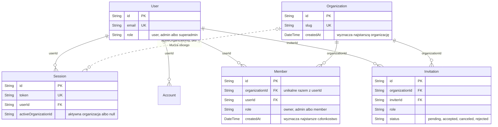
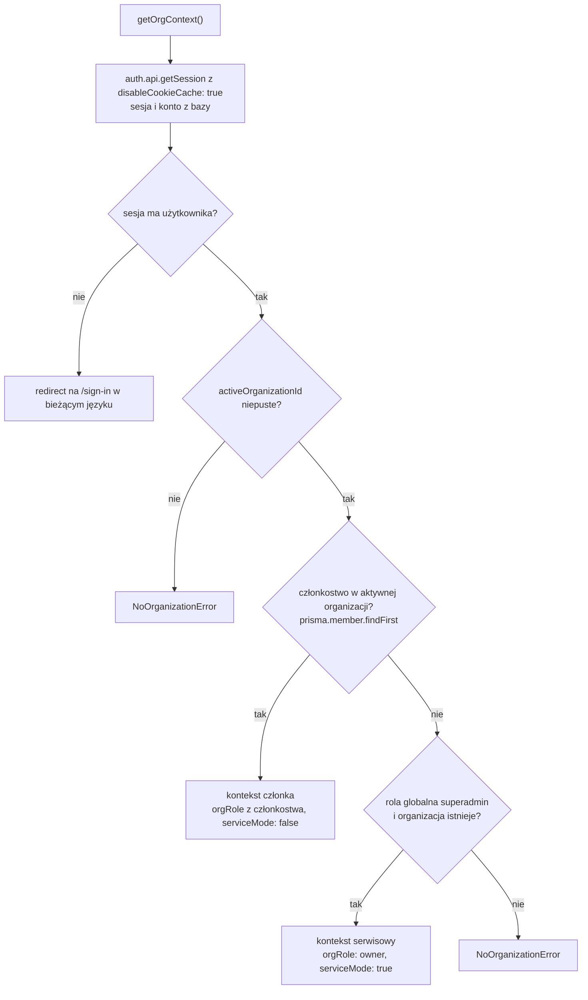
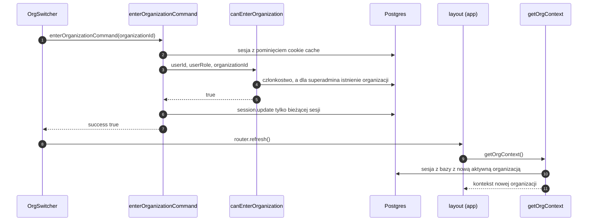

# Dane i organizacje

Po przeczytaniu będziesz wiedzieć:

- jakie modele ma rdzeń i jak organizacje łączą się z kontami;
- co zwraca `getOrgContext()`, skąd bierze dane i kiedy kończy się przekierowaniem albo wyjątkiem `NoOrganizationError`;
- jak napisać zapytanie, które nie pokaże danych innej organizacji, i jak sprawdzają to testy;
- jak aplikacja ustawia aktywną organizację i co widzi użytkownik, który jej nie ma;
- co zmienia `MULTI_ORG`, a co zostaje takie samo w obu trybach.

Zweryfikowano z kodem: 012fe4d, 2026-10-29

Źródła:

- `prisma/schema/auth.prisma`
- `prisma/schema/organizations.prisma`
- `src/shared/lib/env.ts`
- `src/shared/lib/auth/org-context.ts`
- `src/shared/lib/auth/index.ts`
- `src/shared/lib/auth/helpers.ts`
- `src/shared/lib/auth/roles.ts`
- `src/shared/lib/auth/require-module-access.ts`
- `src/shared/lib/auth/service-mode.ts`
- `src/shared/lib/auth/single-org-guard.ts`
- `src/shared/lib/auth/signup-membership-context.ts`
- `src/shared/utils/error-handling.ts`
- `src/features/organizations/`
- `src/features/auth/services/signup-gate.ts`
- `src/features/auth/services/signup-policy.ts`
- `src/features/auth/services/commands/change-password-command.ts`
- `src/features/users/module.ts`
- `src/features/users/components/users-manager.tsx`
- `src/features/users/services/commands/invite-user-command.ts`
- `src/features/users/services/queries/user-account-queries.ts`
- `src/shared/lib/modules/nav.ts`
- `src/app/[locale]/(app)/layout.tsx`
- `src/app/[locale]/(app)/users/page.tsx`
- `src/app/[locale]/no-organization/page.tsx`
- `src/app/[locale]/accept-invitation/[id]/page.tsx`
- `src/test/integration/`
- `vitest.integration.config.ts`
- `src/__tests__/server-entrypoints-guard.test.ts`
- `src/shared/lib/auth/__tests__/org-context.test.ts`
- `src/shared/lib/auth/__tests__/single-org-guard.test.ts`
- `src/shared/lib/auth/__tests__/signup-membership-context.test.ts`
- `src/shared/lib/auth/__tests__/auth-config.test.ts`
- `src/features/users/services/commands/__tests__/invite-user-command.test.ts`
- `src/app/[locale]/no-organization/__tests__/page.test.tsx`
- `e2e/multi-org.spec.ts`

<a id="jedna-baza"></a>

## Wszystkie organizacje w jednej bazie

Organizacja to firma albo zespół, do którego należą użytkownicy i dane. Wszystkie organizacje aplikacji mają wspólną bazę i wspólne tabele. Rekordy jednej organizacji od rekordów innej odróżnia tylko kolumna `organizationId`. Nic pod kodem zapytania nie dopisuje warunku na tę kolumnę: kit nie używa rozszerzenia klienta Prismy, które filtrowałoby automatycznie. Zapytanie bez warunku zwraca więc rekordy wszystkich organizacji i użytkownik jednej firmy zobaczy dane innej. Ten plik opisuje, jak kit tego pilnuje i co musi zrobić autor każdego nowego zapytania ([D07](decyzje.md#d07)).

Pojęcia używane w tym pliku:

- **Członkostwo**: wiersz w tabeli `members`. Mówi, że konto należy do organizacji z rolą `owner` (właściciel), `admin` albo `member`. Jedno konto może mieć członkostwa w wielu organizacjach.
- **Aktywna organizacja**: organizacja, w której użytkownik pracuje w danej sesji logowania. Jej identyfikator leży w wierszu sesji (`Session.activeOrganizationId`), więc dwie sesje tego samego konta (na przykład laptop i telefon) mogą mieć różne aktywne organizacje.
- **Kontekst organizacji** (`OrgContext`): wynik `getOrgContext()`, czyli kto jest zalogowany, w której organizacji pracuje i z jakimi rolami.
- **Dane domenowe**: rekordy, które należą do jednej organizacji i mają kolumnę `organizationId`. W rdzeniu to `Member` i `Invitation`, w modułach ich własne tabele. Konta (`User`), sesje i organizacje same w sobie nie są danymi domenowymi.
- **Tryb serwisowy**: praca superadmina (konta serwisowego Web Amigos) w organizacji, do której nie należy. Pełny opis: [04b-superadmin-i-tryb-serwisowy.md](04b-superadmin-i-tryb-serwisowy.md#tryb-serwisowy).

<a id="schemat-i-migracje"></a>

## Schemat, klient Prismy i migracje

Schemat Prismy leży w kilku plikach w `prisma/schema/`, klient w `src/generated/prisma`, a połączenie z bazą tworzy `src/shared/lib/prisma.ts`. Kit nie commituje migracji, a projekt klienta je commituje. Pliki schematu, klienta, migracje w projekcie i wyjście z rozjazdu historii migracji opisuje [03b-schemat-i-migracje.md](03b-schemat-i-migracje.md).

<a id="model-danych"></a>

## Model danych rdzenia

Diagram pokazuje modele rdzenia, ich klucze i pola ważne dla organizacji. Pełną listę pól i ich znaczenie podaje [Referencja](#referencja-modele). Linia ciągła to klucz obcy w bazie. Linia przerywana to powiązanie bez klucza obcego: `Session.activeOrganizationId` przechowuje identyfikator organizacji, ale baza nie sprawdza, czy ta organizacja istnieje. Model `Verification` (tokeny better-auth) nie ma relacji i nie ma go na diagramie.



Usunięcie konta albo organizacji usuwa kaskadowo zależne wiersze (`onDelete: Cascade`): sesje, sposoby logowania, członkostwa i zaproszenia, także zaproszenia wysłane przez usunięte konto. Konto (`User`) jest globalne: jedno konto może należeć do wielu organizacji, a lista wszystkich kont dla admina globalnego (`getUserAccountsQuery`) celowo nie filtruje po organizacji.

Tabele domenowe modułów idą za `Member` i `Invitation`: wymagane `organizationId` z indeksem i relacją do `Organization` ([D07](decyzje.md#d07)). Żaden test nie czyta schematu pod tym kątem, więc pilnuje tego tylko przegląd kodu.

<a id="kontekst-organizacji"></a>

## Kontekst organizacji: `getOrgContext()`

`getOrgContext()` z `src/shared/lib/auth/org-context.ts` to jedyne źródło `organizationId` dla zapytań o dane domenowe. Kod feature nie czyta `activeOrganizationId` z sesji samodzielnie ([D07](decyzje.md#d07)). Funkcja zwraca obiekt tego typu:

`src/shared/lib/auth/org-context.ts`

```ts
export interface OrgContext {
  userId: string;
  organizationId: string;
  orgRole: OrgRole;
  userRole: UserRole;
  serviceMode: boolean;
}
```

| Pole | Skąd | Znaczenie |
| --- | --- | --- |
| `userId` | `session.user.id` | Zalogowane konto. Podczas impersonacji to konto, pod które ktoś się podszywa. |
| `organizationId` | `session.session.activeOrganizationId` | Aktywna organizacja. Zawsze niepusty napis. |
| `orgRole` | `members.role` członkostwa w aktywnej organizacji, przez `toOrgRole` | Rola w organizacji. Dla superadmina bez członkostwa zawsze `owner`. |
| `userRole` | `session.user.role`, przez `toUserRole` | Rola globalna. |
| `serviceMode` | wynik gałęzi | `true` tylko dla superadmina bez członkostwa w aktywnej organizacji. |

### Gałęzie



| Sytuacja | Wynik | Test w `org-context.test.ts` |
| --- | --- | --- |
| Brak sesji. | Przekierowanie na `/sign-in` (`redirect` z `@/i18n/routing` z językiem z `getLocale()`). Technicznie to wyjątek `NEXT_REDIRECT`, który obsługuje Next.js. | „brak sesji → przekierowanie na /sign-in z bieżącym locale” |
| `activeOrganizationId` to `null` albo pusty napis. | `NoOrganizationError`, bez zapytania o członkostwo. Dotyczy także superadmina. | „użytkownik bez członkostwa → NoOrganizationError”, „superadmin bez aktywnej organizacji → NoOrganizationError, nigdy kontekst bez organizacji”, „superadmin z pustym identyfikatorem aktywnej organizacji → NoOrganizationError” |
| Członkostwo w aktywnej organizacji istnieje. | Kontekst z rolą z członkostwa i `serviceMode: false`, dla każdej roli globalnej, także superadmina. | „zwraca kontekst członka aktywnej organizacji”, „superadmin z członkostwem → rola z członkostwa, bez trybu serwisowego” |
| Brak członkostwa, rola globalna `user` albo `admin`. | `NoOrganizationError`. Rola `admin` nie daje wejścia do cudzej organizacji. | „aktywna organizacja bez członkostwa → NoOrganizationError”, „globalny admin bez członkostwa w aktywnej organizacji → NoOrganizationError, bez trybu serwisowego” |
| Brak członkostwa, rola `superadmin`, organizacja istnieje. | Kontekst z `orgRole: "owner"` i `serviceMode: true`. | „superadmin bez członkostwa w istniejącej aktywnej organizacji → owner w trybie serwisowym” |
| Brak członkostwa, rola `superadmin`, organizacji nie ma w bazie. | `NoOrganizationError`. | „superadmin z aktywną organizacją, która nie istnieje → NoOrganizationError” |

`getOrgContext()` nigdy nie zwraca kontekstu bez organizacji. Brak organizacji kończy się wyjątkiem, a nie pustym filtrem, który w zapytaniu zwróciłby dane wszystkich organizacji. W innym projekcie Web Amigos właśnie brak kontekstu wyłączał filtr ([D21](decyzje.md#d21)). Superadmina i tryb serwisowy opisuje [04b-superadmin-i-tryb-serwisowy.md](04b-superadmin-i-tryb-serwisowy.md).

<a id="no-organization-error"></a>

### Kto obsługuje `NoOrganizationError`

| Miejsce | Co robi z wyjątkiem |
| --- | --- |
| Layout `(app)` (`resolveOrgContext` w `src/app/[locale]/(app)/layout.tsx`) | Przekierowuje na `/no-organization`. Inne błędy przepuszcza. |
| `requireModuleAccess(key)` | Tak samo: przekierowanie na `/no-organization` w bieżącym języku. |
| Strona `/no-organization` | Traktuje wyjątek jako „brak organizacji” i pokazuje stronę ([niżej](#no-organization)). |
| Query, na przykład `getOrganizationMembersQuery` | Nie łapie go. Na stronie z `requireModuleAccess` nie dochodzi do tego, bo guard przekierowuje wcześniej. |
| Komenda z `handleCommandError` (`src/shared/utils/error-handling.ts`) | `NoOrganizationError` nie dziedziczy po `DomainError`, więc trafia do logu jako błąd, a komenda zwraca swój domyślny komunikat, na przykład „Nie udało się zaprosić użytkownika”. Przekierowanie `NEXT_REDIRECT` `handleCommandError` rzuca dalej. |

<a id="cookie-cache"></a>

### Skąd dane: sesja z bazy, a nie z cookie cache

better-auth ma cookie cache, czyli kopię sesji i konta w podpisanym ciasteczku `better-auth.session_data` (przy `APP_URL` z `https://` z prefiksem `__Secure-`). Kit włącza go na 5 minut:

`src/shared/lib/auth/index.ts`

```ts
  session: {
    cookieCache: {
      enabled: true,
      maxAge: 60 * 5,
    },
  },
```

Odczyt sesji bez opcji `disableCookieCache`, dopóki kopia jest ważna, bierze dane z ciasteczka i nie pyta bazy. Aktywna organizacja zmienia się jednak po stronie serwera: `enterOrganizationCommand` zapisuje ją wprost w tabeli `sessions` i nie odświeża ciasteczka. Gdyby `getOrgContext()` czytał kopię z ciasteczka, po przełączeniu organizacji przez kolejne 5 minut zwracałby poprzednią, a zapytania filtrowałyby po złej organizacji. Dlatego czyta sesję z bazy:

`src/shared/lib/auth/org-context.ts`

```ts
async function readSession() {
  const requestHeaders = await headers();
  const { auth } = await import("@/shared/lib/auth");
  // WHY: the active org is switched server-side, so the 5-minute cookie cache can hold a stale one.
  return auth.api.getSession({
    headers: requestHeaders,
    query: { disableCookieCache: true },
  });
}
```

Z `disableCookieCache: true` better-auth szuka sesji w bazie po tokenie z ciasteczka `session_token`, razem z kontem. Rola globalna i aktywna organizacja są więc zawsze takie, jakie są w bazie w chwili odczytu. Testy „członek po przełączeniu organizacji → kontekst z bazy, nie z cookie cache” w `org-context.test.ts` i „cookie cache trzyma jeszcze A → getOrgContext superadmina od razu zwraca B w trybie serwisowym” w teście izolacji sprawdzają to na sesji, której kopia w ciasteczku wskazuje inną organizację niż baza.

Odczyty sesji w kodzie kitu:

| Odczyt | Źródło sesji | Co może być nieaktualne |
| --- | --- | --- |
| `getOrgContext()` | baza | nic |
| `enterOrganizationCommand` | baza | nic |
| hook `before` na ścieżkach z `ADMIN_TARGET_PATHS` i `/admin/create-user` (`getAuthoritativeSessionFromCtx` w `src/shared/lib/auth/index.ts`) | baza | nic |
| hook `before` guarda `MULTI_ORG=false` (`getSessionFromCtx` w `src/shared/lib/auth/index.ts`) | cookie cache | rola globalna, do 5 minut: konto, któremu odebrano rolę `admin`, przechodzi guard jeszcze do 5 minut (dalej better-auth sprawdza członkostwo i rolę w organizacji) |
| `getCurrentUser`, `requireUser`, `getAdminUserOrNull`, `getImpersonatedByUserId`, `getCurrentUserWithImpersonation` z `src/shared/lib/auth/helpers.ts` | cookie cache | rola globalna i dane konta, do 5 minut |
| `getSwitchableOrganizationsQuery` (lista w przełączniku i na `/no-organization`) | cookie cache | rola globalna, do 5 minut ([D21](decyzje.md#d21)) |
| strona `/accept-invitation/[id]`, `changePasswordCommand` | cookie cache | dane konta, do 5 minut |

Do danych domenowych bierz więc `organizationId` wyłącznie z `getOrgContext()` albo z `requireModuleAccess()`, który go woła. Co wynika z nieaktualnej roli w pozostałych odczytach, opisuje [04-auth-i-role.md](04-auth-i-role.md#rola-z-cookie-cache).

<a id="wiele-wywolan"></a>

### Wiele wywołań w jednym żądaniu

Kod nie zapamiętuje wyniku `getOrgContext()` w obrębie żądania (nie używa `cache` z React). Każde wywołanie czyta sesję z bazy i członkostwo, a dla superadmina bez członkostwa sprawdza jeszcze, czy organizacja istnieje. Przy wyświetleniu `/users` przez konto z rolą globalną `user` (na przykład właściciela organizacji przy `MULTI_ORG=true`) kontekst pobierają trzy miejsca, każde osobno ([02-architektura.md](02-architektura.md#droga-zadania)):

1. layout `(app)`, żeby zbudować menu, przełącznik i pasek trybu serwisowego;
2. `requireModuleAccess("users")` na stronie, żeby sprawdzić dostęp;
3. `getOrganizationMembersQuery()`, żeby wiedzieć, której organizacji członków odczytać.

Dla admina globalnego strona woła zamiast tego `getUserAccountsQuery()`, które nie potrzebuje kontekstu, więc wywołania są dwa.

To zamierzone. Layout nie chroni strony ani akcji ([D11](decyzje.md#d11)), a query nie może wierzyć `organizationId` od wywołującego. Test architektury `src/__tests__/server-entrypoints-guard.test.ts` wymaga, żeby każda eksportowana funkcja w `services/queries/` i w pliku z `"use server"` sama wywołała guard sesji przed Prismą ([D24](decyzje.md#d24)). W nowym query i nowej komendzie też wołaj `getOrgContext()` (albo `requireModuleAccess()`), nawet jeśli strona zrobiła to wcześniej. Koszt to zwykle dwa albo trzy zapytania do bazy na wywołanie. Nie przyjmuj `organizationId` jako parametru z formularza ani z adresu: wartość z przeglądarki może wskazywać cudzą organizację.

Test architektury uznaje za guard także samo `getSession`. Query, które woła tylko `auth.api.getSession`, przejdzie test, ale nie dostanie ani `organizationId`, ani sprawdzenia członkostwa. Do danych domenowych to za mało.

<a id="filtr-organizationid"></a>

## Filtr `organizationId` w zapytaniach

Reguła: każde wywołanie Prismy na danych domenowych ma `organizationId` z kontekstu organizacji. Przy odczycie, zmianie i usuwaniu jest w `where`, przy tworzeniu w `data`. Samo `id` rekordu z wejścia nie wystarcza, bo identyfikator wysłany z przeglądarki może należeć do rekordu innej organizacji. Warunek `{ id, organizationId }` sprawia, że taki rekord po prostu nie zostanie znaleziony.

Przykład z rdzenia. Query listy członków bierze `organizationId` z kontekstu i zaczyna od organizacji o tym identyfikatorze, więc członkowie i zaproszenia w zagnieżdżonych `select` należą tylko do niej:

`src/features/organizations/services/queries/organization-queries.ts`

```ts
export async function getOrganizationMembersQuery(): Promise<OrganizationMembersData> {
  const { userId, organizationId, orgRole } = await getOrgContext();

  const organization = await prisma.organization.findUniqueOrThrow({
    where: { id: organizationId },
    select: {
      name: true,
      members: {
        orderBy: { createdAt: "asc" },
        select: {
          id: true,
          role: true,
          user: { select: { id: true, name: true, email: true } },
        },
      },
      invitations: {
        where: { status: "pending" },
        // …
```

Tabela z kolumną `organizationId` dostaje ją wprost w `where`. Tak sprawdza członkostwo sam `getOrgContext()`:

`src/shared/lib/auth/org-context.ts`

```ts
  const member = await prisma.member.findFirst({
    where: { organizationId, userId: session.user.id },
    select: { role: true },
  });
```

Zapis bierze `organizationId` z tego samego kontekstu. Komenda „Zaproś użytkownika” najpierw pobiera kontekst i potwierdza tryb serwisowy, a potem tworzy zaproszenie w aktywnej organizacji:

`src/features/users/services/commands/invite-user-command.ts`

```ts
    const context = await getOrgContext();
    assertServiceModeConfirmed(context, confirmation);
// …
    const invitation = await prisma.invitation.create({
      data: {
        organizationId: context.organizationId,
        email,
        role,
        inviterId: admin.id,
        expiresAt: new Date(Date.now() + INVITATION_TTL_MS),
      },
      select: { id: true },
    });
```

`assertServiceModeConfirmed` dotyczy każdej komendy na danych organizacji. Kontrakt opisują [AGENTS.md](../AGENTS.md#dane-i-organizacje) i [06-wzorce-kodu.md](06-wzorce-kodu.md).

Brakującego filtra nic nie zatrzyma w działaniu aplikacji. Test architektury sprawdza, czy funkcja woła guard, a nie, czy zapytanie filtruje. Lukę wychwyci tylko test izolacji, który autor dopisze razem z query albo komendą.

<a id="izolacja"></a>

## Izolacja organizacji w testach

Izolację sprawdza test integracyjny `src/features/organizations/services/__tests__/organization-isolation.integration.test.ts` na prawdziwym Postgresie. Prawdziwe są Prisma, baza i kod query, komend oraz guardów. Zastąpione są tylko wejścia z Next.js, next-intl i better-auth: `headers()`, `getLocale()`, `redirect`, `notFound` i `auth.api.getSession`. Atrapa `getSession` zachowuje się jak better-auth z cookie cache: bez `disableCookieCache` zwraca kopię sesji z pamięci testu, a z tą opcją czyta `activeOrganizationId` z tabeli `sessions`. Przed każdym testem `resetDatabase()` czyści tabele, a test zakłada dwie organizacje z członkami i zaproszeniami. Sprawdza listę członków każdej z nich, `NoOrganizationError` przy aktywnej organizacji bez członkostwa, dostęp do strony `/users` (definicja modułu `users`) przy `MULTI_ORG=false`, rejestrację z zaproszeniem, atomowość dołączania, wejście superadmina do organizacji i domyślną aktywną organizację. Środowisko testu (między innymi `MULTI_ORG=false`), bazę z nazwą zakończoną na `_test` i uruchamianie przez `npm run test:integration` opisuje [08-testy.md](08-testy.md).

Wzór testu izolacji dla nowego query. Zaloguj użytkownika w jednej organizacji, wywołaj kod i sprawdź, że wynik nie zawiera niczego z drugiej. W teście `world` to konta, organizacje i zaproszenia zakładane w `beforeEach`, a `signInAs(user, organization, role)` tworzy w tabeli `sessions` sesję z podaną aktywną organizacją i ustawia ją jako wynik atrapy `getSession`:

`src/features/organizations/services/__tests__/organization-isolation.integration.test.ts`

```ts
  it("lista członków organizacji B nie widzi niczego z organizacji A", async () => {
    await signInAs(world.bob, world.orgB);

    const data = await getOrganizationMembersQuery();

    expect(data.members.map((member) => member.email)).toEqual([
      "bob@b.example",
    ]);
    expect(data.invitations.map((invitation) => invitation.email)).toEqual([
      "new-b@example.com",
    ]);
  });
```

Dla komendy test wywołuje ją w kontekście jednej organizacji i sprawdza, że rekordy drugiej się nie zmieniły. Oczekiwane wartości są literałami, a nie wynikiem kodu produkcyjnego ([08-testy.md](08-testy.md)). Zapis zaproszenia przez `inviteUserCommand` sprawdza tylko test jednostkowy `invite-user-command.test.ts` z zamockowanym `getOrgContext` (zaproszenie ma `organizationId` z kontekstu). Test integracyjny `invite-user-command.integration.test.ts` sprawdza na prawdziwej bazie tylko wpisy dziennika zdarzeń (organizacja wpisu, autor), a nie to, że zapis zaproszenia omija drugą organizację.

Izolację w interfejsie sprawdza też e2e `e2e/multi-org.spec.ts` (`MULTI_ORG=true`, `AUTH_PUBLIC_SIGNUP=true`): rejestracje Ani i Bartka tworzą dwie organizacje, a Bartek na stronie „Członkowie” nie widzi Ani.

<a id="aktywna-organizacja"></a>

## Aktywna organizacja

Aktywna organizacja jest zapisana w wierszu sesji, nie w koncie. Ustawiają ją te zdarzenia:

| Zdarzenie | Kod | Nowa aktywna organizacja |
| --- | --- | --- |
| Utworzenie sesji: logowanie i impersonacja | hook `databaseHooks.session.create.before` w `src/shared/lib/auth/index.ts`, `getDefaultActiveOrganizationId` | Organizacja najstarszego członkostwa (`Member.createdAt` rosnąco). Superadmin bez członkostw dostaje najstarszą organizację w bazie, a pozostałe konta bez członkostw `null`. Błąd bazy daje `null` i wpis w logu, ale nie blokuje logowania. Superadmin bez członkostwa w tej organizacji dostaje wpis `organization.entered` z hooka `session.create.after` ([04b-superadmin-i-tryb-serwisowy.md](04b-superadmin-i-tryb-serwisowy.md#wejscie-do-organizacji)). |
| Rejestracja | `autoSignIn: false` | Rejestracja nie tworzy sesji. Organizację ustawia pierwsze logowanie. |
| Przyjęcie zaproszenia przez zalogowanego | `auth.api.acceptInvitation` i `auth.api.setActiveOrganization` na stronie `/accept-invitation/[id]` | Organizacja z zaproszenia. Potem przekierowanie na `/dashboard`. |
| Utworzenie organizacji (`MULTI_ORG=true`) | `authClient.organization.create` w `create-organization-form.tsx` | Nowa organizacja. better-auth ustawia ją jako aktywną, bo formularz nie wysyła `keepCurrentActiveOrganization`. |
| Wybór w przełączniku albo na `/no-organization` | `enterOrganizationCommand` | Wybrana organizacja, jeśli `canEnterOrganization` pozwala: superadmin wchodzi do każdej istniejącej, inni tylko do tej, w której mają członkostwo. |

Po ponownym logowaniu użytkownik wraca do organizacji najstarszego członkostwa, a nie do ostatnio wybranej, bo nowa sesja dostaje wartość z hooka.

Przełączenie organizacji wygląda tak:



`enterOrganizationCommand` przyjmuje identyfikator jako `unknown` i sprawdza go schematem `z.string().min(1)`, bez przycinania spacji. Przy niepoprawnym wejściu, braku sesji, braku prawa wejścia i błędzie zapisu zwraca `{ success: false, error: "Brak dostępu do organizacji" }` i nie zmienia żadnej sesji. Zmienia tylko sesję, z której przyszło żądanie, a inne sesje tego konta zostają przy swojej organizacji (`enter-organization-command.test.ts`). Komenda zapisuje sesję przez Prismę. Gdy superadmin wchodzi do organizacji bez członkostwa, po zapisie sesji dopisuje do dziennika zdarzeń wpis `organization.entered` ze znacznikiem `serviceMode: true` przez `trackAudit` ([12-moduly-kitu.md](12-moduly-kitu.md)); bez zainstalowanego modułu `audit-logs` wpis nie powstaje. Endpoint better-auth `/organization/set-active` wymaga członkostwa (bez niego zeruje aktywną organizację i zwraca 403), więc superadmin w trybie serwisowym nie mógłby z niego skorzystać.

`activeOrganizationId` może wskazywać organizację, do której konto już nie należy, na przykład po usunięciu członkostwa albo organizacji. Baza tego nie wykrywa, bo kolumna nie ma klucza obcego. Wykrywa to `getOrgContext()`: rzuca `NoOrganizationError`, a layout przenosi użytkownika na `/no-organization`.

<a id="no-organization"></a>

### Strona `/no-organization`

Strona leży w `src/app/[locale]/no-organization/page.tsx`, poza grupą `(app)`. Gdyby była w `(app)`, layout tej grupy przekierowywałby ją na nią samą bez końca ([D12](decyzje.md#d12)). Strona sama woła `getOrgContext()`:

- działający kontekst (także superadmina w trybie serwisowym): przekierowanie na `/dashboard`;
- brak sesji: przekierowanie na `/sign-in` z `getOrgContext()`;
- `NoOrganizationError`: strona „Brak organizacji”;
- inny błąd: nie jest połykany i kończy się błędem strony.

Strona „Brak organizacji” pokazuje:

- opis zależny od trybu: przy `MULTI_ORG=false` „Twoje konto nie należy do żadnej organizacji. Poproś administratora o zaproszenie.”, przy `true` „… Utwórz własną albo poproś o zaproszenie.”;
- listę „Wejdź do organizacji”, tylko gdy `getSwitchableOrganizationsQuery` zwraca co najmniej jedną organizację (członkostwa konta, a dla superadmina wszystkie organizacje). Przycisk przy każdej organizacji woła `enterOrganizationCommand` i przenosi na `/dashboard`. Użytkownik usunięty z aktywnej organizacji wybiera tu inną, do której należy;
- formularz „Utwórz organizację”, tylko przy `MULTI_ORG=true`;
- przycisk „Wyloguj się”.

Strona nie ma menu bocznego ani paska trybu serwisowego, bo nie korzysta z layoutu `(app)`.

<a id="tryby-multi-org"></a>

## Tryby `MULTI_ORG`

`MULTI_ORG` nie zmienia modelu danych. Baza zawsze dopuszcza wiele organizacji, a flaga zmienia przepływy i uprawnienia ([D06](decyzje.md#d06)). Co widać w interfejsie przy kombinacjach z `AUTH_PUBLIC_SIGNUP`, opisuje [01-uruchomienie.md](01-uruchomienie.md#tryby-uruchomienia). Tabela niżej pokazuje, który kod się zmienia.

| Obszar | `MULTI_ORG=false` (domyślnie) | `MULTI_ORG=true` |
| --- | --- | --- |
| Rejestracja bez zaproszenia (tylko przy `AUTH_PUBLIC_SIGNUP=true`, [D10](decyzje.md#d10)) | Konto dołącza jako `member` do najstarszej organizacji (`Organization.createdAt` rosnąco). Gdy w bazie nie ma organizacji, rejestracja kończy się błędem „Aplikacja nie jest skonfigurowana: uruchom npm run admin:create”. | Powstaje organizacja „`<imię>` — organizacja” z nowym kontem jako `owner`. |
| Rejestracja z zaproszeniem (`invitationId`) | Konto dołącza do organizacji z zaproszenia z rolą z zaproszenia, a zaproszenie dostaje `accepted` w tej samej transakcji. | Tak samo. |
| Zaproszenia | Tylko rola globalna `admin` albo `superadmin`, z członkostwem w aktywnej organizacji albo (superadmin) w trybie serwisowym: „Zaproś użytkownika” zakłada nowe konto w aktywnej organizacji i wysyła mail z linkiem do ustawienia hasła. Komenda odrzuca adres istniejącego konta („Użytkownik z tym adresem już istnieje”), więc istniejące konto dołączy tylko przez endpointy better-auth (zaproszenie i `/accept-invitation/<id>`), dla których kit nie ma przy tym trybie widoku. | Tak samo, a do tego `owner` i `admin` organizacji: „Zaproś osobę” na stronie „Członkowie” wysyła przez endpoint better-auth mail z linkiem `/accept-invitation/<id>`, także na adres istniejącego konta. |
| Tworzenie organizacji przez endpoint `/organization/create` | Zablokowane dla każdego wywołania z przeglądarki: `allowUserToCreateOrganization` zwraca `false` („You are not allowed to create a new organization”), a konto bez roli globalnej `admin` lub `superadmin` zatrzymuje wcześniej guard z `single-org-guard.ts`. | Każdy zalogowany. Twórca zostaje `owner`, a nowa organizacja aktywną. |
| Tworzenie organizacji w interfejsie | Brak przycisku i formularza. | Przycisk „+” nad treścią strony (dialog „Utwórz organizację”) i formularz na `/no-organization`. |
| Endpointy zarządzania organizacją i członkami (zaproszenia, usuwanie członków, zmiana ról, zmiana i usuwanie organizacji) | Najpierw guard: tylko rola globalna `admin` lub `superadmin` (lista `SINGLE_ORG_GLOBAL_ADMIN_PATHS` w `single-org-guard.ts`, komunikat „Zarządzanie organizacją wymaga roli administratora”). Potem better-auth sprawdza członkostwo i uprawnienia wywołującego w tej organizacji, jak w trybie `true`. Przyjęcia i odrzucenia zaproszenia, opuszczenia organizacji ani `set-active` guard nie obejmuje. Interfejs kitu nie ma przy tym trybie widoku do zmiany ról ani usuwania członków. | Według członkostwa i roli wywołującego w organizacji (uprawnienia pluginu `organization`). |
| Strona `/users` dla roli globalnej `admin` i `superadmin` | „Użytkownicy” (`UsersManager`): wszystkie konta aplikacji, „Zaproś użytkownika”, impersonacja (dla `admin` tylko przy `ADMIN_IMPERSONATION=true`). | Tak samo. |
| Strona `/users` dla `owner` i `admin` organizacji z rolą globalną `user` | Brak dostępu (404, `adminOnly` w `src/features/users/module.ts`). | „Członkowie” (`OrganizationMembers`): członkowie i oczekujące zaproszenia aktywnej organizacji, zmiana ról `admin` i `member`, usuwanie członków, „Zaproś osobę”, anulowanie zaproszeń. |
| Strona `/users` dla `member` | Brak dostępu. | Brak dostępu. |
| Etykieta pozycji menu | „Użytkownicy”. | „Członkowie” dla kont z rolą globalną `user`, „Użytkownicy” dla `admin` i `superadmin` (`multiOrgLabelKey`, [02-architektura.md](02-architektura.md#definicja-modulu)). |
| Lista wyboru organizacji w przełączniku | Gdy konto ma dostęp do więcej niż jednej organizacji. | Tak samo. |

W obu trybach jest tak samo:

- model danych, `getOrgContext()`, reguła filtra `organizationId` i testy izolacji;
- domyślna aktywna organizacja po zalogowaniu;
- superadmin wchodzi do każdej organizacji ([D21](decyzje.md#d21));
- `npm run admin:create` tworzy organizację tylko na pustej bazie, a w przeciwnym razie dopisuje konto do najstarszej ([01-uruchomienie.md](01-uruchomienie.md#admin-create)).

<a id="zmiana-trybu"></a>

### Zmiana trybu w działającej aplikacji

Zmiana flagi nie wymaga migracji. Po restarcie serwera:

- **`false` → `true`**: istniejące organizacje i członkostwa zostają. Rejestracja bez zaproszenia zaczyna tworzyć nowe organizacje, każdy może założyć organizację, a `owner` i `admin` organizacji dostają stronę „Członkowie”.
- **`true` → `false`**: wszystkie organizacje i członkostwa zostają, a konta z kilkoma członkostwami nadal widzą przełącznik. Rejestracja bez zaproszenia trafia do najstarszej organizacji. `owner` i `admin` organizacji z rolą globalną `user` tracą stronę „Członkowie” i dostęp do endpointów zarządzania. Nowe konta do organizacji dodaje wtedy przez „Zaproś użytkownika” konto z rolą globalną `admin` z członkostwem w tej organizacji albo superadmin, także w trybie serwisowym. Role członków zmieni i członków usunie tylko konto z rolą globalną `admin` lub `superadmin`, które samo jest członkiem tej organizacji z wystarczającą rolą, i to wyłącznie przez endpointy better-auth, bo interfejs kitu nie ma do tego widoku.

<a id="referencja"></a>

## Referencja

<a id="referencja-modele"></a>

### Modele i pola

Nazwy tabel i kolumn w bazie podaje `@@map` i `@map`. Kolumna „Null” mówi, czy pole może być puste.

**`User`** (tabela `users`, `prisma/schema/auth.prisma`). Konto, globalne dla całej aplikacji.

| Pole | Typ | Kolumna | Null | Domyślnie | Uwagi |
| --- | --- | --- | --- | --- | --- |
| `id` | `String` | `id` | nie | `cuid()` | klucz główny |
| `name` | `String` | `name` | nie | | |
| `email` | `String` | `email` | nie | | unikalny |
| `role` | `String` | `role` | nie | `"user"` | rola globalna. `getOrgContext()` i query czytają ją przez `toUserRole`, które nieznaną wartość zamienia na `user`. |
| `emailVerified` | `Boolean` | `email_verified` | nie | `false` | |
| `image` | `String` | `image` | tak | | |
| `createdAt`, `updatedAt` | `DateTime` | `created_at`, `updated_at` | nie | `now()`, `@updatedAt` | |
| `banned` | `Boolean` | `banned` | tak | `false` | plugin `admin` |
| `banReason` | `String` | `ban_reason` | tak | | plugin `admin` |
| `banExpires` | `DateTime` | `ban_expires` | tak | | plugin `admin` |

Relacje: `sessions`, `accounts`, `members`, `invitations` (wysłane zaproszenia) i region `wa:relations`.

**`Session`** (tabela `sessions`). Sesja logowania.

| Pole | Typ | Kolumna | Null | Uwagi |
| --- | --- | --- | --- | --- |
| `id` | `String` | `id` | nie | klucz główny, `cuid()` |
| `expiresAt` | `DateTime` | `expires_at` | nie | |
| `token` | `String` | `token` | nie | unikalny, wartość ciasteczka sesji |
| `createdAt`, `updatedAt` | `DateTime` | `created_at`, `updated_at` | nie | |
| `ipAddress`, `userAgent` | `String` | `ip_address`, `user_agent` | tak | |
| `userId` | `String` | `user_id` | nie | klucz obcy do `users`, kaskada, indeks |
| `activeOrganizationId` | `String` | `active_organization_id` | tak | aktywna organizacja (plugin `organization`), bez klucza obcego |
| `impersonatedBy` | `String` | `impersonated_by` | tak | identyfikator konta, które impersonuje (plugin `admin`), bez klucza obcego |

**`Account`** (tabela `accounts`). Sposób logowania konta: `id`, `accountId`, `providerId`, `userId` (klucz obcy do `users`, kaskada, indeks), `accessToken`, `refreshToken`, `idToken`, `accessTokenExpiresAt`, `refreshTokenExpiresAt`, `scope`, `password`, `createdAt`, `updatedAt`. Dla logowania e-mailem `providerId` ma wartość `credential`, a `password` zawiera hash hasła. Pola tokenów i `password` mogą być puste.

**`Verification`** (tabela `verifications`). Tokeny better-auth, na przykład z linku resetu hasła: `id`, `identifier`, `value`, `expiresAt`, `createdAt` i `updatedAt` (oba mogą być puste).

**`Organization`** (tabela `organizations`, `prisma/schema/organizations.prisma`)

| Pole | Typ | Kolumna | Null | Domyślnie | Uwagi |
| --- | --- | --- | --- | --- | --- |
| `id` | `String` | `id` | nie | `cuid()` | klucz główny |
| `name` | `String` | `name` | nie | | |
| `slug` | `String` | `slug` | nie | | unikalny. Rejestracja i formularz „Utwórz organizację” biorą go z `slugifyOrganizationName`: nazwa bez znaków diakrytycznych, małymi literami, z myślnikami, skrócona do 48 znaków, z losowym sufiksem z 8 znaków (na przykład `ala-organizacja-1a2b3c4d`). Pierwsza organizacja z `admin:create` ma slug bez sufiksu. |
| `logo` | `String` | `logo` | tak | | |
| `metadata` | `String` | `metadata` | tak | | |
| `createdAt` | `DateTime` | `created_at` | nie | `now()` | wyznacza „najstarszą organizację” |
| `updatedAt` | `DateTime` | `updated_at` | tak | `@updatedAt` | |

Relacje: `members`, `invitations` i region `wa:relations`.

**`Member`** (tabela `members`). Członkostwo konta w organizacji.

| Pole | Typ | Kolumna | Null | Domyślnie | Uwagi |
| --- | --- | --- | --- | --- | --- |
| `id` | `String` | `id` | nie | `cuid()` | klucz główny |
| `organizationId` | `String` | `organization_id` | nie | | klucz obcy do `organizations`, kaskada |
| `userId` | `String` | `user_id` | nie | | klucz obcy do `users`, kaskada, indeks |
| `role` | `String` | `role` | nie | `"member"` | rola w organizacji. Kod czyta ją przez `toOrgRole`, które nieznaną wartość zamienia na `member`. |
| `createdAt` | `DateTime` | `created_at` | nie | `now()` | wyznacza „najstarsze członkostwo” |

Para `organizationId`, `userId` jest unikalna (`@@unique`), więc konto ma w organizacji najwyżej jedno członkostwo.

**`Invitation`** (tabela `invitations`). Zaproszenie do organizacji na adres e-mail.

| Pole | Typ | Kolumna | Null | Domyślnie | Uwagi |
| --- | --- | --- | --- | --- | --- |
| `id` | `String` | `id` | nie | `cuid()` | klucz główny, parametr `invitationId` |
| `organizationId` | `String` | `organization_id` | nie | | klucz obcy do `organizations`, kaskada, indeks |
| `email` | `String` | `email` | nie | | porównywany bez względu na wielkość liter |
| `role` | `String` | `role` | nie | | rola po przyjęciu, czytana przez `toOrgRole` |
| `status` | `String` | `status` | nie | `"pending"` | przyjęcie zmienia na `accepted`, better-auth przy anulowaniu i odrzuceniu ustawia `canceled` i `rejected` |
| `expiresAt` | `DateTime` | `expires_at` | tak | | zaproszenia z kitu i z better-auth wygasają po 48 godzinach |
| `createdAt` | `DateTime` | `created_at` | nie | `now()` | |
| `inviterId` | `String` | `inviter_id` | nie | | klucz obcy do `users`, kaskada, indeks |

Rejestracja z `invitationId` przyjmuje tylko zaproszenie ze statusem `pending`, adresem równym adresowi z formularza (bez względu na wielkość liter) i `expiresAt` w przyszłości. Zaproszenie bez `expiresAt` nie przejdzie.

<a id="referencja-wyjatki"></a>

### Wyjątki i błędy

| Błąd | Skąd | Kiedy | Wynik |
| --- | --- | --- | --- |
| `NoOrganizationError` (`Error`, komunikat „Użytkownik nie należy do aktywnej organizacji”) | `getOrgContext` | Brak aktywnej organizacji; brak członkostwa poza superadminem; superadmin z organizacją, której nie ma w bazie. | [Kto obsługuje](#no-organization-error). |
| Przekierowanie na `/sign-in` (`NEXT_REDIRECT`) | `getOrgContext`, `requireUser` | Brak sesji. | Next.js przekierowuje. `handleCommandError` rzuca je dalej. |
| `ServiceModeConfirmationError` (`DomainError`, „Potwierdź zmianę w trybie serwisowym”) | `assertServiceModeConfirmed` w `service-mode.ts` | W trybie serwisowym: brak potwierdzenia aktywnej organizacji. W każdym trybie: przekazane potwierdzenie nie wskazuje aktywnej organizacji, na przykład z karty otwartej przed przełączeniem organizacji. | `{ success: false, error: "Potwierdź zmianę w trybie serwisowym" }` ([04b-superadmin-i-tryb-serwisowy.md](04b-superadmin-i-tryb-serwisowy.md#kontrakt-potwierdzenia)). |
| `APIError` `FORBIDDEN`, „Zarządzanie organizacją wymaga roli administratora” | `assertGlobalAdmin` w `single-org-guard.ts`, hook `before` | `MULTI_ORG=false`, endpoint z `SINGLE_ORG_GLOBAL_ADMIN_PATHS`, brak sesji albo rola globalna inna niż `admin` i `superadmin`. | Odpowiedź 403. |
| `APIError` `FORBIDDEN`, „You are not allowed to create a new organization” | better-auth, `/organization/create` | `MULTI_ORG=false` (`allowUserToCreateOrganization`). | Odpowiedź 403. |
| `APIError` `FORBIDDEN`, „Rejestracja jest wyłączona” | `assertSignupAllowed` w `signup-policy.ts`, przez `signup-gate.ts` | `AUTH_PUBLIC_SIGNUP=false` i brak oczekującego, ważnego zaproszenia na adres z formularza. Sprawdzane przed wyborem organizacji ([04-auth-i-role.md](04-auth-i-role.md#rejestracja)). | Odpowiedź 403, konto nie powstaje. |
| `APIError` `FORBIDDEN`, „Zaproszenie jest nieprawidłowe lub wygasło” | `resolveSignupMembership` | `AUTH_PUBLIC_SIGNUP=true`, rejestracja z `invitationId` bez adresu e-mail albo bez pasującego, ważnego zaproszenia. Przy `false` takie żądanie zatrzymuje wcześniej „Rejestracja jest wyłączona”. | Odpowiedź 403, konto nie powstaje. |
| `APIError` `INTERNAL_SERVER_ERROR`, „Aplikacja nie jest skonfigurowana: uruchom npm run admin:create” (`NOT_CONFIGURED_MESSAGE`) | `resolveSignupMembership` | `MULTI_ORG=false`, rejestracja bez zaproszenia, w bazie nie ma organizacji. | Odpowiedź 500, konto nie powstaje. |
| `{ success: false, error: "Brak dostępu do organizacji" }` | `enterOrganizationCommand` | Niepoprawny identyfikator, brak sesji, brak prawa wejścia, błąd zapisu. | Komunikat w przełączniku albo na `/no-organization`. |
| Błąd unikalności Prismy na `members` | `joinOrganizationCommand` | Drugie członkostwo tego samego konta w tej samej organizacji. | Wyjątek. Przy zaproszeniu transakcja cofa też zmianę statusu. |

<a id="referencja-funkcje"></a>

### Funkcje

| Funkcja | Plik | Sesja | Działanie |
| --- | --- | --- | --- |
| `getOrgContext()` | `src/shared/lib/auth/org-context.ts` | z bazy | [Kontekst organizacji](#kontekst-organizacji). |
| `requireModuleAccess(key)` | `src/shared/lib/auth/require-module-access.ts` | przez `getOrgContext` | Kontekst albo przekierowanie na `/no-organization`, przy braku dostępu 404 ([02-architektura.md](02-architektura.md#definicja-modulu)). |
| `getOrganizationMembersQuery()` | `src/features/organizations/services/queries/organization-queries.ts` | przez `getOrgContext` | Nazwa aktywnej organizacji, członkowie (od najstarszego członkostwa) i oczekujące zaproszenia (od najnowszego). |
| `getSwitchableOrganizationsQuery()` | `src/features/organizations/services/queries/switchable-organizations-query.ts` | cookie cache, bez sesji `[]` | Superadmin: wszystkie organizacje po nazwie z polem `isMember`. Inni: organizacje z członkostw po nazwie. |
| `getDefaultActiveOrganizationId(userId)` | `src/features/organizations/services/queries/default-organization-query.ts` | brak, wyjątek w `UNGUARDED_ALLOWED` testu architektury | Domyślna aktywna organizacja nowej sesji ([wyżej](#aktywna-organizacja)). |
| `enterOrganizationCommand(organizationId)` | `src/features/organizations/services/commands/enter-organization-command.ts` (`"use server"`) | z bazy | Zmienia `activeOrganizationId` bieżącej sesji. |
| `canEnterOrganization(input)` | `src/features/organizations/services/organization-access.ts` | brak | Superadmin: organizacja istnieje. Inni: członkostwo. |
| `resolveSignupMembership(input)` | `src/features/organizations/services/signup-membership.ts` | brak, hook `before` na `/sign-up/email` | Decyzja `join` (organizacja zaproszenia albo najstarsza) albo `create` (nowa organizacja). |
| `applySignupMembership(userId, membership)` | jak wyżej | brak, hook `databaseHooks.user.create.after` | Wykonuje decyzję przez `joinOrganizationCommand` albo `createOrganizationWithOwnerCommand`. |
| `readSignupMembership(context)` | `src/shared/lib/auth/signup-membership-context.ts` | brak | Czyta decyzję z kontekstu hooka. Wartość bez akcji `join` albo `create` daje `null`, więc hook nic nie zapisuje. |
| `joinOrganizationCommand(input)` | `src/features/organizations/services/commands/member-commands.ts` | brak | Tworzy członkostwo. Z `invitationId` robi to w transakcji ze zmianą statusu zaproszenia na `accepted`. |
| `createOrganizationWithOwnerCommand(input)` | `src/features/organizations/services/commands/organization-commands.ts` | brak | Tworzy organizację ze slugiem i członkostwo `owner`. |
| `slugifyOrganizationName(name)` | `src/features/organizations/contracts/organization-slug.ts` | brak | Slug z losowym sufiksem ([Modele i pola](#referencja-modele)). |
| `requiresGlobalAdminInSingleOrg(path, multiOrg)`, `assertGlobalAdmin(role)` | `src/shared/lib/auth/single-org-guard.ts` | brak | Guard endpointów zarządzania organizacją przy `MULTI_ORG=false`. |

Funkcje z „brak” w kolumnie „Sesja” nie sprawdzają sesji same. Nie są punktami wejścia z przeglądarki: wołają je hooki better-auth, komendy albo, w przypadku `slugifyOrganizationName`, także formularz w przeglądarce ([02-architektura.md](02-architektura.md#anatomia-feature)).
