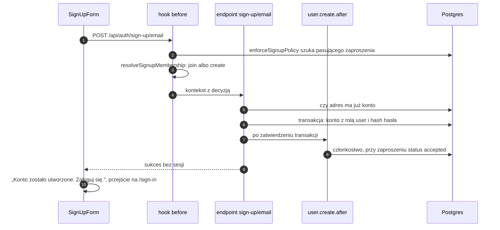
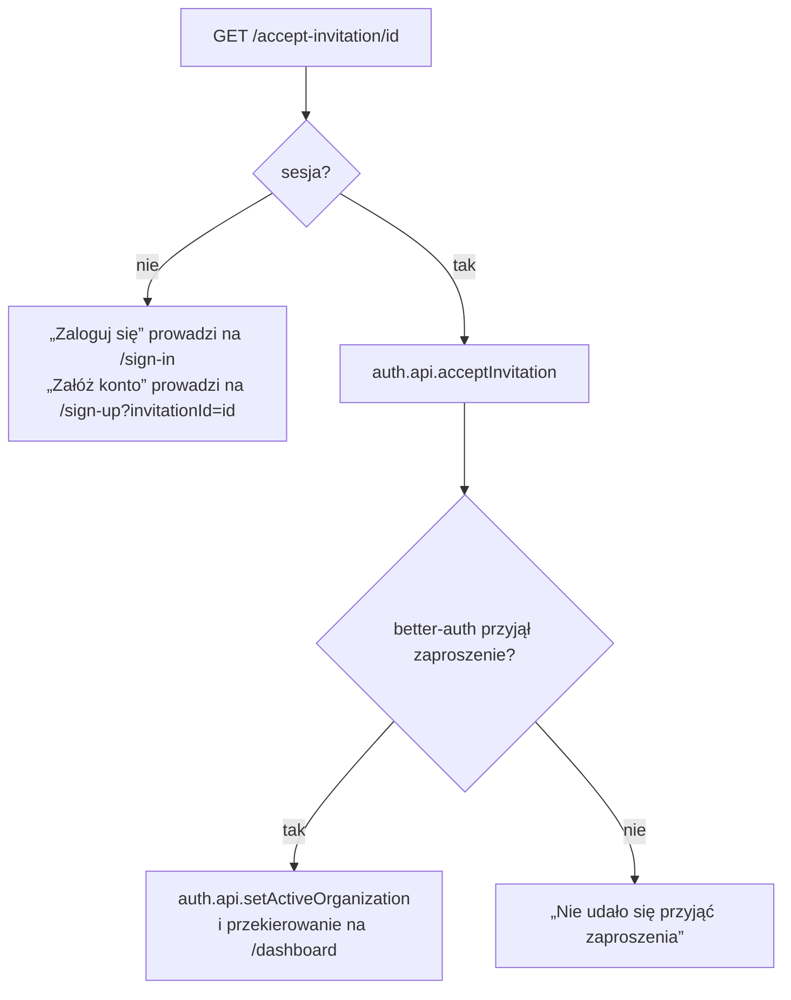

# Logowanie, role i dostęp

Po przeczytaniu będziesz wiedzieć:

- jak kit konfiguruje better-auth i co sprawdza hook `before` przy każdym endpoincie logowania;
- jak przebiegają logowanie, rejestracja, oba rodzaje zaproszeń i ustawianie hasła oraz jakie komunikaty widzi użytkownik;
- czym różni się rola globalna od roli w organizacji i dlaczego konto z rolą zapisaną jako `admin,superadmin` działa w różnych miejscach inaczej;
- kto wchodzi na którą stronę przy każdej kombinacji ról i `MULTI_ORG` (macierz dostępu z testu);
- który guard chroni które miejsce i co wynika z roli odczytanej z cookie cache;
- co robi `npm run admin:create` z nowym i z istniejącym kontem.

Zweryfikowano z kodem: 4a6ffcb, 2026-10-27

Źródła:

- `src/shared/lib/auth/*.ts`
- `src/shared/lib/env.ts`
- `src/shared/lib/mailer.ts`
- `src/shared/lib/modules/nav.ts`
- `src/app/api/auth/[...all]/route.ts`
- `src/app/[locale]/(auth)/`
- `src/app/[locale]/accept-invitation/[id]/page.tsx`
- `src/app/[locale]/(app)/users/page.tsx`
- `src/app/emails/`
- `src/features/auth/`
- `src/features/users/`
- `src/features/organizations/services/signup-membership.ts`
- `src/features/organizations/services/organization-access.ts`
- `src/features/organizations/services/queries/switchable-organizations-query.ts`
- `src/features/organizations/components/organization-members.tsx`
- `src/features/*/module.ts`
- `scripts/admin-create.ts`
- `scripts/lib/admin-create.ts`
- `src/shared/lib/auth/__tests__/`
- `src/features/auth/services/__tests__/`
- `src/features/users/services/commands/__tests__/invite-user-command.test.ts`
- `scripts/lib/__tests__/admin-create.test.ts`
- `e2e/core-auth.spec.ts`
- `node_modules/better-auth/dist/plugins/admin/routes.mjs` (better-auth 1.7.13)
- `node_modules/better-auth/dist/api/routes/sign-up.mjs`

Superadmina, ochronę kont serwisowych, impersonację i tryb serwisowy opisuje [04b-superadmin-i-tryb-serwisowy.md](04b-superadmin-i-tryb-serwisowy.md). Ten plik zakłada, że znasz kontekst organizacji z [03-dane-i-organizacje.md](03-dane-i-organizacje.md#kontekst-organizacji).

<a id="pojecia"></a>

## Pojęcia

- **better-auth**: biblioteka logowania i sesji. Obsługuje endpointy pod `/api/auth/*`, a kod serwera woła te same endpointy funkcjami `auth.api.*`.
- **Plugin better-auth**: rozszerzenie z własnymi endpointami i polami w bazie. Kit używa pluginu `admin` (rola globalna, blokowanie kont, impersonacja, endpointy `/admin/*`) i pluginu `organization` (organizacje, członkowie, zaproszenia, endpointy `/organization/*`).
- **Hook `before`**: funkcja, którą better-auth wywołuje przed obsługą każdego swojego endpointu, także przy wywołaniu `auth.api.*` z serwera. Wyjątek rzucony w hooku kończy żądanie, zanim endpoint cokolwiek zapisze.
- **Cookie cache**: kopia sesji i konta w podpisanym ciasteczku, ważna 5 minut. Odczyt sesji bez opcji `disableCookieCache` bierze dane z tej kopii, a nie z bazy ([03-dane-i-organizacje.md](03-dane-i-organizacje.md#cookie-cache)).
- **Guard**: funkcja, która sprawdza sesję albo uprawnienia, zanim kod sięgnie do danych ([02-architektura.md](02-architektura.md#kit-rdzen-moduly)).

<a id="konfiguracja"></a>

## Konfiguracja better-auth

W aplikacji jest jedna instancja better-auth: `auth` z `src/shared/lib/auth/index.ts`. Endpoint `src/app/api/auth/[...all]/route.ts` przekazuje do niej każde żądanie GET i POST pod `/api/auth/*` (`toNextJsHandler`), a `auth` importuje dopiero przy żądaniu. Komponenty w przeglądarce wołają te endpointy przez `authClient` z `src/shared/lib/auth/client.ts` (klient z pluginami `adminClient`, `organizationClient` i `authClientPlugins` z rejestru).

| Ustawienie | Wartość | Skutek |
| --- | --- | --- |
| `secret` | `BETTER_AUTH_SECRET` | Podpis ciasteczek i tokenów ([D17](decyzje.md#d17)). |
| `baseURL` | `APP_URL` | Adres w linkach z maili i jedyny domyślnie zaufany origin ([D16](decyzje.md#d16)). |
| `database` | `prismaAdapter(prisma, …)` | Konta, sesje i tokeny w tej samej bazie co dane. |
| `emailAndPassword` | `enabled`, `autoSignIn: false`, `resetPasswordTokenExpiresIn` 48 godzin, `sendResetPassword` | Logowanie adresem i hasłem. Rejestracja nie tworzy sesji. Link resetu jest ważny 48 godzin. |
| `hooks.before` | jedna funkcja z trzema gałęziami | [Hook `before`](#hook-before). |
| `databaseHooks.user.create.after` | `applySignupMembership` | Członkostwo nowego konta po rejestracji. |
| `databaseHooks.session.create.before` | `getDefaultActiveOrganizationId` | Aktywna organizacja nowej sesji ([03-dane-i-organizacje.md](03-dane-i-organizacje.md#aktywna-organizacja)). |
| `session.cookieCache` | `enabled: true`, `maxAge: 60 * 5` | Cookie cache przez 5 minut. |
| plugin `admin` | `defaultRole` `user`, `adminRoles` `admin` i `superadmin`, role z `createAdminRoles` | Rola globalna i uprawnienia endpointów `/admin/*` ([Referencja](#referencja-uprawnienia)). |
| plugin `organization` | `allowUserToCreateOrganization` zwraca `MULTI_ORG`, `sendInvitationEmail` | Tworzenie organizacji tylko przy `MULTI_ORG=true`. Mail z linkiem `<APP_URL>/accept-invitation/<id>`. |
| `authPlugins` | z `src/modules.generated.ts` | Pluginy z plików `auth.ts` feature ([02b-rejestr-i-generator.md](02b-rejestr-i-generator.md#rejestr-modulow)). |

Kit nie ustawia czasu życia sesji, więc obowiązują wartości domyślne better-auth 1.7.13: sesja wygasa po 7 dniach, a jej termin przesuwa się przy użyciu, gdy od ostatniego przedłużenia minął dzień (`sessionConfig` w `node_modules/better-auth/dist/context/create-context.mjs`).

<a id="hook-before"></a>

### Hook `before`

Wszystkie reguły, które kit dokłada do endpointów better-auth, są w jednym hooku. Żądanie trafia najwyżej do jednej gałęzi, bo każda kończy się `return`:

`src/shared/lib/auth/index.ts`

```ts
    before: createAuthMiddleware(async (ctx) => {
      if (isGuardedAdminPath(ctx.path)) {
        const session = await getAuthoritativeSessionFromCtx(ctx);
        if (!session && !ctx.request && !ctx.headers) {
          return;
        }
        assertAdminActionAllowed({
          path: ctx.path,
          actorRole: roleFromStored(session?.user.role),
          targetRole: await targetRoleOf(ctx.body),
          requestedRole: requestedRoleOf(ctx.body),
          adminImpersonation: env.ADMIN_IMPERSONATION,
        });
        return;
      }
      if (requiresGlobalAdminInSingleOrg(ctx.path, env.MULTI_ORG)) {
        const session = await getSessionFromCtx(ctx);
        assertGlobalAdmin(session?.user.role);
        return;
      }
      if (ctx.path !== "/sign-up/email") {
        return;
      }
      await enforceSignupPolicy(ctx.body, env.AUTH_PUBLIC_SIGNUP);
      const signupMembership = await resolveSignupMembership({
        multiOrg: env.MULTI_ORG,
        invitationId: readBodyString(ctx.body, "invitationId") ?? null,
        userName: readBodyString(ctx.body, "name") ?? "",
        email: readBodyString(ctx.body, "email"),
      });
      return { context: { signupMembership } };
    }),
```

| Gałąź | Ścieżki | Co sprawdza | Skąd sesja |
| --- | --- | --- | --- |
| 1 | `/admin/create-user` i ścieżki z `ADMIN_TARGET_PATHS` | Ochronę kont superadmina, nadanie roli `superadmin` i impersonację ([04b-superadmin-i-tryb-serwisowy.md](04b-superadmin-i-tryb-serwisowy.md#ochrona-kont)). Wywołanie z kodu serwera bez sesji, bez `request` i bez nagłówków przechodzi bez sprawdzenia. | z bazy (`getAuthoritativeSessionFromCtx`) |
| 2 | endpointy zarządzania organizacją z `SINGLE_ORG_GLOBAL_ADMIN_PATHS`, tylko przy `MULTI_ORG=false` | Rolę globalną `admin` lub `superadmin` ([03-dane-i-organizacje.md](03-dane-i-organizacje.md#tryby-multi-org)). | z cookie cache (`getSessionFromCtx`) |
| 3 | `/sign-up/email` | Bramkę rejestracji i to, gdzie trafi nowe konto ([Rejestracja](#rejestracja)). | nie czyta |

Pozostałe endpointy hook przepuszcza bez zmian. Dalej obowiązują reguły samego better-auth: uprawnienia pluginu `admin` i członkostwo w organizacji dla endpointów `/organization/*`.

<a id="przeplywy"></a>

## Przepływy

<a id="logowanie"></a>

### Logowanie

1. Strona `/sign-in` (`SignInForm`) sprawdza format adresu i niepuste hasło, a potem woła `authClient.signIn.email`.
2. better-auth sprawdza hasło. Plugin `admin` odrzuca konto zablokowane (`banned`), chyba że minął termin z `banExpires`.
3. Nowa sesja dostaje aktywną organizację z hooka `session.create.before`: organizację najstarszego członkostwa, a superadmin bez członkostw najstarszą organizację w bazie ([03-dane-i-organizacje.md](03-dane-i-organizacje.md#aktywna-organizacja), [04b-superadmin-i-tryb-serwisowy.md](04b-superadmin-i-tryb-serwisowy.md#wejscie-do-organizacji)).
4. Formularz przenosi zawsze na `/dashboard`. Nie ma parametru powrotu na stronę, z której przyszedł użytkownik. Layout `(app)` przekierowuje stamtąd na `/no-organization`, gdy konto nie ma organizacji.

Przy złych danych i przy zablokowanym koncie formularz pokazuje „Nie udało się zalogować”, a przy błędzie sieci „Wystąpił błąd połączenia. Spróbuj ponownie.”. Strona logowania linkuje tylko do „Zapomniałeś hasła?”, bez linku do rejestracji.

<a id="rejestracja"></a>

### Rejestracja

Rejestracja przechodzi przez bramkę serwerową, bo formularz wysyła żądanie do publicznego endpointu `POST /api/auth/sign-up/email`, który można wywołać z pominięciem strony ([D10](decyzje.md#d10)). Strona `/sign-up` przy `AUTH_PUBLIC_SIGNUP=false` bez parametru `invitationId` przekierowuje na `/sign-in`, ale to tylko wygoda: o tym, kto założy konto, decyduje hook.



Formularz wysyła `name`, `email`, `password` i, gdy adres strony go ma, `invitationId`. `enforceSignupPolicy` szuka zaproszenia tylko przy `AUTH_PUBLIC_SIGNUP=false`. Decyzja `join` oznacza dołączenie do istniejącej organizacji, a `create` założenie nowej. `resolveSignupMembership` czyta zaproszenie albo najstarszą organizację, a przy `MULTI_ORG=true` bez zaproszenia nie czyta bazy. Członkostwo zapisuje hook `databaseHooks.user.create.after`, który better-auth uruchamia po zatwierdzeniu transakcji z kontem. Zaproszenie pasuje, gdy ma ten sam identyfikator co `invitationId`, adres równy adresowi z formularza bez względu na wielkość liter, status `pending` i `expiresAt` w przyszłości. Wynik zależy od flag ([D06](decyzje.md#d06)):

| Żądanie | `AUTH_PUBLIC_SIGNUP=false` | `AUTH_PUBLIC_SIGNUP=true` |
| --- | --- | --- |
| Bez `invitationId` | 403 „Rejestracja jest wyłączona”. | `MULTI_ORG=false`: konto `member` w najstarszej organizacji, a bez organizacji 500 „Aplikacja nie jest skonfigurowana: uruchom npm run admin:create”. `MULTI_ORG=true`: nowa organizacja „`<imię>` — organizacja” z kontem jako `owner`. |
| Z pasującym zaproszeniem | Konto w organizacji zaproszenia, z rolą z zaproszenia. Zaproszenie dostaje `accepted`. | Tak samo. |
| Z `invitationId` bez pasującego zaproszenia | 403 „Rejestracja jest wyłączona”. | 403 „Zaproszenie jest nieprawidłowe lub wygasło”. |

Formularz pokazuje komunikat błędu z serwera, a gdy go nie ma, „Nie udało się utworzyć konta”.

Dwie rzeczy, które łatwo przeoczyć:

- **Adres istniejącego konta.** Przy `autoSignIn: false` better-auth nie zdradza, że adres jest zajęty: endpoint nie tworzy konta i odpowiada tak samo jak przy sukcesie (`shouldReturnGenericDuplicateResponse` w `node_modules/better-auth/dist/api/routes/sign-up.mjs`). Formularz pokazuje wtedy „Konto zostało utworzone. Zaloguj się.”, członkostwo nie powstaje, a zaproszenie zostaje w statusie `pending`. Hook `before` działa przed tym sprawdzeniem, więc bez ważnego zaproszenia przy `AUTH_PUBLIC_SIGNUP=false` odpowiedź to nadal 403.
- **Rola globalna.** Rejestracja zawsze tworzy konto z rolą `user`. Pole `role` w żądaniu, które przeszło bramkę, kończy się błędem 400, bo plugin `admin` oznacza je jako niedostępne z wejścia (`input: false`).

<a id="zaproszenia"></a>

### Dwa rodzaje zaproszeń

Kit zaprasza na dwa sposoby: przyciskiem „Zaproś użytkownika” i formularzem „Zaproś osobę” (przycisk „Wyślij zaproszenie”). Działają inaczej, bo służą różnym osobom: admin globalny zakłada konta w całej aplikacji, a właściciel organizacji zaprasza do niej osoby, które mogą już mieć konto.

| | przycisk „Zaproś użytkownika” | formularz „Zaproś osobę” |
| --- | --- | --- |
| Gdzie | strona „Użytkownicy” (`UsersManager`) | strona „Członkowie” (`OrganizationMembers`) |
| Kto widzi | rola globalna `admin` i `superadmin` | `owner` i `admin` organizacji z rolą globalną `user`, tylko przy `MULTI_ORG=true` |
| Kod | komenda kitu `inviteUserCommand` przez `useServiceModeAction().run` | `authClient.organization.inviteMember`, endpoint better-auth `/organization/invite-member` |
| Konto | Powstaje od razu. Adres istniejącego konta: „Użytkownik z tym adresem już istnieje”. | Nie powstaje. Adresat zakłada konto albo loguje się istniejącym. |
| Mail | „Witamy w WA App” z przyciskiem „Ustaw hasło” | „Zaproszenie do `<nazwa organizacji>`” z przyciskiem „Przyjmij zaproszenie” |
| Rola w organizacji | `member` (domyślnie) albo `admin` | `member` (domyślnie) albo `admin` |
| Ważność | zaproszenie 48 godzin, link do hasła 48 godzin | zaproszenie 48 godzin (wartość domyślna better-auth) |

„WA App” to `project.name` z `src/shared/config/project.ts`.

<a id="zapros-uzytkownika"></a>

#### „Zaproś użytkownika”

`inviteUserCommand(input, confirmation?)` w `src/features/users/services/commands/invite-user-command.ts` wykonuje kroki w tej kolejności:

1. `getAdminUserOrNull()`: bez sesji przekierowanie na `/sign-in`, bez roli globalnej `admin` lub `superadmin` wynik „Brak uprawnień”.
2. `inviteUserSchema`: imię od 1 do 200 znaków po przycięciu spacji, adres zapisany małymi literami, rola `admin` albo `member`.
3. `getOrgContext()` i `assertServiceModeConfirmed` ([04b-superadmin-i-tryb-serwisowy.md](04b-superadmin-i-tryb-serwisowy.md#kontrakt-potwierdzenia)).
4. Sprawdzenie, że konta z tym adresem nie ma.
5. Zaproszenie w aktywnej organizacji, ważne 48 godzin.
6. `auth.api.signUpEmail` z losowym hasłem, `invitationId` i nagłówkami żądania admina. Rejestracja przechodzi przez tę samą bramkę co formularz, więc nowe konto dołącza do organizacji z rolą z zaproszenia, a zaproszenie dostaje `accepted`. Gdy rejestracja się nie uda, komenda usuwa zaproszenie i zwraca „Nie udało się zaprosić użytkownika”.
7. Adres konta zostaje oznaczony jako potwierdzony.
8. `createWelcomeSetPasswordUrl` zapisuje token i buduje link, a mailer wysyła mail powitalny. Błąd maila nie cofa zaproszenia: komenda zwraca sukces z ostrzeżeniem `mail-failed`, a interfejs pokazuje „Zaproszenie utworzone, ale nie udało się wysłać maila z linkiem do ustawienia hasła. Poproś użytkownika o reset hasła.”.

Po sukcesie interfejs pokazuje „Zaproszenie wysłane. Użytkownik dostał mail z linkiem do ustawienia hasła.”. Cały przebieg, od zaproszenia do zalogowania nowym hasłem, sprawdza e2e „admin zaprasza Jana, Jan ustawia hasło i loguje się” w `e2e/core-auth.spec.ts`.

<a id="accept-invitation"></a>

#### Link `/accept-invitation/<id>`

Mail wysłany formularzem „Zaproś osobę” prowadzi na stronę `src/app/[locale]/accept-invitation/[id]/page.tsx`. Leży ona poza grupą `(app)`, więc nie wymaga aktywnej organizacji.

Strona przyjmuje zaproszenie przy samym otwarciu linku, bez przycisku potwierdzenia:



better-auth przyjmuje zaproszenie, gdy ma ono status `pending` i nie wygasło, adres zaproszenia jest równy adresowi zalogowanego konta bez względu na wielkość liter, organizacja istnieje, a liczba jej członków jest mniejsza niż 100 (domyślne `membershipLimit`; `acceptInvitation` w `node_modules/better-auth/dist/plugins/organization/routes/crud-invites.mjs`). W pozostałych przypadkach strona pokazuje „Nie udało się przyjąć zaproszenia” z opisem „Zaproszenie jest nieprawidłowe, wygasło albo zostało wysłane na inny adres email.” i linkiem „Wróć do aplikacji”, a błąd trafia do logu jako `[ORG] Failed to accept invitation`.

Niezalogowany użytkownik ma dwie drogi i obie mają pułapkę:

- **„Załóż konto”** otwiera `/sign-up?invitationId=<id>`. Rejestracja adresem z zaproszenia od razu dołącza konto do organizacji ([Rejestracja](#rejestracja)). Jeśli adres ma już konto, formularz pokaże komunikat sukcesu, ale zaproszenie zostanie nieprzyjęte.
- **„Zaloguj się”** prowadzi na zwykłe `/sign-in` bez parametru powrotu. Po zalogowaniu formularz przenosi na `/dashboard`, a samo logowanie zaproszenia nie przyjmuje: hook `session.create.before` szuka członkostw, nie zaproszeń. Kto ma konto, loguje się i otwiera link z maila jeszcze raz ([01-uruchomienie.md](01-uruchomienie.md#tryby-uruchomienia)).

<a id="hasla"></a>

### Hasła: ustawienie, reset i zmiana

Ustawienie hasła po „Zaproś użytkownika” i reset hasła to ten sam mechanizm better-auth. Token jest zapisany w tabeli `verifications` jako `reset-password:<token>`, ważny 48 godzin (`resetPasswordTokenExpiresIn`) i jednorazowy. Link prowadzi na endpoint `GET /api/auth/reset-password/<token>`, który przekierowuje na stronę z parametru `callbackURL` z `?token=<token>`, a przy braku lub wygaśnięciu tokenu z `?error=INVALID_TOKEN`.

| Przepływ | Początek | Link w mailu | Strona z formularzem | Po zapisaniu |
| --- | --- | --- | --- | --- |
| Ustawienie hasła | „Zaproś użytkownika”, mail „Witamy w WA App” | `<APP_URL>/api/auth/reset-password/<token>?callbackURL=%2Fset-password` | `/set-password`, nagłówek „Witamy” | `/sign-in` |
| Reset hasła | `/forgot-password` („Zapomniałeś hasła?”), mail „Zresetuj hasło” | `<APP_URL>/api/auth/reset-password/<token>?callbackURL=%2Freset-password` | `/reset-password`, nagłówek „Ustaw nowe hasło” | `/sign-in` |

- Formularz (`PasswordTokenForm`) wymaga co najmniej 8 znaków i powtórzenia hasła. Bez tokenu albo z parametrem `error` pokazuje „Link wygasł” i link „Poproś o nowy link” do `/forgot-password`.
- Formularz `/forgot-password` pokazuje ten sam komunikat, czy konto istnieje, czy nie: „Jeśli konto istnieje, wysłaliśmy link do resetu hasła na adres `<email>`. Sprawdź swoją skrzynkę.”. Dzięki temu formularz nie zdradza, które adresy mają konta. Mail wychodzi tylko na adres istniejącego konta (test „prośba o reset dla nieistniejącego emaila nie wysyła maila”).
- Reset nie wylogowuje innych sesji konta, bo kit nie włącza `revokeSessionsOnPasswordReset`.

**Zmiana hasła** jest na stronie `/account` (formularz „Zmiana hasła”). `changePasswordCommand(currentPassword, newPassword)` czyta sesję z cookie cache i woła `auth.api.changePassword` z `revokeOtherSessions: false`, więc inne sesje zostają zalogowane. Bez sesji zwraca „Sesja wygasła. Zaloguj się ponownie.”, przy złym aktualnym haśle i każdym innym błędzie „Nie udało się zmienić hasła. Sprawdź aktualne hasło.”. To akcja serwerowa, ale nie komenda na danych organizacji, więc nie potwierdza trybu serwisowego.

<a id="role"></a>

## Role

Kit ma dwa poziomy ról, bo w aplikacji klienta są dwa rodzaje uprawnień: ktoś zarządza kontami całej aplikacji, a w obrębie firmy ktoś inny zarządza jej członkami ([D08](decyzje.md#d08)).

| | Rola globalna | Rola w organizacji |
| --- | --- | --- |
| Zapis | `users.role` (plugin `admin`) | `members.role` (plugin `organization`) |
| Wartości | `user`, `admin`, `superadmin` | `owner`, `admin`, `member` |
| Kto ją ma | każde konto, domyślnie `user` | każde członkostwo; konto ma osobną rolę w każdej organizacji |
| Kto ją nadaje | `npm run admin:create`; endpointy `/admin/set-role`, `/admin/create-user` i `/admin/update-user`, dla których kit nie ma widoku | rejestracja, oba zaproszenia, `npm run admin:create` (`owner`), formularz „Utwórz organizację” (`owner`, przy `MULTI_ORG=true`); zmiana roli na stronie „Członkowie” przy `MULTI_ORG=true` |
| Na co wpływa | strona „Użytkownicy”, endpointy `/admin/*`, dostęp do każdej definicji modułu, guard `MULTI_ORG=false`, impersonacja (`superadmin` zawsze, `admin` przy `ADMIN_IMPERSONATION=true`); dla `superadmin` także [tryb serwisowy](04b-superadmin-i-tryb-serwisowy.md#kiedy-tryb-serwisowy), czyli praca w organizacji bez członkostwa | pola `roles` i `multiOrgRoles` definicji modułu, uprawnienia pluginu `organization` w tej organizacji |

Nazwa `admin` występuje na obu poziomach. Pisz i mów „rola globalna `admin`” albo „`admin` organizacji”.

Kod kitu czyta role przez funkcje z `src/shared/lib/auth/roles.ts`. Nieznana wartość jest zawężana do najniższej roli, żeby literówka w bazie nie dawała uprawnień: `toOrgRole` zwraca wtedy `member`, a `toUserRole` zwraca `user`.

`src/shared/lib/auth/roles.ts`

```ts
const USER_ROLE_VALUES: readonly unknown[] = Object.values(USER_ROLES);

export function toUserRole(role: unknown): UserRole {
  return USER_ROLE_VALUES.includes(role) ? (role as UserRole) : USER_ROLES.USER;
}

export function isGlobalAdmin(role: unknown): boolean {
  return role === USER_ROLES.ADMIN || role === USER_ROLES.SUPERADMIN;
}
```

<a id="dwa-czytniki-roli"></a>

### Dwa czytniki roli globalnej

Hook `before` na ścieżkach `/admin/*` i skrypt `admin:create` czytają rolę globalną inną funkcją, `roleFromStored`:

`src/shared/lib/auth/admin-guard.ts`

```ts
export function roleFromStored(role: string | null | undefined): UserRole {
  const roles = (role ?? "").split(",").map((part) => part.trim());
  if (roles.includes(USER_ROLES.SUPERADMIN)) {
    return USER_ROLES.SUPERADMIN;
  }
  return roles.includes(USER_ROLES.ADMIN) ? USER_ROLES.ADMIN : USER_ROLES.USER;
}
```

`toUserRole` i `isGlobalAdmin` porównują całą wartość dokładnie. `roleFromStored` dzieli ją po przecinku i wybiera najwyższą rolę. Dla wartości `user`, `admin` i `superadmin` wynik jest ten sam. Różni się dla wartości z kilkoma rolami, takimi jak `admin,superadmin`.

Taka wartość powstaje, gdy ktoś poda tablicę ról w `/admin/set-role`, `/admin/create-user` albo `/admin/update-user`: better-auth zapisuje ją jako napis z przecinkami (`parseRoles` w `node_modules/better-auth/dist/plugins/admin/routes.mjs`). Tablicę z `superadmin` zapisze tylko superadmin, bo hook odrzuca ją dla innych ([04b-superadmin-i-tryb-serwisowy.md](04b-superadmin-i-tryb-serwisowy.md#ochrona-kont)). Interfejs kitu ról w ten sposób nie zapisuje. Konto z rolą `admin,superadmin` zachowuje się tak:

| Miejsce | Funkcja | Wynik |
| --- | --- | --- |
| Kontekst organizacji (`getOrgContext`), a przez niego menu, `requireModuleAccess`, widok strony „Użytkownicy” i tryb serwisowy; także przełącznik organizacji, `enterOrganizationCommand`, odznaka na liście kont i domyślna aktywna organizacja przy logowaniu (`getDefaultActiveOrganizationId`) | `toUserRole` | `user`: bez trybu serwisowego (bez członkostwa w aktywnej organizacji `NoOrganizationError`), tylko organizacje z członkostwem, odznaka „Użytkownik”, a bez członkostw sesja bez aktywnej organizacji |
| `getAdminUserOrNull` („Zaproś użytkownika”, lista kont) i guard `MULTI_ORG=false` | `isGlobalAdmin` | odmowa: „Brak uprawnień”, 404 i 403 „Zarządzanie organizacją wymaga roli administratora” |
| Hook `before` na `/admin/*`, konto jako cel albo jako wywołujący | `roleFromStored` | `superadmin`: admin nie zmieni konta, impersonacja kończy się 403 |
| Uprawnienia pluginu `admin` | `hasPermission` z better-auth: dzieli po przecinku i sprawdza każdą rolę osobno, a wystarcza jedna z całym żądanym uprawnieniem | uprawnienia `superadmin` |
| `npm run admin:create` | `roleFromStored` | `superadmin`, rola bez zmian |

Konto jest więc chronione jak superadmin, ale w aplikacji działa jak zwykły użytkownik i nie dostaje trybu serwisowego. Lista kont pokazuje je z rolą `user`, więc superadmin (a przy `ADMIN_IMPERSONATION=true` także admin) widzi przy nim „Zaloguj jako”. Kliknięcie kończy się komunikatem „Nie udało się zalogować jako ten użytkownik”, bo hook czyta rolę celu przez `roleFromStored`. Wartość `user,admin` działa analogicznie: w aplikacji to `user`, a w hooku `admin`. Niespójność jest świadomie odłożona ([D08](decyzje.md#d08)). Testy: `roles.test.ts`, `roleFromStored` w `admin-guard.test.ts`, „plugin admin: cel z rolą wielowartościową” w `auth-config.test.ts` i przypadki `user,superadmin` w `scripts/lib/__tests__/admin-create.test.ts`.

<a id="macierz-dostepu"></a>

## Macierz dostępu

Macierz mówi, co zwraca `canAccessModule(definicja, { userRole, orgRole, multiOrg })` z `src/shared/lib/auth/permissions.ts` dla każdej definicji modułu rdzenia, roli globalnej, roli w organizacji i wartości `MULTI_ORG`. Tę funkcję wołają `requireModuleAccess` na stronach i `getNavEntries` w menu ([D05](decyzje.md#d05), [D11](decyzje.md#d11)). Tabele niżej są przepisane wiersz po wierszu ze stałej `MATRIX` w `src/shared/lib/auth/__tests__/access-matrix.test.ts`: 5 definicji × 3 role globalne × 4 kolumny × 2 tryby, czyli 120 komórek. Po zmianie definicji modułu albo `canAccessModule` popraw literał w teście, a potem te tabele.

Nazwy testów cytują trzy decyzje Jakuba o dostępie: decyzja 1 (rola globalna `admin` bez członkostwa w aktywnej organizacji trafia na `/no-organization`), decyzja 2 (przy `MULTI_ORG=false` stronę „Użytkownicy” widzi tylko admin globalny) i decyzja 3 (menu pokazuje dokładnie to, do czego jest dostęp).

Kolumna „bez członkostwa” to wywołanie z `orgRole: null`. `getOrgContext()` nigdy nie zwraca takiego kontekstu, więc w aplikacji o tej kolumnie rozstrzyga wcześniej `getOrgContext()`. Oznaczenia:

| Oznaczenie | Stała w teście | `canAccessModule` | Co dzieje się w aplikacji |
| --- | --- | --- | --- |
| tak | `OK` | `true` | Strona się wyświetla. |
| 404 | `NOT_FOUND` | `false` | `requireModuleAccess` woła `notFound()`. |
| `/no-organization` | `REDIRECT_NO_ORGANIZATION` | `false` | `getOrgContext()` rzuca `NoOrganizationError`, a `requireModuleAccess` przekierowuje na `/no-organization`, zanim zapyta o definicję. |
| tak¹ | `OK_GLOBAL_ADMIN_REDIRECTED_EARLIER` | `true` | Rola globalna daje dostęp do definicji, ale strona się nie wyświetla: konto bez członkostwa dostaje `NoOrganizationError` i przekierowanie na `/no-organization` (decyzja 1). Wyjątek: superadmin w istniejącej aktywnej organizacji dostaje kontekst z `orgRole: "owner"` w [trybie serwisowym](04b-superadmin-i-tryb-serwisowy.md#kiedy-tryb-serwisowy), więc dla niego obowiązuje kolumna `owner`. |

Definicje `auth` i `organizations` mają `public: true`, ale żadna strona nie woła dla nich `requireModuleAccess`, więc ich wiersze opisują tylko wynik funkcji. Ich strony (`(auth)`, `accept-invitation`, `no-organization`) nie wymagają aktywnej organizacji.

<a id="macierz-single"></a>

**`MULTI_ORG=false`**

| Definicja | Rola globalna | `owner` | `admin` | `member` | bez członkostwa |
| --- | --- | --- | --- | --- | --- |
| `auth` | `user` | tak | tak | tak | tak |
| `auth` | `admin` | tak | tak | tak | tak |
| `auth` | `superadmin` | tak | tak | tak | tak |
| `organizations` | `user` | tak | tak | tak | tak |
| `organizations` | `admin` | tak | tak | tak | tak |
| `organizations` | `superadmin` | tak | tak | tak | tak |
| `dashboard` | `user` | tak | tak | tak | `/no-organization` |
| `dashboard` | `admin` | tak | tak | tak | tak¹ |
| `dashboard` | `superadmin` | tak | tak | tak | tak¹ |
| `account` | `user` | tak | tak | tak | `/no-organization` |
| `account` | `admin` | tak | tak | tak | tak¹ |
| `account` | `superadmin` | tak | tak | tak | tak¹ |
| `users` | `user` | 404 | 404 | 404 | `/no-organization` |
| `users` | `admin` | tak | tak | tak | tak¹ |
| `users` | `superadmin` | tak | tak | tak | tak¹ |

<a id="macierz-multi"></a>

**`MULTI_ORG=true`**

| Definicja | Rola globalna | `owner` | `admin` | `member` | bez członkostwa |
| --- | --- | --- | --- | --- | --- |
| `auth` | `user` | tak | tak | tak | tak |
| `auth` | `admin` | tak | tak | tak | tak |
| `auth` | `superadmin` | tak | tak | tak | tak |
| `organizations` | `user` | tak | tak | tak | tak |
| `organizations` | `admin` | tak | tak | tak | tak |
| `organizations` | `superadmin` | tak | tak | tak | tak |
| `dashboard` | `user` | tak | tak | tak | `/no-organization` |
| `dashboard` | `admin` | tak | tak | tak | tak¹ |
| `dashboard` | `superadmin` | tak | tak | tak | tak¹ |
| `account` | `user` | tak | tak | tak | `/no-organization` |
| `account` | `admin` | tak | tak | tak | tak¹ |
| `account` | `superadmin` | tak | tak | tak | tak¹ |
| `users` | `user` | tak | tak | 404 | `/no-organization` |
| `users` | `admin` | tak | tak | tak | tak¹ |
| `users` | `superadmin` | tak | tak | tak | tak¹ |

Tryby różnią się tylko wierszem `users` z rolą globalną `user`. Przy `MULTI_ORG=false` stronę „Użytkownicy” widzi wyłącznie admin globalny (decyzja 2), a przy `true` także `owner` i `admin` organizacji. Ta sama strona pokazuje różne widoki: rola globalna `admin` i `superadmin` dostaje listę wszystkich kont (`UsersManager`), a rola `user` członków aktywnej organizacji (`OrganizationMembers`, [03-dane-i-organizacje.md](03-dane-i-organizacje.md#tryby-multi-org)).

<a id="macierz-menu"></a>

### Menu

Menu boczne pokazuje dokładnie pozycje definicji, do których `canAccessModule` daje dostęp (decyzja 3). Macierz i tabela menu obejmują tylko definicje modułów rdzenia, bo test bierze je z `coreClientModules` (`src/test/core-modules.ts`). Strony modułów kitu (`/audit-log`, `/api-keys`) też chroni `requireModuleAccess`; ich dostęp opisują [13-modul-audit-logs.md](13-modul-audit-logs.md#dostep), [14-modul-api-keys.md](14-modul-api-keys.md#dostep) i [15-modul-uploads.md](15-modul-uploads.md#dostep). Tabela jest przepisana ze stałej `NAV` w tym samym teście (24 kombinacje). Ścieżki etykiet, czyli `<key>.<labelKey>` ([02-architektura.md](02-architektura.md#definicja-modulu)), podaje linia pod tabelą.

| `MULTI_ORG` | Rola globalna | `owner` | `admin` | `member` | bez członkostwa |
| --- | --- | --- | --- | --- | --- |
| `false` | `user` | Dashboard, Konto | Dashboard, Konto | Dashboard, Konto | brak pozycji |
| `false` | `admin` | Dashboard, Użytkownicy, Konto | Dashboard, Użytkownicy, Konto | Dashboard, Użytkownicy, Konto | Dashboard, Użytkownicy, Konto |
| `false` | `superadmin` | Dashboard, Użytkownicy, Konto | Dashboard, Użytkownicy, Konto | Dashboard, Użytkownicy, Konto | Dashboard, Użytkownicy, Konto |
| `true` | `user` | Dashboard, Członkowie, Konto | Dashboard, Członkowie, Konto | Dashboard, Konto | brak pozycji |
| `true` | `admin` | Dashboard, Użytkownicy, Konto | Dashboard, Użytkownicy, Konto | Dashboard, Użytkownicy, Konto | Dashboard, Użytkownicy, Konto |
| `true` | `superadmin` | Dashboard, Użytkownicy, Konto | Dashboard, Użytkownicy, Konto | Dashboard, Użytkownicy, Konto | Dashboard, Użytkownicy, Konto |

Etykiety: Dashboard (`dashboard.nav`), Użytkownicy (`users.nav`), Członkowie (`users.nav-members`), Konto (`account.nav`). Kolejność wynika z pola `order`. Osobny test sprawdza, że „Członkowie” nie pojawia się dla roli globalnej `admin` i `superadmin` w żadnej kombinacji.

<a id="guardy"></a>

## Guardy

Każde miejsce, przez które przeglądarka może dotknąć danych, sprawdza uprawnienia samo, bo layout nie chroni strony ani akcji serwerowej ([D11](decyzje.md#d11), [02-architektura.md](02-architektura.md#kto-co-sprawdza)).

| Guard | Plik | Gdzie działa | Co chroni | Gdy odmawia | Sesja |
| --- | --- | --- | --- | --- | --- |
| `getOrgContext()` | `org-context.ts` | layout `(app)`, strony, query, komendy | kontekst organizacji ([03-dane-i-organizacje.md](03-dane-i-organizacje.md#kontekst-organizacji)) | `/sign-in` albo `NoOrganizationError` | z bazy |
| `requireModuleAccess(key)` | `require-module-access.ts` | `page.tsx` w `(app)`: `dashboard`, `users`, `account` | stronę feature | `/sign-in`, `/no-organization` albo 404 | przez `getOrgContext()` |
| `canAccessModule` | `permissions.ts` | `requireModuleAccess`, `getNavEntries` | decyzję z [macierzy](#macierz-dostepu) | `false` | nie czyta |
| `canAccessPath`, `moduleForPath` | `permissions.ts` | tylko testy | nic: kod produkcyjny ich nie wywołuje | — | — |
| `requireUser`, `getAdminUserOrNull` | `helpers.ts` | `inviteUserCommand`, `getUserAccountsQuery` | operacje admina globalnego | `/sign-in`, potem `null` („Brak uprawnień” albo 404) | cookie cache |
| hook `before`, gałąź `/admin/*` | `admin-guard.ts`, `admin-access.ts` | endpointy pluginu `admin` | konta superadmina, rolę `superadmin`, impersonację ([04b-superadmin-i-tryb-serwisowy.md](04b-superadmin-i-tryb-serwisowy.md#ochrona-kont)) | 403 | z bazy |
| hook `before`, guard `MULTI_ORG=false` | `single-org-guard.ts` | endpointy zarządzania organizacją | zarządzanie organizacją | 403 | cookie cache |
| `enforceSignupPolicy` | `signup-gate.ts`, `signup-policy.ts` | `/sign-up/email` | rejestrację | 403 | nie czyta |
| `assertServiceModeConfirmed` | `service-mode.ts` | komendy na danych organizacji | zmiany w trybie serwisowym ([04b-superadmin-i-tryb-serwisowy.md](04b-superadmin-i-tryb-serwisowy.md#kontrakt-potwierdzenia)) | „Potwierdź zmianę w trybie serwisowym” | nie czyta |
| `canEnterOrganization` | `organization-access.ts` | `enterOrganizationCommand` | wybór aktywnej organizacji | „Brak dostępu do organizacji” | z bazy, w komendzie |

Pliki guardów leżą w `src/shared/lib/auth/`, poza `signup-gate.ts` i `signup-policy.ts` (`src/features/auth/services/`) oraz `organization-access.ts` (`src/features/organizations/services/`). Test architektury pilnuje tylko, że każda eksportowana funkcja w pliku z `"use server"` i w `services/queries/` woła któryś guard sesji przed Prismą, a komenda z kontekstem organizacji także `assertServiceModeConfirmed` ([D24](decyzje.md#d24)). Nie sprawdza ról.

<a id="rola-z-cookie-cache"></a>

### Rola odczytana z cookie cache

`getOrgContext()`, `enterOrganizationCommand` i hook `/admin/*` czytają rolę globalną z bazy. Funkcje z `src/shared/lib/auth/helpers.ts`, guard `MULTI_ORG=false` i lista organizacji w przełączniku czytają ją z cookie cache, czyli taką, jaka była w chwili zapisania ciasteczka, najwyżej sprzed 5 minut. W jednym żądaniu oba odczyty mogą się więc różnić. Skutki dla konta, któremu ktoś zmienił rolę w trakcie jego sesji (wniosek z kodu, żaden test tego nie sprawdza):

| Zmiana | Miejsce | Skutek, dopóki ciasteczko jest ważne |
| --- | --- | --- |
| Odebrana rola `admin` | `inviteUserCommand` | Po odświeżeniu strona „Użytkownicy” nie pokazuje już formularza, bo `requireModuleAccess` czyta rolę z bazy. Karta otwarta wcześniej albo żądanie POST wysłane wprost nadal zakładają konta w aktywnej organizacji. |
| Odebrana rola `admin` | guard `MULTI_ORG=false` | Endpointy zarządzania organizacją przechodzą guard. Dalej better-auth sprawdza członkostwo i rolę w organizacji. |
| Odebrana rola `superadmin` | przełącznik organizacji | Lista nadal pokazuje nazwy wszystkich organizacji, ale wejście do organizacji bez członkostwa odrzuca `enterOrganizationCommand`, które czyta rolę z bazy ([D21](decyzje.md#d21)). |
| Nadana rola `admin` | strona „Użytkownicy” | `requireModuleAccess` już widzi nową rolę i strona wybiera widok listy kont, ale `getUserAccountsQuery` czyta starą rolę i kończy się 404. Pomaga ponowne zalogowanie. |

Dlatego dane domenowe biorą `organizationId` tylko z `getOrgContext()`, a każda nowa reguła oparta na roli globalnej powinna czytać ją z kontekstu, a nie z `helpers.ts`.

<a id="admin-create"></a>

## `npm run admin:create`

Pierwsze konto zakłada skrypt, a nie strona w aplikacji, bo przy rejestracji zamkniętej domyślnie ktoś musi założyć konto i organizację, zanim ktokolwiek się zaloguje ([D09](decyzje.md#d09)). Podstawowe użycie i wynik pokazuje [01-uruchomienie.md](01-uruchomienie.md#admin-create). Uruchamiasz go w katalogu głównym repozytorium z separatorem `--`:

```bash
npm run admin:create -- --email <email> --role superadmin
```

`scripts/admin-create.ts` wczytuje `.env.local` i `.env`, czyta opcje (nieznana opcja i argument bez nazwy kończą się błędem) i bierze adres z `--email` albo `ADMIN_EMAIL`. Logika jest w `adminCreate` w `scripts/lib/admin-create.ts`:

1. **Rola.** `--role` albo `admin`. Inna wartość kończy się błędem `Nieznana rola: <rola> (dozwolone: admin, superadmin)` przed jakimkolwiek zapisem.
2. **Adres** jest zapisywany małymi literami.
3. **Nowe konto** powstaje przez `auth.api.createUser` bez nagłówków. Hook `before` i sprawdzenie uprawnień pluginu `admin` pomijają takie wywołanie z serwera, dlatego skrypt może założyć konto `superadmin` ([04b-superadmin-i-tryb-serwisowy.md](04b-superadmin-i-tryb-serwisowy.md#wywolania-z-serwera)). Konto dostaje wybraną rolę, potwierdzony adres i imię z `--name` albo część adresu przed `@`. Hasło pochodzi z `--password`, z `ADMIN_PASSWORD` albo jest generowane (20 znaków) i wypisywane raz. Pusta `ADMIN_PASSWORD=` albo same białe znaki znaczą brak hasła: skrypt je generuje i wypisuje ([niżej](#pusta-admin-password)).
4. **Istniejące konto** zachowuje hasło i imię. Niższą rolę skrypt podnosi tylko po zgodzie na pytanie `Użytkownik <email> istnieje. Nadać rolę <rola>? [t/N]` (zgoda to `t`, `tak`, `y` albo `yes`, wielkość liter bez znaczenia) albo z `--yes`, a bez zgody kończy się komunikatem `Przerwano`. Roli nigdy nie obniża. Przypadki są w tabeli niżej.
5. **Organizacja** (w jednej transakcji). Na pustej bazie powstaje organizacja o nazwie z `--org-name` albo `WA App`, a konto zostaje jej `owner`. Gdy organizacja już jest, konto dostaje członkostwo `owner` w najstarszej, chyba że już w niej jest: wtedy jego rola w organizacji się nie zmienia.
6. **Częściowy błąd.** Gdy konto z wygenerowanym hasłem powstało, a krok organizacji się nie udał, skrypt wypisuje `Użytkownik został utworzony. Wygenerowane hasło (pokazane raz): <hasło>` i komunikat błędu.

Wszystkie przypadki z testów `scripts/lib/__tests__/admin-create.test.ts`. Rolę istniejącego konta skrypt czyta przez `roleFromStored` i porównuje w kolejności `user` < `admin` < `superadmin`:

| Konto w bazie | `--role` | Pytanie | Rola po skrypcie | Hasło |
| --- | --- | --- | --- | --- |
| brak | brak albo `admin` | nie | `admin` | z opcji albo niepustej `ADMIN_PASSWORD`; bez obu wygenerowane i wypisane; pusta `ADMIN_PASSWORD=` albo same spacje to też brak hasła: wygenerowane i wypisane ([niżej](#pusta-admin-password)) |
| brak | `superadmin` | nie | `superadmin` | jak wyżej |
| `user` | brak albo `admin` | tak, chyba że `--yes` | `admin` po zgodzie | bez zmian |
| `user` | `superadmin` | tak, chyba że `--yes` | `superadmin` po zgodzie | bez zmian |
| `admin` | brak albo `admin` | nie | `admin` | bez zmian |
| `admin` | `superadmin` | tak, chyba że `--yes` | `superadmin` po zgodzie | bez zmian |
| `superadmin` | dowolna | nie | `superadmin` (bez obniżenia) | bez zmian |
| z kilkoma rolami, w tym `superadmin`, na przykład `user,superadmin` | brak albo `admin` | nie | bez zmian | bez zmian |

Skrypt jest idempotentny: ponowne uruchomienie z tymi samymi opcjami nie tworzy drugiego konta, organizacji ani członkostwa i nie zmienia hasła. Po każdym udanym przebiegu konto ma członkostwo w najstarszej organizacji (na pustej bazie w nowej), a nowe członkostwo dostaje rolę `owner`. Dotyczy to też superadmina, więc w tej organizacji nie pracuje on w trybie serwisowym ([04b-superadmin-i-tryb-serwisowy.md](04b-superadmin-i-tryb-serwisowy.md#kiedy-tryb-serwisowy)). Rolę konta `superadmin` obniży tylko superadmin, a rolę `admin` także admin, w obu przypadkach przez `/admin/set-role`, dla którego kit nie ma widoku. Zapomniane hasło, także konta `superadmin`, odzyskasz przez „Zapomniałeś hasła?”, bo skrypt nie zmienia hasła istniejącego konta. Uruchomienie na produkcji opisuje [10-wdrozenie.md](10-wdrozenie.md).

<a id="pusta-admin-password"></a>

**Pusta `ADMIN_PASSWORD=`.** `.env.example` ma tę linię bez wartości, więc w `.env` skopiowanym przy pierwszym uruchomieniu zmienna istnieje i jest pustym napisem. `scripts/admin-create.ts` przekazuje ją dalej bez zmian (`values.password ?? process.env.ADMIN_PASSWORD`), a `ensureUser` w `scripts/lib/admin-create.ts` traktuje pusty napis i same białe znaki jak brak hasła: generuje hasło, przekazuje do `auth.api.createUser` właśnie je i wypisuje je raz. Konto ma więc sposób logowania hasłem, a wypisane hasło działa. Niepuste hasło (z `--password` albo `ADMIN_PASSWORD`) trafia do `createUser` bez zmian.

- **Własne hasło:** podaj `--password` albo ustaw niepustą `ADMIN_PASSWORD`.
- **Istniejące konto:** skrypt hasła nie zmienia, także z `--password`. Nowe hasło ustawia „Zapomniałeś hasła?” na stronie logowania.

Pusta `ADMIN_EMAIL=` działa inaczej: bez `--email` skrypt traktuje ją jak brak adresu i kończy się komunikatem `Podaj --email albo ustaw ADMIN_EMAIL`.

<a id="referencja"></a>

## Referencja

<a id="referencja-uprawnienia"></a>

### Uprawnienia pluginu `admin` (`createAccessControl`)

`createAdminRoles({ adminImpersonation })` w `src/shared/lib/auth/admin-access.ts` buduje `ac` z `createAccessControl(defaultStatements)` i trzy role. Endpoint pluginu `admin` sprawdza uprawnienie roli wywołującego po hooku `before`. Kolumna „Endpoint” podaje ścieżki, które sprawdzają dane uprawnienie w better-auth 1.7.13.

| Uprawnienie | `user` | `admin` | `admin` przy `ADMIN_IMPERSONATION=true` | `superadmin` | Endpoint |
| --- | --- | --- | --- | --- | --- |
| `user:create` | nie | tak | tak | tak | `/admin/create-user` |
| `user:list` | nie | tak | tak | tak | `/admin/list-users` |
| `user:set-role` | nie | tak | tak | tak | `/admin/set-role`; `create-user` i `update-user` z rolą |
| `user:ban` | nie | tak | tak | tak | `/admin/ban-user`, `/admin/unban-user`; `create-user` i `update-user` z polami blokady |
| `user:impersonate` | nie | nie | tak | tak | `/admin/impersonate-user` |
| `user:impersonate-admins` | nie | nie | nie | tak | `/admin/impersonate-user`, gdy cel ma rolę `admin` albo `superadmin` |
| `user:delete` | nie | tak | tak | tak | `/admin/remove-user` |
| `user:set-password` | nie | tak | tak | tak | `/admin/set-user-password` |
| `user:set-email` | nie | tak | tak | tak | `/admin/update-user` ze zmianą adresu |
| `user:get` | nie | tak | tak | tak | `/admin/get-user` |
| `user:update` | nie | tak | tak | tak | `/admin/update-user` |
| `session:list` | nie | tak | tak | tak | `/admin/list-user-sessions` |
| `session:revoke` | nie | tak | tak | tak | `/admin/revoke-user-session`, `/admin/revoke-user-sessions` |
| `session:delete` | nie | tak | tak | tak | żaden endpoint pluginu go nie sprawdza |

Rola `superadmin` dostaje wszystkie uprawnienia z `defaultStatements`. Testy: „createAdminRoles” w `admin-access.test.ts`.

<a id="referencja-single-org"></a>

### Endpointy guarda `MULTI_ORG=false`

`SINGLE_ORG_GLOBAL_ADMIN_PATHS` w `src/shared/lib/auth/single-org-guard.ts`: `/organization/create`, `/organization/update`, `/organization/delete`, `/organization/invite-member`, `/organization/cancel-invitation`, `/organization/remove-member`, `/organization/update-member-role`, `/organization/create-team`, `/organization/update-team`, `/organization/remove-team`, `/organization/add-team-member`, `/organization/remove-team-member`, `/organization/create-role`, `/organization/update-role`, `/organization/delete-role`. Test kompletności w `single-org-guard.test.ts` wylicza endpointy pluginu `organization` i wymaga guardu dla każdego endpointu zarządzania.

<a id="referencja-admin-create"></a>

### Opcje `admin:create`

| Opcja | Zmienna | Znaczenie |
| --- | --- | --- |
| `--email` | `ADMIN_EMAIL` | Adres konta. Bez obu: `Podaj --email albo ustaw ADMIN_EMAIL` i kod wyjścia 1. |
| `--password` | `ADMIN_PASSWORD` | Hasło nowego konta. Bez obu skrypt generuje hasło i wypisuje je raz. Pusta `ADMIN_PASSWORD=` działa jak brak ([wyżej](#pusta-admin-password)). Istniejącemu kontu hasła nie zmienia. |
| `--name` | — | Imię nowego konta, domyślnie część adresu przed `@`. |
| `--org-name` | — | Nazwa organizacji, tylko na pustej bazie. Domyślnie `WA App` (`project.name`). |
| `--role` | — | `admin` (domyślnie) albo `superadmin`. |
| `--yes` | — | Podnosi rolę istniejącego konta bez pytania. |

Pusta `ADMIN_EMAIL=` działa jak brak zmiennej. Wynik: `Utworzono administratora <email>` albo `Administrator <email> gotowy`, potem `Utworzono organizację <id>` albo `Organizacja <id>`, a przy wygenerowanym haśle `Wygenerowane hasło (pokazane raz): <hasło>`.

<a id="referencja-env"></a>

### Zmienne środowiskowe

| Zmienna | Czyta | Działanie |
| --- | --- | --- |
| `BETTER_AUTH_SECRET` | `auth` (`secret`) | Co najmniej 32 znaki po pominięciu spacji z brzegów; na produkcji inna niż w `.env.example`. |
| `APP_URL` | `auth` (`baseURL`), `sendInvitationEmail` | Pełny adres `http` albo `https`. Linki w mailach i zaufany origin. |
| `AUTH_PUBLIC_SIGNUP` | hook `before`, strona `/sign-up` | `true`: rejestracja bez zaproszenia. Domyślnie `false`. |
| `MULTI_ORG` | hook `before`, `allowUserToCreateOrganization`, `requireModuleAccess`, layout `(app)` | [Macierz](#macierz-dostepu) i [03-dane-i-organizacje.md](03-dane-i-organizacje.md#tryby-multi-org). Domyślnie `false`. |
| `ADMIN_IMPERSONATION` | `createAdminRoles`, hook `before`, strona „Użytkownicy” | `true`: `admin` może podszyć się pod `user`. Domyślnie `false`. |
| `ADMIN_EMAIL`, `ADMIN_PASSWORD` | `scripts/admin-create.ts` | Wartości domyślne `--email` i `--password`. |

Flagi przyjmują tylko `true` albo `false`, a brak lub pusta wartość daje `false` ([D17](decyzje.md#d17)). Pełna tabela zmiennych: [07-i18n-mail-env.md](07-i18n-mail-env.md).

<a id="referencja-komunikaty"></a>

### Komunikaty

| Komunikat | Skąd | Kiedy |
| --- | --- | --- |
| „Nie udało się zalogować” | `SignInForm` | Złe dane, zablokowane konto albo inny błąd better-auth przy logowaniu. |
| „Rejestracja jest wyłączona” | `assertSignupAllowed` (403) | `AUTH_PUBLIC_SIGNUP=false` bez pasującego zaproszenia. |
| „Zaproszenie jest nieprawidłowe lub wygasło” | `resolveSignupMembership` (403) | `AUTH_PUBLIC_SIGNUP=true`, `invitationId` bez pasującego zaproszenia. |
| „Aplikacja nie jest skonfigurowana: uruchom npm run admin:create” | `resolveSignupMembership` (500) | `MULTI_ORG=false`, rejestracja bez zaproszenia, brak organizacji. |
| „Konto zostało utworzone. Zaloguj się.” | `SignUpForm` | Odpowiedź sukcesu, także dla adresu istniejącego konta. |
| „Nie udało się przyjąć zaproszenia” | strona zaproszenia | Odrzucone `acceptInvitation`. |
| „Brak uprawnień” | `inviteUserCommand` | Rola globalna inna niż `admin` i `superadmin` (z cookie cache). |
| „Użytkownik z tym adresem już istnieje” | `inviteUserCommand` | Adres ma konto. |
| „Nie udało się zaprosić użytkownika” | `inviteUserCommand` | Błąd rejestracji albo inny nieoczekiwany błąd. |
| „Link wygasł” | `PasswordTokenForm` | Brak tokenu albo parametr `error`. |
| „Sesja wygasła. Zaloguj się ponownie.” | `changePasswordCommand` | Brak sesji. |
| „Nie udało się zmienić hasła. Sprawdź aktualne hasło.” | `changePasswordCommand` | Złe aktualne hasło albo inny błąd. |
| „Zarządzanie organizacją wymaga roli administratora” | `assertGlobalAdmin` (403) | `MULTI_ORG=false`, endpoint zarządzania organizacją, rola inna niż `admin` i `superadmin`. |

Komunikaty ochrony kont superadmina, impersonacji i trybu serwisowego: [04b-superadmin-i-tryb-serwisowy.md](04b-superadmin-i-tryb-serwisowy.md#referencja-komunikaty).
