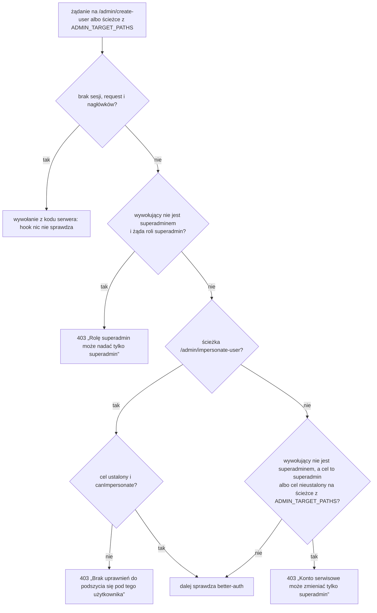
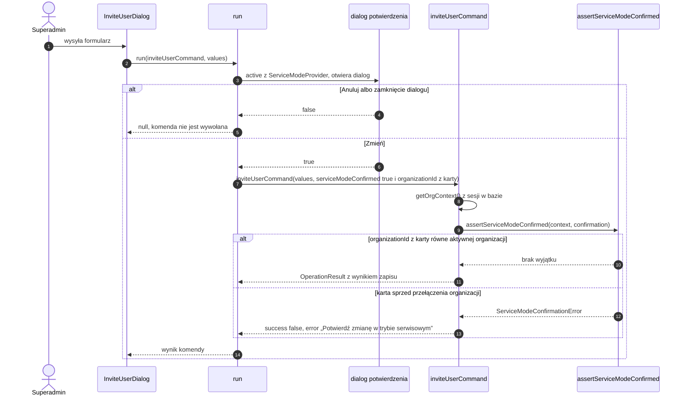

# Superadmin, impersonacja i tryb serwisowy

Po przeczytaniu będziesz wiedzieć:

- kim jest superadmin i co może więcej niż rola globalna `admin`;
- jak hook `before` chroni konta superadmina i których endpointów to dotyczy;
- kto może podszyć się pod kogo i w których miejscach jest to sprawdzane;
- kiedy superadmin pracuje w trybie serwisowym i jak komenda oraz interfejs potwierdzają zmianę danych;
- co się dzieje z kartą otwartą przed przełączeniem organizacji i z wywołaniami `authClient.organization.*`.

Zweryfikowano z kodem: 4a6ffcb, 2026-10-27

Źródła:

- `src/shared/lib/auth/index.ts`
- `src/shared/lib/auth/admin-access.ts`
- `src/shared/lib/auth/admin-guard.ts`
- `src/shared/lib/auth/impersonation-policy.ts`
- `src/shared/lib/auth/org-context.ts`
- `src/shared/lib/auth/service-mode.ts`
- `src/shared/lib/auth/helpers.ts`
- `src/shared/components/service-mode/`
- `src/shared/utils/error-handling.ts`
- `src/features/users/components/`
- `src/features/users/services/commands/`
- `src/features/organizations/services/commands/enter-organization-command.ts`
- `src/features/organizations/services/organization-access.ts`
- `src/features/organizations/services/queries/switchable-organizations-query.ts`
- `src/features/organizations/components/org-switcher.tsx`
- `src/features/organizations/components/enter-organization-list.tsx`
- `src/features/organizations/components/organization-members.tsx`
- `src/features/organizations/components/create-organization-form.tsx`
- `src/app/[locale]/(app)/layout.tsx`
- `src/app/[locale]/(app)/users/page.tsx`
- `src/app/messages/pl.json`
- `src/features/users/i18n/pl.json`
- `scripts/lib/admin-create.ts`
- `src/shared/lib/auth/__tests__/admin-access.test.ts`
- `src/shared/lib/auth/__tests__/admin-guard.test.ts`
- `src/shared/lib/auth/__tests__/auth-config.test.ts`
- `src/shared/lib/auth/__tests__/impersonation-policy.test.ts`
- `src/shared/lib/auth/__tests__/service-mode.test.ts`
- `src/shared/components/service-mode/__tests__/`
- `src/features/users/components/__tests__/`
- `src/features/users/services/commands/__tests__/invite-user-command.test.ts`
- `node_modules/better-auth/dist/plugins/admin/routes.mjs` (better-auth 1.7.13)
- `node_modules/better-auth/dist/plugins/organization/routes/`

Role, macierz dostępu, guardy i `admin:create` opisuje [04-auth-i-role.md](04-auth-i-role.md). Kontekst organizacji, w tym gałąź superadmina w `getOrgContext()`, opisuje [03-dane-i-organizacje.md](03-dane-i-organizacje.md#kontekst-organizacji).

<a id="superadmin"></a>

## Superadmin

Superadmin to konto serwisowe Web Amigos z rolą globalną `superadmin`. W tym pliku „konto serwisowe” i „konto superadmina” znaczą to samo. Web Amigos przekazuje aplikację klientowi, ale przez okres wsparcia potrzebuje do niej dostępu. Administrator po stronie klienta (rola globalna `admin`) zarządza użytkownikami i nie powinien móc usunąć, zablokować ani zmienić kont Web Amigos ([D19](decyzje.md#d19)). Konto superadmina zakłada się świadomie: `npm run admin:create -- --email <email> --role superadmin` ([04-auth-i-role.md](04-auth-i-role.md#admin-create)).

| Co | Rola globalna `admin` | `superadmin` |
| --- | --- | --- |
| Dostęp do definicji modułów (menu i `requireModuleAccess`) | każda definicja | każda definicja |
| Strona „Użytkownicy”: lista wszystkich kont i „Zaproś użytkownika” | tak | tak |
| Endpointy pluginu `admin` na kontach `user` i `admin` (rola, blokada, usunięcie, hasło, dane, sesje) | tak | tak |
| Te same endpointy na koncie `superadmin` | nie, 403 | tak |
| Nadanie roli `superadmin` | nie, 403 | tak |
| Impersonacja | tylko kont `user` i tylko przy `ADMIN_IMPERSONATION=true` | kont `user` i `admin`, bez względu na flagę |
| Praca w organizacji bez członkostwa | nie, `NoOrganizationError` | tak, w trybie serwisowym ([D21](decyzje.md#d21)) |
| Guard `MULTI_ORG=false` | przechodzi | przechodzi |

Strona „Użytkownicy” ma w interfejsie tylko dwie akcje: „Zaproś użytkownika” i „Zaloguj jako”. Pozostałe akcje pluginu `admin` (zmiana roli, blokada, usunięcie, hasło, dane konta, sesje) są dostępne wyłącznie jako endpointy `/api/auth/admin/*`, wołane na przykład przez `authClient.admin.setRole` albo z serwera przez `auth.api.setRole`. Kit nie ma dla nich widoku. Konta superadmina są na liście kont widocznej dla roli globalnej `admin` i `superadmin`, z odznaką „Serwis (Web Amigos)” i bez przycisku „Zaloguj jako”.

<a id="ochrona-kont"></a>

## Ochrona kont serwisowych

Ukrycie przycisku w interfejsie nie chroni konta, bo endpointy pluginu `admin` można wywołać wprost. Dlatego reguły są w hooku `before` better-auth, który działa przed każdym endpointem, także przy wywołaniu `auth.api.*` z serwera ([04-auth-i-role.md](04-auth-i-role.md#hook-before)). Hook sprawdza ścieżkę `/admin/create-user` i każdą ścieżkę z tej listy:

`src/shared/lib/auth/admin-access.ts`

```ts
export const IMPERSONATE_PATH = "/admin/impersonate-user";

export const ADMIN_TARGET_PATHS: readonly string[] = [
  "/admin/set-role",
  "/admin/ban-user",
  "/admin/unban-user",
  "/admin/remove-user",
  "/admin/set-user-password",
  "/admin/update-user",
  IMPERSONATE_PATH,
  "/admin/revoke-user-session",
  "/admin/revoke-user-sessions",
  "/admin/list-user-sessions",
];
```

Lista to wszystkie endpointy pluginu `admin` z better-auth 1.7.13, które działają na wskazanym koncie albo jego sesjach, poza odczytem `/admin/get-user`. Test „zawiera dokładnie ścieżki pluginu admin działające na wskazanym użytkowniku” w `admin-access.test.ts` pilnuje, żeby lista miała dokładnie te dziesięć ścieżek, ale nie porównuje jej z endpointami better-auth, więc nowy endpoint po aktualizacji biblioteki trzeba dopisać ręcznie. Hook nie obejmuje odczytów `/admin/list-users` i `/admin/get-user` ani `/admin/stop-impersonating` i `/admin/has-permission`, więc admin widzi i czyta konta superadmina.

Hook zbiera trzy dane i przekazuje je do `assertAdminActionAllowed` z `src/shared/lib/auth/admin-access.ts`:

- **Rola wywołującego** to `roleFromStored` roli z sesji czytanej z bazy (`getAuthoritativeSessionFromCtx`), a nie z cookie cache. Superadmin zdegradowany w bazie traci uprawnienia od razu, w tej samej sesji (testy „plugin admin: rola aktora z bazy, nie z cookie cache”).
- **Rola celu** to `targetRoleOf(body)` z `src/shared/lib/auth/admin-guard.ts`. Funkcja czyta z bazy rolę konta z pola `userId` (także liczby albo tablicy, zamienionej na napis) i rolę właściciela sesji z pola `sessionToken`, a gdy są oba, bierze wyższą. Gdy żadnego konta nie znajdzie, wynik to `null`, czyli cel nieustalony.
- **Żądana rola** to `requestedRoleOf(body)`: pola `role` i `data.role`, napis albo tablica. Gdy którakolwiek wartość to `superadmin`, wynik to `superadmin`.



Po hooku better-auth sprawdza uprawnienia roli wywołującego ([04-auth-i-role.md](04-auth-i-role.md#referencja-uprawnienia)). Konto `user` przechodzi więc hook na koncie innego `user`, ale endpoint odrzuca je z komunikatem better-auth po angielsku. Bez sesji, ale z nagłówkami, hook traktuje wywołującego jak `user`: na koncie superadmina i przy nieustalonym celu zwraca 403, a gdy przepuści żądanie, endpoint zwraca 401.

Co z tego wynika:

- Admin na koncie superadmina dostaje 403 na każdej ścieżce z listy i nic nie trafia do bazy. Dotyczy to też wariantów obejścia: `userId` jako tablica, `userId` zwykłego konta razem z tokenem sesji superadmina, wywołanie przez handler HTTP i przez `request` bez `headers` (testy w `auth-config.test.ts`).
- Cel nieustalony, na przykład nieistniejący `userId` albo nieznany token, daje adminowi 403, zamiast przepuścić żądanie dalej.
- Superadmin może działać na koncie innego superadmina, z wyjątkiem impersonacji.
- Admin może nadawać i odbierać rolę `admin` oraz zakładać konta z rolą `user` albo `admin`.

<a id="wywolania-z-serwera"></a>

### Wywołania z kodu serwera

Hook pomija żądanie bez sesji, bez `request` i bez nagłówków. Tak wygląda wywołanie `auth.api.createUser({ body })` w `npm run admin:create`, które dzięki temu zakłada konto `superadmin` (test „bez nagłówków i bez sesji tworzy konto z rolą superadmin”). Ten sam wyjątek dotyczy każdego takiego wywołania, a endpoint `/admin/create-user` bez sesji i bez nagłówków też nie sprawdza uprawnień. Komenda, która woła API pluginu `admin` w imieniu zalogowanego użytkownika, musi więc przekazać `headers` żądania. Bez nich utworzy konto z dowolną rolą, także `superadmin`, bez żadnej kontroli, a pozostałe endpointy pluginu odrzucą żądanie: zwykle 401, a `/admin/set-role` 400 „Headers is required”, bo ma `requireHeaders: true`. Puste nagłówki (`new Headers()`) już nie są wyjątkiem: bez sesji żądanie zostaje odrzucone.

<a id="konto-po-wsparciu"></a>

### Konto serwisowe po okresie wsparcia

Dostęp Web Amigos odcina tylko superadmin (decyzja 1 w [D19](decyzje.md#d19)). W kodzie wygląda to tak:

- better-auth nie pozwala usunąć własnego konta przez `/admin/remove-user` („You cannot remove yourself”), a admin klienta dostaje 403. Ostatniego konta `superadmin` nie usunie więc nikt przez API, dopóki ma ono tę rolę.
- Superadmin może zmienić własną rolę przez `/admin/set-role`. Po zmianie na `user` konto przestaje być chronione i admin klienta może je usunąć przez `/admin/remove-user`.
- Sama zmiana roli na `user` nie odcina dostępu do danych. Konto założone przez `admin:create` ma członkostwo `owner` w najstarszej organizacji i zachowuje je po zmianie roli.

Kolejne kroki przy przekazaniu aplikacji opisuje [10-wdrozenie.md](10-wdrozenie.md).

<a id="impersonacja"></a>

## Impersonacja

Impersonacja to praca na koncie innego użytkownika bez jego hasła. Pomaga zobaczyć aplikację oczami konkretnej osoby, ale daje pełny dostęp do jej konta, dlatego zależy od roli ([D20](decyzje.md#d20)). Regułę zapisuje `canImpersonate` z `src/shared/lib/auth/impersonation-policy.ts`, sprawdzone w teście dla wszystkich 18 kombinacji:

| Kto \ pod kogo | `user` | `admin` | `superadmin` |
| --- | --- | --- | --- |
| `superadmin` | tak | tak | nie |
| `admin` przy `ADMIN_IMPERSONATION=false` (domyślnie) | nie | nie | nie |
| `admin` przy `ADMIN_IMPERSONATION=true` | tak | nie | nie |
| `user` | nie | nie | nie |

Nikt nie podszyje się pod własne konto ani pod konto, którego nie ma. Na serwerze regułę sprawdzają dwa niezależne miejsca:

| Warstwa | Co sprawdza | Co zatrzymuje |
| --- | --- | --- |
| Hook `before` na `/admin/impersonate-user` | `canImpersonate` z rolą celu czytaną z bazy | każdą kombinację z „nie” w tabeli, z komunikatem „Brak uprawnień do podszycia się pod tego użytkownika” |
| Uprawnienia pluginu `admin` | `user:impersonate` (rola `admin` ma je tylko przy włączonej fladze), a przy celu z rolą `admin` lub `superadmin` dodatkowo `user:impersonate-admins` (ma je tylko `superadmin`) | `admin` bez flagi i `admin` wobec innego admina, nawet gdyby hook zawiódł |

W interfejsie przycisk „Zaloguj jako” (ikona z podpowiedzią) jest w wierszu konta na stronie „Użytkownicy” tylko wtedy, gdy wiersz nie jest własnym kontem, a `canImpersonate` dla roli oglądającego, roli z wiersza i flagi zwraca prawdę (`buildUserAccountColumns` w `user-account-columns.tsx`). To wygoda, nie ochrona.

Przebieg:

1. `UsersManager` woła `authClient.admin.impersonateUser({ userId })`. better-auth tworzy sesję konta docelowego z polem `impersonatedBy` równym identyfikatorowi wywołującego, ważną godzinę (domyślne `impersonationSessionDuration`), a token własnej sesji wywołującego zapisuje w ciasteczku `admin_session`.
2. Przeglądarka woła `logImpersonationStartCommand()`, które zapisuje w logu `[USERS] Impersonation started` z `impersonatorUserId` i `targetUserId`, i przechodzi na `/dashboard`.
3. Cała aplikacja działa jak konto docelowe: `getOrgContext()` zwraca jego role i jego aktywną organizację, ustawioną przy tworzeniu sesji. Layout pokazuje u góry pasek „Zalogowano jako `<imię>` - używasz konta innego użytkownika.” z przyciskiem „Wróć do własnego konta”.
4. Przycisk najpierw woła `logImpersonationStopCommand()` (`[USERS] Impersonation stopped`), bo zakończenie impersonacji usuwa z sesji znacznik `impersonatedBy`. Potem `authClient.admin.stopImpersonating()` przywraca sesję z `admin_session`, a przeglądarka przechodzi na `/users`.

Zapis w logu zależy od przeglądarki: wywołuje go interfejs po udanym podszyciu. Wywołanie `/api/auth/admin/impersonate-user` z pominięciem interfejsu nie zostawia wpisu `[USERS] Impersonation started`, a na produkcji wpisy trafiają gdziekolwiek tylko z ustawionym eksportem OTLP ([D15](decyzje.md#d15)). Sesja impersonacji należy do konta docelowego, więc admin może ją unieważnić (`/admin/revoke-user-session` z jej tokenem albo `/admin/revoke-user-sessions` dla konta docelowego), także gdy podszywa się superadmin.

<a id="tryb-serwisowy"></a>

## Tryb serwisowy

Superadmin musi widzieć i poprawiać dane w każdej organizacji klienta, także w takiej, do której nie należy. Kit pozwala mu wejść do dowolnej organizacji, ale zawsze jednej naraz i z tym samym filtrem `organizationId` co wszyscy, bez widoków „wszystkie organizacje naraz” ([D21](decyzje.md#d21)). Praca w organizacji bez członkostwa to tryb serwisowy. Każda zmiana danych w tym trybie wymaga potwierdzenia, bo superadmin działa w niej z uprawnieniami ownera w cudzej firmie ([D22](decyzje.md#d22)).

<a id="kiedy-tryb-serwisowy"></a>

### Kiedy superadmin jest w trybie serwisowym

`getOrgContext()` zwraca `serviceMode: true` i `orgRole: "owner"` tylko wtedy, gdy konto ma rolę globalną dokładnie `superadmin` (`toUserRole`), aktywna organizacja istnieje, a konto nie ma w niej członkostwa. Z członkostwem superadmin dostaje rolę z członkostwa i `serviceMode: false`. Bez aktywnej organizacji albo z organizacją, której nie ma w bazie, dostaje `NoOrganizationError` ([03-dane-i-organizacje.md](03-dane-i-organizacje.md#kontekst-organizacji)).

Superadmin założony przez `admin:create` ma członkostwo `owner` w najstarszej organizacji, więc w niej pracuje jak zwykły owner, bez paska i bez dialogu. Tryb serwisowy pojawia się w każdej organizacji, w której konto superadmina nie ma członkostwa: przy `MULTI_ORG=true` w organizacjach innych niż najstarsza, a w obu trybach także po usunięciu członkostwa i dla konta założonego przez `/admin/create-user`, który nie tworzy członkostwa. Takie konto przy `MULTI_ORG=false` pracuje w jedynej organizacji w trybie serwisowym.

<a id="wejscie-do-organizacji"></a>

### Wejście do organizacji

- **Przełącznik** (`OrgSwitcher` nad treścią strony) dla superadmina pokazuje wszystkie organizacje posortowane po nazwie (`getSwitchableOrganizationsQuery`). Lista jest widoczna, gdy organizacji jest więcej niż jedna.
- **Strona `/no-organization`** pokazuje tę samą listę jako „Wejdź do organizacji” (`EnterOrganizationList`) i po wyborze przenosi na `/dashboard`.
- Oba miejsca wołają `enterOrganizationCommand(organizationId)`. Komenda czyta sesję z bazy, pyta `canEnterOrganization` (superadmin: organizacja istnieje; inni: członkostwo) i zmienia `activeOrganizationId` tylko bieżącej sesji. Przy odmowie zwraca „Brak dostępu do organizacji”. Przebieg pokazuje [03-dane-i-organizacje.md](03-dane-i-organizacje.md#aktywna-organizacja).
- Wejście nie zmienia danych organizacji, więc nie ma dialogu, a komenda nie woła `getOrgContext()` ani `assertServiceModeConfirmed`.
- Po zalogowaniu superadmin bez członkostw dostaje najstarszą organizację jako aktywną, więc przy `MULTI_ORG=false` od razu pracuje w jedynej organizacji.

<a id="pasek"></a>

### Pasek trybu serwisowego

Layout `(app)` przekazuje do `ServiceModeProvider` trzy wartości: `active` z `serviceMode` kontekstu, `organizationId` aktywnej organizacji i jej nazwę z listy przełącznika. `ServiceModeBanner` przy `active` renderuje u góry strony pasek z rolą `status` i tekstem „Tryb serwisowy: `<nazwa organizacji>`” (klucz `serviceMode.banner`, [teksty](#referencja-teksty)). Strony poza grupą `(app)`, czyli `(auth)`, `/no-organization` i `/accept-invitation/<id>`, paska nie mają.

<a id="kontrakt-potwierdzenia"></a>

### Kontrakt potwierdzenia w komendzie

Sam dialog w interfejsie nie wystarczy: komponent, który go nie użyje, pominąłby przypomnienie po cichu. Dlatego komenda na danych organizacji sprawdza potwierdzenie na serwerze. Kontrakt jest w [AGENTS.md](../AGENTS.md#dane-i-organizacje):

- sygnatura `(input: unknown, confirmation?: unknown)`;
- zaraz po `getOrgContext()` albo `requireModuleAccess()` wywołanie `assertServiceModeConfirmed(context, confirmation)`, przed pierwszym dostępem do Prismy.

`src/shared/lib/auth/service-mode.ts`

```ts
function confirmsOrganization(
  confirmation: unknown,
  organizationId: string,
): boolean {
  if (typeof confirmation !== "object" || confirmation === null) {
    return false;
  }
  const candidate = confirmation as Record<string, unknown>;
  return (
    candidate.serviceModeConfirmed === true &&
    candidate.organizationId === organizationId
  );
}

export function assertServiceModeConfirmed(
  context: OrgContext,
  confirmation: unknown,
): void {
  if (confirmation === undefined && !context.serviceMode) {
    return;
  }
  if (!confirmsOrganization(confirmation, context.organizationId)) {
    throw new ServiceModeConfirmationError();
  }
}
```

| Kontekst | `confirmation` | Wynik |
| --- | --- | --- |
| poza trybem serwisowym | brak (`undefined`) | przechodzi |
| poza trybem serwisowym | `{ serviceModeConfirmed: true, organizationId }` z aktywną organizacją | przechodzi |
| poza trybem serwisowym | potwierdzenie innej organizacji albo każda inna wartość, na przykład `null` | błąd |
| w trybie serwisowym | `{ serviceModeConfirmed: true, organizationId }` z aktywną organizacją | przechodzi |
| w trybie serwisowym | każda inna wartość: brak, `null`, `true`, `"yes"`, `{}`, `serviceModeConfirmed` inne niż `true`, brak albo inny `organizationId` (także inna wielkość liter albo dłuższy identyfikator) | błąd |

Porównanie jest z `organizationId` z kontekstu, czyli z sesji w bazie, a nie z wartością podaną przez przeglądarkę. Błąd to `ServiceModeConfirmationError`, podklasa `DomainError`, więc `handleCommandError` zwraca jego komunikat: `{ success: false, error: "Potwierdź zmianę w trybie serwisowym" }`. To, że komenda woła `assertServiceModeConfirmed` przed Prismą, sprawdza test architektury ([D24](decyzje.md#d24)). Przypadki z tabeli sprawdza `service-mode.test.ts`, także testami właściwości, a kontrakt w komendzie testy „tryb serwisowy” i „poza trybem serwisowym” w `invite-user-command.test.ts`.

<a id="run"></a>

### Interfejs: `useServiceModeAction().run`

Komponent nie woła komendy na danych organizacji bezpośrednio, tylko przez `run` z hooka `useServiceModeAction()` (`src/shared/components/service-mode/use-service-mode-action.tsx`). Hook czyta stan trybu z `ServiceModeProvider`:

`src/shared/components/service-mode/use-service-mode-action.tsx`

```tsx
  const run = useCallback(
    async <TInput, TResult>(
      action: ServiceModeAction<TInput, TResult>,
      input: TInput,
    ): Promise<TResult | null> => {
      if (!active) {
        return action(input);
      }
      const confirmed = await askForConfirmation();
      if (!confirmed) {
        return null;
      }
      return action(input, { serviceModeConfirmed: true, organizationId });
    },
    [active, organizationId, askForConfirmation],
  );
```

Poza trybem serwisowym `run` woła komendę od razu, bez potwierdzenia. W trybie serwisowym najpierw pyta w dialogu, a komendę woła dopiero po „Zmień”. `organizationId` w potwierdzeniu to organizacja z ostatniego renderowania layoutu w tej karcie.

Przebieg w trybie serwisowym, na przykładzie „Zaproś użytkownika”:



Dialog ma tytuł „Tryb serwisowy”, treść „Zmieniasz dane organizacji `<nazwa>` jako serwis Web Amigos.” i przyciski „Anuluj” oraz „Zmień” ([teksty](#referencja-teksty)). `run` nie ponawia komendy po błędzie: wynik z błędem trafia do komponentu, który pokazuje komunikat.

Zasady dla komponentu:

- Wyrenderuj `dialog` zwrócony przez hook, inaczej okno się nie pokaże, a `run` będzie czekać.
- Obsłuż `null`: oznacza „Anuluj” albo zamknięcie okna, czyli brak wywołania komendy. Nie traktuj go jak błędu.
- Nie pisz własnego dialogu ([D22](decyzje.md#d22)). Drugie `run` przed decyzją kończy pierwsze wynikiem `null`, a „Zmień” wykonuje tylko drugie.

Wzór z `InviteUserDialog`:

`src/features/users/components/invite-user-dialog.tsx`

```tsx
  async function onSubmit(values: InviteUserValues) {
    const result = await serviceModeAction.run(inviteUserCommand, values);
    if (result === null) {
      return;
    }
    if (result.success) {
// …
    } else {
      toast.error(result.error ?? t("toast-invite-error"));
    }
  }
```

Zachowanie `run` sprawdza `use-service-mode-action.test.tsx` (w tym dwa uruchomienia przed decyzją i zmiana stanu providera bez przemontowania), a dialog w formularzu testy „w trybie serwisowym” w `invite-user-dialog.test.tsx`.

<a id="nieaktualna-karta"></a>

### Karta otwarta przed przełączeniem organizacji

Aktywna organizacja jest zapisana w sesji, a sesję dzielą wszystkie karty przeglądarki ([03-dane-i-organizacje.md](03-dane-i-organizacje.md#aktywna-organizacja)). Gdy w jednej karcie zmienisz organizację, druga karta pokazuje starą, dopóki jej nie odświeżysz. Co się stanie, gdy w starej karcie wyślesz formularz przez `run`:

| Stara karta pokazuje | W drugiej karcie wybrano | Co wysyła stara karta | Kontekst na serwerze | Wynik |
| --- | --- | --- | --- | --- |
| organizację X w trybie serwisowym | inną organizację Y | dialog z nazwą X, potem potwierdzenie X | Y | błąd potwierdzenia, nic nie zapisane |
| organizację A z członkostwem | organizację X w trybie serwisowym | brak dialogu i brak potwierdzenia | X w trybie serwisowym | błąd potwierdzenia, nic nie zapisane |
| organizację A z członkostwem | organizację B, też z członkostwem | brak potwierdzenia | B poza trybem serwisowym | zapis w B, chociaż karta pokazuje A |

Ochrona przed starą kartą działa więc tylko wtedy, gdy któraś z dwóch organizacji jest w trybie serwisowym. Poza trybem serwisowym `run` nie wysyła `organizationId`, a `assertServiceModeConfirmed` przepuszcza brak potwierdzenia, więc komenda zapisuje dane w organizacji z sesji. Tak samo działa każda komenda kitu dla każdego konta z kilkoma członkostwami. Po błędzie komponent pokazuje komunikat, a aktualny stan karta pokaże dopiero po odświeżeniu.

Komenda wywołana z interfejsu bezpośrednio, bez `run`, nie wysyła potwierdzenia, więc w trybie serwisowym zawsze kończy się błędem. Żaden test tego nie wychwyci, bo test architektury sprawdza komendę, a nie komponent.

<a id="authclient-organization"></a>

### Wywołania `authClient.organization.*`

Dialog i `assertServiceModeConfirmed` obejmują komendy kitu. Wywołania `authClient.organization.*` idą do endpointów pluginu `organization` w better-auth (`/api/auth/organization/*`), które nie wiedzą o trybie serwisowym: `run` ich nie obsługuje, a serwer nie sprawdza potwierdzenia. W praktyce:

- **Superadmin w trybie serwisowym nie zmieni przez nie danych organizacji.** Endpointy członków, zaproszeń, aktualizacji i usuwania organizacji wymagają członkostwa wywołującego i bez niego kończą się błędem (`findMemberByOrgId` w `node_modules/better-auth/dist/plugins/organization/routes/`). Rola `owner` w trybie serwisowym istnieje tylko w kontekście z `getOrgContext()`, a nie w better-auth.
- **W rdzeniu takie wywołania są tylko w komponentach, których superadmin nie używa do danych obcej organizacji.** `OrganizationMembers` (zaproszenia, role i usuwanie członków) strona „Użytkownicy” pokazuje tylko kontom z rolą globalną `user`. `authClient.organization.create` w formularzu „Utwórz organizację” zakłada nową organizację z wywołującym jako `owner` i ustawia ją jako aktywną, więc nie zmienia organizacji, w której superadmin był w trybie serwisowym.
- **Moduł, który ma pozwolić superadminowi zmieniać dane w trybie serwisowym, robi to komendą kitu**: `getOrgContext()`, `assertServiceModeConfirmed`, Prisma z filtrem `organizationId` i wywołanie z UI przez `run`. Wywołanie endpointu better-auth zamiast komendy nie pokaże dialogu i nie zadziała bez członkostwa.
- Wywołania `authClient.admin.*` (impersonacja) działają na kontach, a nie na danych organizacji, więc też nie przechodzą przez dialog.

<a id="referencja"></a>

## Referencja

<a id="referencja-sciezki-admin"></a>

### Ścieżki pluginu `admin` i hook `before`

| Ścieżka | Cel w ciele żądania | W `ADMIN_TARGET_PATHS` | Hook sprawdza |
| --- | --- | --- | --- |
| `/admin/set-role` | `userId`, `role` | tak | żądaną rolę i cel |
| `/admin/ban-user` | `userId` | tak | cel |
| `/admin/unban-user` | `userId` | tak | cel |
| `/admin/remove-user` | `userId` | tak | cel |
| `/admin/set-user-password` | `userId` | tak | cel |
| `/admin/update-user` | `userId`, `data` | tak | żądaną rolę (`data.role`) i cel |
| `/admin/impersonate-user` | `userId` | tak | `canImpersonate` |
| `/admin/revoke-user-session` | `sessionToken` | tak | cel (właściciel sesji) |
| `/admin/revoke-user-sessions` | `userId` | tak | cel |
| `/admin/list-user-sessions` | `userId` | tak | cel |
| `/admin/create-user` | `role`, `data.role` | nie, osobno w `isGuardedAdminPath` | żądaną rolę; cel tylko wtedy, gdy ciało ma `userId` albo `sessionToken` (`userId` superadmina daje adminowi 403) |
| `/admin/list-users`, `/admin/get-user`, `/admin/stop-impersonating`, `/admin/has-permission` | — | nie | nic |

<a id="referencja-tryb-serwisowy"></a>

### Elementy trybu serwisowego

| Element | Plik | Rola |
| --- | --- | --- |
| `OrgContext.serviceMode` | `src/shared/lib/auth/org-context.ts` | `true` tylko dla superadmina bez członkostwa w istniejącej aktywnej organizacji. |
| `ServiceModeConfirmation` | `src/shared/lib/auth/service-mode.ts` | Typ `{ serviceModeConfirmed: true; organizationId: string }`. |
| `assertServiceModeConfirmed(context, confirmation)` | `src/shared/lib/auth/service-mode.ts` | [Kontrakt](#kontrakt-potwierdzenia). |
| `ServiceModeConfirmationError` | `src/shared/lib/auth/service-mode.ts` | `DomainError` z komunikatem „Potwierdź zmianę w trybie serwisowym”. |
| `ServiceModeProvider` | `src/shared/components/service-mode/service-mode-provider.tsx` | Props `active`, `organizationId`, `organizationName`. Bez providera tryb jest nieaktywny. |
| `useServiceMode()` | `src/shared/components/service-mode/service-mode-provider.tsx` | Stan z providera. |
| `useServiceModeAction()` | `src/shared/components/service-mode/use-service-mode-action.tsx` | `{ run, dialog }`; `run(command, input)` zwraca wynik komendy albo `null`. |
| `ServiceModeBanner` | `src/shared/components/service-mode/service-mode-banner.tsx` | Pasek „Tryb serwisowy: `<nazwa>`”. |
| `enterOrganizationCommand(organizationId)` | `src/features/organizations/services/commands/enter-organization-command.ts` | Zmienia aktywną organizację bieżącej sesji. |

<a id="referencja-teksty"></a>

### Teksty paska i dialogu

Namespace `serviceMode` we wspólnych tekstach `src/app/messages/pl.json`. `{name}` to nazwa aktywnej organizacji.

| Klucz | Tekst |
| --- | --- |
| `banner` | Tryb serwisowy: {name} |
| `dialog-title` | Tryb serwisowy |
| `dialog-description` | Zmieniasz dane organizacji {name} jako serwis Web Amigos. |
| `dialog-cancel` | Anuluj |
| `dialog-confirm` | Zmień |

<a id="referencja-komunikaty"></a>

### Komunikaty

| Komunikat | Skąd | Kiedy |
| --- | --- | --- |
| „Konto serwisowe może zmieniać tylko superadmin” | `assertAdminActionAllowed` (403) | Wywołujący inny niż superadmin, cel `superadmin` albo nieustalony na ścieżce z `ADMIN_TARGET_PATHS`. |
| „Rolę superadmin może nadać tylko superadmin” | `assertAdminActionAllowed` (403) | Wywołujący inny niż superadmin żąda roli `superadmin`, także w tablicy ról. |
| „Brak uprawnień do podszycia się pod tego użytkownika” | `assertAdminActionAllowed` (403) | Impersonacja, na którą `canImpersonate` nie pozwala, albo cel nieustalony. |
| „Nie udało się zalogować jako ten użytkownik” | `UsersManager` | Błąd `authClient.admin.impersonateUser`. |
| „Zalogowano jako `<imię>` - używasz konta innego użytkownika.” | `ImpersonationBanner` | Sesja z `impersonatedBy`. |
| „Nie udało się zakończyć impersonacji” | `ImpersonationBanner` | Błąd `authClient.admin.stopImpersonating`. |
| „Serwis (Web Amigos)” | `user-account-columns.tsx` | Odznaka konta `superadmin` na liście kont. |
| „Tryb serwisowy: `<nazwa>`” | `ServiceModeBanner` | Tryb serwisowy. |
| „Zmieniasz dane organizacji `<nazwa>` jako serwis Web Amigos.” | dialog z `useServiceModeAction` | `run` w trybie serwisowym. |
| „Potwierdź zmianę w trybie serwisowym” | `ServiceModeConfirmationError` | [Kontrakt](#kontrakt-potwierdzenia). |
| „Brak dostępu do organizacji” | `enterOrganizationCommand` | Niepoprawny identyfikator, brak sesji, brak prawa wejścia albo błąd zapisu. |
