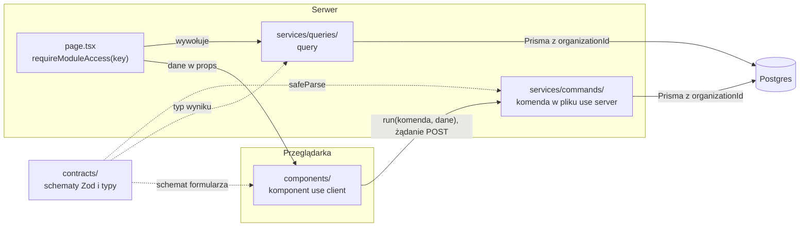

# Wzorce kodu

Po przeczytaniu będziesz wiedzieć:

- jak napisać komendę na danych organizacji: sygnaturę, kolejność sprawdzeń, wynik i obsługę błędów;
- jak napisać query, które sprawdza sesję i nie pokaże danych innej organizacji;
- gdzie leżą schematy Zod i typy oraz jak formularz i komenda korzystają z jednego schematu;
- jak komponent wywołuje komendę przez `useServiceModeAction().run` i dlaczego zmiana danych nie może się dziać w `page.tsx`;
- które reguły stylu sprawdza ESLint, które hook Claude Code, a których pilnuje tylko przegląd kodu;
- co sprawdza test architektury `server-entrypoints-guard.test.ts`, jak naprawić jego błąd i jak dodać wyjątek.

Zweryfikowano z kodem: 3e92d1f, 2026-11-12 (wiersze „`name` klasy błędu napisem, a nie nazwą klasy” i „Klasa dziedzicząca wprost po `Error` ma własne `name`” w [Regułach stylu](#reguly-stylu)); pozostała część pliku: 4a6ffcb, 2026-10-27

Źródła:

- `src/shared/types/common.ts`
- `src/shared/utils/error-handling.ts`
- `src/shared/lib/auth/service-mode.ts`
- `src/shared/lib/auth/org-context.ts`
- `src/shared/lib/auth/require-module-access.ts`
- `src/shared/lib/auth/helpers.ts`
- `src/shared/components/service-mode/use-service-mode-action.tsx`
- `src/features/users/services/commands/invite-user-command.ts`
- `src/features/users/services/commands/impersonation-commands.ts`
- `src/features/users/services/queries/user-account-queries.ts`
- `src/features/users/contracts/`
- `src/features/users/components/invite-user-dialog.tsx`
- `src/features/auth/services/commands/change-password-command.ts`
- `src/features/auth/contracts/auth.schemas.ts`
- `src/features/organizations/services/`
- `src/features/organizations/contracts/`
- `src/features/organizations/components/org-switcher.tsx`
- `src/app/[locale]/(app)/users/page.tsx`
- `eslint.config.mjs`
- `tsconfig.json`
- `.lintstagedrc.json`
- `.husky/pre-commit`
- `.prettierrc`
- `stryker.config.json`
- `.claude/settings.json`
- `.claude/hooks/block-comments.mjs`
- `.claude/hooks/protect-tests.mjs`
- `src/__tests__/server-entrypoints-guard.test.ts`
- `src/shared/components/service-mode/__tests__/use-service-mode-action.test.tsx`
- `src/features/users/services/commands/__tests__/invite-user-command.test.ts`
- `.claude/hooks/block-comments.test.mjs`
- `AGENTS.md`
- `node_modules/eslint-config-next/dist/typescript.js` (eslint-config-next 16.3.8)
- `node_modules/next/dist/client/components/not-found.js` (Next.js 16.3.8)
- `node_modules/next/dist/server/app-render/action-handler.js`
- `node_modules/next/dist/client/components/app-router.js`
- `node_modules/next/dist/client/components/router-reducer/reducers/server-action-reducer.js`
- `node_modules/next/dist/docs/01-app/03-api-reference/04-functions/redirect.md`
- `node_modules/next/dist/docs/01-app/03-api-reference/04-functions/not-found.md`
- `node_modules/react-hook-form/dist/index.esm.mjs` (react-hook-form 7.91.0, `handleSubmit`)
- `node_modules/better-auth/dist/cookies/index.mjs` (better-auth 1.7.13)
- `node_modules/next/dist/docs/01-app/02-guides/data-security.md`
- `node_modules/next/dist/docs/01-app/01-getting-started/05-server-and-client-components.md`

Ten rozdział pokazuje, jak pisać kod feature tak, jak napisany jest rdzeń kitu. Źródłem reguł pozostaje [AGENTS.md](../AGENTS.md). Tutaj są ich powody, prawdziwy kod z repozytorium i informacja, co każdej reguły pilnuje. Tam, gdzie kod rdzenia odbiega od wzorca, tekst mówi o tym wprost i wyjaśnia dlaczego. Gdzie leżą pliki feature, opisuje [Anatomia feature](02-architektura.md#anatomia-feature), a cały nowy feature krok po kroku buduje tutorial [09-nowy-modul.md](09-nowy-modul.md).

Pojęcia używane w rozdziale:

- **Akcja serwerowa**: eksportowana funkcja z pliku, który zaczyna się od dyrektywy `"use server"`. Next.js udostępnia ją jako endpoint `POST`, więc żądanie do niej może wysłać każdy, także z pominięciem interfejsu. Dlatego akcja sama sprawdza sesję i uprawnienia.
- **Komenda**: akcja serwerowa w `services/commands/`, która zapisuje dane ([Pojęcia](decyzje.md#pojęcia)). **Komenda na danych organizacji** bierze organizację z `getOrgContext()` albo `requireModuleAccess()` i podlega kontraktowi trybu serwisowego.
- **Query**: funkcja w `services/queries/`, która czyta dane dla strony. Woła ją kod serwera, a nie przeglądarka.
- **Guard sesji**: funkcja, która sprawdza sesję, zanim kod sięgnie do danych, na przykład `getOrgContext()`. **Kontekst organizacji** to wynik `getOrgContext()`: `{ userId, organizationId, orgRole, userRole, serviceMode }` ([03-dane-i-organizacje.md](03-dane-i-organizacje.md#kontekst-organizacji)).
- **Tryb serwisowy**: superadmin pracuje w organizacji, do której nie należy. Każda zmiana danych wymaga wtedy potwierdzenia w dialogu ([04b-superadmin-i-tryb-serwisowy.md](04b-superadmin-i-tryb-serwisowy.md#tryb-serwisowy)).

<a id="czesci-feature"></a>

## Jak części feature współpracują



Odczyt idzie przez stronę: `page.tsx` sprawdza dostęp do feature, woła query i przekazuje dane komponentowi. Zapis idzie z komponentu: komponent woła komendę przez `run`, a komenda sama sprawdza wejście, sesję, uprawnienia i tryb serwisowy, zapisuje dane i zwraca wynik. Komponent pokazuje wynik i odświeża stronę, więc query wykonuje się ponownie. Z `contracts/` korzystają obie strony, dlatego ten katalog nie może zależeć od kodu serwera.

| Część | Plik | Kto woła | Sprawdza sesję | Zwraca |
| --- | --- | --- | --- | --- |
| Strona | `src/app/[locale]/(app)/<x>/page.tsx` | Next.js przy żądaniu GET | `requireModuleAccess(key)` ([D11](decyzje.md#d11)) | JSX |
| Query | `src/features/<x>/services/queries/*.ts` | strona albo inny kod serwera | guard sesji, zwykle `getOrgContext()` | dane |
| Komenda | `src/features/<x>/services/commands/*.ts` z `"use server"` | komponent przez `run` | `requireModuleAccess(key)` albo `getOrgContext()`, potem `assertServiceModeConfirmed` | `OperationResult<T>` |
| Kontrakt | `src/features/<x>/contracts/*.schemas.ts`, `*.types.ts` | komponent, komenda, query | nie dotyczy | nie dotyczy |
| Komponent | `src/features/<x>/components/*.tsx` z `"use client"` | strona | nie dotyczy | nie dotyczy |

<a id="komenda"></a>

## Komenda

<a id="kontrakt-komendy"></a>

### Kontrakt i jego powody

Kontrakt komendy na danych organizacji opisuje [AGENTS.md](../AGENTS.md#dane-i-organizacje). Każdy punkt ma powód:

1. **Plik zaczyna się od `"use server"`, a eksportowana jest tylko komenda.** Każdy eksport takiego pliku jest publicznym endpointem `POST`. Funkcje pomocnicze zostają bez `export`, więc z przeglądarki nie da się ich wywołać, a test architektury sprawdza każdy eksport ([Test architektury](#test-architektury)).
2. **Sygnatura `(input: unknown, confirmation?: unknown)`.** Typy TypeScriptu nie istnieją w żądaniu z przeglądarki: endpoint może dostać dowolne dane. `unknown` mówi o tym prawdę, a TypeScript nie pozwoli użyć pól wejścia, zanim kod ich nie sprawdzi. `confirmation` jest osobnym parametrem, bo dokleja go `run` w trybie serwisowym i niesie `organizationId` karty, a nie dane formularza ([D22](decyzje.md#d22)).
3. **Wejście sprawdza schemat Zod z `contracts/`** (`safeParse`), ten sam, którego używa formularz ([Kontrakty](#kontrakty)).
4. **Organizacja i uprawnienia pochodzą z guardu**: `requireModuleAccess(key)` albo `getOrgContext()`. `organizationId` bierzesz zawsze z kontekstu, nigdy z `input`, bo identyfikator z przeglądarki może wskazywać cudzą organizację ([D07](decyzje.md#d07)).
5. **Zaraz po kontekście `assertServiceModeConfirmed(context, confirmation)`, przed pierwszym użyciem Prismy.** W trybie serwisowym bez ważnego potwierdzenia komenda kończy się błędem, zanim cokolwiek zapisze. Tabelę przypadków ma [04b-superadmin-i-tryb-serwisowy.md](04b-superadmin-i-tryb-serwisowy.md#kontrakt-potwierdzenia).
6. **Całe ciało w `try`, a `catch` oddaje błąd do `handleCommandError(error, "<komunikat>")`.** Komenda zwraca `OperationResult<T>`, więc komponent zawsze dostaje obiekt `{ success, data?, error? }`, a nie wyjątek z serwera z technicznym komunikatem ([Wynik i błędy](#wynik-i-bledy)).

Test architektury sprawdza z tej listy dwie rzeczy: że guard z punktu 4 i `assertServiceModeConfirmed` z punktu 5 są wywołane przed Prismą. Resztę kontraktu sprawdzają tylko przegląd kodu i testy komendy.

<a id="przyklad-komendy"></a>

### Przykład z rdzenia: `inviteUserCommand`

Jedyna komenda rdzenia, która spełnia kontrakt. Admin globalny zaprasza nią użytkownika do aktywnej organizacji: komenda tworzy zaproszenie, konto i wysyła mail z linkiem do ustawienia hasła ([04-auth-i-role.md](04-auth-i-role.md#zapros-uzytkownika)).

`src/features/users/services/commands/invite-user-command.ts`

```ts
"use server";

import { randomBytes } from "node:crypto";
import { headers } from "next/headers";
import { revalidatePath } from "next/cache";
import { prisma } from "@/shared/lib/prisma";
import { auditActor, trackAudit } from "@/shared/lib/audit";
import { getAdminUserOrNull } from "@/shared/lib/auth/helpers";
import { getOrgContext } from "@/shared/lib/auth/org-context";
import { assertServiceModeConfirmed } from "@/shared/lib/auth/service-mode";
import { logger } from "@/shared/lib/logger";
import { handleCommandError } from "@/shared/utils/error-handling";
import { createWelcomeSetPasswordUrl } from "@/shared/lib/auth/welcome-set-password";
import { sendWelcomeSetPasswordEmail } from "@/shared/lib/mailer";
import { inviteUserSchema } from "../../contracts/user-account.schemas";
import type { OperationResult } from "@/shared/types/common";

type RequestHeaders = Awaited<ReturnType<typeof headers>>;

const INVITATION_TTL_MS = 48 * 60 * 60 * 1000;

export async function inviteUserCommand(
  input: unknown,
  confirmation?: unknown,
): Promise<OperationResult<{ userId: string }> & { warning?: "mail-failed" }> {
  try {
    const admin = await getAdminUserOrNull();
    if (!admin) {
      return { success: false, error: "Brak uprawnień" };
    }

    const parsed = inviteUserSchema.safeParse(input);
    if (!parsed.success) {
      return {
        success: false,
        error: parsed.error.issues[0]?.message ?? "Nieprawidłowe dane",
      };
    }
    const { name, email, role } = parsed.data;

    const context = await getOrgContext();
    assertServiceModeConfirmed(context, confirmation);

    const existing = await prisma.user.findUnique({
      where: { email },
      select: { id: true },
    });
    if (existing) {
      return {
        success: false,
        error: "Użytkownik z tym adresem już istnieje",
      };
    }

    const invitation = await prisma.invitation.create({
      data: {
        organizationId: context.organizationId,
        email,
        role,
        inviterId: admin.id,
        expiresAt: new Date(Date.now() + INVITATION_TTL_MS),
      },
      select: { id: true },
    });

    const requestHeaders = await headers();
    const userId = await registerInvitedUser(
      { name, email, invitationId: invitation.id },
      requestHeaders,
    );
    await trackAudit({
      ...auditActor(context),
      action: "member.invited",
      entityType: "invitation",
      entityId: invitation.id,
      newData: { email, role },
    });

    await markEmailVerified(userId);
    const mailSent = await sendWelcomeEmailBestEffort({ name, email, userId });

    revalidatePath("/users");
    return mailSent
      ? { success: true, data: { userId } }
      : { success: true, data: { userId }, warning: "mail-failed" };
  } catch (error) {
    return handleCommandError(error, "Nie udało się zaprosić użytkownika");
  }
}
// …
```

| Krok | Kod | Po co |
| --- | --- | --- |
| 1 | `getAdminUserOrNull()` | Zaproszenie zakłada konto, więc wysyła je tylko admin globalny (`admin` albo `superadmin`). Bez sesji guard przekierowuje na `/sign-in`, a bez roli komenda zwraca „Brak uprawnień”. |
| 2 | `inviteUserSchema.safeParse(input)` | Sprawdza i normalizuje wejście (przycięte spacje, adres małymi literami, domyślna rola `member`). Przy błędzie komenda zwraca pierwszy komunikat Zod albo „Nieprawidłowe dane”. |
| 3 | `getOrgContext()` | Aktywna organizacja i rola z sesji w bazie ([03-dane-i-organizacje.md](03-dane-i-organizacje.md#kontekst-organizacji)). |
| 4 | `assertServiceModeConfirmed(context, confirmation)` | W trybie serwisowym bez potwierdzenia aktywnej organizacji rzuca błąd, zanim komenda dotknie bazy. |
| 5 | `prisma.user.findUnique` | Sprawdza, czy adres ma już konto. Konta są globalne, więc to zapytanie nie filtruje po organizacji ([D07](decyzje.md#d07)). |
| 6 | `prisma.invitation.create` z `organizationId: context.organizationId` | Zaproszenie należy do aktywnej organizacji z kontekstu. |
| 7 | `trackAudit` z `auditActor(context)` | Wpis `member.invited` w dzienniku zdarzeń po udanej rejestracji. Autor, organizacja i `serviceMode` pochodzą z kontekstu, więc w trybie serwisowym wpis ma `serviceMode: true`. Gdy rejestracja się nie uda, `registerInvitedUser` usuwa zaproszenie i rzuca błąd, zanim komenda dojdzie do wpisu ([13-modul-audit-logs.md](13-modul-audit-logs.md#zdarzenia)). |
| 8 | `registerInvitedUser`, `markEmailVerified`, `sendWelcomeEmailBestEffort`, `revalidatePath("/users")`, `return mailSent ? … : …` | Funkcje pomocnicze z tego samego pliku, bez `export`, więc nie są endpointami. `revalidatePath` oznacza dane strony `/users` w pamięci podręcznej Next.js jako nieaktualne. Gdy mail się nie wyśle, konto i tak powstało, więc wynik to sukces z ostrzeżeniem `warning: "mail-failed"`, które dodaje typ `OperationResult<{ userId: string }> & { warning?: "mail-failed" }`. |
| 9 | `catch` i `handleCommandError` | Każdy wyjątek poza przekierowaniem, także błąd potwierdzenia z kroku 4, zamienia na `OperationResult`. Przekierowanie rzuca dalej. |

<a id="kolejnosc"></a>

### Kolejność kroków w nowej komendzie

Nowa komenda na danych organizacji w feature z definicją modułu przechodzi te kroki:

1. `"use server";` w pierwszej linii pliku `src/features/<x>/services/commands/<nazwa>-command.ts`.
2. `export async function <nazwa>Command(input: unknown, confirmation?: unknown): Promise<OperationResult<T>>`.
3. Całe ciało w `try { … } catch (error) { return handleCommandError(error, "<komunikat dla użytkownika>"); }`.
4. Walidacja: `<schemat>.safeParse(input)`. Przy błędzie `return { success: false, error: … }`.
5. Kontekst: `const context = await requireModuleAccess("<key>")`, gdzie `<key>` to klucz z `module.ts` feature.
6. Od razu `assertServiceModeConfirmed(context, confirmation)`, z parametrem `confirmation` przekazanym bez zmian.
7. Reguła węższa niż dostęp do strony, jeśli komenda jej potrzebuje: na podstawie `context.orgRole` albo `context.userRole`, z `return { success: false, error: "Brak uprawnień" }`.
8. Prisma z `organizationId: context.organizationId`: w `where` przy odczycie, zmianie i usuwaniu, w `data` przy tworzeniu ([03-dane-i-organizacje.md](03-dane-i-organizacje.md#filtr-organizationid)).
9. `revalidatePath("<ścieżka strony>")` i `return { success: true, data }`.

Ten wzorzec różni się od `inviteUserCommand` w trzech miejscach, więc nie kopiuj z niej guardu `getAdminUserOrNull()` ani kolejności sprawdzeń. Pełną komendę według tej kolejności buduje tutorial [09b-implementacja-i-bramki.md](09b-implementacja-i-bramki.md#komenda). Każda różnica ma powód:

- **Walidacja przed autoryzacją.** `AGENTS.md` ustala kolejność „walidacja → autoryzacja → wywołanie serwisu”, a `inviteUserCommand` sprawdza rolę przed walidacją. Obie kolejności są bezpieczne: ani walidacja, ani sprawdzenie roli nie czytają danych organizacji, a Prisma jest dopiero za guardem i potwierdzeniem, czego pilnuje test architektury. Różnią się tylko odpowiedzią dla kogoś bez uprawnień, kto wyśle błędne dane: dostaje komunikat walidacji zamiast „Brak uprawnień”. Ten komunikat nic nie zdradza, gdy formularz używa tego samego schematu, bo schemat i tak trafia do przeglądarki. W nowym kodzie trzymaj się `AGENTS.md`: błędne wejście kończy się bez zapytań do bazy, które wykonuje guard, a `assertServiceModeConfirmed` zostaje tuż za kontekstem.
- **`requireModuleAccess(key)` zamiast osobnego guardu roli.** Komenda dostaje ten sam kontekst i tę samą decyzję o dostępie co strona feature, więc nie da się nią obejść ról z definicji modułu, wysyłając żądanie `POST` z pominięciem strony ([D11](decyzje.md#d11)). W `inviteUserCommand` sam `requireModuleAccess("users")` by nie wystarczył, bo definicja modułu `users` przy `MULTI_ORG=true` wpuszcza na stronę także ownera i admina organizacji, a konta przez zaproszenie zakłada tylko admin globalny. Komenda ma osobny guard `getAdminUserOrNull()` i `getOrgContext()`. Sam `getOrgContext()` w nowej komendzie wybierz wtedy, gdy feature nie ma definicji modułu albo reguła dostępu komendy od niej nie zależy. Regułę ról dopisujesz wtedy w kroku 7.
- **Rola z kontekstu.** `getAdminUserOrNull()` czyta rolę globalną z cookie cache, czyli kopii sesji w ciasteczku sprzed najwyżej 5 minut, a kontekst czyta ją z bazy. Konto, któremu odebrano rolę, przechodzi więc przez guard z `helpers.ts`, dopóki ciasteczko jest ważne ([04-auth-i-role.md](04-auth-i-role.md#rola-z-cookie-cache)). Nowa reguła oparta na roli czyta `context.userRole` albo `context.orgRole`.

Komenda dostaje testy jednostkowe każdego kroku, także negatywne (błędne wejście, brak uprawnień, tryb serwisowy bez potwierdzenia), i test izolacji na prawdziwej bazie: dwie organizacje, zapis z kontekstem jednej nie dotyka drugiej ([03-dane-i-organizacje.md](03-dane-i-organizacje.md#izolacja), [08-testy.md](08-testy.md)). Wzór przypadków trybu serwisowego: bloki „tryb serwisowy” i „poza trybem serwisowym” w `src/features/users/services/commands/__tests__/invite-user-command.test.ts`.

<a id="wynik-i-bledy"></a>

### Wynik i błędy

`OperationResult<T>` z `src/shared/types/common.ts` ma pola `success: boolean`, `data?: T` i `error?: string`. To nie jest unia rozróżniana: po sprawdzeniu `result.success` TypeScript nadal traktuje `data` jako pole opcjonalne, więc komponent, który czyta `data`, sprawdza je sam. Dodatkowe pole wyniku dopisujesz przez `&`, jak `warning` w `inviteUserCommand`.

Błędy zamienia na wynik `handleCommandError`:

`src/shared/utils/error-handling.ts`

```ts
export class DomainError extends Error {
  name = "DomainError";
}
// …
export function handleCommandError(
  error: unknown,
  defaultMessage: string,
): OperationResult<never> {
  if (isNextRedirect(error)) {
    throw error;
  }
  if (error instanceof DomainError) {
    logger.warn(defaultMessage, { err: error });
    return { success: false, error: error.message };
  }
  logger.error(defaultMessage, { err: error });
  return {
    success: false,
    error: defaultMessage,
  };
}
```

Przekierowanie Next.js leci dalej, żeby Next.js mógł je wykonać. `DomainError` niesie komunikat przeznaczony dla użytkownika. Każdy inny błąd kończy się komunikatem domyślnym, a szczegóły zostają w logu, więc tekst techniczny, na przykład z Prismy, nie trafia do przeglądarki. Co dostaje komponent w każdej sytuacji:

| Sytuacja w komendzie | Co się dzieje | Komponent dostaje | Wpis w logu |
| --- | --- | --- | --- |
| Błędne wejście | Komenda zwraca `{ success: false, error }` z komunikatem z `safeParse`. | Komunikat walidacji. | brak |
| Brak sesji | Guard woła `redirect` na `/sign-in`, `handleCommandError` rzuca je dalej. | Next.js przenosi przeglądarkę na `/sign-in`. | brak |
| `requireModuleAccess`: brak aktywnej organizacji albo członkostwa | Przekierowanie na `/no-organization`, rzucone dalej. | Next.js przenosi przeglądarkę na `/no-organization`. | brak |
| `requireModuleAccess`: brak dostępu do definicji modułu albo nieznany klucz | `notFound()` rzuca błąd z `digest` `NEXT_HTTP_ERROR_FALLBACK;404`, którego `handleCommandError` nie rozpoznaje jako przekierowania. | Komunikat domyślny komendy. | `error` |
| `getOrgContext()`: brak aktywnej organizacji albo członkostwa | `NoOrganizationError`, który nie jest `DomainError`. | Komunikat domyślny komendy. | `error` |
| Tryb serwisowy bez ważnego potwierdzenia | `ServiceModeConfirmationError`, podklasa `DomainError`. | „Potwierdź zmianę w trybie serwisowym”. | `warn` |
| Przewidziany błąd biznesowy | `return { success: false, error: "…" }` albo `throw new DomainError("…")`. | Ten komunikat. | brak przy `return`, `warn` przy `DomainError` |
| Każdy inny wyjątek, na przykład błąd bazy albo better-auth | Trafia do `catch`. | Komunikat domyślny komendy. | `error` |

Odmowa dostępu przez `requireModuleAccess` jest bezpieczna, bo komenda kończy się przed Prismą, ale komponent pokaże komunikat domyślny w rodzaju „Nie udało się…”, a log zapisze odmowę jako błąd. W rdzeniu żadna komenda nie woła `requireModuleAccess`, więc to zachowanie pojawia się dopiero w komendach nowych feature.

Mimo to wołaj `requireModuleAccess` wewnątrz `try` i nie dodawaj `unstable_rethrow`, chociaż dokumentacja Next.js dołączona do paczki tak radzi (`node_modules/next/dist/docs/01-app/03-api-reference/04-functions/redirect.md` i `node_modules/next/dist/docs/01-app/03-api-reference/04-functions/not-found.md`). W kicie dałoby to gorszy wynik. `notFound()`, które wyjdzie z akcji, nie pokaże strony 404: obsługa akcji w Next.js (`isHTTPAccessFallbackError` w `node_modules/next/dist/server/app-render/action-handler.js`) ustawia status 404 i odsyła odrzucony wynik, więc `await run(…)` w `onSubmit` rzuca wyjątek. `handleSubmit` z react-hook-form rzuca go dalej, a nasłuch na nieobsłużone błędy w routerze Next.js (`handleUnhandledRedirect` w `node_modules/next/dist/client/components/app-router.js`) obsługuje tylko przekierowania. Użytkownik nie dostaje wtedy żadnego komunikatu (wniosek z kodu Next.js i react-hook-form, żaden test tego nie sprawdza). Przekierowania działają tak samo w `try` i poza nim, bo `handleCommandError` je przepuszcza. Przy poprawnym kluczu odmowę dostaje zresztą tylko żądanie wysłane z pominięciem strony albo karta otwarta przed zmianą roli lub aktywnej organizacji, bo bez dostępu strona z formularzem się nie otworzy. `requireModuleAccess` czyta aktywną organizację i rolę z bazy, więc karta, w której aktywną organizację przełączono w innej karcie na organizację z niższą rolą, też dostanie odmowę. Przy błędnym kluczu w komendzie, innym niż klucz strony, odmowę dostaje każdy, także admin globalny, bo `requireModuleAccess` nie znajdzie definicji modułu. Gdyby komunikat albo poziom logu dla odmowy miały być inne, zmienia się je w `handleCommandError`, wspólnie dla wszystkich komend, a nie w komendzie.

Przewidziany błąd biznesowy, taki jak zajęty adres, zwracaj przez `return`, tak jak `inviteUserCommand`. `throw new DomainError("…")` przydaje się w funkcji pomocniczej, z której trudno zwrócić wynik, tak jak `assertServiceModeConfirmed` rzuca `ServiceModeConfirmationError`. Własna klasa błędu ma w logach produkcyjnych w `err.type` swoją nazwę tylko wtedy, gdy wpisuje ją napisem do `name`, tak jak `ServiceModeConfirmationError`. Klasa, która dziedziczy bezpośrednio po `DomainError` i nie ustawia `name`, ma w `err.type` napis `DomainError`, tak samo jak błąd rzucony wprost jako `DomainError`, także w `npm run dev` ([07b-logi-naglowki-healthcheck.md](07b-logi-naglowki-healthcheck.md#logger-typ-bledu)).

Komunikaty komend rdzenia są zapisane w kodzie po polsku, a komunikaty walidacji to domyślne komunikaty Zod po angielsku (na przykład „Invalid email address”), bo schematy rdzenia nie mają własnych komunikatów. Komponenty pokazują `result.error` bez tłumaczenia, więc w wersji `en` użytkownik widzi polskie komunikaty komend. Komunikat walidacji z serwera widać rzadko, bo formularz sprawdza ten sam schemat przed wysłaniem i pokazuje własne, przetłumaczone teksty ([Formularz](#formularz)).

<a id="akcje-spoza-kontraktu"></a>

### Akcje serwerowe spoza kontraktu

Kontrakt `(input, confirmation?)` obejmuje akcje, które biorą organizację z kontekstu. Akcja, która zmienia coś innego niż dane organizacji, na przykład hasło własnego konta, aktywną organizację sesji albo wpis w logu, ma własną sygnaturę. Nadal woła guard sesji przed Prismą, sprawdza wejście i zwraca `OperationResult`. Akcje rdzenia spoza kontraktu i powody, dla których są poza nim, wymienia [05-moduly-rdzenia.md](05-moduly-rdzenia.md#kontrakt).

Nie wzoruj się na `changePasswordCommand`: przyjmuje dwa napisy (`currentPassword`, `newPassword`) bez walidacji Zod na serwerze, a zwraca typ zapisany wprost zamiast `OperationResult`. Funkcje w `services/commands/` bez `"use server"`, na przykład `joinOrganizationCommand`, nie są akcjami serwerowymi, tylko funkcjami wewnętrznymi wołanymi z kodu serwera ([02-architektura.md](02-architektura.md#anatomia-feature)).

<a id="query"></a>

## Query

Query czyta dane dla strony. Reguły i ich powody:

- **Plik w `services/queries/`, bez `"use server"`.** Query woła strona, layout albo inny kod serwera. Dyrektywa zrobiłaby z niego publiczny endpoint `POST`, a akcja `"use server"` z kontekstem organizacji musi wołać `assertServiceModeConfirmed`, więc w trybie serwisowym sam odczyt wymagałby potwierdzenia w dialogu. Dane dla komponentu dostarcza strona, a po zapisie komponent odświeża stronę.
- **Pierwsza linia `import "server-only";`.** Import takiego pliku w komponencie z `"use client"` kończy się błędem budowania, zamiast wciągać kod z Prismą do paczki przeglądarki (dokumentacja Next.js dołączona do paczki: `node_modules/next/dist/docs/01-app/01-getting-started/05-server-and-client-components.md`). Mają ją `user-account-queries.ts` i `switchable-organizations-query.ts`; dwa pozostałe pliki query rdzenia jej nie mają.
- **Guard sesji przed Prismą.** Query na danych organizacji zaczyna od `getOrgContext()` i filtruje po `organizationId` z kontekstu ([03-dane-i-organizacje.md](03-dane-i-organizacje.md#filtr-organizationid), z przykładem `getOrganizationMembersQuery`). Strona wołała wcześniej `requireModuleAccess(key)`, ale query ma własny guard, bo może je zaimportować inna strona, a test architektury wymaga guardu w każdym eksporcie z `services/queries/`.
- **Typ wyniku w `contracts/*.types.ts`.** Ten sam typ importuje komponent, który dostaje dane w props.
- **W pliku query eksportujesz tylko query.** Eksportowana funkcja pomocnicza bez guardu, nawet bez Prismy, nie przejdzie testu architektury ([Typowe przyczyny czerwonego testu](#naruszenia)).

Przykład query na danych globalnych, czyli na kontach, które nie należą do organizacji. Nowe query na danych organizacji zaczyna się tak samo od `import "server-only"` i guardu, ale woła `getOrgContext()` i filtruje po organizacji. Gałąź `if (!admin)` nie ma w nim odpowiednika, bo `getOrgContext()` nigdy nie zwraca pustego wyniku: bez sesji przekierowuje, a bez organizacji rzuca `NoOrganizationError`.

`src/features/users/services/queries/user-account-queries.ts`

```ts
import "server-only";

import { notFound } from "next/navigation";
import { prisma } from "@/shared/lib/prisma";
import { getAdminUserOrNull } from "@/shared/lib/auth/helpers";
import { toUserRole } from "@/shared/lib/auth/roles";
import type { UserAccountListItem } from "../../contracts/user-account.types";

export async function getUserAccountsQuery(): Promise<UserAccountListItem[]> {
  const admin = await getAdminUserOrNull();
  if (!admin) {
    notFound();
  }
// …
```

Strona `src/app/[locale]/(app)/users/page.tsx` woła najpierw `requireModuleAccess("users")`, a potem jedno z dwóch query, zależnie od roli globalnej. Cały przebieg z kolejnymi wywołaniami pokazuje [02-architektura.md](02-architektura.md#droga-zadania).

<a id="kontrakty"></a>

## Kontrakty

Katalog `contracts/` feature zawiera to, czego potrzebują jednocześnie przeglądarka i serwer:

- `*.schemas.ts`: schematy Zod i typy z `z.infer`. Schemat sprawdza formularz w przeglądarce i komenda na serwerze, więc reguła wejścia jest w jednym miejscu.
- `*.types.ts`: typy danych, które query zwraca, a komponent dostaje w props, na przykład `UserAccountListItem`.

Komponent z `"use client"` importuje te pliki, więc nie mogą importować kodu serwera (Prismy, `next/headers`, `server-only`). Schemat zaproszenia:

`src/features/users/contracts/user-account.schemas.ts`

```ts
import { z } from "zod";
import { ORG_ROLES } from "@/shared/lib/auth/roles";

export const inviteUserSchema = z.object({
  name: z.string().trim().min(1).max(200),
  email: z.string().trim().toLowerCase().pipe(z.email()),
  role: z.enum([ORG_ROLES.ADMIN, ORG_ROLES.MEMBER]).default(ORG_ROLES.MEMBER),
});

export type InviteUserValues = z.infer<typeof inviteUserSchema>;
```

Schemat nie tylko sprawdza, ale też normalizuje: `trim` i `toLowerCase` sprawiają, że komenda zapisuje i porównuje adres w jednej postaci, a `default` uzupełnia rolę. `z.infer` daje typ po walidacji, czyli z rolą zawsze ustawioną. `role` przyjmuje tylko `admin` i `member`, więc rolę `owner` odrzuca już walidacja (test „odrzuca rolę spoza listy zapraszanych”). Kit używa Zod 4 (na przykład `z.email()`).

W rdzeniu są trzy odstępstwa od tego układu. `contracts/organization-slug.ts` zawiera funkcję `slugifyOrganizationName`, której używają formularz w przeglądarce i kod serwera. Typ wyniku `OrganizationMembersData` jest zadeklarowany w pliku query `organization-queries.ts`. Schemat `organizationIdSchema` leży w pliku akcji `enter-organization-command.ts`. W nowym kodzie trzymaj schematy i typy w `contracts/`.

<a id="interfejs"></a>

## Wywołanie z interfejsu

Komponent wywołuje komendę na danych organizacji przez `run` z hooka `useServiceModeAction()`, a nie bezpośrednio. Przykład z formularza „Zaproś użytkownika”:

`src/features/users/components/invite-user-dialog.tsx`

```tsx
"use client";
// …
import { useServiceModeAction } from "@/shared/components/service-mode/use-service-mode-action";
import { inviteUserCommand } from "../services/commands/invite-user-command";
import {
  inviteUserSchema,
  type InviteUserValues,
} from "../contracts/user-account.schemas";
// …
type InviteUserFormValues = z.input<typeof inviteUserSchema>;

export function InviteUserDialog() {
  const router = useRouter();
  const t = useTranslations("users");
  const tc = useTranslations("common");
  const [open, setOpen] = useState(false);
  const serviceModeAction = useServiceModeAction();

  const {
    register,
    handleSubmit,
    control,
    reset,
    formState: { errors, isSubmitting },
  } = useForm<InviteUserFormValues, unknown, InviteUserValues>({
    resolver: zodResolver(inviteUserSchema),
    defaultValues: { name: "", email: "", role: ORG_ROLES.MEMBER },
  });
// …
  async function onSubmit(values: InviteUserValues) {
    const result = await serviceModeAction.run(inviteUserCommand, values);
    if (result === null) {
      return;
    }
    if (result.success) {
      if (result.warning === "mail-failed") {
        toast.warning(t("toast-invite-mail-failed"));
      } else {
        toast.success(t("toast-invited"));
      }
      handleOpenChange(false);
      router.refresh();
    } else {
      toast.error(result.error ?? t("toast-invite-error"));
    }
  }
// …
      {serviceModeAction.dialog}
    </>
  );
}
```

Zasady i ich powody:

- **Komponent importuje komendę wprost z pliku `"use server"`.** Next.js zamienia ten import na wywołanie przez żądanie `POST` ([02-architektura.md](02-architektura.md#droga-zadania)).
- **`run(komenda, dane)` zamiast `komenda(dane)`.** Poza trybem serwisowym `run` woła komendę od razu, bez potwierdzenia. W trybie serwisowym najpierw otwiera dialog potwierdzenia i woła komendę dopiero po „Zmień”, z potwierdzeniem `{ serviceModeConfirmed: true, organizationId }` ([diagram w 04b](04b-superadmin-i-tryb-serwisowy.md#run)). Komenda wywołana bezpośrednio nie wyśle potwierdzenia, więc w trybie serwisowym zawsze zwróci błąd, a żaden test tego nie wychwyci.
- **Dialog potwierdzenia daje hook.** Wyrenderuj `serviceModeAction.dialog` i obsłuż `null`, czyli „Anuluj” bez wywołania komendy: nie pokazuj błędu, okno formularza zostaje otwarte z danymi. Feature nie pisze własnego dialogu potwierdzenia ([D22](decyzje.md#d22)). Pozostałe zasady i przypadek dwóch wywołań `run` przed decyzją opisuje [04b-superadmin-i-tryb-serwisowy.md](04b-superadmin-i-tryb-serwisowy.md#run).
- **`success: false`**: pokaż `result.error`, z zapasowym tekstem z tłumaczeń na wypadek braku komunikatu.
- **`success: true`**: komunikat, zamknięcie okna formularza i `router.refresh()` (`useRouter` z `@/i18n/routing`), żeby strona pobrała dane od nowa i query wykonało się ponownie.
- **Hook działa w stronach grupy `(app)`**, bo `ServiceModeProvider` dodaje layout tej grupy ([04b-superadmin-i-tryb-serwisowy.md](04b-superadmin-i-tryb-serwisowy.md#pasek)). Bez providera tryb jest nieaktywny i `run` woła komendę od razu (test „bez providera woła akcję od razu, bez okna potwierdzenia”).
- **Wywołanie, które nie jest akcją serwerową**, na przykład `fetch` do trasy API, pyta o potwierdzenie przez `requestConfirmation()` z tego samego hooka i samo dołącza wynik do żądania; trasa sprawdza go jak komenda. Funkcja zwraca `undefined` poza trybem serwisowym, `null` po „Anuluj” i potwierdzenie po „Zmień” ([04b-superadmin-i-tryb-serwisowy.md](04b-superadmin-i-tryb-serwisowy.md#run), przykład: `<FileUpload>` w [15-modul-uploads.md](15-modul-uploads.md#request-confirmation)).
- **Wywołania `authClient.organization.*` nie przechodzą przez `run`** i nie znają trybu serwisowego. Zmiana danych organizacji, którą ma móc wykonać superadmin w trybie serwisowym, idzie przez komendę kitu ([04b-superadmin-i-tryb-serwisowy.md](04b-superadmin-i-tryb-serwisowy.md#authclient-organization)).

<a id="formularz"></a>

### Formularz

Formularze zaproszenia, logowania, rejestracji i haseł używają react-hook-form z `zodResolver` z `@hookform/resolvers/zod` i schematem z `contracts/`. Tylko w formularzu zaproszenia ten sam schemat sprawdza też komenda na serwerze: formularze logowania, rejestracji, resetu i ustawienia hasła wysyłają dane przez `authClient` do better-auth, `changePasswordCommand` nie sprawdza `changePasswordSchema`, a „Utwórz organizację” trzyma nazwę w `useState`. Formularz nowej komendy rób jak formularz zaproszenia. Przeglądarka pokazuje wtedy błędy pól z tekstami z tłumaczeń, zanim cokolwiek wyśle, a serwer sprawdza dane drugi raz, bo przeglądarce nie można ufać. `FormField`, `FormLabel` i `FormError` z `src/components/ui/form.tsx` to tylko układ pola; z `useForm` wiążesz samo pole przez `register` albo `Controller` ([05-moduly-rdzenia.md](05-moduly-rdzenia.md#components-ui)).

Gdy schemat ma `default` albo przekształcenia (`trim`, `toLowerCase`), typ danych w polach formularza (`z.input`) różni się od typu po walidacji (`z.infer`). Dlatego `useForm` dostaje trzy parametry typu: `useForm<InviteUserFormValues, unknown, InviteUserValues>`. `zodResolver` przekazuje do `onSubmit` dane już po walidacji, więc komenda dostaje adres przycięty i małymi literami, a i tak normalizuje go sama.

<a id="zmiana-danych"></a>

## Zmiana danych tylko w akcji serwerowej

`page.tsx` i `layout.tsx` renderują stronę przy żądaniu GET. Zmiana danych podczas renderowania jest błędem z trzech powodów:

1. **Next.js to odradza i częściowo blokuje.** Dokumentacja Next.js dołączona do paczki (`node_modules/next/dist/docs/01-app/02-guides/data-security.md`, sekcja „Avoiding side-effects during rendering”) mówi, że zmiana danych nie powinna być skutkiem ubocznym renderowania. Sam Next.js blokuje w renderze tylko ustawianie ciasteczek i odświeżanie pamięci podręcznej. Zmiana w żądaniu GET grozi atakiem CSRF: wywoła ją kliknięcie linku na cudzej stronie albo w mailu, bo przeglądarka dołącza wtedy ciasteczko sesji (better-auth ustawia je z `SameSite=Lax`, które przepuszcza nawigację GET z innej witryny, `node_modules/better-auth/dist/cookies/index.mjs`). Akcje serwerowe działają tylko przez `POST`, a Next.js odrzuca żądanie, gdy nagłówek `Origin` nie zgadza się z `Host` (sekcja „Allowed origins (advanced)”).
2. **Tryb serwisowy nie zadziała.** Potwierdzenie pokazuje komponent przez `run`, zanim wywoła komendę. Render strony nie ma jak zapytać superadmina, więc zmiana w `page.tsx` omija dialog i `assertServiceModeConfirmed`.
3. **Test architektury jej nie zobaczy.** Sprawdza pliki z `"use server"` i z `services/queries/`, a nie strony.

Jak to zrobić: strona pobiera dane przez query i renderuje komponent z `"use client"` z przyciskiem albo formularzem. Kliknięcie woła komendę przez `run`, a po sukcesie komponent woła `router.refresh()` albo przechodzi na inną stronę (`router.push`). W rdzeniu wyjątkiem jest strona `/accept-invitation/<id>`, która przyjmuje zaproszenie przy samym otwarciu adresu ([05-moduly-rdzenia.md](05-moduly-rdzenia.md#organizations), [04-auth-i-role.md](04-auth-i-role.md#accept-invitation)). Nie wzoruj się na niej.

<a id="reguly-stylu"></a>

## Reguły stylu

Reguły pochodzą z sekcji „Bez komentarzy w kodzie” i „Struktura” w [AGENTS.md](../AGENTS.md#bez-komentarzy-w-kodzie) oraz z [CLAUDE.md](../CLAUDE.md). Siła egzekwowania jest różna ([Jak czytać wpis w decyzje.md](decyzje.md#jak-czytać-wpis)). ESLint działa w `npm run lint`, czyli w `npm run verify` i w CI, oraz jako `eslint --fix` przy commicie (`.lintstagedrc.json`). Hook `.claude/hooks/block-comments.mjs` działa tylko w sesji Claude Code. Reguły, których nie pilnuje żadne narzędzie, sprawdza tylko recenzent.

| Reguła | Kto pilnuje | Gdzie to ustawiono | Dlaczego |
| --- | --- | --- | --- |
| Bez komentarzy poza `// WHY: …` (do 3 linii) i dyrektywami narzędzi | hook `block-comments.mjs`, tylko w Claude Code, przy narzędziach `Edit` i `Write` | `.claude/settings.json` (hook `PreToolUse` dla `Edit` i `Write`), funkcja `check` w hooku. ESLint nie ma takiej reguły. | Kod ma się tłumaczyć nazwami, a komentarz rozjeżdża się z kodem ([D23](decyzje.md#d23)). |
| `@ts-expect-error` tylko z opisem (co najmniej 3 znaki), bez `@ts-ignore` | ESLint, `@typescript-eslint/ban-ts-comment` | `typescript-eslint` `configs.recommended`, dołączony przez `eslint-config-next/typescript` w `eslint.config.mjs` | `@ts-ignore` nic nie zgłasza, gdy błąd typów zniknie, a opis mówi, dlaczego wyłączenie jest potrzebne. |
| Bez zagnieżdżonych ternary | ESLint, `no-nested-ternary: "error"` | `packages/eslint-config/src/rules.mjs` (`@gatojs/eslint-config`), dołączony w `eslint.config.mjs` | Zagnieżdżone `? :` trudno czytać; zamiast tego `if` z wczesnym `return`. |
| Klamry przy każdym `if`, `else` i pętli | ESLint, `curly: ["error", "all"]` | `packages/eslint-config/src/rules.mjs` (`@gatojs/eslint-config`). | Druga linia dopisana pod `if` bez klamer wykonuje się zawsze. |
| `name` klasy błędu napisem, a nie nazwą klasy | ESLint, `no-restricted-syntax`, tylko dla nazwy klasy wpisanej wprost do `this.name` albo pola `name`; zapis okrężny (zmienna, getter, `this["name"]`, `Object.defineProperty`) widzi tylko przegląd kodu, a getter, `this["name"]` i `Object.defineProperty` w klasie dziedziczącej wprost po `Error` zgłasza też reguła z następnego wiersza | `packages/eslint-config/src/error-name.mjs` (selektory) i funkcja `restrictedSyntax(extra)` w `packages/eslint-config/src/rules.mjs`. Późniejszy obiekt konfiguracji z własnym `no-restricted-syntax` zastępuje całą listę selektorów, więc własne selektory dodaj w `eslint.config.mjs` przez `...restrictedSyntax([{ selector, message }])` z `@gatojs/eslint-config`; funkcja ustawia je też dla plików testów, `e2e/` i `*.d.ts`. | Build minifikuje nazwy klas, więc przy `this.constructor.name`, `new.target.name` i `<Klasa>.name` typ błędu w logach produkcyjnych jest krótką nazwą, na przykład `d`. Klasę dziedziczącą wprost po `Error` bez własnego `name` zatrzymuje reguła z następnego wiersza, a podklasa innej klasy bez własnego `name` przechodzi lint i ma w logu `name` klasy nadrzędnej (albo zminifikowaną nazwę konstruktora, gdy klasa nadrzędna, na przykład z biblioteki, sama nie ma `name`) ([07b-logi-naglowki-healthcheck.md](07b-logi-naglowki-healthcheck.md#logger-typ-bledu)). |
| Klasa dziedzicząca wprost po `Error` ma własne `name` | ESLint, `no-restricted-syntax`, poza plikami testów, `e2e/` i `*.d.ts`; za własne `name` uznaje tylko pole `name` z wartością albo `this.name = …` jako osobną instrukcję w treści konstruktora | `packages/eslint-config/src/error-name.mjs`, selektor `unnamedErrorClass`. Osobny obiekt konfiguracji z `restrictedSyntax()` dla `**/__tests__/**`, plików `*.test.*` i `*.spec.*` z rozszerzeniem kodu, `e2e/**` i `**/*.d.ts` powtarza pozostałe selektory bez tego. | Klasa bez własnego `name` ma `name` równe `"Error"`, więc typ błędu w logach produkcyjnych to zminifikowana nazwa konstruktora, na przykład `d`. Podklasy `TypeError` i `DomainError` dziedziczą czytelny napis, więc reguła ich nie obejmuje. Testy i `e2e/` nie trafiają do buildu, a testy loggera i mocki celowo tworzą klasy bez `name`; w `*.d.ts` pole nie może mieć wartości ([07b-logi-naglowki-healthcheck.md](07b-logi-naglowki-healthcheck.md#logger-typ-bledu)). |
| Bez `any` | ESLint, `@typescript-eslint/no-explicit-any`; TypeScript z `strict: true` zgłasza niejawne `any` | `eslint-config-next/typescript`, `tsconfig.json` | `any` wyłącza sprawdzanie typów. Dane z zewnątrz mają typ `unknown` i są zawężane walidacją, jak `confirmation` w `assertServiceModeConfirmed`. |
| Bez cichych `catch` | tylko przegląd kodu | Reguła `no-empty` nie jest włączona: pusty `catch {}` przechodzi `npm run lint`. | Połknięty błąd nie zostawia śladu ani w logu, ani w interfejsie. |
| Logika biznesowa i Prisma poza komponentami, `page.tsx`, `layout.tsx` i route handlerami | tylko przegląd kodu | Brak reguły ESLint. Test architektury sprawdza pliki `"use server"` i `services/queries/`, a nie strony i komponenty. | Komponent działa w przeglądarce albo w renderze strony. Kod w `services/` przechodzi przez guardy i test architektury, da się go testować bez Reacta, a mutacje Strykera ([D26](decyzje.md#d26)) obejmują `src/features/**/services/**/*.ts` i `src/features/**/contracts/**/*.ts` (`mutate` w `stryker.config.json`), czyli nie obejmują komponentów ani stron. |
| Każde wejście z zewnątrz przez Zod, schematy w `contracts/` | częściowo TypeScript, resztę przegląd kodu | Przy `input: unknown` TypeScript nie pozwala czytać pól bez zawężenia, ale nie wymaga, żeby zrobił to Zod. | Jedna reguła wejścia dla formularza i serwera ([Kontrakty](#kontrakty)). |
| Guard sesji i `assertServiceModeConfirmed` przed Prismą w akcjach i query | test architektury | `src/__tests__/server-entrypoints-guard.test.ts` w `npm test` | Brak guardu to luka bezpieczeństwa, której nie wykryją mutacje, bo nie ma czego mutować ([D24](decyzje.md#d24)). |
| Akcja zwraca `OperationResult` i obsługuje błędy przez `handleCommandError` | tylko przegląd kodu | TypeScript sprawdza tylko typ wyniku zadeklarowany w sygnaturze. | Komponent zawsze dostaje ten sam kształt wyniku, a szczegóły błędu zostają w logu. |
| Formatowanie | Prettier przy commicie | `.lintstagedrc.json` (`prettier --write`), ustawienia w `.prettierrc` | Jeden format bez dyskusji w recenzji. `npm run verify` i CI formatowania nie sprawdzają. |

Działające reguły ESLint dla konkretnego pliku wypisze `npx eslint --print-config <plik>`.

<a id="komentarze"></a>

### Komentarze

Hook przepuszcza tylko nowe linie komentarza w tych formach: `// WHY:` albo `/* WHY:` (z kontynuacją, razem najwyżej 3 linie), `// @ts-expect-error`, `// eslint-disable…` i `// eslint-enable…` (także w postaci `/* … */` i `{/* eslint-disable… */}` w JSX), `// prettier-ignore`, `// @vitest-environment` i shebang. Przepuszcza też formy, których `AGENTS.md` nie wymienia: `/// <reference`, `// cache-scope:` i komentarze bundlera `/* webpack…: … */` oraz `/* turbopack…: … */`. Komentarz, który już był w zastępowanym fragmencie (przy `Write`: w pliku) i tylko się przesunął, nie blokuje edycji. Przy `Edit` hook porównuje tylko zastępowany fragment z nowym, a cały plik dopiero przy `Write`. Hook pomija ścieżki z `node_modules/`, `generated/` i `components/ui/`. Przy naruszeniu kończy się kodem 2 i wypisuje znalezione linie, a Claude Code nie wykonuje edycji.

`// WHY:` służy do powodu, którego kod nie pokaże. Przykład z kontekstu organizacji:

`src/shared/lib/auth/org-context.ts`

```ts
async function readSession() {
  const requestHeaders = await headers();
  const { auth } = await import("@/shared/lib/auth");
  // WHY: the active org is switched server-side, so the 5-minute cookie cache can hold a stale one.
  return auth.api.getSession({
    headers: requestHeaders,
    query: { disableCookieCache: true },
  });
}
```

Zamiast komentarza „co robi kod” wybierz nazwę, która to mówi: stałą `INVITATION_TTL_MS = 48 * 60 * 60 * 1000` zamiast liczby z opisem, funkcję `sendWelcomeEmailBestEffort` zamiast komentarza „błąd maila nie przerywa zaproszenia”. Hook nie działa przy edycji ręcznej ani w innych narzędziach, a ESLint i CI komentarzy nie sprawdzają, więc poza Claude Code reguły pilnuje recenzent ([D23](decyzje.md#d23)).

<a id="catch"></a>

### `catch`, który nie milczy

`catch` musi zrobić coś widocznego: zapisać błąd w logu, zwrócić wynik z błędem, pokazać komunikat albo rzucić błąd dalej. Przykład z `inviteUserCommand`: gdy rejestracja konta się nie uda, komenda usuwa utworzone zaproszenie. Błąd samego usuwania nie może przykryć pierwotnego błędu, więc trafia do logu, a pierwotny błąd leci dalej do `handleCommandError`:

`src/features/users/services/commands/invite-user-command.ts`

```ts
async function discardInvitation(invitationId: string): Promise<void> {
  try {
    await prisma.invitation.delete({ where: { id: invitationId } });
  } catch (error) {
    logger.error("[USERS] Failed to discard invitation", {
      invitationId,
      err: error,
    });
  }
}
```

W komponentach rdzenia `catch` bez zmiennej pokazuje komunikat (`catch { toast.error(…); }`), więc użytkownik wie, że coś się nie udało. Kod w `src/components/ui/` ma komentarze, `catch` bez logu i komunikatu oraz zagnieżdżone ternary wyłączone przez `eslint-disable`, bo pochodzi z komponentów w stylu shadcn. Nie jest wzorcem dla kodu feature.

<a id="test-architektury"></a>

## Test architektury

`src/__tests__/server-entrypoints-guard.test.ts` czyta składnię plików TypeScript i sprawdza, czy punkty wejścia serwera wołają guardy we właściwej kolejności ([D24](decyzje.md#d24)). Działa w `npm test`, więc także w `npm run verify` i w jobie `verify` w CI. Powód jego istnienia: brak wywołania guardu to błąd bezpieczeństwa, którego nie wykryje mutation testing, bo w kodzie nie ma czego mutować.

**Które pliki.** Test przegląda pliki TypeScript (rozszerzenie ts albo tsx) w `src/` poza katalogami `__tests__` i `generated`. Sprawdza te, których pierwszą instrukcją jest `"use server"`, i każdy plik ze ścieżką zawierającą `/services/queries/`. W nich sprawdzana jest każda eksportowana funkcja: `export async function`, `export const x = async () => …` i funkcja eksportowana przez `export { x }` albo `export { x as y }` (test zgłasza ją pod nazwą lokalną `x`).

**Reguła 1, guard sesji.** Pierwszym dostępem w funkcji musi być wywołanie guardu: `getOrgContext`, `requireModuleAccess`, `getAdminUserOrNull`, `requireUser`, `getCurrentUser`, `getImpersonatedByUserId` albo `getSession`. Guard liczy się także pod aliasem importu (`import { getOrgContext as ctx }`) i przez stałą na najwyższym poziomie pliku (`const ctx = getOrgContext`), a `getSession` po nazwie metody, więc `auth.api.getSession(…)` też jest guardem. Wywołanie funkcji zadeklarowanej na najwyższym poziomie tego samego pliku liczy się jak pierwszy dostęp w jej ciele. Prisma to identyfikator `prisma` i każda nazwa zaimportowana z `@/shared/lib/prisma`. Funkcja bez guardu jest naruszeniem także wtedy, gdy nie używa Prismy.

**Reguła 2, potwierdzenie trybu serwisowego.** Dotyczy tylko plików z `"use server"`. Funkcja, która woła `getOrgContext` albo `requireModuleAccess` (wprost, przez funkcję z tego samego pliku, alias importu albo stałą na najwyższym poziomie pliku), musi wywołać `assertServiceModeConfirmed` przed pierwszym użyciem Prismy, także gdy tylko czyta dane, i także wtedy, gdy w ogóle nie używa Prismy (na przykład przekazuje kontekst do serwisu). Drugim argumentem musi być parametr samej funkcji albo parametr funkcji pomocniczej, który dostał go bez zmian. Parametr nie może mieć wartości domyślnej ani być nadpisany w ciele funkcji.

Test ma też przykłady kodu zgodnego i niezgodnego z regułami: to testy samego analizatora w blokach `describe("findUnguardedEntrypoints", …)` i `describe("findUnconfirmedServiceModeEntrypoints", …)`.

<a id="naruszenia"></a>

### Typowe przyczyny czerwonego testu

Test wypisuje naruszenia jako `<ścieżka>#<nazwa funkcji>`.

| Test, który nie przechodzi | Przyczyna | Co zrobić |
| --- | --- | --- |
| „każda eksportowana akcja i query wywołuje guard sesji przed dostępem do Prismy” | Eksportowana funkcja pomocnicza w pliku query albo `"use server"`, bez guardu. | Usuń `export` albo przenieś funkcję do pliku poza `services/queries/` i bez `"use server"`. |
| jak wyżej | Guard wołany przez własną funkcję z innego pliku, na przykład wspólny helper feature. Test rozpoznaje guard tylko po nazwie z listy albo przez funkcję z tego samego pliku. | Wołaj guard wprost albo przez funkcję w tym samym pliku. |
| jak wyżej | Prisma przed guardem, także w funkcji pomocniczej wołanej przed guardem. | Przenieś guard na początek funkcji. |
| „każda akcja "use server" z getOrgContext potwierdza tryb serwisowy przed dostępem do Prismy” | Brak `assertServiceModeConfirmed`, także w akcji, która tylko czyta. | Dodaj wywołanie zaraz za kontekstem. Odczyt dla strony przenieś do query. |
| jak wyżej | `assertServiceModeConfirmed` po Prismie. | Przenieś je zaraz za `getOrgContext()` albo `requireModuleAccess()`. |
| jak wyżej | Drugim argumentem jest literał, zmienna lokalna, parametr z wartością domyślną albo parametr nadpisany przez `=` lub `??=`. | Przekaż parametr `confirmation` bez zmian. |
| „wyjątki z listy UNGUARDED_ALLOWED nadal istnieją” | Wpis wskazuje funkcję, której już nie ma albo której nazwa się zmieniła. | Popraw albo usuń wpis. |

<a id="wyjatki"></a>

### Wyjątek od reguły guardu

Wyjątek od reguły 1 to wpis w mapie `UNGUARDED_ALLOWED` na początku testu. Kluczem jest ścieżka od katalogu głównego repozytorium i nazwa funkcji po `#`, wartością uzasadnienie. Jedyny wpis:

`src/__tests__/server-entrypoints-guard.test.ts`

```ts
const UNGUARDED_ALLOWED = new Map([
  [
    "src/features/organizations/services/queries/default-organization-query.ts#getDefaultActiveOrganizationId",
    "wywoływane przez hook session.create.before z userId tworzonej sesji",
  ],
]);
```

Hook better-auth `databaseHooks.session.create.before` z `src/shared/lib/auth/index.ts` woła `getDefaultActiveOrganizationId`, zanim sesja powstanie, więc nie ma jeszcze sesji, którą guard mógłby sprawdzić. Wyjątek ma sens tylko dla takiej funkcji: wołanej wyłącznie z kodu serwera, w miejscu bez sesji. Dopisujesz kolejną parę: klucz `<ścieżka>#<nazwa>` i uzasadnienie. Test „wyjątki z listy UNGUARDED_ALLOWED nadal istnieją” zatrzyma wpis, który przestał pasować do kodu. Reguła 2 nie ma mapy wyjątków.

Plik testu leży w `__tests__/`, więc w fazie implementacji (plik `.superpowers/phase` z wartością `implement`) hook `.claude/hooks/protect-tests.mjs` blokuje jego edycję. Implementer, który potrzebuje wyjątku, zgłasza to w raporcie zamiast dopisywać wpis ([D25](decyzje.md#d25), [08b-testy-adwersarialne.md](08b-testy-adwersarialne.md#faza)).

Analiza jest składniowa, a nie oparta na przebiegu programu, więc łapie pomyłki, ale nie celowe obejście: nie widzi na przykład akcji `"use server"` zdefiniowanej wewnątrz funkcji ani Prismy wołanej przez serwis z innego pliku. Pełną listę ograniczeń ma [AGENTS.md](../AGENTS.md#testy).
