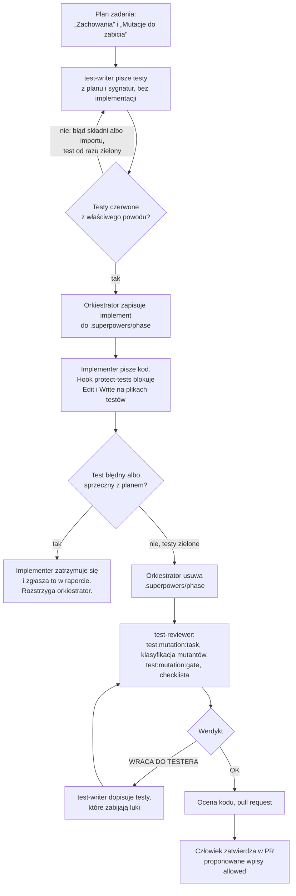

# Testy adwersarialne i mutacje

Po przeczytaniu będziesz wiedzieć:

- dlaczego testy zadania pisze inny agent niż kod i co z tego wynika dla Twojej pracy;
- jak przebiega zadanie: `test-writer`, faza implementacji z hookiem `protect-tests`, `test-reviewer`;
- jakie zasady muszą spełniać testy i jak wyglądają w kodzie kitu;
- jak działa Stryker, co znaczy wynik mutacji, jak uruchomić go na plikach zadania i dlaczego testy właściwości mają pod nim stały seed;
- jak działa bramka plików krytycznych, kto dopisuje wyjątki do `mutation-gate.json` i co zrobić, gdy bramka jest czerwona;
- dlaczego naraz może działać tylko jeden Stryker.

Zweryfikowano z kodem: 4a6ffcb, 2026-10-27

Źródła:

- `.claude/agents/test-writer.md`
- `.claude/agents/test-reviewer.md`
- `.claude/hooks/protect-tests.mjs`
- `.claude/hooks/protect-tests.test.mjs`
- `.claude/settings.json`
- `stryker.config.json`
- `stryker.integration.config.json`
- `vitest.setup.ts`
- `src/__tests__/vitest-setup.test.ts`
- `kit/cli/vitest.config.ts`
- `kit/cli/vitest.setup.ts`
- `kit/cli/src/__tests__/vitest-setup.test.ts`
- `mutation-gate.json`
- `scripts/mutation-gate.ts`
- `scripts/lib/mutation-gate.ts`
- `scripts/lib/__tests__/mutation-gate.test.ts`
- `.github/workflows/mutation.yml`
- `package.json`

Reguły procesu są w [AGENTS.md](../AGENTS.md#testy-które-próbują-złamać-kod), sekcja „Testy, które próbują złamać kod”. Ten plik je wyjaśnia, podaje powody i pokazuje, jak z nich korzystać. Decyzje: [D25](decyzje.md#d25) (tester i implementer) i [D26](decyzje.md#d26) (Stryker i bramka). Rodzaje testów, ich uruchamianie i test izolacji organizacji opisuje [08-testy.md](08-testy.md).

Pojęcia używane w tym pliku:

- **Test adwersarialny**: test, który ma złamać kod, a nie potwierdzić to, co założył jego autor.
- **Orkiestrator**: główna sesja agenta, która prowadzi plan zadanie po zadaniu i uruchamia subagentów (tryb subagent-driven-development z pakietu umiejętności superpowers dla Claude Code).
- **Subagent**: osobna sesja agenta z własnym kontekstem. Nie widzi rozmowy orkiestratora ani innych subagentów, tylko to, co dostał w poleceniu.
- **Implementer**: subagent, który pisze kod produkcyjny zadania.
- **Mutant**: kopia kodu z jedną celową zmianą, na przykład odwróconym warunkiem. Mutant, którego żaden test nie wykrywa, wskazuje zachowanie bez testu.
- **Wynik mutacji** (mutation score): procent wykrytych mutantów ([wzór](#wynik)).
- **Plik przyrostowy**: plik, w którym Stryker zapisuje wyniki ostatniego przebiegu, żeby następny sprawdzał od nowa tylko mutanty zmienionego kodu ([Tryb przyrostowy](#przyrostowy)).
- **Bramka mutacji**: skrypt `npm run test:mutation:gate`, który w plikach krytycznych nie przepuszcza żadnego niewykrytego mutanta bez wyjątku zatwierdzonego przez człowieka.

Przebieg z `test-writer`, plikiem fazy i `test-reviewer` dotyczy zadań, które wykonują sesje agentów według planu. Deweloper, który sam pisze kod i testy, nie używa pliku fazy ani subagentów, ale obowiązują go te same zasady pisania testów, a przed oddaniem zmiany w pliku z listy `critical` sam uruchamia `npm run test:mutation:task -- <pliki>` i `npm run test:mutation:gate`. CI nie uruchamia mutacji automatycznie ([D26](decyzje.md#d26)).

<a id="dlaczego"></a>

## Dlaczego testy pisze ktoś inny niż kod

Test, który pisze autor kodu po napisaniu kodu, zwykle odtwarza jego założenia i przechodzi. Research przeprowadzony przed wprowadzeniem procesu (notatka z 2026-10-27, poza repozytorium) zebrał na to dane z publikacji o testach pisanych przez modele językowe:

- Asercje, które model pisze na podstawie kodu, opisują to, co kod robi, a nie to, co powinien robić. Dlatego słabo wykrywają błędy.
- Testy wygenerowane po wadliwym kodzie wykryły 14% błędów, a wygenerowane niezależnie od kodu 25%. Błąd z kodu przechodzi do testu i oba się zgadzają.
- Agenci, którzy mogą zmieniać testy, potrafią je zmienić albo usunąć zamiast naprawić kod. Pokazują to benchmarki ImpossibleBench i EvilGenie, także dla Claude Code.
- Anthropic w zaleceniach do promptów każe modelowi zgłosić błędny test zamiast go obchodzić.

Liczby pochodzą ze streszczeń preprintów, a nie z pełnych tekstów. Wniosek researchu: sama instrukcja „pisz dobre testy” nie wystarcza. Trzeba rozdzielić, kto i na podstawie czego pisze testy, technicznie zablokować implementerowi ich zmianę i mierzyć siłę testów narzędziem, którego nie da się przekonać słowami. Takim narzędziem jest mutation testing: mutant ginie albo przeżywa, a autor testów nie może tego zinterpretować na swoją korzyść.

Audyt testów rdzenia (plan 1, commit `50a4d9e`) potwierdził to na kodzie kitu. Wynik mutacji wyniósł 71,75%. Testy były mocne tam, gdzie sprawdzały czyste funkcje bez mocków, a słabe w dwóch sytuacjach, które wykrył tylko Stryker:

- **Mock pliku z regułą bezpieczeństwa.** Sprawdzenie roli admina w `getAdminUserOrNull` (`src/shared/lib/auth/helpers.ts`) nie miało żadnego testu, bo testy komendy zaproszenia i listy kont podstawiały cały `helpers.ts`. Zmiana, po której każdy zalogowany użytkownik może zapraszać innych, przeszłaby wszystkie testy.
- **Dwa przykłady z dłuższej listy.** Z 15 ścieżek better-auth blokowanych w trybie jednej organizacji (`single-org-guard.ts`) 13 dało się usunąć bez czerwonego testu, bo testy sprawdzały tylko dwie.

Po audycie dopisano testy, które zabijają wskazane mutanty, a do repozytorium trafiły Stryker, bramka i opisany niżej proces. Research opisuje też testy metamorficzne (relacja między dwoma wywołaniami zamiast konkretnego wyniku), ale reguły kitu ich nie wymagają.

<a id="role"></a>

## Role

| Rola | Co dostaje | Czego nie robi | Narzędzia | Definicja |
| --- | --- | --- | --- | --- |
| Orkiestrator | Plan zadania. | Nie pisze testów ani kodu zadania. Uruchamia subagentów, zapisuje i usuwa plik fazy `.superpowers/phase`. | wszystkie | brak osobnej definicji |
| `test-writer` | Zadanie z planu (sekcje „Zachowania” i „Mutacje do zabicia”), sygnatury, kontrakty z `contracts/`, istniejące testy jako wzór stylu. | Nie czyta implementacji zadania ani rozumowania implementera. Istniejącą implementację traktuje jak czarną skrzynkę. | `Read`, `Grep`, `Glob`, `Write`, `Edit`, `Bash` | `.claude/agents/test-writer.md` |
| Implementer | Plan i gotowe testy. | Nie zmienia testów. Błędny test zgłasza w raporcie. | wszystkie, w fazie `implement` bez edycji testów | brak osobnej definicji |
| `test-reviewer` | Pliki zadania (diff) i raporty Strykera. | Nie edytuje plików. Nie dopisuje wpisów do `mutation-gate.json`, tylko je proponuje. | `Read`, `Grep`, `Glob`, `Bash` | `.claude/agents/test-reviewer.md` |
| Człowiek | Raport `test-reviewer` i pull request. | — | — | — |

`test-reviewer` nie ma narzędzi `Edit` ani `Write`, ale ma `Bash`, więc to, że wpisów do `mutation-gate.json` nie dopisuje agent, jest konwencją, a nie blokadą ([kto dopisuje wpisy](#bramka)).

<a id="przebieg"></a>

## Przebieg zadania



1. **Plan.** Każde zadanie ma sekcję „Zachowania” (wejście → oczekiwany wynik jako literał) i „Mutacje do zabicia” (zmiany w kodzie, które test musi wychwycić). Tak wyglądał plan komendy przełączania organizacji, z którego powstał test z [08-testy.md](08-testy.md#izolacja): w „Zachowaniach” było „owner A → `enterOrganizationCommand(B)` → odmowa, `activeOrganizationId` sesji bez zmian”, a w „Mutacjach do zabicia” między innymi „superadmin wpuszczany do nieistniejącej organizacji” i „brak sprawdzenia członkostwa dla nie-superadmina w komendzie”.
2. **Testy przed kodem.** `test-writer` pisze testy, uruchamia je i oddaje listę testów z mutacją, którą każdy zabija. Testy mają być czerwone z właściwego powodu: brak eksportu albo zła wartość, a nie błąd składni czy importu. Na tym etapie kodu zadania nie ma, więc asercja nie może go odtworzyć. Definicja `test-writer` każe uruchomić testy komendą `npx vitest run <pliki>`, która pomija `*.integration.test.ts` i bez innych plików kończy się `No test files found` z kodem 1. Dla testów integracyjnych orkiestrator wskazuje więc w poleceniu komendę `npm run test:integration -- <pliki>` i bazę `_test` ([08-testy.md](08-testy.md#integracyjne)).
3. **Faza implementacji.** Orkiestrator zapisuje `implement` do `.superpowers/phase` i uruchamia implementera. Hook blokuje mu edycję testów ([Faza implementacji](#faza)). Implementer, który uzna test za błędny, zatrzymuje się i zgłasza to w raporcie.
4. **Koniec fazy.** Gdy testy są zielone, orkiestrator usuwa plik fazy.
5. **Recenzja testów.** `test-reviewer` ustala pliki produkcyjne zadania (`git diff --name-only <base>...HEAD`, bez testów i plików generowanych), uruchamia Strykera na tych plikach i klasyfikuje każdy mutant `Survived` albo `NoCoverage` w liniach zmienionych przez zadanie:
   - **luka**: mutant zmienia zachowanie widoczne z zewnątrz, więc trzeba dopisać test;
   - **równoważny**: mutanta nie da się odróżnić od oryginału, na przykład `select: { id: true }` → `{}`, gdy wynik jest sprawdzany tylko na `!== null` (`test-reviewer` podaje dlaczego);
   - **komunikat albo log**: tekst bez kontraktu, dopuszczalny.

   Logika bezpieczeństwa (auth, organizacje, role, guardy, rejestracja) nie może mieć żadnej luki. Potem `test-reviewer` uruchamia bramkę i przechodzi checklistę: zmiany w plikach testowych w diffie implementera, literały, testy negatywne, mocki tylko I/O, test bugfixu po cofnięciu poprawki, niezmienniki do `test.prop`. Werdykt to **OK** albo **WRACA DO TESTERA** z listą luk. Format raportu jest w `.claude/agents/test-reviewer.md`.
6. **Poprawki testów.** Przy werdykcie „WRACA DO TESTERA” `test-writer` dopisuje testy, które zabijają wskazane mutanty, i recenzja się powtarza. Plik fazy musi być wtedy usunięty, bo hook blokuje edycję testów każdemu agentowi, także testerowi.
7. **Ocena kodu i pull request.** Recenzja testów odbywa się przed oceną kodu, a proponowane wpisy wyjątków trafiają do pull requestu ([Bramka mutacji](#bramka)).

<a id="faza"></a>

## Faza implementacji i hook `protect-tests`

Hook `.claude/hooks/protect-tests.mjs` jest zarejestrowany w `.claude/settings.json` jako `PreToolUse` dla narzędzi pasujących do `Edit|Write`, obok hooka komentarzy ([D23](decyzje.md#d23)). Przed każdą edycją pliku Claude Code przekazuje mu ścieżkę pliku. Hook czyta plik `.superpowers/phase` z dwóch miejsc: z kopii roboczej, w której leży edytowany plik, i z katalogu projektu sesji ([Faza w worktree](#faza-worktree)). Blokuje edycję, gdy w którymkolwiek z nich zawartość pliku po obcięciu białych znaków na brzegach ma wartość dokładnie `implement`, a ścieżka pasuje do wzorca:

`.claude/hooks/protect-tests.mjs`

```js
const TEST_PATH = /(^|\/)(__tests__|e2e)\/|\.(test|spec)\.[cm]?[jt]sx?$/;
```

Wzorzec obejmuje każdy plik w katalogu `__tests__/` albo `e2e/` (na każdym poziomie ścieżki, także pomocniki w `__tests__/helpers/`) i każdy plik z końcówką `.test.` albo `.spec.` i rozszerzeniem `ts`, `tsx`, `js`, `jsx`, `mts`, `mjs`, `cts` albo `cjs`. Ukośniki odwrotne z Windows są zamieniane na zwykłe. Test hooka sprawdza, że nie są blokowane nazwy tylko podobne, na przykład „src/features/testimonials/service.ts”, „src/contest.ts” i „docs/e2e-notes.md” (ścieżki wymyślone na potrzeby testu).

Zablokowana edycja kończy hook kodem 2. Claude Code jej nie wykonuje i pokazuje agentowi komunikat:

```text
Zablokowane: faza implementacji (.superpowers/phase = implement), testy są tylko do odczytu.
Jeśli test jest błędny albo sprzeczny ze specyfikacją, zatrzymaj się i zgłoś to w raporcie zamiast go zmieniać.
```

Fazę włącza i wyłącza orkiestrator w katalogu głównym kopii roboczej, w której pracuje implementer, czyli w katalogu worktree, gdy zadanie ma własny worktree:

```bash
mkdir -p .superpowers && printf 'implement\n' > .superpowers/phase
rm .superpowers/phase
```

Hook czyta plik przy każdej edycji, więc zmiana działa od razu, bez restartu sesji.

<a id="faza-worktree"></a>

### Faza w worktree

`$CLAUDE_PROJECT_DIR` wskazuje katalog projektu sesji, a nie katalog, w którym agent akurat pracuje ([Hooki Claude Code](11-praca-z-kitem.md#hooki)). W sesji uruchomionej w głównej kopii zmienna zostaje przy głównej kopii także po przejściu agenta do worktree. W sesji, którą aplikacja Claude uruchamia we własnym worktree w `.claude/worktrees/`, od początku wskazuje główną kopię. Gdyby hook czytał plik fazy tylko z `$CLAUDE_PROJECT_DIR`, orkiestrator, który zapisał fazę w worktree zadania, nie zablokowałby implementera. Dlatego hook czyta plik fazy z dwóch katalogów:

- z katalogu głównego kopii roboczej edytowanego pliku, czyli z najbliższego katalogu nad plikiem, który zawiera wpis `.git` (w głównej kopii to katalog `.git/`, w worktree plik `.git`). Hook szuka go od fizycznej ścieżki katalogu pliku, po rozwinięciu dowiązań symbolicznych, więc ścieżka, która prowadzi do worktree przez dowiązanie, też trafia na jego plik fazy;
- z katalogu projektu sesji (`$CLAUDE_PROJECT_DIR`, a bez tej zmiennej z katalogu roboczego sesji).

| Gdzie leży plik fazy | Gdzie hook blokuje edycję testów |
| --- | --- |
| W worktree zadania. | W tym worktree, w każdej sesji. |
| W głównej kopii. | W każdej kopii roboczej edytowanej w sesji, której `$CLAUDE_PROJECT_DIR` wskazuje główną kopię. Tak jest w sesji uruchomionej w głównej kopii i w każdej sesji aplikacji Claude dla tego repozytorium, także działającej w `.claude/worktrees/`. |
| W głównej kopii, a sesja wystartowała w katalogu worktree poza aplikacją Claude, na przykład poleceniem `claude` w tym katalogu. | Tylko w głównej kopii. Hook nie szuka pliku fazy powyżej katalogu z `.git`, a `$CLAUDE_PROJECT_DIR` tej sesji wskazuje worktree. |

Zapisuj plik fazy w kopii roboczej implementera, a nie w głównej kopii. Wtedy blokada obejmuje tylko jego zadanie, a `test-writer` innego zadania może w tym czasie pisać testy w innym worktree. Plik w głównej kopii zablokowałby edycję testów we wszystkich sesjach aplikacji Claude dla tego repozytorium. Przypadki z tabeli sprawdzają testy w `.claude/hooks/protect-tests.test.mjs`.

Skrypt hooka Claude Code uruchamia z katalogu projektu sesji (`$CLAUDE_PROJECT_DIR/.claude/hooks/protect-tests.mjs`). Sesja uruchomiona w głównej kopii i każda sesja aplikacji Claude w `.claude/worktrees/` używają więc wersji hooka z głównej kopii, a nie z gałęzi swojego worktree. Zmiana hooka zaczyna w nich działać dopiero wtedy, gdy główna kopia ma jego nową wersję, na przykład po scaleniu do `main` i `git pull` w głównej kopii.

### Czego hook nie blokuje

| Luka | Skutek | Kto to łapie |
| --- | --- | --- |
| Zapis przez powłokę (`Bash`: `sed -i`, heredoc, `cp`). | Hook działa tylko dla `Edit` i `Write`. | `test-reviewer`: punkt checklisty o zmianach w plikach testowych. |
| Pomocniki testów poza `__tests__/`: `src/test/fake-prisma.ts`, `src/test/integration/`. | Implementer może zmienić `resetDatabase` albo zachowanie Prismy w pamięci. | Tylko przegląd diffu. |
| Konfiguracja testów i mutacji: `vitest.config.ts`, `vitest.integration.config.ts`, `playwright.config.ts`, `stryker.config.json`, `stryker.integration.config.json`, `mutation-gate.json`, a także sam hook i `.claude/settings.json`. | Implementer może na przykład zawęzić `mutate` albo dopisać wpis do `allowed`. | Tylko przegląd diffu. |
| Inne narzędzia niż Claude Code (Codex, Cursor, edytor człowieka). | Hook działa tylko w sesji Claude Code. | Przegląd diffu. |
| Plik fazy poza kopią roboczą edytowanego pliku i poza katalogiem projektu sesji, na przykład w worktree innego zadania. | Hook nie widzi takiego pliku i przepuszcza edycję testów ([Faza w worktree](#faza-worktree)). `.superpowers/` jest w `.gitignore`, więc nowy worktree nie dostaje pliku fazy z głównej kopii. | `test-reviewer`: punkt checklisty o zmianach w plikach testowych. |

`test-reviewer` najłatwiej sprawdzi, czy implementer nie zmienił testów, gdy testy mają własny commit sprzed implementacji. Wystarczy wtedy porównać pliki testów, ich pomocników i bramki od tego commitu, na przykład:

```bash
git diff --stat <commit-z-testami>..HEAD -- '**/__tests__/**' '**/*.test.*' '**/*.spec.*' 'e2e/**' src/test mutation-gate.json 'vitest*.ts' playwright.config.ts 'stryker*.json' .claude/
```

Każda zmiana z tej listy w diffie implementera wymaga uzasadnienia.

<a id="zasady"></a>

## Zasady pisania testów

Pełna lista jest w [AGENTS.md](../AGENTS.md#testy-które-próbują-złamać-kod) i w `.claude/agents/test-writer.md`. Tu są powody i przykłady z kodu kitu.

| Zasada | Dlaczego | Przykład |
| --- | --- | --- |
| Wartość oczekiwana to literał albo wartość ze specyfikacji. Nie liczy się jej kodem produkcyjnym, kopią jego algorytmu, pętlą ani pomocnikiem. | Test, który liczy wynik tym samym algorytmem, dziedziczy jego błąd i zawsze się zgadza. | Termin ważności zaproszenia poniżej. |
| Każda pozycja z „Mutacji do zabicia” ma test, który pada przy tej mutacji. | Mutacje z planu to błędy, które autor planu uznał za najgroźniejsze. | Test „owner organizacji A podaje id B ręcznie → odmowa, sesja bez zmian” zabija mutację „brak sprawdzenia członkostwa”. |
| Każda granica (akcja serwerowa, query, parser) ma testy negatywne: niepoprawne wejście Zod, brak sesji, cudza organizacja, za niska rola, awaria zależności, podwójne wywołanie. | Autor kodu testuje zwykle tylko szczęśliwą ścieżkę. Te klasy błędów leżą poza nią. | Bloki „tryb serwisowy” i „poza trybem serwisowym” w `src/features/users/services/commands/__tests__/invite-user-command.test.ts`, test „dwa równoległe dołączenia tego samego użytkownika → jedno członkostwo” w teście izolacji. |
| Mockuje się tylko wejście i wyjście: Prismę w testach jednostkowych, mail, sieć, `auth.api`. Nie mockuje się pliku z regułą bezpieczeństwa, którą test sprawdza, i nie sprawdza się samego mocka. | Mock pliku z regułą wyłącza ją z testu. Tak powstała luka w `getAdminUserOrNull` opisana w [Dlaczego](#dlaczego). | `src/shared/lib/auth/__tests__/helpers.test.ts` podstawia tylko wejścia: nagłówki, język, `redirect` i `auth.api.getSession`. |
| Czysta funkcja z niezmiennikiem (parser, serializacja, normalizacja, slug) dostaje test właściwości `test.prop` z `@fast-check/vitest`. | Wejścia losuje biblioteka (domyślnie 100 na test), więc test sprawdza też przypadki, o których autor nie pomyślał. Pod Strykerem losuje je ze stałego seeda ([Testy właściwości pod Strykerem](#seed)). | Slug organizacji poniżej. |
| Poprawka błędu ma test, który bez poprawki nie przechodzi. | Dowodzi, że test w ogóle widzi ten błąd. | `test-reviewer` sprawdza to, cofając poprawkę. |
| Nazwa testu opisuje zachowanie z punktu widzenia kontraktu, po polsku. | Czerwony test od razu mówi, które zachowanie się zepsuło. | „zaproszenie wygasa dokładnie 48 godzin po utworzeniu”. |

Termin ważności zaproszenia jest sprawdzany literałem, a nie wyrażeniem `now + 48 * 60 * 60 * 1000`. Mutanty, które zmieniają czas ważności albo odejmują go zamiast dodawać, dają inną datę i test pada:

`src/features/users/services/commands/__tests__/invite-user-command.test.ts`

```ts
  it("zaproszenie wygasa dokładnie 48 godzin po utworzeniu", async () => {
    vi.useFakeTimers({
      toFake: ["Date"],
      now: new Date("2026-03-10T08:00:00.000Z"),
    });
    try {
      mockPrisma.user.findUnique.mockResolvedValueOnce(null);

      await inviteUserCommand(validInput);

      const { expiresAt } = mockPrisma.invitation.create.mock.calls[0][0].data;
      expect(expiresAt).toEqual(new Date("2026-03-12T08:00:00.000Z"));
    } finally {
      vi.useRealTimers();
    }
  });
```

Test właściwości sprawdza regułę na losowych nazwach. Oczekiwanie to wzorzec ze specyfikacji sluga, a nie wynik funkcji:

`src/features/organizations/contracts/__tests__/organization-slug.test.ts`

```ts
  test.prop([fc.string({ unit: "grapheme", maxLength: 80 })])(
    "dowolna nazwa → slug bezpieczny w URL z 8-znakowym sufiksem hex",
    (name) => {
      expect(slugifyOrganizationName(name)).toMatch(
        /^[a-z0-9]+(?:-[a-z0-9]+)*-[a-f0-9]{8}$/,
      );
    },
  );
```

<a id="stryker"></a>

## Stryker

Stryker robi z kodu mutanty i dla każdego uruchamia testy, które obejmują zmienioną linię. Pracuje na kopii projektu w `.stryker-tmp/`, więc Twoje pliki się nie zmieniają. Mutanty, które pojawiają się w `mutation-gate.json`, pokazują typowe zmiany: `ConditionalExpression` zastępuje warunek stałą (`value === undefined` → `false`), `EqualityOperator` zmienia operator (`>` → `>=`), `StringLiteral` opróżnia napis, `ObjectLiteral` zamienia obiekt na `{}`, a `BooleanLiteral` odwraca `true` i `false`.

<a id="wynik"></a>

### Statusy i wynik mutacji

Każdy mutant dostaje status ([pełna tabela](#referencja-statusy)). Wykryte są `Killed` (co najmniej jeden test padł) i `Timeout` (testy z mutantem nie skończyły się w czasie, na przykład przez nieskończoną pętlę). Niewykryte są `Survived` (testy objęły mutanta i przeszły) i `NoCoverage` (żaden test nie wykonuje tej linii). `CompileError` to mutant odrzucony przez TypeScript (`checkers: ["typescript"]`) i do wyniku się nie liczy.

Wynik mutacji = (`Killed` + `Timeout`) / (`Killed` + `Timeout` + `Survived` + `NoCoverage`) × 100%.

Przykład z lokalnego raportu pełnego przebiegu unitowego z 2026-10-27: 908 `Killed`, 11 `Timeout`, 157 `Survived`, 31 `NoCoverage` i 674 `CompileError` dają 919 / 1107, czyli 83,02%.

### Dwie konfiguracje

`stryker.config.json` (komendy `npm run test:mutation` i `npm run test:mutation:task`) uruchamia testy jednostkowe. Mutuje logikę: `src/shared/lib/`, `src/shared/utils/`, `services/` i `contracts/` każdego feature, `src/i18n/`, `src/app/api/` i `scripts/lib/`, bez testów, `src/shared/lib/prisma.ts` i `src/shared/lib/logger.ts`. Komponentów i stron nie mutuje, bo logika biznesowa ma być w `services/` ([06-wzorce-kodu.md](06-wzorce-kodu.md#reguly-stylu)).

`stryker.integration.config.json` (komenda `npm run test:mutation:integration`) uruchamia testy integracyjne na prawdziwej bazie `_test` i mutuje pliki, które te testy sprawdzają: `services/` każdego feature (`src/features/*/services/**/*.ts`, także modułów kitu i funkcji projektu), `org-context.ts` i `require-module-access.ts`. Część zachowań tych plików (filtr `organizationId`, sortowanie, transakcje) da się sprawdzić tylko na bazie, więc przebieg unitowy pokazałby je jako niewykryte. Przebieg integracyjny czyści bazę tak samo jak `npm run test:integration` ([08-testy.md](08-testy.md#baza)) i potrzebuje `INTEGRATION_DATABASE_URL`, a w projekcie z modułem `uploads` także działającego MinIO, tak jak testy integracyjne ([08-testy.md](08-testy.md#integracyjne)).

<a id="concurrency"></a>

Konfiguracja integracyjna ma `concurrency: 1`, ale nie daje to jednego procesu testów. Stryker 10.1.1 przy włączonym sprawdzaniu typów dzieli ją na 1 proces sprawdzania typów i 1 proces testów, a gdy sprawdzanie typów się skończy, w miejsce procesu sprawdzania typów uruchamia drugi proces testów (`ConcurrencyTokenProvider.freeCheckers` w `node_modules/@stryker-mutator/core`). Dwa procesy Vitest używają wtedy jednej bazy, w której każdy test zaczyna od wyczyszczenia tabel. Jeden może wyczyścić dane drugiemu w trakcie testu, a test, który padł z tego powodu, oznacza mutanta jako wykrytego, choć żaden test go nie wykrył. Wynik przebiegu integracyjnego i bramka mogą więc wychodzić lepsze, niż są (wniosek z kodu Strykera, bez przebiegu). Obejście i możliwe zmiany opisuje [znane-ograniczenia.md](znane-ograniczenia.md#stryker-concurrency).

Pełne porównanie ustawień: [Referencja](#referencja-konfiguracje).

<a id="progi"></a>

### Progi

| Próg | Unitowa | Integracyjna | Co robi |
| --- | --- | --- | --- |
| `high` | 85 | 80 | Wynik od tego progu raport pokazuje na zielono. |
| `low` | 75 | 70 | Wynik od `low` do `high` jest żółty, poniżej `low` czerwony. |
| `break` | 75 | `null` | Wynik poniżej progu ustawia kod wyjścia 1, więc komenda i job CI kończą się błędem. `null` wyłącza to sprawdzenie. |

Stryker wypisuje na końcu na przykład `Final mutation score of 83.02 is greater than or equal to break threshold 75`, a poniżej progu `Final mutation score … under breaking threshold 75, setting exit code to 1 (failure).` Przy wprowadzeniu Strykera wynik bazowy wynosił 77%, a próg ustawiono na 75. `AGENTS.md` zabrania obniżania progu, żeby przepuścić zmianę. Przebieg integracyjny nie ma progu `break`, więc nie kończy się błędem z powodu wyniku. Jego mutanty w plikach krytycznych ocenia bramka.

<a id="task"></a>

### Przebieg na plikach zadania

1. Sprawdź, że nie działa inny Stryker: `pgrep -fl stryker` nie wypisuje nic ([dlaczego](#jeden-stryker)).
2. W katalogu głównym repozytorium uruchom przebieg na plikach zadania, rozdzielonych przecinkami bez spacji:

   ```bash
   npm run test:mutation:task -- src/a.ts,src/b.ts
   ```

   Skrypt to `stryker run --force --mutate`. `--mutate` zastępuje listę `mutate` z konfiguracji podanymi plikami, a `--force` sprawdza wszystkie ich mutanty od nowa, nawet gdy tryb przyrostowy mógłby użyć starych wyników.
3. Przeczytaj wynik. Poniżej fragment logu przebiegu na `src/shared/lib/auth/service-mode.ts` na komputerze z 8 rdzeniami.

   Znaczniki czasu usunięto:

   ```text
   INFO ProjectReader Found 1 of 432 file(s) to be mutated using incremental report with 1781 mutant(s), and 1170 test(s). Force mode is activated, all mutants will be retested.
   INFO Instrumenter Instrumented 1 source file(s) with 35 mutant(s)
   INFO ConcurrencyTokenProvider Creating 4 checker process(es) and 3 test runner process(es).
   INFO DryRunExecutor Initial test run succeeded. Ran 101 tests in 7 seconds (net 1945.0492559999984 ms, overhead 5232.950744000002 ms).
   INFO MutationTestReportHelper Final mutation score of 83.02 is greater than or equal to break threshold 75
   INFO MutationTestExecutor Done in 1 minute and 15 seconds.
   ```

   Stryker uruchomił tylko 101 testów powiązanych z plikiem (opcja `related` runnera Vitest, domyślnie włączona). Z 35 mutantów 31 dostało `Killed`, a 4 `CompileError`. Cała komenda trwała 1 minutę 16 sekund.
4. Patrz na wiersze swoich plików, a nie na wynik końcowy. Gdy istnieje plik trybu przyrostowego (`reports/stryker-incremental.json`), raport i wynik końcowy obejmują cały projekt: wyniki pozostałych plików Stryker bierze z tego pliku. W przykładzie 83,02% to wynik projektu, a `service-mode.ts` ma 100%. Wiersz pliku jest w tabeli wypisanej w terminalu i w `reports/mutation/mutation.html`, gdzie widać też kod każdego mutanta. Bez pliku przyrostowego (świeży klon) raport obejmuje tylko pliki zadania, a próg `break` dotyczy ich wyniku.
5. Jeśli plik zadania jest na liście `mutate` konfiguracji integracyjnej, przebieg unitowy pokaże jako niewykryte mutanty, które zabijają tylko testy integracyjne. Przed bramką uruchom wtedy `npm run test:mutation:integration` z `INTEGRATION_DATABASE_URL`, żeby bramka połączyła raport unitowy z aktualnym raportem integracyjnym.
6. Uruchom bramkę: `npm run test:mutation:gate` ([Bramka mutacji](#bramka)).

<a id="przyrostowy"></a>

### Tryb przyrostowy, raporty i katalog roboczy

- **Tryb przyrostowy** (`incremental: true`): plik przyrostowy przechowuje wyniki ostatniego przebiegu. Następny przebieg sprawdza od nowa tylko mutanty w zmienionym kodzie i te, których testy się zmieniły, a resztę wyników kopiuje. Log pokazuje to w bloku `Incremental report` (na przykład `Result: 0 of 35 mutant result(s) are reused.`). Plik jest nadpisywany po każdym przebiegu. Pełny przebieg od zera wymusza `--force` albo usunięcie pliku. CI trzyma te pliki w cache ([08-testy.md](08-testy.md#ci)).
- **Raporty** trafiają do `reports/`, który jest w `.gitignore`. Unitowe: `reports/mutation/mutation.html` i `reports/mutation/mutation.json` (domyślne ścieżki Strykera). Integracyjne: `reports/mutation-integration/mutation.html` i `reports/mutation-integration/mutation.json`.
- **Katalog roboczy**: każdy przebieg kopiuje projekt do własnego podkatalogu `.stryker-tmp/sandbox-<losowe znaki>`, z pominięciem plików, które Stryker pomija zawsze (między innymi `node_modules`, `.git`, `.next`, katalog roboczy `.stryker-tmp`, plik przyrostowy i pliki raportów HTML i JSON), oraz `ignorePatterns` z konfiguracji, które w obu konfiguracjach wykluczają cały katalog `reports`. Po udanym przebiegu usuwa swój podkatalog, a po przerwanym albo nieudanym go zostawia. Stare podkatalogi możesz usunąć, gdy nie działa żaden Stryker. `npm test` pomija `.stryker-tmp/**`, więc kopie testów z tego katalogu się nie uruchamiają.
- **Wyłączenie pliku z mutacji** zapisuje się wzorcem z `!` w `mutate`, a nie komentarzem `// Stryker disable`, bo hook komentarzy by go zablokował ([D23](decyzje.md#d23)).

<a id="seed"></a>

### Testy właściwości pod Strykerem

W procesach Strykera testy właściwości (`test.prop`) losują wejścia ze stałego seeda, a w zwykłych przebiegach z nowego przy każdym uruchomieniu. Stały seed jest potrzebny, bo Stryker wybiera testy dla mutanta po nazwach. W przebiegu suchym, czyli przebiegu testów bez mutantów, zapisuje pełną nazwę każdego testu i to, kod których mutantów test wykonał. Dla mutanta uruchamia potem tylko testy o nazwach, które go objęły (filtr `testNamePattern` w `node_modules/@stryker-mutator/vitest-runner/dist/src/vitest-test-runner.js`). `@fast-check/vitest` dopisuje do nazwy testu właściwości seed, na przykład `… (with seed=-480522100)`, a gdy seed nie jest ustawiony, losuje go przy każdym ładowaniu pliku testów (`node_modules/@fast-check/vitest/lib/vitest-fast-check.js`). Bez stałego seeda test w procesie z mutantem ma więc inną nazwę niż w przebiegu suchym i filtr go pomija (sprawdzone). Mutant, którego wykrywa tylko test właściwości, dostaje wtedy `Survived`, a w pliku krytycznym bramka każe go zabić nowym testem albo opisać wpisem w `mutation-gate.json`, choć test, który go wykrywa, istnieje. Bez stałego seeda testy właściwości uruchamiają się tylko dla mutantów statycznych, czyli zmian w kodzie wykonywanym przy ładowaniu modułu, bo dla nich Stryker uruchamia wszystkie testy bez filtra nazw.

Seed ustawia `vitest.setup.ts`, tylko gdy istnieje zmienna `STRYKER_MUTATOR_WORKER`. Stryker ustawia ją na numer procesu w każdym procesie, w którym uruchamia testy albo sprawdza typy (`child-process-proxy.js` w `node_modules/@stryker-mutator/core`), a procesy Vitest dziedziczą ją po procesie Strykera:

`vitest.setup.ts`

```ts
// …
// WHY: @fast-check/vitest puts the seed in each property test's name and Stryker picks a mutant's tests by
// the names from its dry run, so a seed drawn anew in every Stryker process would keep property tests from running.
if (process.env.STRYKER_MUTATOR_WORKER !== undefined) {
  fc.configureGlobal({ seed: 42 });
}
```

Przykład z lokalnych przebiegów `npm run test:mutation:task` z 2026-11-05 na plikach z testami właściwości, bez stałego seeda i z nim (sprawdzone):

- Z opcją `--disableBail` Stryker wykonuje wszystkie testy, które obejmują mutanta, i zapisuje każdy test, który padł. Na pięciu plikach (`service-mode.ts`, `organization-slug.ts`, `upload.schemas.ts`, `content-disposition.ts`, `api-key-secret.ts`) testy właściwości zabiły bez stałego seeda 2 mutanty, oba statyczne, a ze stałym seedem 56. Bez stałego seeda każdy z 71 mutantów objętych testem właściwości miał wykonanych dokładnie o tyle testów mniej, ile testów właściwości go obejmowało.
- W zwykłym przebiegu (bez `--disableBail`) na dziesięciu plikach z testami właściwości wynik mutacji się nie zmienił (95,02%). Stryker kończy przebieg mutanta na pierwszym teście, który padnie, a w tych plikach testy przykładowe stoją przed testami właściwości i zabijają te same mutanty. 9 mutantów objętych testem właściwości przeżyło w obu przebiegach, ale ze stałym seedem z wykonanym testem właściwości: właściwości nie sprawdzają tych zachowań albo mutant jest równoważny. Na przykład w `organization-slug.ts` zamiana `/^-+|-+$/g` na `/^-|-+$/g` nic nie zmienia, bo wcześniejsze `.replace(/[^a-z0-9]+/g, "-")` nie zostawia dwóch myślników obok siebie.

Które mutanty zabija test właściwości, pokaże więc dopiero przebieg z `--disableBail`, na przykład `npm run test:mutation:task -- src/a.ts --disableBail`. Trwa dłużej, bo dla każdego mutanta wykonuje wszystkie testy, które go obejmują.

Co z tego wynika:

- `npm test` i CI losują seed przy każdym uruchomieniu, więc każdy przebieg sprawdza nowe wejścia. Seed jest w nazwie testu, a gdy właściwość nie przejdzie, fast-check wypisuje parametry do powtórzenia kontrprzykładu, na przykład `{ seed: 42, path: "6:1:0", endOnFailure: true }`. Podaj je w drugim argumencie `test.prop`.
- W procesach Strykera każdy test właściwości sprawdza w każdym przebiegu te same wejścia. Mutant, którego te wejścia nie wykrywają, przeżyje w każdym przebiegu i ponowne uruchomienie tego nie zmieni. Zabije go test przykładowy albo właściwość z lepiej dobranym generatorem wejść lub większym `numRuns`.
- Wejścia z procesów Strykera odtworzysz bez Strykera: `STRYKER_MUTATOR_WORKER=0 npx vitest run <plik testu>`. Przydaje się to, gdy test właściwości pada w przebiegu suchym Strykera, a w `npm test` przechodzi.
- `fc.configureGlobal` zastępuje całą konfigurację globalną fast-check. Wywołanie bez `seed` w pliku testów usuwa stały seed dla tego pliku, więc jego testy właściwości znowu nie biorą udziału w przebiegach mutantów. Ustawienie dla jednego testu podawaj w drugim argumencie `test.prop`, jak `{ numRuns: 300 }` w `src/features/uploads/services/__tests__/content-disposition.test.ts`.
- Nazwy testów właściwości są stałe także między przebiegami Strykera. Plik przyrostowy rozpoznaje test po pliku, pozycji i nazwie (`IncrementalDiffer` w `node_modules/@stryker-mutator/core`). Z losowym seedem każdy przebieg uznawałby testy właściwości za nowe i od nowa sprawdzał mutanty, które obejmują; ze stałym seedem tryb przyrostowy może użyć ich wyników z poprzedniego przebiegu.
- `vitest.integration.config.ts` nie ładuje `vitest.setup.ts`, więc przebieg integracyjny nie ma stałego seeda. Testy integracyjne nie używają `test.prop`; test właściwości dopisany do testów integracyjnych potrzebowałby tego samego ustawienia w `src/test/integration/setup-env.ts`.
- CLI kitu ma to samo ustawienie w `kit/cli/vitest.setup.ts` (`setupFiles` w `kit/cli/vitest.config.ts`), bo jego Stryker wybiera testy tak samo ([16b-rozwoj-kitu.md](16b-rozwoj-kitu.md#bramka-cli)).

Ustawienie sprawdzają `src/__tests__/vitest-setup.test.ts` i `kit/cli/src/__tests__/vitest-setup.test.ts`: plik ustawień jest wpisany w `setupFiles`, przy ustawionej zmiennej seed wynosi 42 dla każdego numeru procesu i przy każdym ładowaniu pliku, także przy innej dacie systemowej, a bez zmiennej seed nie jest ustawiony.

<a id="bramka"></a>

## Bramka mutacji

Próg `break` dotyczy wyniku całego kodu, więc przepuszcza pojedyncze luki w poszczególnych plikach. W kodzie auth, organizacji, użytkowników i usług modułów kitu każda luka to możliwy błąd bezpieczeństwa, taki jak brak testu roli admina z [Dlaczego](#dlaczego). Bramka (`npm run test:mutation:gate`, czyli `tsx scripts/mutation-gate.ts`) sprawdza więc pliki krytyczne osobno: każdy niewykryty mutant w nich musi być zabity testem albo mieć wpis wyjątku z uzasadnieniem.

### `mutation-gate.json`

Plik ma dwie listy. `critical` to prefiksy ścieżek plików krytycznych:

- `src/shared/lib/auth/`
- `src/features/auth/services/`
- `src/features/organizations/services/`
- `src/features/users/services/`
- `scripts/lib/mutation-gate.ts`
- `src/shared/lib/audit.ts`
- `src/features/audit-logs/services/`
- `src/features/api-keys/services/`
- `src/features/uploads/services/`

Cztery ostatnie wpisy dotyczą modułów kitu: szew `audit.ts` w rdzeniu i katalogi `services/` trzech modułów ([16b-rozwoj-kitu.md](16b-rozwoj-kitu.md#nowy-modul-kitu), krok 10). `mutation-gate.json` należy do rdzenia, więc projekt bez tych modułów też ma ich katalogi na liście; bramka ocenia tylko pliki obecne w raporcie.

Plik jest krytyczny, gdy jego ścieżka od katalogu głównego repozytorium zaczyna się od któregoś prefiksu. Nowy plik w tych katalogach jest objęty bramką od razu. Ścieżka, która tylko zaczyna się podobnie (w teście bramki „src/shared/lib/authz.ts”) albo zawiera prefiks w środku, krytyczna nie jest.

`allowed` to wpisy wyjątków. Każdy ma pięć pól ([opis pól](#referencja-pola)). Przykład:

`mutation-gate.json`

```json
    {
      "file": "src/shared/lib/auth/org-context.ts",
      "mutator": "StringLiteral",
      "original": "\"Użytkownik nie należy do aktywnej organizacji\"",
      "replacement": "\"\"",
      "reason": "tylko komunikat: NoOrganizationError rozpoznajemy przez instanceof, nie przez name/message"
    },
```

Mutant zamienia komunikat błędu `NoOrganizationError` na pusty napis. Kod kitu rozpoznaje ten błąd przez `instanceof`, a jego komunikat czyta tylko `logger`: wpis `error` z `handleCommandError` ma go w `err.message`. Użytkownik dostaje wtedy domyślny komunikat komendy, bo `NoOrganizationError` nie dziedziczy po `DomainError` ([03-dane-i-organizacje.md](03-dane-i-organizacje.md#no-organization-error)). Żaden test nie może więc zabić tego mutanta bez sprawdzania samego tekstu. `AGENTS.md` dopuszcza trzy rodzaje uzasadnień, a każdy ma przykład w pliku:

- **mutant równoważny**: zachowanie się nie zmienia, na przykład `{ id: true }` → `{}` w `select`, gdy wynik jest sprawdzany tylko na obecność;
- **tylko komunikat albo log**: tekst bez kontraktu, jak komunikat `NoOrganizationError` w przykładzie wyżej;
- **świadoma stała konfiguracyjna**: na przykład `60 * 5` (czas cookie cache sesji) w `src/shared/lib/auth/index.ts`.

Wpisy dopisuje i zatwierdza człowiek w pull requeście. Agent, także `test-reviewer`, tylko je proponuje w raporcie.

<a id="bramka-algorytm"></a>

### Jak bramka liczy

1. **Raporty.** Bez argumentów bramka czyta `reports/mutation/mutation.json` i `reports/mutation-integration/mutation.json`, o ile istnieją. Z argumentami czyta podane pliki (`npm run test:mutation:gate -- <raport.json> <raport.json>`). Bez żadnego raportu kończy się komunikatem `Brak raportu mutacji. Uruchom najpierw npm run test:mutation.` i kodem 1.
2. **Łączenie raportów.** Ten sam mutant w dwóch raportach to ten sam plik, mutator, zamiennik i pozycja początku i końca. Status inny niż `Survived` i `NoCoverage` w którymkolwiek raporcie wygrywa, więc mutant zabity tylko przez testy integracyjne liczy się jako zabity. Gdy oba statusy są niewykryte, `Survived` wygrywa z `NoCoverage`. Treść pliku bramka bierze z pierwszego raportu, który go zawiera.
3. **Puste uzasadnienia.** Wpis, którego `reason` jest pusty albo zawiera same spacje, jest naruszeniem.
4. **Niewykryte mutanty w plikach krytycznych.** Niewykryte to statusy z tej stałej:

   `scripts/lib/mutation-gate.ts`

   ```ts
   const UNTESTED_STATUSES = new Set(["Survived", "NoCoverage"]);
   ```

   Dla każdego takiego mutanta bramka wycina z treści pliku fragment, który mutant zmienia (oryginał), i szuka wpisu, który go pokrywa:

   `scripts/lib/mutation-gate.ts`

   ```ts
   function covers(
     entry: AllowedMutant,
     file: string,
     mutant: ReportMutant,
     original: string,
   ): boolean {
     return (
       entry.file === file &&
       entry.mutator === mutant.mutatorName &&
       entry.original === original &&
       entry.replacement === (mutant.replacement ?? "")
     );
   }
   ```

   Mutant bez wpisu jest naruszeniem.
5. **Nieaktualne wpisy.** Wpis dla pliku, który jest w raporcie, ale nie pokrył żadnego mutanta, jest nieaktualny i też zatrzymuje bramkę. Tak się dzieje, gdy mutanta zabił nowy test albo gdy zmienił się kod i oryginał wygląda inaczej. Wpis dla pliku, którego nie ma w raporcie, bramka pomija.
6. **Wynik.** Przy naruszeniu albo nieaktualnym wpisie bramka kończy się kodem 1. Inaczej wypisuje `Bramka mutacji: OK (raporty: …).`

Wpis pasuje po treści, a nie po numerze linii. Dzięki temu nie trzeba go poprawiać, gdy kod przesunie się o kilka linii. Skutek uboczny: jeden wpis pokrywa każdy mutant o tym samym pliku, mutatorze, oryginale i zamienniku, także mutant w kodzie dopisanym później. Na przykład wpis `BooleanLiteral` `true` → `false` w `src/features/users/services/commands/invite-user-command.ts` przepuści każdy taki niewykryty mutant w tym pliku. Przy zmianie pliku krytycznego, który ma wpisy, sprawdź w raporcie HTML, czy nowy kod nie ma niewykrytych mutantów ukrytych za starym wpisem.

Bramka czyta raporty, które leżą na dysku. Jeśli raport integracyjny pochodzi ze starszego stanu kodu, połączy się z nowym raportem unitowym bez ostrzeżenia. Przed bramką sprawdź daty plików w `reports/` i w razie wątpliwości uruchom oba przebiegi na tym samym kodzie. W CI oba raporty powstają w tym samym jobie, tuż przed bramką.

<a id="bramka-czerwona"></a>

### Co zrobić, gdy bramka jest czerwona

Bramka wypisuje jedną linię na problem, a na końcu podpowiedź:

```text
Nieobjęty testami mutant w pliku krytycznym: <plik>:<linia> <mutator> „<oryginał>” → „<zamiennik>” (<status>)
Nieobjęty testami mutant w pliku krytycznym: <plik> <mutator> „<oryginał>”: brak uzasadnienia
Nieaktualny wpis w mutation-gate.json: <plik> <mutator> „<oryginał>”
Dopisz test, który zabija mutanta, albo dodaj wpis do mutation-gate.json z uzasadnieniem (równoważny / tylko komunikat).
```

1. **Nieobjęty mutant.** Otwórz `reports/mutation/mutation.html` (albo raport integracyjny) i zobacz kod mutanta. Zdecyduj, czy zmienia zachowanie widoczne z zewnątrz.
   - Tak: to luka. `test-writer` dopisuje test, który pada przy tej mutacji. W logice bezpieczeństwa każdy taki mutant to luka do zamknięcia.
   - Nie (mutant równoważny, tylko tekst komunikatu albo logu, świadoma stała): `test-reviewer` proponuje w raporcie wpis z pięcioma polami. `original` i `replacement` przepisz dokładnie z komunikatu bramki (tekst między „ i ”). Fragment z kilku linii zawiera znaki nowej linii i wcięcia z kodu, w JSON zapisane jako `\n` i spacje, a cudzysłowy jako `\"`, jak w istniejących wpisach.
2. **Brak uzasadnienia.** Uzupełnij `reason` we wskazanym wpisie.
3. **Nieaktualny wpis.** Mutant jest zabity albo kod się zmienił. Człowiek usuwa wpis albo poprawia `original` w pull requeście.

[AGENTS.md](../AGENTS.md#testy-które-próbują-złamać-kod) zabrania obniżania `thresholds.break`, żeby przepuścić zmianę. Wyjątki od mutacji ustawia się w `mutate`, ale wykluczenie służy plikom bez logiki do testowania, jak `src/shared/lib/prisma.ts`. Wykluczony jest też `src/shared/lib/logger.ts`, chociaż jego reguła typu błędu ma testy ([07b-logi-naglowki-healthcheck.md](07b-logi-naglowki-healthcheck.md#logger-typ-bledu)): pełny przebieg (`npm run test:mutation`) jej nie mutuje, a jej mutanty pokazuje dopiero przebieg zadania z tym plikiem, `npm run test:mutation:task -- src/shared/lib/logger.ts`. Plik krytyczny wykluczony z `mutate` przestaje być mutowany. Przy istniejącym pliku przyrostowym (lokalnie i w CI z cache) Stryker przenosi do raportu stare wyniki tego pliku dla kodu, który się nie zmienił (`IncrementalDiffer` w `node_modules/@stryker-mutator/core`), więc bramka widzi zamrożony stan. Bez pliku przyrostowego plik znika z raportu, a bramka pomija go razem z jego wpisami w `allowed`, bez komunikatu o nieaktualnym wpisie (`checkMutationGate` bierze pod uwagę tylko pliki obecne w raporcie). W obu przypadkach nowy kod tego pliku nie ma żadnej kontroli mutacjami.

<a id="praktyka"></a>

## Praktyka

Czasy przebiegów wszystkich rodzajów testów są w [08-testy.md](08-testy.md#czas). Najdłuższy jest pełny przebieg Strykera bez pliku przyrostowego, dlatego mutation testing nie wchodzi do `npm run verify` (research zalecał „dodać, ale nie do verify”).

<a id="jeden-stryker"></a>

### Jeden Stryker naraz

Nie uruchamiaj dwóch przebiegów Strykera jednocześnie. Powody wynikają z konfiguracji:

1. **Te same pliki wyników.** `npm run test:mutation` i `npm run test:mutation:task` używają `stryker.config.json`, więc piszą do tych samych `reports/mutation/mutation.json`, `reports/mutation/mutation.html` i `reports/stryker-incremental.json`. Przebieg, który skończy później, nadpisze wyniki drugiego, a bramka przeczyta wyniki z przypadkowego przebiegu.
2. **Jedna baza testowa.** Przebieg integracyjny używa bazy `_test`, w której każdy test zaczyna od wyczyszczenia tabel. Drugi przebieg integracyjny albo `npm run test:integration` na tej samej bazie kasuje dane w trakcie testu. Test pada z tego powodu, a Stryker liczy mutanta jako wykrytego, więc wynik i bramka wychodzą lepsze, niż są. Z tego samego powodu testy integracyjne mają `fileParallelism: false`. `concurrency: 1` w konfiguracji integracyjnej tego nie zapewnia, bo po sprawdzeniu typów działają dwa procesy testów ([Dwie konfiguracje](#concurrency)).
3. **Procesor.** Bez ustawionego `concurrency` Stryker liczy procesy z `os.availableParallelism()` (liczba logicznych procesorów) minus jeden, gdy procesorów jest więcej niż cztery. Na 8 logicznych procesorach startuje 4 procesy sprawdzania typów i 3 procesy testów, a po sprawdzeniu typów działa 7 procesów testów. Dwa przebiegi naraz spowalniają testy, a test, który przekroczy limit czasu, daje status `Timeout`. `Timeout` liczy się jako wykryty i przechodzi przez bramkę.

Katalog `.stryker-tmp/` sam w sobie nie jest problemem: każdy przebieg ma w nim własny podkatalog i usuwa tylko swój. W CI dwa przebiegi tej samej gałęzi też się nie nakładają, bo nowe ręczne uruchomienie workflowu dla tej gałęzi przerywa poprzednie (`concurrency` z `cancel-in-progress: true`).

<a id="referencja"></a>

## Referencja

<a id="referencja-statusy"></a>

### Statusy mutantów

| Status | Znaczenie | W wyniku mutacji | W bramce |
| --- | --- | --- | --- |
| `Killed` | Co najmniej jeden test padł. | wykryty | przechodzi |
| `Timeout` | Testy z mutantem nie skończyły się w limicie czasu. | wykryty | przechodzi |
| `Survived` | Testy objęły mutanta i przeszły. | niewykryty | naruszenie bez wpisu |
| `NoCoverage` | Żaden test nie wykonuje zmienionej linii. | niewykryty | naruszenie bez wpisu |
| `CompileError` | TypeScript odrzucił mutanta. | pominięty | przechodzi |
| `RuntimeError` | Testy z mutantem nie dały się uruchomić z powodu innego niż asercja. | pominięty | przechodzi |
| `Ignored` | Mutant wyłączony konfiguracją. | pominięty | przechodzi |

<a id="referencja-pola"></a>

### Pola `mutation-gate.json`

| Pole | Typ | Znaczenie |
| --- | --- | --- |
| `critical` | lista napisów | Prefiksy ścieżek plików krytycznych, liczone od katalogu głównego repozytorium. |
| `allowed` | lista obiektów | Wpisy wyjątków. |
| `allowed[].file` | napis | Ścieżka pliku od katalogu głównego, dokładnie jak w raporcie Strykera. |
| `allowed[].mutator` | napis | Nazwa mutatora Strykera, na przykład `StringLiteral`. |
| `allowed[].original` | napis | Dokładny fragment kodu, który mutant zmienia, z wcięciami i znakami nowej linii. |
| `allowed[].replacement` | napis | Kod mutanta. Pusty napis, gdy raport nie podaje zamiennika. |
| `allowed[].reason` | napis | Uzasadnienie: mutant równoważny, tylko komunikat albo log, świadoma stała konfiguracyjna. Pusty napis jest naruszeniem. |

<a id="referencja-konfiguracje"></a>

### Konfiguracje Strykera

| Ustawienie | `stryker.config.json` | `stryker.integration.config.json` |
| --- | --- | --- |
| Komendy | `npm run test:mutation`, `npm run test:mutation:task` | `npm run test:mutation:integration` |
| Testy | domyślna konfiguracja Vitest (`vitest.config.ts`) z plikiem ustawień `vitest.setup.ts`, który ustawia stały seed testów właściwości ([Testy właściwości pod Strykerem](#seed)) | `vitest.integration.config.ts`, baza `_test`; bez `vitest.setup.ts`, więc bez stałego seeda |
| `mutate` | `src/shared/lib/**/*.ts`, `src/shared/utils/**/*.ts`, `src/features/**/services/**/*.ts`, `src/features/**/contracts/**/*.ts`, `src/i18n/**/*.ts`, `src/app/api/**/*.ts`, `scripts/lib/**/*.ts`; bez `**/__tests__/**`, `src/shared/lib/prisma.ts`, `src/shared/lib/logger.ts` | `src/features/*/services/**/*.ts`, `src/shared/lib/auth/org-context.ts`, `src/shared/lib/auth/require-module-access.ts`; bez `**/__tests__/**` |
| `concurrency` | domyślna Strykera (logiczne procesory minus jeden przy więcej niż czterech; po sprawdzeniu typów tyle procesów testów) | `1` (1 proces sprawdzania typów i 1 proces testów, po sprawdzeniu typów 2 procesy testów) |
| `incrementalFile` | `reports/stryker-incremental.json` | `reports/stryker-integration-incremental.json` |
| Raport HTML i JSON | `reports/mutation/` (domyślnie) | `reports/mutation-integration/` |
| `thresholds` (`high`, `low`, `break`) | 85, 75, 75 | 80, 70, `null` |
| `timeoutMS` (zapas w milisekundach dodawany do czasu testów bez mutanta, pomnożonego przez `timeoutFactor`) | 15000 | 30000 |
| Wspólne | `testRunner: "vitest"`, `vitest.pool: "forks"` (jak `npm test`; domyślna pula runnera Strykera, `threads`, nie stosuje `vi.stubEnv("TZ", …)`, więc testy dat padały na runnerze z UTC), `checkers: ["typescript"]`, `tsconfigFile: "tsconfig.json"`, `incremental: true`, reportery `html`, `json`, `clear-text`, `progress`, `tempDirName: ".stryker-tmp"`, `ignorePatterns` z `docs`, `reports`, `.next`, `.superpowers` i innymi katalogami spoza kodu | |

<a id="referencja-pliki"></a>

### Pliki procesu

| Plik | Rola |
| --- | --- |
| `.claude/agents/test-writer.md` | Definicja subagenta piszącego testy. |
| `.claude/agents/test-reviewer.md` | Definicja subagenta recenzującego testy, format raportu i checklista. |
| `.claude/hooks/protect-tests.mjs` | Blokada edycji testów w fazie `implement`. |
| `.claude/hooks/protect-tests.test.mjs` | Testy hooka (`npm run test:hooks`). |
| `.claude/settings.json` | Rejestracja hooków `PreToolUse` dla narzędzi `Edit` i `Write`. |
| `.superpowers/phase` | Plik fazy, lokalny, poza git. |
| `stryker.config.json`, `stryker.integration.config.json` | Konfiguracje Strykera. |
| `vitest.setup.ts`, `kit/cli/vitest.setup.ts` | Stały seed testów właściwości w procesach Strykera ([Testy właściwości pod Strykerem](#seed)). |
| `src/__tests__/vitest-setup.test.ts`, `kit/cli/src/__tests__/vitest-setup.test.ts` | Testy tego seeda (w `npm test` i `npm test --prefix kit/cli`). |
| `mutation-gate.json` | Pliki krytyczne i wpisy wyjątków. |
| `scripts/mutation-gate.ts` | Wejście bramki: czyta raporty i konfigurację, wypisuje wynik. |
| `scripts/lib/mutation-gate.ts` | Logika bramki: `mergeReports`, `checkMutationGate`, `mutantOriginal`. |
| `scripts/lib/__tests__/mutation-gate.test.ts` | Testy logiki bramki (w `npm test`). |
| `.github/workflows/mutation.yml` | Job CI: oba przebiegi Strykera i bramka. |
