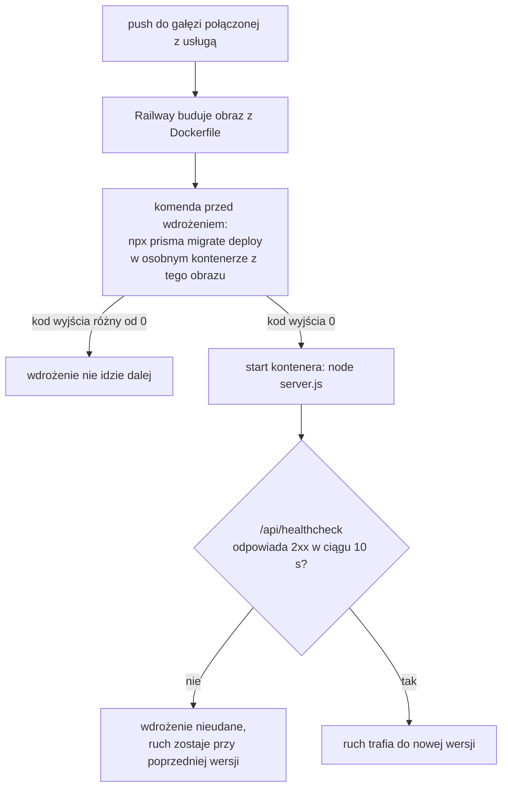

# Wdrożenie i przekazanie aplikacji

Po przeczytaniu będziesz wiedzieć:

- jak powstaje obraz Docker aplikacji, co do niego trafia i dlaczego nie da się w nim uruchomić `admin:create`;
- co ustawia `railway.toml`, czego Railway nie odczyta z tego pliku w nowej usłudze i co sprawdza healthcheck wdrożenia;
- jak wdrożyć projekt na Railway krok po kroku, z migracjami i zmiennymi wymaganymi na produkcji;
- gdzie na produkcji trzymać pliki modułu `uploads`: Railway Bucket, wolumen Railway albo wolumen na własnym serwerze;
- jak założyć konta na produkcji przez `railway run` i jak przekazać aplikację klientowi, łącznie z odcięciem dostępu Web Amigos po okresie wsparcia;
- co uruchamia każdy workflow CI i kiedy.

Zweryfikowano z kodem: 6c05f1f, 2026-11-05

Źródła:

- `Dockerfile`
- `.dockerignore`
- `railway.toml`
- `next.config.ts`
- `prisma.config.ts`
- `package-lock.json` (wersje `prisma` i `dotenv`)
- `.gitignore`
- `README.md` (sekcja „Railway”)
- `packages/env/src/*.ts`, `src/env.ts`
- `src/shared/lib/prisma.ts`
- `src/shared/lib/logger.ts`
- `src/shared/lib/mailer.ts`
- `src/instrumentation.ts`
- `src/features/uploads/env.ts`, `src/features/uploads/services/storage-env.ts`, `src/features/uploads/services/local-storage.ts`, `kit/modules/uploads.json` (provider storage modułu `uploads`)
- `src/proxy.ts`
- `src/app/api/healthcheck/route.ts`
- `scripts/admin-create.ts`
- `scripts/lib/admin-create.ts`
- `src/shared/lib/auth/index.ts`
- `src/shared/lib/auth/admin-access.ts`
- `src/shared/lib/auth/admin-guard.ts` (`targetRoleOf`, `roleFromStored`)
- `src/shared/lib/auth/org-context.ts`
- `src/features/auth/services/signup-gate.ts` (`enforceSignupPolicy`, `hasPendingInvitation`)
- `src/features/auth/services/signup-policy.ts`
- `src/features/organizations/services/signup-membership.ts`
- `src/features/organizations/components/organization-members.tsx`
- `src/features/organizations/services/queries/default-organization-query.ts` (aktywna organizacja nowej sesji)
- `src/features/users/services/commands/impersonation-commands.ts`
- `src/features/users/components/impersonation-banner.tsx`
- `src/features/users/i18n/pl.json`
- `prisma/schema/auth.prisma`
- `prisma/schema/organizations.prisma`
- `.github/workflows/` (wszystkie sześć plików)
- `node_modules/better-auth/dist/plugins/admin/routes.mjs` (better-auth 1.7.27: `setRole`, `removeUser`, `impersonateUser`, `stopImpersonating`)
- `node_modules/better-auth/dist/plugins/organization/routes/crud-members.mjs` (`leaveOrganization`, `listMembers`, `updateMemberRole`)
- dokumentacja Railway, sprawdzona 2026-10-28: [Config as Code](https://docs.railway.com/reference/config-as-code), [Infrastructure as Code](https://docs.railway.com/infrastructure-as-code), [healthchecki](https://docs.railway.com/reference/healthchecks), [komenda przed wdrożeniem](https://docs.railway.com/guides/pre-deploy-command), [`railway run`](https://docs.railway.com/cli/run), [PostgreSQL](https://docs.railway.com/databases/postgresql), [zmienne](https://docs.railway.com/reference/variables), [wdrożenia z GitHub](https://docs.railway.com/guides/github-autodeploys)
- dokumentacja Railway, sprawdzona 2026-11-04: [wolumeny](https://docs.railway.com/volumes/reference), [Storage Buckets](https://docs.railway.com/storage-buckets), [zmienne ustawiane przez Railway](https://docs.railway.com/variables/reference)
- forum Railway: [odpowiedź Railway o nowych usługach](https://station.railway.com/questions/railway-toml-has-no-effect-what-replac-b623aa81) (o usługach od 2026-08-28; odpowiedź z 2026-09-14), [wątek o odrzuconym wdrożeniu](https://station.railway.com/questions/custom-dockerfile-path-is-ignored-railw-8477b5bc)

Produkcja projektu to projekt na Railway (platforma hostingowa) z dwiema usługami: aplikacją uruchamianą z obrazu Docker i bazą PostgreSQL. Projekt z modułem `uploads` ma do tego Railway Bucket albo wolumen usługi aplikacji ([Pliki modułu `uploads`](#pliki-uploads)). Maile wysyła Resend, a logi przyjmuje zewnętrzny odbiornik OTLP (protokołu eksportu logów OpenTelemetry, [07b-logi-naglowki-healthcheck.md](07b-logi-naglowki-healthcheck.md#otel)). Diagram usług jest w [02-architektura.md](02-architektura.md).

Opis zachowania Railway pochodzi z jego dokumentacji (linki wyżej), a nie z kodu kitu, i nikt go nie sprawdzał wdrożeniem. Oznaczenie „(sprawdzone)” znaczy, że zachowanie potwierdziło uruchomienie kodu z repozytorium lokalnie: `npx prisma migrate deploy` na lokalnej bazie PostgreSQL, zbudowany serwer `.next/standalone/server.js` oraz wywołania endpointów better-auth przez `auth.handler` z ciasteczkiem sesji i nagłówkiem `Origin`, tak jak robi to przeglądarka.

Przebieg każdego wdrożenia:



<a id="obraz-docker"></a>

## Obraz Docker

`next.config.ts` ustawia `output: "standalone"`. Przy tej opcji `next build` zapisuje w `.next/standalone` serwer `server.js` i tylko te pliki z `node_modules`, których serwer używa. Obraz nie potrzebuje więc pełnego `node_modules` ani kodu źródłowego. `Dockerfile` ma cztery etapy:

| Etap | Co robi | Po co |
| --- | --- | --- |
| `base` | `FROM node:22-alpine` | Wspólna baza pozostałych etapów, Node 22 jak w `.nvmrc`. |
| `deps` | Kopiuje `package.json` i `package-lock.json`, potem `npm ci --ignore-scripts`. | Instalacja dokładnie według lockfile. `--ignore-scripts` pomija `postinstall` (`prisma generate`) i `prepare` (husky). |
| `builder` | Kopiuje `node_modules` z `deps` i cały kontekst budowania, uruchamia `npx prisma generate`, `mkdir -p public` i `npm run build` z `NEXT_TELEMETRY_DISABLED=1`. | Klient Prismy powstaje od nowa, bo `src/generated` nie trafia do kontekstu. Repozytorium nie ma katalogu `public/`, a etap `runner` go kopiuje, więc `mkdir` go zakłada. |
| `runner` | Ustawia zmienne, zakłada użytkownika `nextjs` (uid 1001), kopiuje `public/`, `.next/standalone`, `.next/static`, `prisma/` i `prisma.config.ts`, instaluje Prisma CLI, zakłada katalog `/app/volumes/uploads` należący do `nextjs:nodejs`, przełącza się na `USER nextjs` i uruchamia `CMD ["node", "server.js"]`. | Obraz końcowy: serwer, pliki statyczne, schemat z migracjami i narzędzie do migracji. Proces nie działa jako `root`, więc provider `local` modułu `uploads` potrzebuje katalogu z prawem zapisu dla `nextjs` ([Pliki modułu `uploads`](#pliki-uploads)). Katalog powstaje w każdym obrazie, także bez modułu. |

`Dockerfile`

```dockerfile
FROM base AS runner
WORKDIR /app

ENV NODE_ENV=production
ENV NEXT_TELEMETRY_DISABLED=1
ENV PORT=3000
ENV HOSTNAME="0.0.0.0"
```

- `NODE_ENV=production` włącza wymogi produkcyjne walidacji zmiennych. Rdzeń wymaga dostawcy maili (`SMTP_HOST`, `SMTP_URL`, `RESEND_API_KEY` albo jawne `MAIL_PROVIDER=console`, [ADR-64](adrs/64-production-mail-needs-a-configured-provider-or-explicit-console.md)) i odrzuca `BETTER_AUTH_SECRET` z `.env.example` ([D17](decyzje.md#d17)). Moduły kitu dokładają własne. `api-keys` odrzuca `API_KEY_PEPPER` z `.env.example`. `uploads` z providerem `local` wymaga na Railway wolumenu (ustawiony `STORAGE_LOCAL_PATH` musi leżeć w nim), a poza Railway `STORAGE_LOCAL_PATH` ze ścieżką bezwzględną ([reguły](15-modul-uploads.md#reguly-produkcyjne)). Niespełniony wymóg zatrzymuje start serwera ([kiedy zobaczysz błąd](#blad-env)). `NODE_ENV=production` zmienia też działanie `logger`: na produkcji nie pisze na konsolę ([D15](decyzje.md#d15)).
- `PORT=3000` to wartość domyślna. Railway wstrzykuje własną zmienną `PORT`, która zastępuje tę z obrazu, i na tym porcie wykonuje healthcheck, a `server.js` nasłuchuje na porcie z `PORT`. Nie musisz jej ustawiać. Gdy ustawisz `PORT` w zmiennych usługi, Railway użyje tej wartości także do healthchecku.
- <a id="hostname"></a>`HOSTNAME="0.0.0.0"` każe serwerowi nasłuchiwać na wszystkich interfejsach. **Nie zmieniaj go na `127.0.0.1`.** Przy tej wartości polskie adresy bez prefiksu języka odpowiadają przekierowaniem 307 na ten sam adres, czyli pętlą, a healthcheck tego nie wykryje, bo jego ścieżka omija proxy. Bezpieczne wartości to `0.0.0.0` i `::`; działa też `localhost` (tak ustawiają serwery e2e w `e2e/env.ts`), ale serwer słucha wtedy tylko na loopbacku, więc w kontenerze go nie używaj (wiersz `HOSTNAME` w [tabeli zmiennych spoza schematu](07-i18n-mail-env.md#referencja-env-poza-schematem)).

<a id="prisma-cli"></a>

### Prisma CLI w obrazie

Komenda przed wdrożeniem (`npx prisma migrate deploy`) działa w kontenerze z tego obrazu i czyta `prisma.config.ts`, który importuje pakiety `dotenv` i `prisma`. Wynik `next build` nie zawiera pakietów `prisma` ani `dotenv`, tylko `@prisma/client` (sprawdzone w `.next/standalone/node_modules`). Dlatego etap `runner` instaluje je osobno:

`Dockerfile`

```dockerfile
COPY --from=builder /app/prisma ./prisma
COPY --from=builder /app/prisma.config.ts ./prisma.config.ts

RUN cd /tmp && npm init -y > /dev/null 2>&1 \
    && npm install prisma@7.10.1 dotenv@17.4.2 > /dev/null 2>&1 \
    && cp -rP /tmp/node_modules/* /app/node_modules/ \
    && mkdir -p /app/node_modules/.bin \
    && ln -sf ../prisma/build/index.js /app/node_modules/.bin/prisma \
    && rm -rf /tmp/node_modules /tmp/package.json /tmp/package-lock.json \
    && chown -R nextjs:nodejs /app/node_modules
```

Wersje 7.10.1 i 17.4.2 to te same, które zapisuje `package-lock.json`. Po aktualizacji `prisma` albo `dotenv` w `package.json` zmień je też w `Dockerfile`, bo nic nie porównuje tych dwóch miejsc.

W obrazie nie ma `scripts/`, `src/`, `tsx` ani zależności deweloperskich. Dlatego `npm run admin:create` nie da się uruchomić w kontenerze i na produkcji uruchamia się go z własnego komputera przez `railway run` ([niżej](#admin-create)).

<a id="dockerignore"></a>

### `.dockerignore`

`.dockerignore`

```text
node_modules
.next
.git
.env
.env.*
!.env.example
*.md
.claude
.superpowers
.turbo
volumes
e2e
playwright.config.ts
test-results
playwright-report
src/generated
kit
docs
```

- `.env` i `.env.*` (poza `.env.example`) nie trafiają do kontekstu budowania, więc lokalne sekrety nie wejdą do obrazu. Zmienne produkcyjne pochodzą wyłącznie z Railway.
- `node_modules`, `.next` i `src/generated` powstają w obrazie od nowa. Pozostałe wpisy to pliki, których serwer nie potrzebuje: historia git, dokumentacja, konfiguracja agentów, dane lokalnej bazy, MinIO i lokalne pliki `uploads` z `volumes/` oraz testy e2e. Wzorzec `*.md` obejmuje tylko pliki Markdown w katalogu głównym, a `kit/` i `docs/` są wpisane osobno, bo to pliki tylko dla kitu.
- `prisma/migrations/` nie jest wykluczony, więc migracje trafiają do obrazu razem z `prisma/`. Railway buduje jednak z repozytorium, czyli tylko z zacommitowanych plików. Migracje, które zostały zignorowane (jak w repozytorium kitu), nie dotrą do obrazu ([migracje](#migracje)).

<a id="railway-toml"></a>

## `railway.toml`

`railway.toml`

```toml
[build]
builder = "DOCKERFILE"
dockerfilePath = "Dockerfile"

[deploy]
preDeployCommand = "npx prisma migrate deploy"
startCommand = "node server.js"

healthcheckPath = "/api/healthcheck"
healthcheckTimeout = 10

restartPolicyType = "ON_FAILURE"
restartPolicyMaxRetries = 3
```

| Pole | Działanie według dokumentacji Railway | Co z tego wynika |
| --- | --- | --- |
| `builder`, `dockerfilePath` | Budowanie z `Dockerfile` w katalogu głównym. | Railway buduje z `Dockerfile` także bez tego pola, gdy go znajdzie. |
| `preDeployCommand` | Komenda między budowaniem a startem, w osobnym kontenerze, w sieci prywatnej projektu i ze zmiennymi usługi. Zmiany w systemie plików nie zostają. Kod wyjścia różny od 0 zatrzymuje wdrożenie bez ponawiania. | Migracje stosuje `npx prisma migrate deploy` z adresem `DATABASE_URL` (adres prywatny bazy działa, bo komenda jest w sieci projektu). Wyniki i błędy: [Pierwsze wdrożenie](#migracje-w-logu). |
| `startCommand` | Komenda startu kontenera. | To samo co `CMD` w `Dockerfile`. |
| `healthcheckPath`, `healthcheckTimeout` | Po starcie Railway odpytuje ścieżkę, aż dostanie odpowiedź 2xx, najwyżej przez podaną liczbę sekund (domyślnie 300). Bez 2xx wdrożenie jest nieudane, a ruch przełącza się na nową wersję dopiero po udanym healthchecku. Działa tylko przy wdrożeniu, a nie jako stały monitoring. | Nowa wersja ma 10 sekund na odpowiedź 200 z `/api/healthcheck`. Gdy host bazy nie odpowiada, samo połączenie czeka do 10 sekund (`connectionTimeoutMillis` w `src/shared/lib/prisma.ts`). |
| `restartPolicyType`, `restartPolicyMaxRetries` | Restart kontenera, gdy proces zakończy się błędem, najwyżej 3 razy. | Błędne zmienne środowiskowe kończą proces przy starcie kodem 1 ([kiedy zobaczysz błąd](#blad-env)). Restart ich nie naprawi, bo każdy kolejny start kończy się tym samym raportem. |

<a id="config-as-code"></a>

### Czy Railway czyta `railway.toml`

`railway.toml` to format, który Railway nazywa „Config as Code”. Według dokumentacji Railway sprawdzonej 2026-10-28 ten format jest wycofywany:

- nowe usługi nie mogą z niego korzystać (według odpowiedzi Railway na forum dotyczy to usług utworzonych od 2026-08-28), a usługa dla projektu na kicie jest zawsze nowa;
- usługi, które już z niego korzystały, przestają go czytać 2026-12-01;
- następcą jest „Infrastructure as Code” (plik `.railway/railway.ts`), którego kit nie ma.

Plik zostaje w repozytorium jako zapis wartości, ale Railway z niego nie skorzysta. Zbuduje obraz z `Dockerfile` i uruchomi `node server.js` z `CMD`, ale nie uruchomi migracji przed wdrożeniem i nie zastosuje healthchecku ani polityki restartu z pliku. Dlatego wartości z tabeli wyżej wpisujesz w ustawieniach usługi w panelu Railway ([krok 4](#krok-ustawienia)). Najważniejsza jest komenda przed wdrożeniem: bez niej baza produkcyjna nie dostanie tabel. Czy migracje działają, sprawdzasz w logu wdrożenia ([krok 6](#migracje-w-logu)).

Według wątku na forum Railway (niesprawdzone) wdrożenie usługi, która ma w ustawieniach ścieżkę pliku konfiguracji, może zostać odrzucone komunikatem `Config as Code (railway.json / railway.toml) is deprecated. Use Infrastructure as Code (.railway/railway.ts) instead.`. Railway radzi wtedy wyczyścić w ustawieniach usługi pole ścieżki pliku konfiguracji.

<a id="healthcheck"></a>

### Co sprawdza healthcheck

`/api/healthcheck` wykonuje na bazie `SELECT 1` i zwraca 200 albo 503 ([07b-logi-naglowki-healthcheck.md](07b-logi-naglowki-healthcheck.md#healthcheck)). Udany healthcheck znaczy, że proces przeszedł sprawdzenie zmiennych przy starcie ([kiedy zobaczysz błąd](#blad-env)), działa i łączy się z bazą. Nie wykrywa:

- wartości zmiennych, które przechodzą walidację, ale nie działają, na przykład nieprawidłowego klucza Resend albo `APP_URL` z inną domeną, bo walidacja sprawdza tylko obecność i format;
- braku tabel, bo `SELECT 1` działa na pustej bazie;
- pętli przekierowań przy złej wartości `HOSTNAME` ([wyżej](#hostname)), bo ścieżki `/api` omijają proxy.

Dlatego po pierwszym wdrożeniu i po każdej zmianie zmiennych wykonaj ręczne sprawdzenie z [kroku 8](#krok-sprawdzenie).

<a id="zmienne"></a>

## Zmienne produkcyjne

Zmienne ustawiasz w usłudze aplikacji na Railway. Schemat w `packages/env/src/core-env-schema.ts` sprawdza je przy starcie procesu, a przy błędzie proces kończy się, zanim obsłuży pierwsze żądanie ([kiedy zobaczysz błąd](#blad-env)). Wynik pierwszego odczytu `env` proces zapamiętuje do końca działania ([07-i18n-mail-env.md](07-i18n-mail-env.md#walidacja-env)). Nowe wartości działają więc dopiero po ponownym wdrożeniu. Railway może trzymać zmiany zmiennych i ustawień jako oczekujące (staged), dopóki ich nie zatwierdzisz wdrożeniem (niesprawdzone). Pełny opis każdej zmiennej jest w [tabeli zmiennych](07-i18n-mail-env.md#referencja-env).

| Zmienna | Na produkcji | Wartość | Skutek braku albo złej wartości |
| --- | --- | --- | --- |
| `DATABASE_URL` | wymagana | Zmienna referencyjna, czyli wartość wskazująca zmienną innej usługi w składni `${{USŁUGA.ZMIENNA}}`: `${{Postgres.DATABASE_URL}}`, gdzie `Postgres` to nazwa usługi bazy w projekcie. To adres w sieci prywatnej. | Komenda przed wdrożeniem i healthcheck się nie powiodą. |
| `BETTER_AUTH_SECRET` | wymagana | Losowy napis, co najmniej 32 znaki bez spacji na brzegach, na przykład z `openssl rand -base64 32`. Inny niż w `.env.example` i niż lokalnie. | Linia `- BETTER_AUTH_SECRET: …` w raporcie startowym i koniec procesu ([kiedy zobaczysz błąd](#blad-env)). |
| `APP_URL` | wymagana | Pełny adres `https://`, pod którym użytkownicy otwierają aplikację. | better-auth odrzuca żądania z innego adresu, a linki w mailach prowadzą pod zły adres ([D16](decyzje.md#d16)). |
| `EMAIL_FROM` | wymagana | Nadawca maili, na przykład `WA App <noreply@example.com>`, z domeny skonfigurowanej w Resend. | Błąd walidacji przy braku. |
| `RESEND_API_KEY` | na Railway: tak, jeśli wysyłasz przez Resend | Klucz API Resend. | Bez żadnego dostawcy maili: `MAIL_PROVIDER: no mail provider configured for production: …`. |
| `MAIL_PROVIDER` | nie (wykrywanie); `console` przy instalacji bez maili | `smtp`, `resend` albo `console`. | Bez dostawcy i bez `console` start się nie uda ([ADR-64](adrs/64-production-mail-needs-a-configured-provider-or-explicit-console.md)). |
| `SMTP_HOST`, `SMTP_PORT`, `SMTP_USER`, `SMTP_PASS`, `SMTP_SECURE` | przy własnym serwerze SMTP | Host, port (domyślnie 587), logowanie (obie albo żadna) i TLS (`true` dla portu 465). | Połowa logowania albo zmienne obok `SMTP_URL` kończą start błędem. |
| `API_KEY_PEPPER` | wymagana, gdy zainstalowany jest moduł `api-keys` | Losowy napis, co najmniej 32 znaki, na przykład z `openssl rand -base64 32`. Nigdy wartość z `.env.example`. `wa create` zostawia wartość przykładową w `.env.example` i w `.env` (`writeEnvFile` w `packages/gato-cli/src/commands/create.ts` kopiuje `.env.example` i podmienia tylko `BETTER_AUTH_SECRET` i `ADMIN_EMAIL`), więc ustaw własną przed pierwszym wdrożeniem. Zmiana wartości unieważnia wszystkie klucze API, więc wartość ma być stała dla środowiska ([konfiguracja peppera](14-modul-api-keys.md#pepper)). | Błąd walidacji dla całej aplikacji, nie tylko dla modułu: proces kończy się przy starcie, także przy wartości z `.env.example` na produkcji ([kiedy zobaczysz błąd](#blad-env)). |
| `STORAGE_PROVIDER` | gdy zainstalowany jest moduł `uploads`; opcjonalna | `local` (domyślnie): pliki na dysku serwera; `s3`: magazyn zgodny z S3. Wybór opisuje [Pliki modułu `uploads`](#pliki-uploads). | Inna wartość: `STORAGE_PROVIDER: dozwolone wartości: local, s3` i koniec procesu przy starcie ([kiedy zobaczysz błąd](#blad-env)). |
| `STORAGE_LOCAL_PATH` | przy `local` poza Railway wymagana | Bezwzględna ścieżka trwałego katalogu, na przykład wolumenu: w obrazie Docker `/app/volumes/uploads`. Na Railway z wolumenem jej nie ustawiasz, bo katalogiem jest `RAILWAY_VOLUME_MOUNT_PATH`; jeśli ją ustawisz, musi leżeć w wolumenie ([reguły](15-modul-uploads.md#reguly-produkcyjne)). | Brak poza Railway: `STORAGE_LOCAL_PATH: wymagana w produkcji przy STORAGE_PROVIDER=local: wskaż trwały katalog`; ścieżka względna poza Railway, także `./volumes/uploads` z `.env.example`: `STORAGE_LOCAL_PATH: w produkcji poza Railway musi być ścieżką bezwzględną: wskaż trwały katalog`; na Railway bez wolumenu: `STORAGE_PROVIDER: na Railway bez wolumenu pliki zginą przy redeployu: …`. W każdym z tych przypadków proces kończy się przy starcie. |
| `S3_ENDPOINT`, `S3_ACCESS_KEY_ID`, `S3_SECRET_ACCESS_KEY`, `S3_BUCKET` | wymagane przy `STORAGE_PROVIDER=s3` | Dane dostępowe do magazynu zgodnego z S3: Railway Bucket (zasób w projekcie Railway, [niżej](#railway-bucket)) albo Cloudflare R2. Wartości weź z panelu magazynu, a nie z `.env.example` (tam jest lokalny MinIO z hasłem `minioadmin`). Bucket musi istnieć przed pierwszym wdrożeniem: aplikacja go nie tworzy. Walidacja nie odrzuca wartości z `.env.example` ([zmienne S3](15-modul-uploads.md#zmienne-s3)). Przy `local` te zmienne nie są sprawdzane. | Przy `s3` błąd walidacji dla całej aplikacji: proces kończy się przy starcie ([kiedy zobaczysz błąd](#blad-env)). |
| `S3_REGION`, `S3_FORCE_PATH_STYLE` | opcjonalne przy `s3` | `S3_REGION` domyślnie `auto` (tak działa R2; dla dostawcy z regionami podaj jego nazwę). `S3_FORCE_PATH_STYLE=true` włącza adresowanie `endpoint/bucket/klucz` zamiast `bucket.endpoint`; ustaw je, gdy dostawca nie obsługuje adresów z nazwą bucketu w domenie. Brak daje `false`. | Zły format zatrzymuje start: pusty `S3_REGION` albo `S3_FORCE_PATH_STYLE` inna niż `true` i `false` dają linię raportu startowego ([zmienne S3](15-modul-uploads.md#zmienne-s3)). Wartość w poprawnym formacie, która nie pasuje do dostawcy (inny region, zły styl adresowania), kończy się błędem dopiero przy pierwszym zapisie pliku (500 `storage_failed`). |
| `SMTP_URL` | nie ustawiaj (zamiast niego `SMTP_HOST`) | Brak. | Ustawiona wygrywa z Resend także na produkcji, a obok `SMTP_HOST` i pokrewnych zmiennych jest błędem ([ADR-64](adrs/64-production-mail-needs-a-configured-provider-or-explicit-console.md)). |
| `AUTH_PUBLIC_SIGNUP`, `MULTI_ORG`, `ADMIN_IMPERSONATION` | opcjonalne | `true` albo `false`; brak daje `false`. Do czasu założenia kont `AUTH_PUBLIC_SIGNUP=false` ([krok 7](#krok-konta)). | Każda inna wartość, na przykład `1` albo `yes`, to błąd walidacji ([D17](decyzje.md#d17)). Znaczenie flag: [D10](decyzje.md#d10), [D06](decyzje.md#d06), [D20](decyzje.md#d20). |
| `OTEL_EXPORTER_OTLP_ENDPOINT` | schemat nie wymaga, ale ustaw | Adres bazowy odbiornika OTLP przez HTTP, bez `/v1/logs`. | Wpisy `logger` nigdzie nie trafiają ([logi](#logi)). |
| `OTEL_EXPORTER_OTLP_HEADERS` | gdy odbiornik wymaga klucza | `klucz=wartość`, kilka par po przecinku. | Odbiornik, który wymaga klucza, odrzuci eksport. |
| `OTEL_SERVICE_NAME`, `GIT_COMMIT_SHA` | opcjonalne | Nazwa usługi i commit w eksporcie logów. | Domyślnie `wa-app` i `dev`. Railway podaje commit wdrożenia z GitHub w zmiennej `RAILWAY_GIT_COMMIT_SHA`, której kit nie czyta. Możesz ustawić `GIT_COMMIT_SHA` na `${{RAILWAY_GIT_COMMIT_SHA}}` (składni odwołania do zmiennej tej samej usługi nie sprawdzono). |
| `DATABASE_POOL_MAX` | opcjonalna | Największa liczba połączeń w puli `pg`. | Domyślnie 10. |
| `NODE_ENV`, `PORT`, `HOSTNAME` | nie trzeba | Ustawia je `Dockerfile`, a `PORT` także Railway. | Inna wartość `NODE_ENV` wyłącza wymogi produkcyjne; `PORT` i `HOSTNAME`: [obraz](#hostname). |
| `ADMIN_EMAIL`, `ADMIN_PASSWORD` | nie ustawiaj | Brak. | Czyta je tylko `admin:create`. Ustawione w usłudze trafiłyby do każdego `railway run`. |
| `LOG_LEVEL` | nie ustawiaj | Brak. | Niczego nie zmienia ([07b-logi-naglowki-healthcheck.md](07b-logi-naglowki-healthcheck.md#log-level)). |

Moduły i feature mogą dokładać własne zmienne: linie w regionie `# wa:modules:start` / `# wa:modules:end` w `.env.example` i schematy z `src/features/<x>/env.ts`, które walidacja łączy ze schematem rdzenia ([07-i18n-mail-env.md](07-i18n-mail-env.md#env-feature)). Z modułów kitu własne zmienne mają `api-keys` i `uploads`; pełne listy z regułami są w [14b-modul-api-keys-uzycie.md](14b-modul-api-keys-uzycie.md#referencja-env) i [15b-modul-uploads-uzycie.md](15b-modul-uploads-uzycie.md#referencja-env). Usługi `minio` i `minio-init` z regionu `wa:services` w `docker-compose.yml` mają profil `s3` i służą tylko do pracy lokalnej ([15-modul-uploads.md](15-modul-uploads.md#minio)). Obraz Docker ich nie zawiera: na produkcji aplikacja zapisuje pliki w katalogu z `STORAGE_LOCAL_PATH` albo w magazynie S3 pod `S3_ENDPOINT` ([Pliki modułu `uploads`](#pliki-uploads)).

<a id="blad-env"></a>**Kiedy zobaczysz błąd.** Błędne zmienne zatrzymują start. `register()` z `src/instrumentation.ts` sprawdza zmienne rdzenia i zainstalowanych modułów, zanim serwer obsłuży pierwsze żądanie, a przy błędzie wypisuje raport na stderr i kończy proces kodem 1 ([07-i18n-mail-env.md](07-i18n-mail-env.md#walidacja-env), [D48](decyzje.md#d48)). Sprawdzone na zbudowanym serwerze uruchomionym bez zmiennych komendą `env -i PATH="$PATH" PORT=3998 node .next/standalone/server.js`: proces zakończył się sam w mniej niż sekundę, bez żadnego żądania, z kodem 1, a raport na stderr zaczynał się od linii (sprawdzone 2026-11-04 na kodzie z modułami `api-keys` i `uploads`, pełny raport w [07-i18n-mail-env.md](07-i18n-mail-env.md#walidacja-env)):

```text
Nieprawidłowe zmienne środowiskowe (6):
- DATABASE_URL: Invalid input: expected string, received undefined
- BETTER_AUTH_SECRET: Invalid input: expected string, received undefined
```

Healthcheck nowego wdrożenia nie przechodzi więc, wdrożenie jest nieudane, a ruch zostaje przy poprzedniej wersji (niesprawdzone na Railway). Polityka restartu tego nie zmienia, bo każdy kolejny start kończy się tym samym raportem. Raport idzie przez `console.error`, a nie przez `logger`, więc trafia do logów usługi także bez eksportu OTLP (niesprawdzone na Railway). Raport wymienia wszystkie problemy naraz z jednym wyjątkiem: warunki produkcyjne schematu, na przykład `BETTER_AUTH_SECRET: must not be the .env.example value in production`, Zod sprawdza dopiero po przejściu podstawowych reguł tego samego schematu. Po poprawieniu zmiennych kolejny start może więc pokazać nowy raport ([07-i18n-mail-env.md](07-i18n-mail-env.md#walidacja-env)).

<a id="logi"></a>

### Logi na produkcji

- Bez `OTEL_EXPORTER_OTLP_ENDPOINT` `logger` na produkcji nic nie zapisuje: ani na konsolę, ani do eksportu. W logach usługi widać wtedy tylko to, co wypisują Next.js i biblioteki, bez błędów komend z `handleCommandError` i bez nieudanych wysyłek maili ([07b-logi-naglowki-healthcheck.md](07b-logi-naglowki-healthcheck.md#logger-cel), [D15](decyzje.md#d15)).
- Eksport wysyła wpisy paczkami co 5 sekund. Przy `SIGTERM`, czyli przy zatrzymaniu kontenera w trakcie restartu albo nowego wdrożenia, Next.js kończy proces przez `process.exit(143)` bez opróżnienia kolejki OTel. Wpisy z ostatnich sekund przed redeployem mogą więc nie dotrzeć do odbiornika ([07b-logi-naglowki-healthcheck.md](07b-logi-naglowki-healthcheck.md#otel)).

<a id="pliki-uploads"></a>

## Pliki modułu `uploads`

Projekt z modułem `uploads` trzyma pliki tam, gdzie wskazuje `STORAGE_PROVIDER`: domyślnie w katalogu na dysku serwera (`local`), a przy `s3` w magazynie zgodnym z S3 ([15-modul-uploads.md](15-modul-uploads.md#provider)). Na produkcji wybierasz jedno z trzech miejsc:

| Miejsce | Zmienne | Zalety | Ograniczenia |
| --- | --- | --- | --- |
| Railway Bucket | `STORAGE_PROVIDER=s3` i referencje do zmiennych bucketu ([niżej](#railway-bucket)) | Usługa aplikacji może mieć repliki, wdrożenie nie ma przerwy, którą Railway zapowiada dla usług z wolumenem, a proces nie musi działać jako root. | Według dokumentacji Railway bucket jest zawsze prywatny i nie ma automatycznych kopii zapasowych ani wersjonowania. |
| Wolumen Railway | `STORAGE_PROVIDER` nieustawiona albo `local`, bez `STORAGE_LOCAL_PATH` ([niżej](#railway-wolumen)) | Prosty przy jednej instancji. Według dokumentacji Railway wolumeny mają kopie zapasowe ręczne i automatyczne. | Jeden wolumen na usługę, bez replik, krótka przerwa przy każdym redeployu i możliwy brak prawa zapisu dla użytkownika `nextjs`. |
| Własny serwer klienta | `local` z `STORAGE_LOCAL_PATH` na trwałym wolumenie albo `s3` z dowolnym magazynem zgodnym z S3 ([niżej](#wlasny-serwer)) | Bez zależności od Railway. | Przy `local` jedna instancja, a kopie zapasowe katalogu robi administrator serwera. |

**Zalecenie.** Na Railway wybierz domyślnie Railway Bucket: pozwala na repliki, nie ma przerwy przy redeployu i nie wymaga `RAILWAY_RUN_UID=0`. Wolumen wybierz dla prostego wdrożenia z jedną instancją. Na własnym serwerze klienta wybierz `local` na trwałym wolumenie albo S3.

Część konfiguracji, które zgubiłyby pliki, zatrzymuje sprawdzenie przy starcie ([kiedy zobaczysz błąd](#blad-env)): provider `local` w produkcji na Railway wymaga wolumenu, a poza Railway jawnego `STORAGE_LOCAL_PATH` ze ścieżką bezwzględną ([reguły produkcyjne](15-modul-uploads.md#reguly-produkcyjne)). Czy wskazany katalog przetrwa redeploy, kit nie sprawdza. Plików między providerami moduł nie przenosi, więc wybór na produkcji zrób przed pierwszym uploadem ([znane-ograniczenia.md](znane-ograniczenia.md#uploads-local)).

<a id="railway-bucket"></a>

### Railway Bucket

1. Utwórz bucket w projekcie Railway i wybierz jego region; regionu nie zmienisz później. Prawdziwa nazwa bucketu to nazwa wyświetlana z krótkim hashem, na przykład `my-bucket-jdhhd8oe18xi` (dokumentacja Railway).
2. W usłudze aplikacji ustaw zmienne z referencjami do zmiennych bucketu, gdzie `<bucket>` to nazwa bucketu w projekcie:

   ```text
   STORAGE_PROVIDER=s3
   S3_BUCKET=${{<bucket>.BUCKET}}
   S3_ENDPOINT=${{<bucket>.ENDPOINT}}
   S3_REGION=${{<bucket>.REGION}}
   S3_ACCESS_KEY_ID=${{<bucket>.ACCESS_KEY_ID}}
   S3_SECRET_ACCESS_KEY=${{<bucket>.SECRET_ACCESS_KEY}}
   ```

3. `S3_FORCE_PATH_STYLE` zostaw nieustawione. Railway Bucket używa adresów z nazwą bucketu w domenie (virtual-hosted) pod endpointem `https://t3.storageapi.dev`. Według dokumentacji Railway adresów `endpoint/bucket` (`S3_FORCE_PATH_STYLE=true`) mogą wymagać tylko buckety utworzone przed tą zmianą.

Bucket nie ma dostępu publicznego, ale aplikacji to nie przeszkadza: pliki zawsze idą przez `GET /api/uploads/<id>` ([15-modul-uploads.md](15-modul-uploads.md#get)). Tych zmiennych nie sprawdzono w kicie na prawdziwym projekcie Railway (niesprawdzone). Spec providera storage podaje, że projekt Ragen potwierdził na projekcie testowym upload i pobieranie z tymi referencjami.

<a id="railway-wolumen"></a>

### Wolumen Railway

1. Podepnij wolumen do usługi aplikacji z punktem montowania `/app/volumes/uploads`. Obraz zakłada ten katalog dla użytkownika `nextjs` ([Obraz Docker](#obraz-docker)).
2. Nie ustawiaj `STORAGE_PROVIDER` (albo ustaw `local`) ani `STORAGE_LOCAL_PATH`. Railway ustawia w usłudze z wolumenem `RAILWAY_VOLUME_MOUNT_PATH` na punkt montowania, a moduł bierze go jako katalog plików. `STORAGE_LOCAL_PATH` ustawiona poza wolumenem zatrzymuje start ([reguły](15-modul-uploads.md#reguly-produkcyjne)).
3. Ustaw `RAILWAY_RUN_UID=0`. Według dokumentacji Railway obraz, który uruchamia proces jako użytkownik inny niż root (tu `nextjs`, UID 1001), ma problemy z prawami w podpiętym wolumenie, a ta zmienna uruchamia proces jako root. Prawa zapisu do wolumenu Railway bez niej i z nią są niesprawdzone.

Według dokumentacji Railway usługa ma najwyżej jeden wolumen, usługa z wolumenem nie może mieć replik, a redeploy usługi z wolumenem ma krótką przerwę, także z healthcheckiem. Usługa Railway bez wolumenu z providerem `local` nie wystartuje: raport ma linię `STORAGE_PROVIDER: na Railway bez wolumenu pliki zginą przy redeployu: podepnij wolumen albo ustaw STORAGE_PROVIDER=s3` (komunikat sprawdzony 2026-11-04 ze zmiennymi Railway ustawionymi w powłoce; reakcja Railway na nieudany start niesprawdzona, [kiedy zobaczysz błąd](#blad-env)).

<a id="wlasny-serwer"></a>

### Własny serwer

Obraz ustawia `NODE_ENV=production`, więc provider `local` poza Railway wymaga `STORAGE_LOCAL_PATH` ze ścieżką bezwzględną. Podepnij trwały wolumen w katalogu, który obraz przygotowuje, i wskaż go w zmiennej, na przykład (pozostałe zmienne z [tabeli](#zmienne) pominięte):

```bash
docker run -v uploads:/app/volumes/uploads -e STORAGE_LOCAL_PATH=/app/volumes/uploads <obraz>
```

`./volumes/uploads` z `.env.example` wskazywałby w obrazie ten sam katalog, bo katalogiem roboczym jest `/app`, ale reguła nie patrzy na katalog roboczy, więc taka wartość zatrzyma start (regułę sprawdzono 2026-11-05 na zbudowanym serwerze poza Dockerem, [reguły](15-modul-uploads.md#reguly-produkcyjne)).

Właściciela katalogu z obrazu przejmuje tylko nowy, pusty nazwany wolumen; wtedy użytkownik `nextjs` może do niego pisać. Zapis do świeżego nazwanego wolumenu w `/app/volumes/uploads` działał, a nazwany wolumen podpięty w ścieżce, której obraz nie przygotowuje, dał `Permission denied` (sprawdzone 2026-11-04 komendą `touch` w kontenerze z obrazu kitu). Wolumen użyty wcześniej, którego katalog i pliki należą do roota, na przykład po kontenerze działającym jako root, zostaje z dotychczasowym właścicielem, a pierwszy upload kończy się 500 `storage_failed`, bo proces nie może zapisać pliku (`Permission denied`, niesprawdzone). Serwera aplikacji z wolumenem nie uruchamiano (niesprawdzone). Katalog hosta podpięty zamiast wolumenu, na przykład `-v /srv/uploads:/app/volumes/uploads`, musi dawać prawo zapisu użytkownikowi o UID 1001 (niesprawdzone). Kilka instancji aplikacji wymaga `STORAGE_PROVIDER=s3`.

<a id="pierwsze-wdrozenie"></a>

## Pierwsze wdrożenie krok po kroku

Wymagania: repozytorium projektu na GitHub, konto Resend z kluczem API i domeną nadawcy, odbiornik logów OTLP, lokalna kopia repozytorium po `npm install` i Railway CLI zalogowane przez `railway login`.

<a id="migracje"></a>

1. **Migracje w repozytorium.** Utwórz migrację, jeśli katalog jest pusty (`npx prisma migrate dev --name init`), i zacommituj cały katalog ([03b-schemat-i-migracje.md](03b-schemat-i-migracje.md#migracje-w-projekcie)). Kit nie dostarcza migracji, bo schemat projektu zależy od wybranych modułów, i ignoruje ten katalog plikiem `prisma/migrations/.gitignore`, którego `wa create` nie kopiuje ([D13](decyzje.md#d13)). Wynik: `git ls-files prisma/migrations` wypisuje `prisma/migrations/migration_lock.toml` i co najmniej jeden plik `migration.sql`.
2. **Projekt na Railway.** Utwórz projekt z usługą PostgreSQL i usługą aplikacji połączoną z repozytorium GitHub. Railway wdraża usługę po każdym pushu do gałęzi połączonej z nią w ustawieniach.
3. **Domena i zmienne.** W ustawieniach sieci usługi aplikacji wygeneruj domenę albo podepnij własną. Potem ustaw zmienne z [tabeli](#zmienne), a `APP_URL` na adres tej domeny z `https://`. W projekcie z modułem `uploads` przygotuj też miejsce na pliki: bucket albo wolumen ([Pliki modułu `uploads`](#pliki-uploads)). `AUTH_PUBLIC_SIGNUP` zostaw `false` (albo jej nie ustawiaj) do czasu założenia kont w kroku 7, bo inaczej obca osoba może zostać właścicielem organizacji klienta ([dlaczego](#krok-konta)). Docelowe flagi uzgodnione z klientem ustawisz przy przekazaniu ([krok 5](#przekazanie-start)).

   <a id="krok-ustawienia"></a>
4. **Ustawienia wdrożenia.** Wpisz w ustawieniach usługi wartości z `railway.toml`, bo nowa usługa nie czyta tego pliku ([dlaczego](#config-as-code)): komenda przed wdrożeniem `npx prisma migrate deploy`, ścieżka healthchecku `/api/healthcheck` z limitem czasu (w pliku 10 sekund), restart przy błędzie z najwyżej 3 próbami. Komendę startu możesz zostawić pustą, bo obraz ma `CMD ["node", "server.js"]`.
5. **Wdrożenie.** Uruchom wdrożenie albo zrób push do połączonej gałęzi.

   <a id="migracje-w-logu"></a>
6. **Log komendy przed wdrożeniem.** Sprawdź, co wypisała `prisma migrate deploy`. Komunikaty pochodzą z Prisma 7.10.1 (sprawdzone na lokalnej bazie):

   | Komunikat | Znaczenie | Co zrobić |
   | --- | --- | --- |
   | Linia z liczbą migracji, na przykład `1 migration found in prisma/migrations`, potem `Applying migration` … i `All migrations have been successfully applied.` | Migracje zastosowane. | Nic. |
   | `No pending migrations to apply.` po linii z liczbą znalezionych migracji | Baza ma wszystkie migracje. | Nic. |
   | `No migration found in prisma/migrations`, potem `No pending migrations to apply.` | W obrazie nie ma migracji. Na pustej bazie komenda kończy się kodem 0, więc wdrożenie idzie dalej, a healthcheck przechodzi na bazie bez tabel ([dlaczego](#healthcheck)). | Wróć do kroku 1. |
   | `Error: P3005` i `The database schema is not empty.` | Baza ma tabele bez historii migracji, na przykład po `prisma db push`. Wdrożenie się zatrzymuje. | Baza produkcyjna nie powinna powstawać przez `db push`. Prisma opisuje dalsze kroki pod adresem z komunikatu (baseline). |
   | `Error: P3018` i `A migration failed to apply.` | Migracja nie przeszła na tej bazie. Wdrożenie się zatrzymuje. | Popraw przyczynę. Kolejne wdrożenia kończą się `Error: P3009` (`migrate found failed migrations in the target database`), dopóki nie oznaczysz nieudanej migracji komendą `prisma migrate resolve` według instrukcji z adresu w komunikacie. |

   <a id="krok-konta"></a>
7. **Konta.** Załóż konta przez `railway run` ([niżej](#admin-create), kolejność w [Przy przekazaniu](#przekazanie-start)) zaraz po pierwszym udanym wdrożeniu. Co się dzieje, gdy ktoś spróbuje zarejestrować się bez zaproszenia wcześniej, czyli na bazie bez organizacji:

   | `AUTH_PUBLIC_SIGNUP` | `MULTI_ORG` | Rejestracja przed `admin:create` |
   | --- | --- | --- |
   | `false` albo brak | dowolny | 403 „Rejestracja jest wyłączona” (`assertSignupAllowed`); baza nie ma zaproszeń, więc nikt się nie zarejestruje. |
   | `true` | `false` albo brak | Błąd „Aplikacja nie jest skonfigurowana: uruchom npm run admin:create”, konto nie powstaje ([D09](decyzje.md#d09)). |
   | `true` | `true` | Rejestracja się udaje: nowa osoba zakłada organizację „<imię> — organizacja” i zostaje jej `owner` (`resolveSignupMembership`). Ta organizacja jest najstarsza, więc `admin:create` dopisze do niej konta Web Amigos i klienta jako `owner` i pominie `--org-name` (`ensureOrganizationOwner`). Obca osoba zostaje właścicielem organizacji z danymi klienta. |

   Pierwszy i trzeci wiersz są sprawdzone na lokalnej bazie, drugi sprawdza test „MULTI_ORG=false bez organizacji → czytelny błąd i brak użytkownika” w `src/shared/lib/auth/__tests__/signup-endpoint.test.ts`. Dlatego do końca tego kroku obowiązuje `AUTH_PUBLIC_SIGNUP=false` z kroku 3.

   <a id="krok-sprawdzenie"></a>
8. **Sprawdzenie ręczne.** Healthcheck nie wykrywa zmiennych, które przechodzą walidację, ale nie działają ([dlaczego](#healthcheck)), więc pod adresem z `APP_URL`:
   - zaloguj się kontem z kroku 7; zmienne o złym formacie albo brakujące zatrzymałyby już start ([kiedy zobaczysz błąd](#blad-env)), a logowanie sprawdza, czy `APP_URL` wskazuje adres, pod którym otwierasz aplikację ([D16](decyzje.md#d16));
   - otwórz polski adres bez prefiksu, na przykład `/sign-in`, i sprawdź, że strona się wyświetla, a nie przekierowuje w kółko ([dlaczego](#hostname));
   - wyślij reset hasła przez „Zapomniałeś hasła?” i sprawdź, czy mail dotarł, co potwierdza dostawcę maili (`RESEND_API_KEY` albo `SMTP_HOST`) i `EMAIL_FROM`;
   - sprawdź eksport logów: logowanie, strony i reset hasła nie zapisują wpisów `logger`, więc wywołaj akcję, która to robi. Zalogowany kontem serwisowym, na stronie „Użytkownicy” kliknij „Zaloguj jako” przy koncie administratora klienta, zanim klient zacznie z niego korzystać, a potem „Wróć do własnego konta”. W odbiorniku OTLP, pod nazwą usługi z `OTEL_SERVICE_NAME` albo `wa-app`, pojawią się wpisy `[USERS] Impersonation started` i `[USERS] Impersonation stopped` (`impersonation-commands.ts`). „Wróć do własnego konta” usuwa sesję podszycia.

Każde kolejne wdrożenie przechodzi kroki 5 i 6. Nowa migracja trafia na produkcję razem z commitem, który ją dodał.

<a id="admin-create"></a>

## Konta na produkcji: `admin:create` przez `railway run`

`railway run <komenda>` uruchamia komendę **na Twoim komputerze** ze zmiennymi usługi Railway, domyślnie tej połączonej przez `railway link` (inną wskazuje `--service`). Skrypt działa więc z lokalnego katalogu projektu, z lokalnym `node_modules` i lokalnym klientem Prismy. Przebieg samego skryptu opisuje [04-auth-i-role.md](04-auth-i-role.md#admin-create).

Adres `DATABASE_URL` z usługi aplikacji wskazuje sieć prywatną Railway (`*.railway.internal`), z której Twój komputer nie ma połączenia. Skrypt musi dostać publiczny adres bazy:

1. W usłudze PostgreSQL włącz dostęp publiczny w ustawieniach sieci. Railway tworzy wtedy proxy TCP i zmienną `DATABASE_PUBLIC_URL` w usłudze bazy. Ruch przez to proxy Railway nalicza jako transfer wychodzący.
2. W usłudze aplikacji dodaj zmienną referencyjną `DATABASE_PUBLIC_URL` z wartością `${{Postgres.DATABASE_PUBLIC_URL}}` (nazwa usługi bazy jak w projekcie). Bez niej `$DATABASE_PUBLIC_URL` w komendzie niżej jest pusty, bo `railway run` bierze zmienne tylko z jednej usługi, a skrypt kończy się błędem `DATABASE_URL: Too small …` ([niżej](#admin-create-bledy)).
3. W lokalnej kopii projektu przełącz się na commit, który działa na produkcji, i wygeneruj klienta Prismy: `npm install` (jego `postinstall` uruchamia `prisma generate`) albo, gdy zależności się nie zmieniły, `npm run db:generate`. Klient w `src/generated/prisma` powstaje z lokalnego schematu, więc schemat musi zgadzać się z bazą.
4. Sprawdź, skąd skrypt weźmie hasło (powód niżej).
5. W katalogu głównym projektu, połączonym z usługą aplikacji przez `railway link`, uruchom komendę z `README.md`:

   `README.md`

   ```bash
   railway run sh -c 'DATABASE_URL="$DATABASE_PUBLIC_URL" npm run admin:create -- --email <email>'
   ```

   Opcje `--role superadmin` i `--org-name "<nazwa>"` dopisujesz po `--email <email>`, wewnątrz apostrofów.
6. Wynik to `Utworzono administratora <email>`, potem `Utworzono organizację <id>` albo `Organizacja <id>`, i `Wygenerowane hasło (pokazane raz): <hasło>`. Zaloguj się tym hasłem, zanim zamkniesz terminal.
7. Gdy nie potrzebujesz już połączenia z zewnątrz, usuń zmienną z kroku 2 i wyłącz dostęp publiczny do bazy.

**`ADMIN_PASSWORD` z lokalnego `.env`.** `scripts/admin-create.ts` wczytuje `.env.local` i `.env` przez dotenv, który nie nadpisuje zmiennych już ustawionych. Zmienne z Railway wygrywają, ale każdej zmiennej, której usługa nie ma, skrypt szuka w lokalnych plikach. Pusta linia `ADMIN_PASSWORD=` skopiowana z `.env.example` działa jak brak hasła: skrypt generuje hasło i wypisuje je raz ([04-auth-i-role.md](04-auth-i-role.md#pusta-admin-password)). Niepusta `ADMIN_PASSWORD` z lokalnego pliku stałaby się hasłem konta produkcyjnego, więc sprawdź ją przed uruchomieniem. Ile wartości przyszło z lokalnych plików, pokazuje linia `injected env (N) from .env.local,.env` na początku wyniku, zaraz po dwóch liniach npm (`> wa-app@0.0.0 admin:create` …) (sprawdzone).

<a id="admin-create-bledy"></a>Inne błędy:

- `Nieprawidłowe zmienne środowiskowe: DATABASE_URL: Too small: expected string to have >=1 characters` znaczy, że `$DATABASE_PUBLIC_URL` jest pusty: `sh` ustawia wtedy `DATABASE_URL` na pusty napis, a dotenv go nie nadpisuje (sprawdzone). Wróć do kroku 2.
- `Nieprawidłowe zmienne środowiskowe: …` z inną zmienną znaczy, że tej zmiennej nie ma ani w usłudze, ani lokalnie ([01-uruchomienie.md](01-uruchomienie.md#bledy-env)).
- Błąd połączenia z hostem `*.railway.internal` pojawia się, gdy uruchomisz `railway run npm run admin:create …` bez `sh -c '…'`: skrypt dostaje wtedy prywatny `DATABASE_URL` usługi zamiast publicznego.

<a id="przekazanie"></a>

## Przekazanie aplikacji klientowi

Web Amigos przekazuje aplikację klientowi, ale przez okres wsparcia zachowuje dostęp serwisowy. Kit rozwiązuje to dwiema rolami globalnymi ([D19](decyzje.md#d19), [04b-superadmin-i-tryb-serwisowy.md](04b-superadmin-i-tryb-serwisowy.md#superadmin)):

| Konto | Dla kogo | Rola globalna | Członkostwo po `admin:create` | Kto może je zmienić albo usunąć |
| --- | --- | --- | --- | --- |
| Serwisowe | osoby z Web Amigos | `superadmin` | `owner` w najstarszej organizacji | Tylko superadmin. Admin klienta dostaje 403 „Konto serwisowe może zmieniać tylko superadmin” (sprawdzone dla usunięcia i zmiany roli). |
| Administrator klienta | osoba wskazana przez klienta | `admin` | `owner` w najstarszej organizacji | Admin albo superadmin. |

O tym, kiedy dostęp Web Amigos się kończy, decyduje Web Amigos: klient nie może usunąć ani zmienić konta serwisowego (decyzja 1 w [D19](decyzje.md#d19)).

<a id="przekazanie-start"></a>

### Przy przekazaniu

Konta zakłada deweloper Web Amigos po pierwszym wdrożeniu, przez `railway run` ([wyżej](#admin-create)):

1. **Pierwsze uruchomienie z nazwą organizacji klienta.** Organizację tworzy pierwsze uruchomienie `admin:create` na pustej bazie i tylko wtedy działa `--org-name`; bez tej opcji organizacja dostaje nazwę `WA App`. Poza tym kolejność kont nie zmienia wyniku: każde dostaje członkostwo `owner` w tej samej, najstarszej organizacji (sprawdzone). Komendy niżej zaczynają od konta serwisowego: `--email <adres w Web Amigos> --role superadmin --org-name "<nazwa klienta>"`.
2. **Konto administratora klienta**: `--email <adres klienta>`, bez `--role`, bo domyślna rola to `admin`. Pełne komendy kroków 1 i 2, w tej kolejności:

   ```bash
   railway run sh -c 'DATABASE_URL="$DATABASE_PUBLIC_URL" npm run admin:create -- --email <adres w Web Amigos> --role superadmin --org-name "<nazwa klienta>"'
   railway run sh -c 'DATABASE_URL="$DATABASE_PUBLIC_URL" npm run admin:create -- --email <adres klienta>'
   ```
3. **Hasło klienta.** Najlepiej nie przekazuj wygenerowanego hasła: poproś klienta, żeby ustawił własne przez „Zapomniałeś hasła?” (`/forgot-password`). Przy okazji sprawdzisz, że maile z produkcji dochodzą. Jeśli przekazujesz wygenerowane hasło, zrób to bezpiecznym kanałem i poproś o zmianę na stronie `/account` („Zmiana hasła”). Ani reset, ani zmiana hasła nie wylogowuje innych sesji konta ([04-auth-i-role.md](04-auth-i-role.md#hasla)), więc nie loguj się na konto klienta.
4. **Sprawdzenie z klientem.** Klient loguje się i na stronie „Użytkownicy” widzi konta serwisowe z odznaką „Serwis (Web Amigos)”, bez przycisku „Zaloguj jako”.
5. **Flagi.** Ustal z klientem `ADMIN_IMPERSONATION` (czy jego admin może podszywać się pod zwykłych użytkowników, [D20](decyzje.md#d20)), `MULTI_ORG` i `AUTH_PUBLIC_SIGNUP`, ustaw je w usłudze i wdróż ją ponownie. Do tej chwili `AUTH_PUBLIC_SIGNUP` jest `false` ([krok 7 wdrożenia](#krok-konta)). Przy `AUTH_PUBLIC_SIGNUP=true` i `MULTI_ORG=false` każdy, kto się zarejestruje, dostaje rolę `member` w organizacji klienta (`resolveSignupMembership`, [04-auth-i-role.md](04-auth-i-role.md#rejestracja)).

Konto serwisowe ma członkostwo `owner` w organizacji klienta, więc pracuje w niej jak zwykły właściciel: bez paska trybu serwisowego i bez dialogu potwierdzenia przy zmianach danych ([04b-superadmin-i-tryb-serwisowy.md](04b-superadmin-i-tryb-serwisowy.md#kiedy-tryb-serwisowy)).

Role w aplikacji nie obejmują dostępu poza nią. Kto ma dostęp do projektu Railway, ma też bazę i wszystkie zmienne, w tym `BETTER_AUTH_SECRET`. Dostęp do projektu Railway, repozytorium, konta Resend i odbiornika logów kit nie obsługuje; przekazanie tych usług i odebranie z nich dostępu Web Amigos ustala się z klientem osobno. Gdy Web Amigos traci dostęp do projektu Railway, rozważ nowy `BETTER_AUTH_SECRET`. Sekret podpisuje ciasteczka sesji, także cookie cache, któremu część kodu ufa bez zapytania do bazy ([04-auth-i-role.md](04-auth-i-role.md#rola-z-cookie-cache)), więc kto go zna, może podpisać własne ciasteczko. Po zmianie sekretu dotychczasowe sesje przestają działać i każdy loguje się ponownie (sprawdzone: stare ciasteczko daje `null` z `/api/auth/get-session`).

<a id="odciecie-dostepu"></a>

### Odcięcie dostępu Web Amigos po okresie wsparcia

Dostęp Web Amigos odcina superadmin (decyzja 1 w [D19](decyzje.md#d19)). W krokach 1–6 Web Amigos usuwa swoje pozostałe konta serwisowe, a ostatnie zmienia tak, że przestaje być serwisowe: bez roli `superadmin` i bez członkostw. Klient w kroku 7 tylko porządkuje: usuwa konto, które nie jest już serwisowe. Tego kroku Web Amigos nie wykona sam, bo better-auth nie pozwala usunąć własnego konta; bez niego zostaje konto bez roli i członkostwa.

Kit nie ma widoku zmiany roli, usuwania kont ani opuszczania organizacji. Te operacje wykonuje się przez endpointy better-auth pod `/api/auth/`, z konsoli narzędzi deweloperskich przeglądarki na karcie z otwartą aplikacją i zalogowanym kontem. Wywołanie `fetch` z tej karty wysyła ciasteczko sesji i nagłówek `Origin`. Otwórz aplikację pod adresem z `APP_URL`, bo better-auth odrzuca żądania z innego adresu.

Kolejność wynika z ograniczeń better-auth i kitu (sprawdzone, poza sesją podszycia, która jest wnioskiem z kodu):

- konto nie może usunąć samego siebie: `/admin/remove-user` odpowiada 400 „You cannot remove yourself”, więc ostatniego konta serwisowego Web Amigos nie usunie samo;
- zmiana roli na `user` nie usuwa członkostwa `owner`, więc konto nadal widziałoby dane organizacji;
- po zmianie roli na `user` nie da się jej przywrócić: próba kończy się 403 „Rolę superadmin może nadać tylko superadmin”;
- sesja podszycia („Zaloguj jako”) należy do konta, pod które się podszywasz, wygasa po 3600 sekundach (`impersonateUser` w better-auth) i nie znika przy usunięciu konta serwisowego, bo pole `impersonatedBy` w `prisma/schema/auth.prisma` nie ma relacji ani kaskady. Do jej wygaśnięcia daje dostęp do danych konta, pod które się podszyto.

| Krok | Kto | Co | Wynik |
| --- | --- | --- | --- |
| 0 | Klient | Loguje się kontem administratora i potwierdza, że ma dostęp. | Po kroku 5 tylko ono zarządza użytkownikami. |
| 1 | Web Amigos, we wszystkich przeglądarkach | Kończy każde podszywanie przyciskiem „Wróć do własnego konta” albo odczekuje godzinę od ostatniego „Zaloguj jako”. | „Wróć do własnego konta” usuwa sesję podszycia (`stopImpersonating`). |
| 2 | Web Amigos, zalogowany kontem serwisowym, które zostaje do końca | Otwiera w przeglądarce adresy `/api/auth/get-session` (własne `user.id`) i `/api/auth/admin/list-users?searchField=email&searchValue=<adres>` dla każdego innego konta serwisowego (`users[0].id`). | Lista identyfikatorów. |
| 3 | Web Amigos | Usuwa pozostałe konta serwisowe przez `/admin/remove-user` (wywołanie niżej). Superadmin może usunąć innego superadmina. | `{"success":true}` dla każdego konta. |
| 4 | Web Amigos | Otwiera `/api/auth/organization/list` i opuszcza każdą organizację z listy przez `/organization/leave`. | Lista z `/organization/list` jest pusta. |
| 5 | Web Amigos | Zmienia własną rolę na `user` przez `/admin/set-role`. | `{"user":{…,"role":"user",…}}`. Konto nie ma roli serwisowej ani członkostwa, więc nowa sesja nie dostaje aktywnej organizacji (`getDefaultActiveOrganizationId` podstawia najstarszą tylko superadminowi) i przy logowaniu konto trafia na stronę „Brak organizacji” ([03-dane-i-organizacje.md](03-dane-i-organizacje.md#no-organization)). |
| 6 | Web Amigos | Wylogowuje się. | Bieżąca sesja jest usunięta. Sesje z innych przeglądarek zostają, ale konto nie ma już roli ani członkostwa. |
| 7 | Klient | Usuwa pozostałe konto przez `/admin/remove-user` z identyfikatorem z `list-users`. Web Amigos przekazuje klientowi gotowe wywołanie z identyfikatorem albo wykonuje je z nim na wspólnym ekranie. Przed krokiem 5 ta sama próba kończy się 403. | Konto znika z listy „Użytkownicy”. |

Po kroku 6 Web Amigos nie ma dostępu do danych w aplikacji. Krok 7 usuwa pozostałe konto. Usunięcie kasuje też kaskadowo (`onDelete: Cascade` w `prisma/schema/auth.prisma` i `prisma/schema/organizations.prisma`) sesje, sposoby logowania, członkostwa i zaproszenia wysłane z tego konta, także te nieprzyjęte.

Wywołania z kroków 3–5 i 7 wpisujesz w konsoli. Pierwsze usuwa konto (kroki 3 i 7):

```js
await fetch("/api/auth/admin/remove-user", {
  method: "POST",
  headers: { "Content-Type": "application/json" },
  body: JSON.stringify({ userId: "<id konta>" }),
}).then((response) => response.json());
```

Opuszczenie organizacji (krok 4):

```js
await fetch("/api/auth/organization/leave", {
  method: "POST",
  headers: { "Content-Type": "application/json" },
  body: JSON.stringify({ organizationId: "<id organizacji>" }),
}).then((response) => response.json());
```

Zmiana własnej roli (krok 5):

```js
await fetch("/api/auth/admin/set-role", {
  method: "POST",
  headers: { "Content-Type": "application/json" },
  body: JSON.stringify({ userId: "<własne id>", role: "user" }),
}).then((response) => response.json());
```

Gdy krok 4 kończy się komunikatem „You cannot leave the organization as the only owner”, konto serwisowe jest jedynym właścicielem tej organizacji, na przykład takiej, którą samo utworzyło przy `MULTI_ORG=true`. W organizacji założonej przez `admin:create` to się nie zdarza, bo administrator klienta też jest jej właścicielem. Formularz członków w kicie nie nadaje roli `owner` (`ASSIGNABLE_ROLES` w `organization-members.tsx`), a better-auth pozwala ją nadać tylko właścicielowi (`updateMemberRole`). Dlatego przed krokiem 5, póki konto serwisowe jest właścicielem, Web Amigos nadaje ją osobie klienta, która jest członkiem tej organizacji:

1. Otwiera `/api/auth/organization/list-members?organizationId=<id organizacji>` i z listy `members` bierze pole `id` członkostwa tej osoby (nie `userId`).
2. Wpisuje w konsoli:

   ```js
   await fetch("/api/auth/organization/update-member-role", {
     method: "POST",
     headers: { "Content-Type": "application/json" },
     body: JSON.stringify({ organizationId: "<id organizacji>", memberId: "<id członkostwa>", role: "owner" }),
   }).then((response) => response.json());
   ```

3. Powtarza krok 4 dla tej organizacji.

Gdy w takiej organizacji nie ma nikogo od klienta, na przykład w organizacji testowej Web Amigos, rolę `owner` nie ma komu nadać. Wtedy Web Amigos, póki jest jej właścicielem, usuwa organizację wywołaniem `/organization/delete` z `{ organizationId: "<id organizacji>" }` (better-auth wymaga członkostwa i uprawnienia `delete`, które ma `owner`; przy `MULTI_ORG=false` guard kitu dopuszcza to tylko roli globalnej `admin` albo `superadmin`). Usunięcie kasuje kaskadowo jej członkostwa i zaproszenia.

Ta ścieżka wynika z kodu better-auth; nie była uruchamiana.

Między krokami 5 i 6 elementy interfejsu, które czytają rolę z cookie cache, mogą do 5 minut pokazywać menu administratora ([04-auth-i-role.md](04-auth-i-role.md#rola-z-cookie-cache)). Dane chroni `getOrgContext()`, który czyta sesję z bazy, z pominięciem cookie cache. Stan kodu po okresie wsparcia opisuje też [04b-superadmin-i-tryb-serwisowy.md](04b-superadmin-i-tryb-serwisowy.md#konto-po-wsparciu).

<a id="ci"></a>

## CI

Sześć workflowów w `.github/workflows/` sprawdza kod, ale żaden nie wdraża aplikacji. Wdrożenie uruchamia Railway po pushu do połączonej gałęzi, niezależnie od wyniku CI. Railway ma opcję „Wait for CI” (wymaga workflowu z wyzwalaczem `push`): wdrożenie czeka wtedy, aż zakończą się wszystkie workflowy GitHub Actions uruchomione dla tego commita, najwyżej dwie godziny, i jest pomijane, gdy któryś się nie powiedzie. Czeka więc też na `e2e.yml` (limit 30 minut). `mutation.yml` działa tylko po ręcznym uruchomieniu, więc wdrożenie na niego nie czeka. Każdy workflow ma `permissions: contents: read` i pobiera repozytorium z `persist-credentials: false`. Szczegóły testów i baz w CI: [08-testy.md](08-testy.md#ci).

**`ci.yml`** sprawdza każdy push i pull request do `main`.

`.github/workflows/ci.yml`

```yaml
on:
  push:
    branches: [main]
  pull_request:
    branches: [main]
# …
jobs:
  verify:
    name: Generate + verify
# …
  integration:
    name: Integration tests (Postgres)
```

Job `verify` uruchamia `npm run wa -- generate`, sprawdza `git diff --exit-code` (pliki generowane muszą być aktualne, [D04](decyzje.md#d04)) i uruchamia `npm run verify`. Job `integration` uruchamia `npm run test:integration` z usługą `postgres:16`. Przed testami wykonuje kroki z regionu `# wa:ci-integration:start` / `# wa:ci-integration:end`, który `npm run wa -- generate` wypełnia z pól `ciSteps` manifestów: w projekcie z modułem `uploads` to start MinIO i założenie bucketu `<slug>-uploads`, bez tego modułu region jest pusty ([15-modul-uploads.md](15-modul-uploads.md#ci)). MinIO z CI służy tylko testom; z wdrożeniem nie ma związku.

**`e2e.yml`** uruchamia testy e2e przy pushu do `main` i przy pull requeście do `main`, chyba że pull request zmienia tylko dokumentację albo `.husky/`.

`.github/workflows/e2e.yml`

```yaml
on:
  push:
    branches: [main]
  pull_request:
    branches: [main]
    paths-ignore:
      - "docs/**"
      - "*.md"
      - ".husky/**"
# …
jobs:
  test-e2e:
    timeout-minutes: 30
```

Job `test-e2e` instaluje Chromium, uruchamia `npx prisma migrate dev --name init` i `npm run test:e2e` z usługami `postgres:16` i mailpit, a raport HTML zapisuje jako artefakt `playwright-report`. W projekcie z zacommitowanymi migracjami ten krok ma skutek uboczny: gdy ktoś zmienił schemat bez migracji, `migrate dev` utworzy brakującą migrację w trakcie przebiegu i testy przejdą, a `prisma migrate deploy` na produkcji jej nie dostanie (wniosek z kodu workflowu: w repozytorium kitu ten sam krok tworzy migrację `init` bez pytania). Wyjątek to zmiana, przy której Prisma pyta o zgodę (ostrzeżenia o utracie danych): w CI nie ma kogo zapytać, więc krok najpewniej skończy się błędem (niesprawdzone). Przed pushem uruchom lokalnie `npx prisma migrate dev`. Wynik `Already in sync, no schema change or pending migration was found.` znaczy, że migracje pokrywają schemat; w przeciwnym razie komenda utworzy brakującą migrację, którą dołączasz do commita ([03b-schemat-i-migracje.md](03b-schemat-i-migracje.md#migracje-w-projekcie), krok 4).

**`mutation.yml`** uruchamia testy mutacyjne tylko ręcznie (`workflow_dispatch`), na przykład przed releasem kitu. Przed przebiegiem integracyjnym wykonuje kroki z regionu `wa:ci-integration`, tego samego co job `integration`. Na co dzień mutacje działają lokalnie ([08b-testy-adwersarialne.md](08b-testy-adwersarialne.md#przebieg)).

`.github/workflows/mutation.yml`

```yaml
on:
  workflow_dispatch:
# …
jobs:
  stryker:
    name: Stryker (incremental)
```

Job `stryker` uruchamia `npm run test:mutation`, `npm run test:mutation:integration` i `npm run test:mutation:gate`, z limitem 360 minut ([08b-testy-adwersarialne.md](08b-testy-adwersarialne.md#stryker)).

**`security-audit.yml`** sprawdza podatności zależności przy zmianie `package.json` albo `package-lock.json` (w pull requeście także przy zmianie samego workflowu) i co poniedziałek o 6:00 UTC.

`.github/workflows/security-audit.yml`

```yaml
on:
  pull_request:
    branches: [main]
    paths:
      - "package.json"
      - "package-lock.json"
      - ".github/workflows/security-audit.yml"
  push:
    branches: [main]
    paths:
      - "package.json"
      - "package-lock.json"
  schedule:
    - cron: "0 6 * * 1"
# …
jobs:
  npm-audit:
    name: npm audit (critical)
```

Job `npm-audit` uruchamia `npm ci --ignore-scripts` i `npm audit --audit-level=critical --omit=dev`, więc kończy się błędem tylko przy podatności krytycznej w zależnościach produkcyjnych.

**`security-secret-scan.yml`** szuka sekretów w commitach przy każdym pull requeście i pushu do `main`.

`.github/workflows/security-secret-scan.yml`

```yaml
on:
  pull_request:
    branches: [main]
  push:
    branches: [main]
# …
jobs:
  trufflehog:
    name: Scan for committed secrets
```

Job `trufflehog` pobiera pełną historię (`fetch-depth: 0`) i uruchamia akcję `trufflesecurity/trufflehog@main` na commitach między bazą a końcem pull requestu albo pushu, z `--results=verified,unknown`.

**`workflow-lint.yml`** sprawdza same workflowy, gdy zmienia się coś w `.github/workflows/`.

`.github/workflows/workflow-lint.yml`

```yaml
on:
  pull_request:
    branches: [main]
    paths:
      - ".github/workflows/**"
  push:
    branches: [main]
    paths:
      - ".github/workflows/**"
# …
jobs:
  actionlint:
    name: actionlint
```

Job `actionlint` uruchamia obraz `rhysd/actionlint:latest`.
