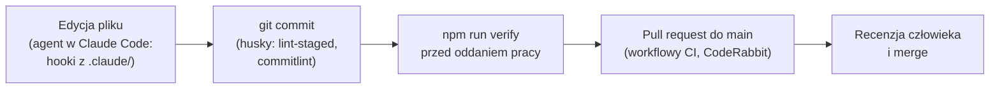
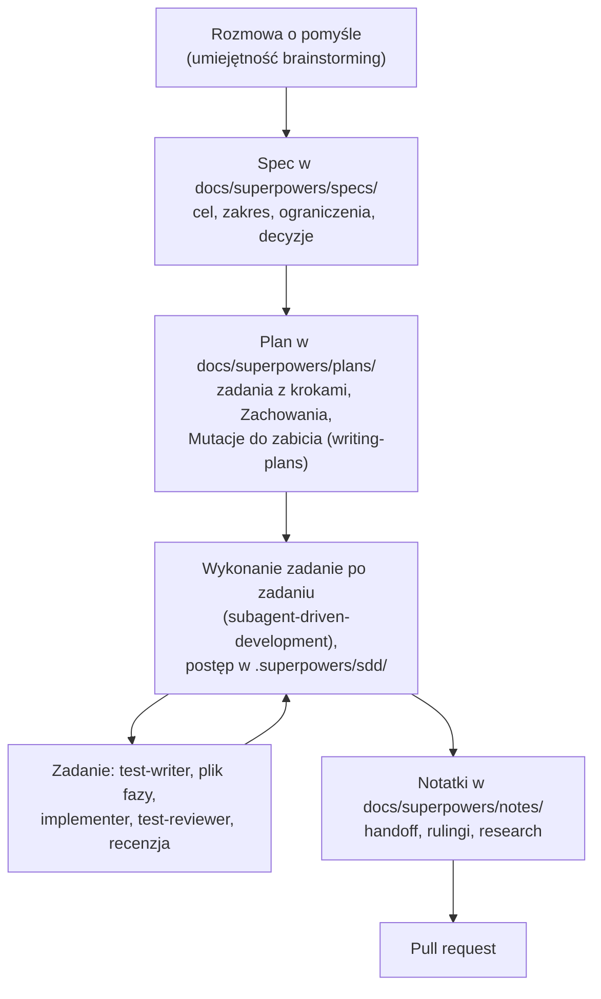

# Praca z kitem

Po przeczytaniu będziesz wiedzieć:

- którą zmianę zostawić w projekcie, a którą wysłać jako pull request do repozytorium kitu `webamigos/wa-kit`, i jak to zrobić krok po kroku;
- co sprawdzają hooki przy `git commit`, bramka `npm run verify` i CI oraz jak napisać wiadomość commitu, którą przyjmie commitlint;
- po co są dwa pliki instrukcji dla agentów AI, `CLAUDE.md` i `AGENTS.md`, i co zrobić, gdy `next dev` dopisze blok do `AGENTS.md`;
- co blokują hooki Claude Code z `.claude/settings.json` i do czego służą agenci z `.claude/agents/`;
- jak przebiega praca według procesu superpowers i gdzie leżą jej dokumenty;
- których plików nie edytuje się ręcznie i co uruchomić po zmianie, od której zależą.

Zweryfikowano z kodem: 25adbb8, 2026-10-28

Źródła:

- `CLAUDE.md`
- `AGENTS.md`
- `.claude/settings.json`
- `.claude/hooks/block-comments.mjs`
- `.claude/hooks/protect-tests.mjs`
- `.claude/agents/test-writer.md`
- `.claude/agents/test-reviewer.md`
- `.husky/pre-commit`
- `.husky/commit-msg`
- `.lintstagedrc.json`
- `commitlint.config.mjs`
- `node_modules/@commitlint/config-conventional/lib/index.js` (wersja 19.8.1)
- `.coderabbit.yaml`
- `package.json`
- `turbo.json`
- `eslint.config.mjs`
- `.prettierignore`
- `.gitignore`
- `.wa/kit.json`
- `.github/workflows/`
- `vitest.config.ts`
- `next.config.ts`
- `src/shared/config/project.ts`
- `src/modules.generated.ts`
- `prisma/schema/organizations.prisma`
- `kit/cli/src/bin.ts`
- `kit/cli/src/generate/index.ts`
- `kit/cli/src/generate/registry.ts`
- `docs/superpowers/`
- `node_modules/next/dist/server/lib/generate-agent-files.js`, `node_modules/next/dist/server/lib/app-info-log.js`, `node_modules/next/dist/server/lib/start-server.js` (Next.js 16.3.8)
- dokumentacja Claude Code: [hooki](https://code.claude.com/docs/en/hooks) i [pliki instrukcji](https://code.claude.com/docs/en/memory)

Ten plik opisuje pracę wokół kodu: dokąd trafia zmiana, przez jakie kontrole przechodzi, jak współpracować z agentami AI i jak wygląda proces, w którym powstaje kit. Dotyczy repozytorium kitu i projektów klientów, bo projekt powstaje z kitu (`wa create`) i ma te same pliki konfiguracji ([D39](decyzje.md#d39), [D38](decyzje.md#d38)). Reguły są w [CLAUDE.md](../CLAUDE.md) i [AGENTS.md](../AGENTS.md). Ten plik je wyjaśnia i podaje powody, ale ich nie przepisuje. Dodaje tylko kilka praktyk oznaczonych słowem **Zalecenie**: tych `AGENTS.md` nie zawiera i nic ich nie sprawdza.

Pojęcia używane w tym pliku:

- **Repozytorium kitu**: `webamigos/wa-kit`, z którego pochodzi kod rdzenia. **Projekt** (projekt klienta): repozytorium aplikacji klienta, które powstało z kitu komendą `wa create`. Moduł, feature, rejestr modułów i **szew** (miejsce, przez które rdzeń dowiaduje się o modułach: plik generowany albo region) definiuje [decyzje.md](decyzje.md#pojęcia).
- **Design doc, plan 1, handoff, ruling**: design doc to [główny dokument projektowy kitu](superpowers/specs/2026-10-26-wa-kit-design.md), plan 1 to [plan budowy rdzenia](superpowers/plans/2026-10-26-wa-kit-plan-1-core.md). Handoff to notatka przekazania pracy między sesjami, a ruling to decyzja, którą prowadzący wykonanie planu podjął sam, gdy plan czegoś nie rozstrzygał. Rulingi planu 1 są w [handoffie planu 1](superpowers/notes/2026-10-26-plan-1-handoff.md).
- **Pull request do kitu**: propozycja zmiany do gałęzi `main` repozytorium kitu. Tylko tą drogą kod wraca z projektu do kitu.
- **Agent AI**: narzędzie, które na polecenie samo czyta i zmienia kod, na przykład Claude Code, Codex albo Cursor. **Subagent** to osobna sesja agenta z własnym kontekstem, uruchomiona przez główną sesję. **Orkiestrator** to główna sesja, która prowadzi plan i uruchamia subagentów ([08b-testy-adwersarialne.md](08b-testy-adwersarialne.md)).
- **Hook Claude Code**: skrypt, który Claude Code uruchamia przed użyciem narzędzia przez agenta i który może to użycie zablokować. To co innego niż hooki git, które husky uruchamia przy `git commit`.
- **superpowers**: zestaw umiejętności (skills) dla Claude Code, który prowadzi pracę od rozmowy o pomyśle przez spec i plan do wykonania planu przez subagentów.

<a id="punkty-kontroli"></a>

## Gdzie zmiana jest sprawdzana

Zmiana przechodzi przez kilka punktów kontroli. Każdy łapie co innego, a pierwsze trzy można ominąć, więc ostatnim automatycznym punktem jest CI.



| Punkt | Co działa | Co zatrzymuje | Czego nie widzi | Opis |
| --- | --- | --- | --- | --- |
| Edycja pliku przez agenta w Claude Code | Hooki `block-comments.mjs` i `protect-tests.mjs`. | Nowy komentarz w kodzie; zmianę testu w fazie implementacji. | Zapisu przez powłokę, zmian w innych narzędziach i w edytorze. | [Hooki Claude Code](#hooki) |
| `git commit` | husky: lint-staged i commitlint. | Błąd ESLint, którego `--fix` nie naprawi; wiadomość niezgodną z Conventional Commits. | Plików spoza commitu. `git commit --no-verify` pomija oba hooki. | [Commity](#commity) |
| Przed oddaniem pracy | `npm run verify`. | Błędy ESLint, typów, testów jednostkowych, buildu, testów pakietów workspace i hooków. | Testów integracyjnych, e2e i mutacyjnych; nieaktualnych plików generowanych. | [Bramka](#verify) |
| Pull request i push do `main` | Workflowy z `.github/workflows/`, CodeRabbit. | To samo co `verify`, a do tego nieaktualne pliki generowane, testy integracyjne i e2e, sekrety w commitach (testy mutacyjne tylko lokalnie albo ręcznie); przy zmianie zależności także podatności, a przy zmianie workflowów ich błędy. | Wiadomości commitów i formatowania Prettierem. | [10-wdrozenie.md](10-wdrozenie.md#ci) |
| Recenzja | Człowiek. | Reguły, których nie pilnuje żadne narzędzie. | — | [Jak czytać wpis](decyzje.md#jak-czytać-wpis) |

Dlatego regułę, którą pilnuje tylko hook Claude Code albo hook git, sprawdza też recenzent: hook Claude Code nie działa w innych narzędziach, a hooki git można wyłączyć.

<a id="projekt-a-kit"></a>

## Zmiany w projekcie a poprawki do kitu

### Dlaczego poprawki wracają do kitu

Projekt dostaje kod kitu jako zwykły kod, a nie jako zależność, i może go zmieniać jak własny ([D39](decyzje.md#d39)). Poprawki z kitu przenosi do istniejącego projektu dopiero wydanie nowej wersji kitu i `wa update` w projekcie ([16-cli-wa.md](16-cli-wa.md#wa-update)): komenda scala zmiany kitu między tagami z lokalnymi zmianami projektu, a zmianę w tych samych liniach zostawia jako konflikt do ręcznego rozwiązania. Pole `files` modułów w `.wa/kit.json` projektu przechowuje hashe skopiowanych plików, więc `wa remove` i `wa update` wiedzą, które pliki zmieniono lokalnie. Co dokumentacja świadomie pomija, opisuje [README.md](README.md).

Z tego wynika reguła z [CLAUDE.md](../CLAUDE.md#pochodzenie-kodu) i [AGENTS.md](../AGENTS.md#co-to-jest): zmiany specyficzne dla projektu robisz w projekcie, a poprawki, które przydadzą się innym projektom, wysyłasz jako pull request do `webamigos/wa-kit`. Powody:

- Kit jest źródłem kolejnych projektów. Poprawki, która nie wróci do kitu, zabraknie w każdym nowym projekcie, a ten sam błąd trzeba będzie znaleźć jeszcze raz.
- Ten sam błąd poprawiony w kilku projektach na różne sposoby daje kopie rdzenia, których nie da się już porównać ani z kitem, ani ze sobą.

### Co zostaje w projekcie, a co trafia do kitu

O miejscu decyduje pytanie: czy ta zmiana byłaby poprawna w każdym projekcie na kicie?

| Zmiana | Gdzie | Powód |
| --- | --- | --- |
| Funkcja klienta: feature w `src/features/<x>/`, jego plik schematu w `prisma/schema/`, wpis w `.wa/kit.json`, strony. | Projekt | Dotyczy jednego klienta. Przykład: feature `notes` z [09-nowy-modul.md](09-nowy-modul.md). |
| Nazwa i slug projektu w `src/shared/config/project.ts`. | Projekt | Każdy projekt ma własne ([05-moduly-rdzenia.md](05-moduly-rdzenia.md#project)). |
| Migracje w `prisma/migrations/`. | Projekt | Historia migracji zależy od modułów projektu, a kit migracji nie commituje ([D13](decyzje.md#d13)). |
| Wpis funkcji klienta w `projectModules` w `.wa/kit.json`. | Projekt | Dotyczy jednego klienta; testów rdzenia to nie zmienia ([09b-implementacja-i-bramki.md](09b-implementacja-i-bramki.md#testy-rdzenia)). |
| Błąd w kodzie rdzenia: guard, komenda, query, komponent, walidacja zmiennych środowiskowych. | Kit, a w projekcie od razu, jeśli poprawka jest pilna. | Ten sam kod jest w każdym projekcie. |
| Wspólny tekst w `src/app/messages/`, nowy język. | Kit | Teksty rdzenia i lista języków w generatorze to kod kitu ([07-i18n-mail-env.md](07-i18n-mail-env.md#dodawanie-jezyka)). |
| Zmiana generatora albo CLI w `kit/cli/`. | Kit | Wynik generatora ma być taki sam w każdym projekcie. Pracę nad CLI, bramkę CLI i bundel opisuje [16b-rozwoj-kitu.md](16b-rozwoj-kitu.md). |
| Reguły dla agentów (`AGENTS.md`, `CLAUDE.md`), hooki i agenci w `.claude/`, workflowy CI, konfiguracja husky, lint-staged i commitlint. | Kit | Wspólny sposób pracy. Zmiana w jednym projekcie rozjeżdża go z pozostałymi. |
| Funkcja klienta potrzebuje od rdzenia czegoś, czego rdzeń nie daje, na przykład szwu, przez który moduł dopisałby się do pliku rdzenia. | Kit, a w projekcie lokalna zmiana rdzenia do czasu poprawki w kicie. | Moduł nie edytuje rdzenia ([D03](decyzje.md#d03)), więc brakujący szew dodaje się w kicie. |

**Zalecenie.** Poprawkę pliku kitu, która ma wrócić do kitu (wiersze „Kit” w tabeli), zrób w projekcie w osobnym commicie, który zawiera tylko tę poprawkę. Taki commit łatwo przenieść do kitu ([krok 2](#pull-request)). Nie dotyczy to zmian rdzenia, które należą do funkcji projektu, na przykład wpisu feature w `projectModules` i plików generowanych: te commitujesz razem z feature, jak w [kroku 9 tutorialu](09b-implementacja-i-bramki.md#krok-9).

<a id="pull-request"></a>

### Pull request do kitu krok po kroku

Poprawkę przenosisz ręcznie. Projekt i kit mają ten sam układ katalogów ([D38](decyzje.md#d38)), więc ścieżki plików się zgadzają.

1. **Gałąź w klonie kitu.** W katalogu z klonem repozytorium kitu zacznij od najnowszego `main`:

   ```bash
   git switch main
   git pull
   git switch -c fix/<temat>
   ```

2. **Przeniesienie zmiany** (zalecany sposób; bez osobnego commitu w projekcie przenosisz zmianę ręcznie). Gdy poprawka ma w projekcie własny commit, zapisz ją jako łatkę. W katalogu projektu:

   ```bash
   git diff <commit>~1 <commit> -- <ścieżki plików kitu> > ~/poprawka.patch
   ```

   Potem w katalogu klonu kitu:

   ```bash
   git apply --check ~/poprawka.patch
   git apply ~/poprawka.patch
   ```

   `git apply --check` sprawdza, czy łatka pasuje, i niczego nie zmienia. Kończy się błędem, gdy w kicie zmieniły się linie, których dotyczy łatka, albo linie wokół nich. Wtedy spróbuj `git apply -3 ~/poprawka.patch`: git bierze wersję pliku sprzed poprawki z historii kitu, scala obie zmiany i dodaje wynik do indeksu, a gdy obie strony zmieniły te same linie, zostawia w pliku znaczniki konfliktu do ręcznego rozwiązania. Działa to, gdy projekt nie zmieniał wcześniej tego pliku, bo wtedy wersja sprzed poprawki jest w historii kitu. W pozostałych przypadkach przenieś zmianę ręcznie, porównując pliki. Łatka nie zawiera wiadomości commitu, więc napiszesz ją w kicie od nowa. Oba warianty sprawdzono na dwóch repozytoriach testowych z niezależną historią.

3. **Test, który bez poprawki nie przechodzi.** Tego wymaga [AGENTS.md](../AGENTS.md#testy) dla każdej poprawki błędu. Jeśli test powstał w projekcie, przenieś go razem z poprawką. Gdy pracują agenci, test pisze `test-writer` przed implementacją ([Proces superpowers](#superpowers)).

4. **Bramki.** Uruchom `npm run verify`, a przy zmianie query, komendy albo przepływu logowania także testy integracyjne i e2e ([08-testy.md](08-testy.md)). Przy zmianie pliku z listy `critical` w `mutation-gate.json` uruchom lokalnie `npm run test:mutation:task -- <pliki>` i `npm run test:mutation:gate`, bo CI nie robi tego za Ciebie ([08b-testy-adwersarialne.md](08b-testy-adwersarialne.md#bramka)). Generator ma wypisać `Bez zmian`, bo CI sprawdza to samo ([Bramka](#verify)).

5. **Dokumentacja.** **Zalecenie:** gdy zmiana dotyczy zachowania opisanego w `docs/`, popraw opis w tym samym pull requeście. Każdy plik dokumentacji wymienia w nagłówku „Źródła:” pliki, które opisuje, więc pliki do sprawdzenia znajdziesz komendą `grep -l '<ścieżka zmienionego pliku>' docs/*.md`. Linia „Zweryfikowano z kodem” podaje commit, z którym plik sprawdzono, a `git log <commit>..HEAD -- <źródła>` pokazuje, co od niego zmieniło się w źródłach. Nowa decyzja albo zmiana obowiązującej trafia do [decyzje.md](decyzje.md#statusy-i-numeracja).

6. **Commit i pull request do `main`.** Wiadomość według sekcji [Commity](#commity). Pull request uruchamia `ci.yml` (generator, `npm run verify`, testy integracyjne), `e2e.yml` (chyba że zmienia tylko `docs/**`, pliki `*.md` w katalogu głównym albo `.husky/**`; wzorzec `*` w GitHub Actions nie obejmuje `/`) i `security-secret-scan.yml`, a przy zmianie zależności także `security-audit.yml`, przy zmianie workflowów `workflow-lint.yml` ([10-wdrozenie.md](10-wdrozenie.md#ci)). Automatyczną recenzję robi [CodeRabbit](#coderabbit), jeśli jest zainstalowany dla repozytorium. Wpisy wyjątków w `mutation-gate.json` zatwierdza człowiek w pull requeście ([D26](decyzje.md#d26)).

7. **Po scaleniu.** Projekt, z którego przyszła poprawka, ma ją już u siebie. Inne projekty jej nie dostaną same: kto je prowadzi, przenosi ją tak samo, w drugą stronę.

<a id="modul-kitu"></a>

### Nowy moduł kitu

Moduł kitu to kod, który ma trafić do wielu projektów: manifest w `kit/modules/<nazwa>.json` i feature, które ten manifest obejmuje. Poza rdzeniem `core` kit ma moduły `audit-logs`, `api-keys` i `uploads` ([12-moduly-kitu.md](12-moduly-kitu.md#lista-modulow)). Nowy moduł powstaje w repozytorium kitu, przez pull request. Kod piszesz tymi samymi krokami co funkcję klienta w [09-nowy-modul.md](09-nowy-modul.md) i [09b-implementacja-i-bramki.md](09b-implementacja-i-bramki.md); listę kroków właściwych dla kitu podaje [16b-rozwoj-kitu.md](16b-rozwoj-kitu.md#nowy-modul-kitu). Różnice:

- Manifest piszesz w `kit/modules/<nazwa>.json`, a `npm run wa -- kit sync` przepisuje go do sekcji `modules` w `.wa/kit.json` kitu ([16b-rozwoj-kitu.md](16b-rozwoj-kitu.md#kit-sync)). Funkcja klienta dostaje wpis w osobnej sekcji `projectModules` ([krok 3 tutorialu](09-nowy-modul.md#krok-3)). Pola manifestu opisuje [02b-rejestr-i-generator.md](02b-rejestr-i-generator.md#referencja-manifest).
- Każdy nowy plik i każda nowa zależność npm muszą mieć w manifeście właściciela, inaczej padnie test własności w bramce CLI ([16b-rozwoj-kitu.md](16b-rozwoj-kitu.md#wlasnosc), [D38](decyzje.md#d38)).
- Migracji nie commitujesz, bo kit ich nie commituje ([D13](decyzje.md#d13)).
- Testy rdzenia się nie zmieniają: porównują rejestr tylko z pięcioma modułami rdzenia (`src/test/core-modules.ts`), a spójność całego rejestru, także nowego modułu kitu, sprawdza `src/shared/lib/modules/__tests__/registry-consistency.test.ts` ([09b-implementacja-i-bramki.md](09b-implementacja-i-bramki.md#testy-rdzenia)).
- Decyzję, która obowiązuje w kodzie modułu, dopisujesz do [decyzje.md](decyzje.md#statusy-i-numeracja).

Moduł kitu dodajesz do istniejącego projektu komendą `wa add`, a usuwasz komendą `wa remove` ([16-cli-wa.md](16-cli-wa.md#wa-add), [16-cli-wa.md](16-cli-wa.md#wa-remove)).

<a id="commity"></a>

## Commity

Reguła z [AGENTS.md](../AGENTS.md#commity): Conventional Commits, temat małymi literami, a husky uruchamia lint-staged i commitlint. Jeden format wiadomości pozwala przejrzeć historię według rodzaju zmiany, na przykład same poprawki błędów: `git log --oneline --grep '^fix'`.

### Format wiadomości

Pierwsza linia ma postać `typ(zakres): temat`.

- **Typ** to jeden z: `build`, `chore`, `ci`, `docs`, `feat`, `fix`, `perf`, `refactor`, `revert`, `style`, `test`. Listę daje `@commitlint/config-conventional`, który `commitlint.config.mjs` rozszerza (`extends`).
- **Zakres** w nawiasie jest opcjonalny. W historii repozytorium to nazwa feature albo obszaru, na przykład `auth`, `users`, `organizations`, `cli`, `i18n`, `env`, `prisma`, `claude`.
- **Temat** zaczyna się małą literą i nie kończy kropką. W historii repozytorium identyfikatory w temacie zachowują pisownię, a tematy są po angielsku.

Przykłady z historii: `feat(organizations): let superadmin enter any organization`, `fix(cli): keep line endings and reject marker tokens in region bodies`, `refactor: rename BETTER_AUTH_URL to APP_URL`, `docs: add rules for tests that try to break the code`.

Co sprawdza commitlint (reguły `@commitlint/config-conventional` w wersji 19.8.1):

| Reguła | Co sprawdza | Przykład odrzucony |
| --- | --- | --- |
| `type-enum`, `type-case`, `type-empty` | Typ jest z listy, małymi literami i jest obecny. | `feature: add x`, `Feat: add x` |
| `subject-case` | Temat nie jest zapisany jak zdanie (`Add notes`), jak tytuł (`Organization Notes`), w PascalCase ani wielkimi literami. | `feat: Add notes`, `feat: ADD NOTES` |
| `subject-empty`, `subject-full-stop` | Temat jest obecny i nie kończy się kropką. | `feat: add x.` |
| `header-max-length`, `header-trim` | Pierwsza linia ma najwyżej 100 znaków i nie zaczyna się ani nie kończy spacją. | — |
| `body-max-line-length`, `footer-max-line-length` | Linie treści i stopki mają najwyżej 100 znaków. | — |
| `body-leading-blank`, `footer-leading-blank` | Pusta linia przed treścią i przed stopką. Tylko ostrzeżenie. | — |

Odrzucona wiadomość przerywa commit, a commitlint wypisuje regułę, na przykład:

```text
⧗   input: feat: Add notes
✖   subject must not be sentence-case, start-case, pascal-case, upper-case [subject-case]
```

Reguła „temat małymi literami” z `CLAUDE.md` jest surowsza niż `subject-case`, więc commitlint sprawdza tylko jej część. Odrzuca temat zaczynający się wielką literą, ale przepuszcza `feat: add API keys` (sprawdzone). To zgodne z historią, w której identyfikatory zachowują pisownię.

Wiadomość sprawdzisz przed commitem tak:

```bash
echo "feat(notes): organization notes" | npx --no -- commitlint
```

Poprawna wiadomość nie wypisuje nic i kończy się kodem 0.

### Co robi `git commit`

`npm ci` i `npm install` uruchamiają skrypt `prepare`, czyli `husky`. Husky ustawia w konfiguracji git repozytorium `core.hooksPath` na swój podkatalog w `.husky/`, więc git przy commicie wywołuje skrypty z `.husky/`:

| Hook git | Plik | Treść | Co robi |
| --- | --- | --- | --- |
| `pre-commit` | `.husky/pre-commit` | `lint-staged` | Uruchamia lint-staged na plikach dodanych do commitu. |
| `commit-msg` | `.husky/commit-msg` | `npx --no -- commitlint --edit $1` | Sprawdza wiadomość commitu. `--no` nie pozwala `npx` pobrać pakietu, którego nie ma w `node_modules`. |

Konfiguracja lint-staged:

`.lintstagedrc.json`

```json
{
  "*.{js,jsx,ts,tsx,mts,cts}": ["eslint --fix"],
  "*.{json,js,ts,jsx,tsx,mts,cts,html}": ["prettier --write --ignore-unknown"]
}
```

- lint-staged działa tylko na plikach dodanych do commitu (`git add`), więc commit nie poprawia reszty repozytorium.
- `eslint --fix` poprawia to, co da się poprawić automatycznie. Błąd, którego nie naprawi, przerywa commit. Poprawki ESLint i Prettiera trafiają do commitu.
- Wzorce nie obejmują plików z rozszerzeniem `mjs` i `cjs` ani plików Markdown, YAML i CSS. Takich plików commit nie poprawia ani nie formatuje.
- ESLint pomija ścieżki z `globalIgnores` w `eslint.config.mjs` (między innymi `docs/`, `packages/`, `.claude/` i trzy pliki generowane: oba pliki rejestru modułów i `src/i18n/locales.generated.ts`), a Prettier ścieżki z `.prettierignore`. Dzięki temu commit nie zmienia plików generowanych ([D04](decyzje.md#d04)).

### Pomijanie hooków

`git commit --no-verify` pomija oba hooki, a zmienna `HUSKY=0` wyłącza wszystkie hooki husky. CI nie uruchamia ani commitlint, ani Prettiera, więc commit z pominiętymi hookami zostawia w historii wiadomość, której nikt nie sprawdził, i kod bez formatowania. Błędy ESLint złapie wtedy dopiero `npm run verify` albo job `verify` w CI. **Zalecenie:** nie pomijaj hooków.

<a id="verify"></a>

## Bramka `npm run verify`

[CLAUDE.md](../CLAUDE.md#bramka) wymaga `npm run verify` przed oddaniem pracy: przed pushem, pull requestem albo raportem agenta. Powód: job `verify` w CI uruchamia ten sam skrypt, więc błąd przeoczony lokalnie zatrzyma pull request.

`package.json`

```json
"verify": "npm run lint && npm run typecheck && npm test && npm run build && turbo run test typecheck && npm run test:hooks",
```

| Krok | Komenda | Co sprawdza |
| --- | --- | --- |
| `npm run lint` | `eslint` | Reguły ESLint w repozytorium poza `globalIgnores` ([06-wzorce-kodu.md](06-wzorce-kodu.md#reguly-stylu)). |
| `npm run typecheck` | `tsc --noEmit` | Typy aplikacji. |
| `npm test` | `vitest run` | Testy jednostkowe i komponentowe, w tym test architektury ([D24](decyzje.md#d24)). |
| `npm run build` | `next build` | Build produkcyjny. |
| `turbo run test typecheck` | Skrypty `test` i `typecheck` pakietów w workspace `packages/*`. | Nic, bo katalog `packages/` jest pusty (CLI leży w `kit/cli` i ma własną bramkę `npm run verify --prefix kit/cli`, [16b-rozwoj-kitu.md](16b-rozwoj-kitu.md#bramka-cli)). Zadania w `turbo.json` mają `dependsOn: ["^build"]`. |
| `npm run test:hooks` | `node --test` na plikach `.claude/hooks/*.test.mjs`. | Hooki Claude Code ([Hooki](#hooki)). |

Kroki są połączone `&&`, więc łańcuch kończy się na pierwszym błędzie i kolejne kroki się nie wykonują. `verify` nie uruchamia testów integracyjnych, e2e ani mutacyjnych, bo wymagają bazy albo przeglądarki albo trwają długo ([08-testy.md](08-testy.md#rodzaje)). Nie sprawdza też aktualności plików generowanych, formatowania ani wiadomości commitów. Job `verify` w CI przed `npm run verify` uruchamia generator i porównuje wynik z repozytorium. **Zalecenie:** zrób to samo lokalnie i sprawdź, że generator wypisuje `Bez zmian`:

```bash
npm run wa -- generate
npm run verify
```

Czasy przebiegów są w [08-testy.md](08-testy.md#czas). Pierwszy `verify` po dodaniu feature w projekcie przechodzi bez zmian w testach rdzenia ([09b-implementacja-i-bramki.md](09b-implementacja-i-bramki.md#testy-rdzenia)).

<a id="agenci-ai"></a>

## Praca z agentami AI

Repozytorium jest przygotowane do pracy z agentami AI: instrukcje są w `CLAUDE.md` i `AGENTS.md`, hooki i definicje agentów w `.claude/`, a pull requesty recenzuje CodeRabbit. Hooki i agenci testów działają tylko w Claude Code. Inne narzędzia dostają tylko instrukcje, więc reguły pilnują w nich CI i recenzja.

<a id="claude-agents-md"></a>

### `CLAUDE.md` i `AGENTS.md`

| Plik | Kto go czyta | Zawartość |
| --- | --- | --- |
| `AGENTS.md` | Agenci AI, dla których plik jest przeznaczony (pierwsze zdanie wymienia Claude Code, Codex, Cursor i Copilot), oraz recenzja CodeRabbit. | Pełne instrukcje: czym jest kit, kolejność priorytetów, komendy, twarde reguły, testy, commity. |
| `CLAUDE.md` | Claude Code, który wczytuje go na początku sesji w repozytorium, oraz recenzja CodeRabbit. | Krótka lista twardych reguł (pochodzenie kodu, dane, komentarze, pliki generowane, testy, bramka) i import `AGENTS.md`. |

Trzecia linia `CLAUDE.md` importuje `AGENTS.md`:

`CLAUDE.md`

```markdown
Twarde reguły tego repozytorium. Pełne instrukcje: @AGENTS.md
```

Zapis `@ścieżka` w `CLAUDE.md` każe Claude Code wczytać wskazany plik razem z `CLAUDE.md`. Import jest potrzebny, bo gdy w katalogu roboczym albo wyżej jest `CLAUDE.md`, Claude Code domyślnie czyta tylko `CLAUDE.md`, a `AGENTS.md` pomija ([dokumentacja Claude Code](https://code.claude.com/docs/en/memory), sekcja „AGENTS.md”). Dzięki importowi Claude Code dostaje pełne instrukcje z `AGENTS.md`, a inne narzędzia czytają ten sam plik bezpośrednio. Powody takiego podziału:

- **Jedno źródło pełnych reguł.** Gdyby każde narzędzie miało własny plik z pełną treścią, każdą zmianę reguły trzeba by wprowadzać w kilku miejscach i któreś zostałoby nieaktualne. Next.js używa tego samego układu: gdy nie ma żadnego z dwóch plików, `next dev` uruchomione przez agenta tworzy `AGENTS.md` i `CLAUDE.md`, który zawiera tylko import `AGENTS.md` (stała `CLAUDE_MD_CONTENT` w `node_modules/next/dist/server/lib/generate-agent-files.js`).
- **Skrót najważniejszych reguł w `CLAUDE.md`.** Lista w `CLAUDE.md` nie dodaje reguł. Każda ma pełne brzmienie w `AGENTS.md`, a `CLAUDE.md` zbiera te, których złamanie kosztuje najwięcej: filtr `organizationId`, guardy, potwierdzenie trybu serwisowego, zakaz komentarzy, pliki generowane, testy pisane przed kodem.

Zasady pracy z tymi plikami:

- Oba pliki mają być spójne (drugie zdanie `AGENTS.md`), ale nic tego nie sprawdza. **Zalecenie:** zmieniając twardą regułę, popraw oba pliki w jednym commicie.
- Długie listy, na przykład komendy, ograniczenia testu architektury i zasady testów, zostają w `AGENTS.md` (decyzja Jakuba z projektu dokumentacji). Dokumentacja w `docs/` je wyjaśnia i linkuje, zamiast kopiować. Zmiana reguły to więc zmiana `AGENTS.md`, `CLAUDE.md`, jeśli reguła ma tam skrót, i pliku dokumentacji, który ją objaśnia.
- Oba pliki pochodzą z kitu, więc zmiana reguły to zmiana kitu ([tabela](#projekt-a-kit)).

Gdzie dokumentacja wyjaśnia sekcje `AGENTS.md`:

| Sekcja `AGENTS.md` | Wyjaśnienie |
| --- | --- |
| Co to jest, Kolejność priorytetów | [Zasady kitu](02-architektura.md#zasady-kitu), [Zmiany w projekcie a poprawki do kitu](#projekt-a-kit) |
| Komendy | [01-uruchomienie.md](01-uruchomienie.md), [komendy testów](08-testy.md#referencja-komendy) |
| Dane i organizacje | [03-dane-i-organizacje.md](03-dane-i-organizacje.md), [04b-superadmin-i-tryb-serwisowy.md](04b-superadmin-i-tryb-serwisowy.md) |
| Bez komentarzy w kodzie | [Komentarze](06-wzorce-kodu.md#komentarze), [D23](decyzje.md#d23) |
| Moduły i pliki generowane | [02b-rejestr-i-generator.md](02b-rejestr-i-generator.md), [Pliki generowane](#pliki-generowane) |
| Struktura | [Anatomia feature](02-architektura.md#anatomia-feature), [06-wzorce-kodu.md](06-wzorce-kodu.md) |
| Auth | [04-auth-i-role.md](04-auth-i-role.md), [04b-superadmin-i-tryb-serwisowy.md](04b-superadmin-i-tryb-serwisowy.md) |
| i18n, Mail | [07-i18n-mail-env.md](07-i18n-mail-env.md) |
| Testy | [08-testy.md](08-testy.md), [test architektury](06-wzorce-kodu.md#test-architektury) |
| Testy, które próbują złamać kod | [08b-testy-adwersarialne.md](08b-testy-adwersarialne.md) |
| Commity | [Commity](#commity), [Bramka](#verify) |

<a id="next-dev-agents-md"></a>

### `next dev` uruchomione przez agenta zmienia `AGENTS.md`

Next.js 16.3.8 przy starcie `next dev` sprawdza, czy uruchomił go agent AI, na przykład sesja Claude Code. Jeśli tak, a ani `AGENTS.md`, ani `CLAUDE.md` nie ma aktualnego bloku reguł Next.js, funkcja `writeAgentFiles` dopisuje ten blok na końcu `AGENTS.md`. `next.config.ts` kitu nie wyłącza tego ustawieniem `agentRules: false`. Uruchomienie przez człowieka w zwykłym terminalu niczego nie zmienia.

Po czym to poznasz:

- terminal `next dev` wypisuje ``✓ Generated AGENTS.md for AI agents. Set `agentRules: false` in next.config to disable.``;
- `git status --short` pokazuje `AGENTS.md` jako zmieniony (` M AGENTS.md`);
- na końcu `AGENTS.md` jest blok między liniami `<!-- BEGIN:nextjs-agent-rules -->` i `<!-- END:nextjs-agent-rules -->`.

Co zrobić: `AGENTS.md` pochodzi z kitu, a `AGENTS.md` kitu tego bloku nie zawiera, więc nie commituj go razem z inną zmianą, choć tekst bloku do tego zachęca. Jeśli sam nie zmieniasz `AGENTS.md`, przed `git add` przywróć plik komendą `git restore AGENTS.md`. Gdy zmiana jest już w indeksie, samo `git restore AGENTS.md` nic nie da, bo przywraca plik z indeksu. Wtedy użyj `git restore --staged --worktree AGENTS.md`. Obie komendy kasują też Twoje niezacommitowane zmiany w `AGENTS.md`, więc gdy je masz, usuń blok ręcznie. Blok wraca przy każdym starcie `next dev` przez agenta. **Zalecenie:** przed każdym commitem sprawdź `git status`. Tę samą sytuację z przebiegu tutorialu opisuje [09b-implementacja-i-bramki.md](09b-implementacja-i-bramki.md#krok-8-przegladarka).

<a id="hooki"></a>

### Hooki Claude Code

`.claude/settings.json` rejestruje dwa hooki. Plik jest w repozytorium, więc hooki działają u każdego, kto otworzy repozytorium kitu albo projekt w Claude Code.

`.claude/settings.json`

```json
{
  "hooks": {
    "PreToolUse": [
      {
        "matcher": "Edit|Write",
        "hooks": [
          {
            "type": "command",
            "command": "node \"$CLAUDE_PROJECT_DIR/.claude/hooks/block-comments.mjs\""
          },
          {
            "type": "command",
            "command": "node \"$CLAUDE_PROJECT_DIR/.claude/hooks/protect-tests.mjs\""
          }
        ]
      }
    ]
  }
}
```

Jak to działa:

- `PreToolUse` oznacza: przed użyciem narzędzia. `matcher` o wartości `Edit|Write` to lista dokładnych nazw, więc hooki działają przy narzędziach `Edit` (zamiana fragmentu pliku) i `Write` (zapis całego pliku), a na przykład przy `NotebookEdit` już nie.
- Przed każdym takim użyciem Claude Code uruchamia oba polecenia i przekazuje im na standardowym wejściu JSON z nazwą narzędzia i jego parametrami: ścieżką pliku (`file_path`), zastępowanym fragmentem i nowym tekstem (`old_string`, `new_string`) albo nową treścią pliku (`content`), a także bieżący katalog sesji (`cwd`).
- `$CLAUDE_PROJECT_DIR` to katalog, w którym wystartowała sesja Claude Code. Zostaje taki sam, gdy agent przejdzie w trakcie sesji do worktree albo innego katalogu; za agentem podąża tylko pole `cwd` (dokumentacja hooków, „Worktrees are different”). Dzięki temu skrypt hooka znajdzie się niezależnie od bieżącego katalogu, ale zawsze jest to wersja z katalogu startu sesji. Cudzysłów przekazuje ścieżkę ze spacją jako jeden argument, a sam skrypt działa z takiej ścieżki (test „the CLI exits 2 on a comment and 0 without one, from a path with a space” w `.claude/hooks/block-comments.test.mjs`).
- Kod wyjścia 2 blokuje użycie narzędzia: Claude Code nie wykonuje edycji i pokazuje agentowi tekst, który hook wypisał na wyjście błędów. Kod 0 przepuszcza edycję. Każdy inny wynik, na przykład wyjątek w samym hooku, to błąd nieblokujący: edycja przechodzi, a w transkrypcie sesji pojawia się tylko notka `<nazwa hooka> hook error` z pierwszą linią wyjścia błędów. Uszkodzony hook przestaje więc chronić, a jedynym śladem jest ta notka. Dlatego hooki mają testy w `npm run verify`.

| | `block-comments.mjs` | `protect-tests.mjs` |
| --- | --- | --- |
| Kiedy blokuje | Edycja dodaje linię komentarza w pliku `.ts/.tsx/.js/.jsx/.mjs/.cjs/.mts/.cts`. | Plik `.superpowers/phase` w katalogu startu sesji (`$CLAUDE_PROJECT_DIR`) ma treść `implement` (po obcięciu białych znaków), a ścieżka edytowanego pliku wskazuje test. |
| Co przepuszcza | `// WHY:` do 3 linii, dyrektywy narzędzi i kilka innych form ([Komentarze](06-wzorce-kodu.md#komentarze)); komentarze, które tylko się przesunęły; ścieżki z katalogami `node_modules`, `generated` i `components/ui`. | Każdą edycję, gdy pliku fazy nie ma albo ma inną treść; pliki poza wzorcem testów. |
| Co porównuje | Przy `Edit` zastępowany fragment z nowym tekstem, przy `Write` istniejący plik z nową treścią. | Tylko ścieżkę pliku. |
| Wzorzec ścieżki | Stałe `CODE_FILE` (rozszerzenia) i `EXEMPT_PATH` (wyjątki). | Stała `TEST_PATH`: katalogi `__tests__` i `e2e`, pliki `*.test.*` i `*.spec.*` z rozszerzeniem JS albo TS. |
| Komunikat | `Blocked: this edit adds code comments. The code must explain itself.` i znalezione linie. | `Zablokowane: faza implementacji (.superpowers/phase = implement), testy są tylko do odczytu.` |
| Testy | `.claude/hooks/block-comments.test.mjs` | `.claude/hooks/protect-tests.test.mjs` |
| Decyzja i opis | [D23](decyzje.md#d23), [Komentarze](06-wzorce-kodu.md#komentarze) | [D25](decyzje.md#d25), [Faza implementacji](08b-testy-adwersarialne.md#faza) |

Czego hooki nie widzą:

- Zapis przez powłokę (`sed -i`, heredoc w `Bash`), inne narzędzia AI i edytor człowieka omijają hooki. Nowy komentarz złapie wtedy tylko recenzja, bo ESLint nie ma takiej reguły. Zmianę testów złapie punkt checklisty `test-reviewer` i przegląd diffu ([Czego hook nie blokuje](08b-testy-adwersarialne.md#czego-hook-nie-blokuje)).
- Żaden hook nie chroni plików generowanych ani konfiguracji testów. Ręczną zmianę pliku generowanego zatrzyma dopiero CI ([Pliki generowane](#pliki-generowane)).

Hooki są kodem kitu, więc ich zmiana idzie przez pull request do kitu, razem z testem w pliku `*.test.mjs` obok hooka. ESLint pomija katalog `.claude/`, więc o poprawności hooka mówią tylko jego testy.

<a id="agenci"></a>

### Agenci testów

`.claude/agents/` zawiera definicje dwóch subagentów. Każda to plik Markdown: nagłówek z polami `name`, `description` (kiedy użyć agenta) i `tools` (narzędzia, które dostaje), a pod nim instrukcja dla subagenta. Claude Code udostępnia je głównej sesji jako typy subagentów o nazwie z pola `name`.

| Agent | Zadanie | Narzędzia | Wynik |
| --- | --- | --- | --- |
| `test-writer` | Pisze testy zadania z planu przed implementacją, bez czytania implementacji. Dopisuje też testy, które zabijają przeżyłe mutanty. | `Read`, `Grep`, `Glob`, `Write`, `Edit`, `Bash` | Lista testów z mutacją, którą zabija każdy z nich, i wynik przebiegu: testy czerwone z właściwego powodu. |
| `test-reviewer` | Sprawdza siłę testów: `npm run test:mutation:task`, klasyfikacja mutantów, `npm run test:mutation:gate`, checklista. Nie edytuje plików. | `Read`, `Grep`, `Glob`, `Bash` | Werdykt **OK** albo **WRACA DO TESTERA** z listą luk; propozycje wpisów do `mutation-gate.json`. |

Rolę obu w przebiegu zadania i ich znane braki opisują [Role](08b-testy-adwersarialne.md#role) i [Przebieg zadania](08b-testy-adwersarialne.md#przebieg) w 08b oraz [Mutacje](09b-implementacja-i-bramki.md#krok-8-stryker) w 09b. Znane braki to komenda testów w `test-writer`, która pomija testy integracyjne (orkiestrator podaje wtedy `npm run test:integration -- <pliki>`), i brak w `test-reviewer` reguły dla kodu wyjścia 1 z progu `break`. W innym narzędziu niż Claude Code rozdzielenie testera i implementera zapewnia człowiek, który prowadzi pracę.

<a id="coderabbit"></a>

### CodeRabbit

`.coderabbit.yaml` konfiguruje CodeRabbit, usługę, która recenzuje pull requesty na GitHubie przy pomocy AI. Plik działa tylko wtedy, gdy aplikacja CodeRabbit jest zainstalowana dla repozytorium. Z samego repozytorium tego nie widać.

| Ustawienie | Wartość | Skutek |
| --- | --- | --- |
| `language` | `en-US` | Recenzja po angielsku. |
| `reviews.profile` | `assertive` | Profil z większą liczbą uwag niż domyślny `chill`. |
| `reviews.high_level_summary` | `true` | Podsumowanie zmian w pull requeście. |
| `reviews.auto_review` | `enabled: true`, `drafts: false`, `base_branches` z `main`, `ignore_title_keywords` z `wip` i `draft` | Automatyczna recenzja pull requestów do domyślnej gałęzi i do gałęzi pasujących do wyrażenia regularnego `main`, bez szkiców i bez pull requestów ze słowem `wip` albo `draft` w tytule (wielkość liter bez znaczenia). |
| `reviews.tools` | `eslint`, `gitleaks`, `hadolint` | ESLint, wyszukiwanie sekretów i sprawdzanie `Dockerfile`. |
| `chat.auto_reply` | `true` | CodeRabbit odpowiada na komentarze w pull requeście, także gdy nikt go w nich nie oznaczył. |
| `knowledge_base.code_guidelines.filePatterns` | `**/AGENTS.md`, `**/CLAUDE.md` | Recenzja bierze pod uwagę reguły z obu plików instrukcji. |

Komentarze w pliku mówią, że `CLAUDE.md` to jednolinijkowy import `AGENTS.md`, a domyślna gałąź to `dev`. W repozytorium `CLAUDE.md` ma własną listę reguł, a workflowy CI działają na gałęzi `main`.

<a id="pulapki-agentow"></a>

### Pułapki przy pracy z agentem

Poza opisanymi wyżej (blok w `AGENTS.md`, zapis przez powłokę, braki definicji agentów) są dwie:

- **`npm run test:e2e` uruchomione przez agenta** zatrzymuje się na resecie bazy, bo Prisma bez zgody użytkownika odmawia go agentowi. Testy e2e uruchamia człowiek albo agent po jego wyraźnej zgodzie ([08-testy.md](08-testy.md#e2e-agent)).
- **Plik fazy pozostawiony po przerwanym zadaniu** blokuje edycję testów w każdej sesji Claude Code uruchomionej w tym katalogu, także po przejściu agenta do worktree ([Plik fazy](#faza)).

<a id="superpowers"></a>

## Proces superpowers

superpowers to wtyczka Claude Code z zestawem umiejętności (skills), czyli instrukcji, które agent wczytuje do określonego rodzaju pracy. Każdy instaluje ją u siebie, a repozytorium jej nie konfiguruje: `.claude/settings.json` zawiera tylko hooki. Kit powstaje według tego procesu, a repozytorium dopasowuje go regułami z `AGENTS.md`.

### Przebieg



1. **Spec.** Umiejętność `brainstorming` prowadzi rozmowę o pomyśle i kończy się dokumentem projektowym w `docs/superpowers/specs/` (nazwa `RRRR-MM-DD-<temat>-design.md`): cel, zakres i to, czego praca nie obejmuje, ograniczenia i podjęte decyzje. Przykład: [design doc kitu](superpowers/specs/2026-10-26-wa-kit-design.md).
2. **Plan.** Umiejętność `writing-plans` zamienia spec na plan w `docs/superpowers/plans/`: ograniczenia globalne i zadania z krokami. W tym repozytorium każde zadanie ma też sekcje „Zachowania” i „Mutacje do zabicia” ([AGENTS.md](../AGENTS.md#testy-które-próbują-złamać-kod)). Przykład: [plan 1](superpowers/plans/2026-10-26-wa-kit-plan-1-core.md). Plan 1 powstał przed tą regułą (wprowadził ją commit `e40c0e8`), więc jego zadania tych sekcji nie mają.
3. **Wykonanie.** Umiejętność `subagent-driven-development` prowadzi plan zadanie po zadaniu: orkiestrator uruchamia dla każdego zadania świeżego subagenta i recenzję, a postęp zapisuje w lokalnym katalogu planu w `.superpowers/sdd/`. Gdy plan czegoś nie rozstrzyga, orkiestrator decyduje sam i zapisuje decyzję jako ruling. Gdy plan wykonuje jedna sesja bez subagentów, tę rolę pełni umiejętność `executing-plans`. Żadna z tych umiejętności nie zna `test-writer`, `test-reviewer` ani pliku fazy. Ten przebieg dokłada orkiestrator, bo czyta reguły z `AGENTS.md` ([Przebieg zadania](08b-testy-adwersarialne.md#przebieg)).
4. **Notatki i przekazanie.** Co ma przetrwać sesję, na przykład rulingi ważne dla dalszej pracy, przekazanie do następnego planu albo research, trafia do `docs/superpowers/notes/`. Przykład: [handoff planu 1](superpowers/notes/2026-10-26-plan-1-handoff.md) z rulingami R1–R22 i checklistą dla planu 2.

Spec i plan opisują zamiar z chwili pisania. W trakcie wykonania zmieniają go rulingi i poprawki, więc przy sprzeczności rozstrzyga kod. Dokumentacja w `docs/` przyjmuje kolejność: kod, testy, `AGENTS.md` i `CLAUDE.md`, a dopiero potem spec i plan. Tak samo czytaj je przy pracy z kodem. Przykład: plan 1 zakładał logger pino, a ruling R15 wybrał logger na OpenTelemetry, taki jak w kodzie, z którego powstał rdzeń ([D15](decyzje.md#d15)).

### Gdzie leżą dokumenty procesu

| Miejsce | Zawartość | W git |
| --- | --- | --- |
| `docs/superpowers/specs/` | Dokumenty projektowe (spec). | Tak. |
| `docs/superpowers/plans/` | Plany wykonania. | Tak. |
| `docs/superpowers/notes/` | Handoffy, rulingi, research, audyty. | Tak. |
| `.superpowers/` | Lokalny warsztat: katalogi planów w `.superpowers/sdd/` z postępem, poleceniami i raportami zadań, szkice, plik fazy. | Nie, katalog jest w `.gitignore`. |
| `.worktrees/` | Osobne kopie robocze (`git worktree`), które tworzy umiejętność `using-git-worktrees`. | Nie, katalog jest w `.gitignore`. |
| Podkatalog `handoffs` w `.claude/` | Handoffy z sesji agentów zapisane lokalnie. | Nie jest śledzony, ale nie ma go w `.gitignore`, więc `git add -A` doda go do commitu. Przed commitem sprawdź `git status`. |

Plik w `docs/superpowers/` jest częścią repozytorium dopiero po commicie. W commicie `4a6ffcb` są trzy takie pliki: design doc, plan 1 i handoff planu 1 (odnośniki wyżej). Kopia robocza może mieć ich więcej. Dokumentacja do niezacommitowanych plików nie linkuje, a ich treść, sprawdzoną z kodem, streszcza ([źródła w decyzje.md](decyzje.md#pojęcia)).

Zasady:

- Co ma przetrwać, przenieś z `.superpowers/` do `docs/`. `.superpowers/` nie trafia do git, więc ginie z kopią roboczą (na przykład po `git clean -fdx`), a odnośnik do niego z pliku w repozytorium prowadzi donikąd.
- Pliki w `docs/superpowers/` opisują zamiar i decyzje z chwili pisania, a ich zgodności z kodem nic nie sprawdza. Opis kodu jest w pozostałych plikach `docs/` i w [decyzje.md](decyzje.md).

<a id="faza"></a>

### Plik fazy

Plik `.superpowers/phase` włącza blokadę testów. Orkiestrator zapisuje do niego `implement` przed uruchomieniem implementera i usuwa go po implementacji ([AGENTS.md](../AGENTS.md#testy-które-próbują-złamać-kod)). Hook czyta plik przy każdej edycji, więc zmiana działa od razu. Komendy i pełny opis: [Faza implementacji](08b-testy-adwersarialne.md#faza).

Skutki dla codziennej pracy:

- Hook czyta `.superpowers/phase` z katalogu, w którym wystartowała sesja Claude Code (`$CLAUDE_PROJECT_DIR`), także gdy agent pracuje w worktree. Plik w głównej kopii blokuje więc edycję testów również w worktree, do którego agent przeszedł w trakcie sesji, a plik zapisany w worktree działa tylko w sesji uruchomionej w tym worktree (sprawdzone wywołaniem hooka z `cwd` w worktree). Plik nie trafia do git (`.superpowers/` jest w `.gitignore`), więc inne kopie robocze go nie dostają.
- Plik pozostawiony po przerwanym zadaniu blokuje edycję testów w każdej sesji uruchomionej w tym katalogu, także `test-writer` i Twojej sesji Claude Code. Gdy hook zgłasza „Zablokowane: faza implementacji”, a żadne zadanie nie trwa, usuń plik komendą `rm .superpowers/phase`.
- Deweloper, który sam pisze kod i testy, pliku fazy nie używa ([08b-testy-adwersarialne.md](08b-testy-adwersarialne.md)).

<a id="pliki-generowane"></a>

## Pliki generowane

Generator kitu (`wa generate`) zapisuje miejsca, przez które rdzeń dowiaduje się o modułach ([D03](decyzje.md#d03)). Nie edytuj ich ręcznie ([CLAUDE.md](../CLAUDE.md#pliki-generowane)):

- `src/modules.generated.ts` i `src/modules.client.generated.ts`, czyli rejestr modułów;
- `src/i18n/locales.generated.ts`, czyli lista języków z pola `locales` w `.wa/kit.json` ([07-i18n-mail-env.md](07-i18n-mail-env.md#dodawanie-jezyka));
- region `wa:relations` w `prisma/schema/auth.prisma` i w `prisma/schema/organizations.prisma`;
- region `wa:modules` w `.env.example`;
- region `wa:services` w `docker-compose.yml`;
- region `wa:ci-integration` w `.github/workflows/ci.yml` (kroki z pola `ciSteps` manifestów).

Trzy pliki generowane wymienia `generatedFiles` w `kit/kit.json`. `CLAUDE.md` i `AGENTS.md` wymieniają z nazwy tylko dwa pliki rejestru. `CLAUDE.md` zakazuje edycji wszystkich regionów wzorcem `wa:*:start/end`, więc obejmuje też `wa:ci-integration`; jawna lista regionów w `AGENTS.md` go nie ma. Zakaz ręcznej edycji dotyczy wszystkich miejsc z tej listy: generator przepisuje je tak samo, a CI sprawdza je tym samym `git diff --exit-code`.

Pliki generowane rozpoznasz po pierwszej linii:

`src/modules.generated.ts`

```ts
// generated by wa — nie edytuj. Uruchom: npm run wa -- generate
```

Region to fragment pliku między liniami z markerami, na przykład w modelu `Organization` repozytorium kitu, w którym są wszystkie moduły (w projekcie region zawiera relacje tylko zainstalowanych modułów i funkcji projektu, a w projekcie z samym rdzeniem jest pusty):

`prisma/schema/organizations.prisma`

```prisma
model Organization {
// …
  members     Member[]
  invitations Invitation[]

  // wa:relations:start
  apiKeys ApiKey[]
  auditLogs AuditLog[]
  uploads Upload[]
  // wa:relations:end

  @@map("organizations")
```

Dlaczego nie ręcznie:

- Generator przepisuje te miejsca przy każdym przebiegu na podstawie `.wa/kit.json`, listy plików w katalogach feature i treści plików wskazanych w polach `compose` i `ciSteps`, więc ręczna zmiana znika przy następnym przebiegu.
- Job `verify` w CI uruchamia generator i `git diff --exit-code`. Ręczna zmiana albo dodanie lub usunięcie pliku z listy niżej bez przebiegu generatora daje różnicę i zatrzymuje job przed `npm run verify` ([Idempotencja i kontrola w CI](02b-rejestr-i-generator.md#idempotencja-i-kontrola-w-ci)).
- Prettier i ESLint pomijają trzy pliki generowane, żeby commit nie rozjechał ich z wyjściem generatora ([D04](decyzje.md#d04)). Żaden hook Claude Code nie blokuje ich edycji.

Co zrobić po zmianie, od której zależą:

1. Sprawdź, czy zmiana wymaga generatora ([Uruchomienie](02b-rejestr-i-generator.md#uruchomienie) w 02b). Wymaga go:
   - zmiana `.wa/kit.json`;
   - dodanie albo usunięcie w feature pliku `module.ts`, `env.ts`, `auth.ts`, `auth-client.ts`, `audit-sink.ts` albo `i18n/<locale>.json`;
   - dodanie, usunięcie albo zmiana nazwy katalogu feature;
   - zmiana treści pliku wskazanego w polu `compose` albo `ciSteps` manifestu.

   Zmiana treści `module.ts`, nowy klucz w istniejącym pliku tłumaczeń, nowa komenda, query, komponent albo strona generatora nie wymagają, bo rejestr importuje pliki, a nie kopiuje ich treści ([09b-implementacja-i-bramki.md](09b-implementacja-i-bramki.md#istniejacy-modul)).
2. Z katalogu głównego repozytorium uruchom generator:

   ```bash
   npm run wa -- generate
   ```

   Wynik to `Bez zmian` albo po jednej linii `zmieniono <plik>` dla każdego zapisanego pliku.
3. Zacommituj zmienione pliki razem ze zmianą, która je wywołała.

Nagłówek pliku rejestru podaje `npm run wa -- generate`. Komenda działa na świeżym klonie, bo bundel CLI `.wa/bin/wa.mjs` jest w repozytorium ([D04](decyzje.md#d04)).

Gdy generator nie daje tego, czego potrzebujesz, na przykład nowego rodzaju szwu, zmiana dotyczy `kit/cli/src/generate/`, czyli kodu kitu, i idzie przez [pull request do kitu](#pull-request).

Klient Prismy w `src/generated/prisma/` to inny plik generowany: tworzy go `prisma generate` (skrypt `postinstall` i `npm run db:generate`), a katalog jest w `.gitignore`. Po zmianie schematu odśwież go komendą, zamiast edytować ([03b-schemat-i-migracje.md](03b-schemat-i-migracje.md#schemat)).
