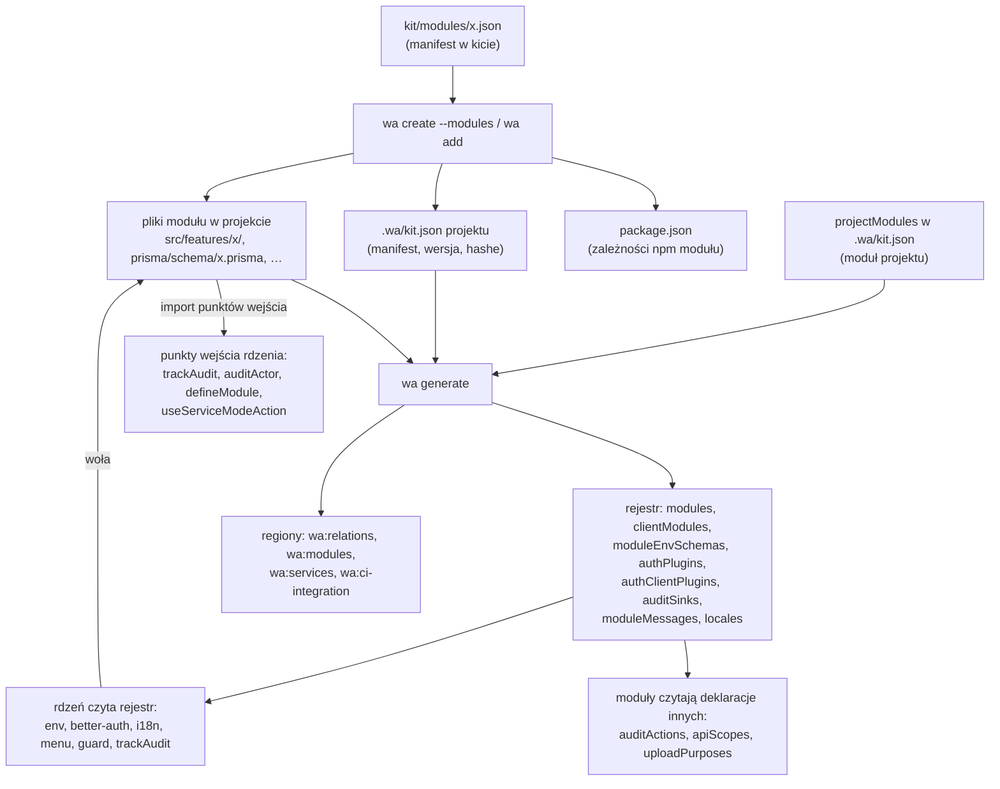

# Moduły kitu i warstwa szwów

Po przeczytaniu będziesz wiedzieć:

- czym moduł kitu różni się od rdzenia i od funkcji napisanej w projekcie (modułu projektu);
- jakie moduły ma kit, czego każdy wymaga i jak dobrać je do projektu;
- jaką drogę przechodzi moduł od manifestu w kicie do działającej funkcji w projekcie;
- które szwy generowane i które punkty wejścia rdzenia łączą moduł z aplikacją;
- co dzieje się z kodem, który korzysta z punktu wejścia, gdy modułu w projekcie nie ma.

Zweryfikowano z kodem: 6c05f1f, 2026-11-05

Źródła:

- `kit/kit.json`
- `kit/modules/core.json`, `kit/modules/audit-logs.json`, `kit/modules/api-keys.json`, `kit/modules/uploads.json`, `kit/modules/encryption.json`, `kit/modules/legal.json`
- `packages/gato-cli/src/manifest/schema.ts`
- `packages/gato-cli/src/manifest/kit-state.ts`
- `packages/gato-cli/src/generate/index.ts`
- `packages/gato-cli/src/generate/registry.ts`
- `packages/gato-cli/src/generate/targets.ts`
- `src/modules.generated.ts`
- `src/modules.client.generated.ts`
- `src/i18n/locales.generated.ts`
- `src/shared/lib/audit.ts`
- `src/shared/lib/modules/define-module.ts`
- `src/shared/components/service-mode/use-service-mode-action.tsx`
- `packages/env/src/*.ts`, `src/env.ts`
- `src/shared/lib/auth/index.ts`
- `src/shared/lib/auth/client.ts`
- `src/shared/lib/auth/permissions.ts`
- `src/shared/lib/auth/require-module-access.ts`
- `src/shared/lib/modules/nav.ts`
- `src/i18n/request.ts`
- `src/i18n/config.ts`
- `src/test/core-modules.ts`
- `src/features/organizations/services/commands/member-commands.ts`
- `src/features/organizations/services/commands/enter-organization-command.ts`
- pliki modułów, które czytają szwy: `src/features/audit-logs/` (`module.ts`, `audit-sink.ts`, `subscribers.ts`, `components/audit-trail.tsx`, `components/audit-log-view.tsx`, `components/audit-action-labels.ts`), `src/features/api-keys/` (`module.ts`, `services/api-scopes.ts`, `components/api-scope-labels.ts`, `components/api-keys-manager.tsx`, `contracts/api-key.schemas.ts`, `services/commands/api-key-commands.ts`), `src/features/uploads/` (`module.ts`, `services/upload-purposes.ts`, `components/file-upload.tsx`, `services/commands/create-upload.ts`, `services/commands/upload-commands.ts`)
- `mutation-gate.json`
- `docker/uploads.compose.yml`, `docker-compose.yml`, `Dockerfile`, `src/test/integration/setup-env.ts`, `e2e/env.ts`, `src/features/uploads/services/storage-env.ts` (provider storage modułu `uploads`)
- `.github/workflows/kit.yml`
- `AGENTS.md` („Moduły i pliki generowane”)
- `src/proxy.ts`
- zmiany rdzenia dodane razem z modułami: `git diff 5b2d308..76ca2d7 -- src/shared src/app/api src/i18n src/proxy.ts prisma/schema/auth.prisma prisma/schema/organizations.prisma`

Ten plik wyjaśnia, jak moduły kitu trafiają do projektu i jak łączą się z aplikacją. Każdy moduł ma osobny plik ze szczegółami: [13-modul-audit-logs.md](13-modul-audit-logs.md), [14-modul-api-keys.md](14-modul-api-keys.md) i [15-modul-uploads.md](15-modul-uploads.md). Komendy CLI opisuje [16-cli-wa.md](16-cli-wa.md), pracę nad samym kitem (manifesty, `wa kit sync`, dodanie modułu do kitu) [16b-rozwoj-kitu.md](16b-rozwoj-kitu.md), a generator i pola manifestu [02b-rejestr-i-generator.md](02b-rejestr-i-generator.md).

„(sprawdzone)” znaczy tu, że zachowanie potwierdził przebieg z 2026-10-30 na projekcie założonym z tagu `v0.1.0` (`wa create` bez `--modules`, czyli sam rdzeń), skopiowanym do katalogu tymczasowego, z `npm ci` i `npx prisma generate`. Do kopii doszedł moduł projektu `notes` z wpisem w `projectModules`, który deklaruje `auditActions`, `apiScopes` i `uploadPurposes` i woła `trackAudit`; po `wa generate` przebiegi `npx tsc --noEmit` i `npx vitest run` dla tego feature były zielone.

<a id="modul-a-rdzen"></a>

## Moduł kitu, rdzeń i moduł projektu

Słowo „moduł” ma w kicie dwa znaczenia ([02-architektura.md](02-architektura.md#kit-rdzen-moduly)):

- **moduł kitu**: jednostka, którą CLI kopiuje do projektu i z niego usuwa; opisuje go manifest `kit/modules/<nazwa>.json`;
- **definicja modułu**: plik `src/features/<x>/module.ts` z `defineModule({...})`, opisujący jeden feature (klucz, menu, role); trafia do rejestru `modules`.

Moduł kitu może obejmować kilka feature. Rdzeń to moduł kitu `core` z pięcioma feature (`account`, `auth`, `dashboard`, `organizations`, `users`), a każdy z modułów opcjonalnych ma jeden feature o tej samej nazwie.

| | Rdzeń (`core`) | Moduł kitu (opcjonalny) | Moduł projektu |
| --- | --- | --- | --- |
| Skąd pochodzi | Kit, zawsze. | Kit, wybierany przy `wa create --modules` albo dodawany `wa add`. | Pisze go zespół projektu ([tutorial 09](09-nowy-modul.md)). |
| Wpis w `.wa/kit.json` | `modules.core`: wersja, manifest, hashe plików. | `modules.<nazwa>`: wersja, manifest, hashe plików. | `projectModules.<nazwa>`: sam manifest, bez wersji i hashy ([D36](decyzje.md#d36)). |
| Usunięcie | Niemożliwe (`Nie można usunąć rdzenia`). | `wa remove <nazwa>` ([16](16-cli-wa.md#wa-remove)). | Ręcznie: pliki i wpis w `projectModules`. |
| Rejestracja w aplikacji | `wa generate`, jako pierwszy. | `wa generate`, po rdzeniu, w kolejności nazw. | `wa generate`, po modułach kitu ([16](16-cli-wa.md#moduly-projektu)). |
| Poprawki | Pull request do `webamigos/wa-kit`, jeśli przydadzą się innym projektom. | Jak rdzeń. | Tylko w projekcie. |

Kod modułu kitu jest po skopiowaniu zwykłym kodem projektu, bez paczki npm i bez ładowania pluginów w trakcie działania ([D39](decyzje.md#d39)). Rdzeń nie importuje plików modułów opcjonalnych. Widzi je tylko przez szwy: pliki generowane i regiony `wa:*` ([D03](decyzje.md#d03)). Moduł korzysta z rdzenia wprost, importując jego punkty wejścia ([Punkty wejścia](#punkty-wejscia)). Dzięki temu rdzeń buduje się i działa tak samo z modułem i bez niego.

<a id="lista-modulow"></a>

## Moduły kitu

Kit ma cztery moduły opcjonalne. `wa list` wypisuje je z opisem z manifestu ([16](16-cli-wa.md#wa-list)).

<a id="audit-logs"></a>

### `audit-logs`

Dziennik zdarzeń organizacji: kto, kiedy i co zmienił. Dodaje tabelę `audit_logs`, stronę `/audit-log`, komponent `<AuditTrail>` i jedyne w kicie ujście `trackAudit`. Bez zmiennych środowiskowych i usług. Szczegóły: [13-modul-audit-logs.md](13-modul-audit-logs.md).

<a id="api-keys"></a>

### `api-keys`

Klucze API organizacji z zakresami: zewnętrzny system woła trasy projektu z nagłówkiem `Authorization: Bearer <klucz>`. Dodaje tabelę `api_keys`, stronę `/api-keys`, przykładową trasę `GET /api/v1/organization` i wymaganą zmienną `API_KEY_PEPPER`. Szczegóły: [14-modul-api-keys.md](14-modul-api-keys.md).

<a id="uploads"></a>

### `uploads`

Pliki organizacji na dysku serwera albo w magazynie zgodnym z S3, zależnie od `STORAGE_PROVIDER` (domyślnie `local`, czyli dysk). Dodaje tabelę `uploads`, trasy `/api/uploads`, komponent `<FileUpload>`, zmienne `STORAGE_PROVIDER`, `STORAGE_LOCAL_PATH` i `S3_*`, usługi `minio` i `minio-init` z profilem Compose `s3` w `docker-compose.yml` i kroki MinIO w CI projektu, bo testy integracyjne modułu działają na S3. Szczegóły: [15-modul-uploads.md](15-modul-uploads.md).

<a id="encryption"></a>

### `encryption`

Szyfrowanie kopertowe (AES-256-GCM) z kluczem danych osobnym dla każdej organizacji, dla modułów, które przechowują wrażliwe dane. Dodaje pakiet `@gatojs/crypto` (`packages/crypto`), tabelę `organization_data_keys`, serwerowe API `encryptForOrganization` / `decryptForOrganization` oraz zmienne `ENCRYPTION_PROVIDER` (`local`) i wymaganą `ENCRYPTION_MASTER_KEY`. Bez UI i bez usług. Szczegóły (po angielsku): [17-encryption-module.md](17-encryption-module.md).

<a id="legal"></a>

### `legal`

Publiczne strony `/terms` i `/privacy` z treścią z plików seed, które projekt edytuje jak własne (szablon `pl` i `en` do zastąpienia), linki w stopkach przez sloty rdzenia `auth.footer` i `app.sidebar.footer` oraz baner cookies na każdej stronie przez slot `app.root`, który pojawia się tylko wtedy, gdy projekt zadeklaruje kategorie opcjonalnych cookies w `src/features/legal/legal.config.ts`. Zgoda jest w ciasteczku `cookie_consent` w przeglądarce, bez modelu w bazie, bez zmiennych środowiskowych i bez usług zewnętrznych. Kod projektu sprawdza zgodę przez `hasConsent`, `useCookieConsent` i `<ConsentGate>`. Szczegóły (po angielsku): [18-legal-module.md](18-legal-module.md).

<a id="macierz-zaleznosci"></a>

### Zależności między modułami

Żaden moduł nie ma `requires`, więc każdy można dodać i usunąć niezależnie od pozostałych. Moduły współpracują jednak przez punkty wejścia: korzystają z wkładu innego modułu, gdy ten jest zainstalowany, i działają bez niego.

| Moduł | `requires` | Korzysta z innego modułu, jeśli jest | Bez tego modułu |
| --- | --- | --- | --- |
| `audit-logs` | — | Pokazuje etykiety akcji, które deklarują `api-keys` i `uploads` (`auditActions`). | Akcja bez deklaracji jest pokazywana jako surowy napis. |
| `api-keys` | — | Zapisuje zdarzenia kluczy przez `trackAudit`; zapisze je `audit-logs`. | Zdarzenia kluczy nie trafiają nigdzie. |
| `uploads` | — | Zapisuje `upload.created` i `upload.deleted` przez `trackAudit`; zapisze je `audit-logs`. | Zdarzenia plików nie trafiają nigdzie. |
| `encryption` | — | — | Moduły nie mają `encryptForOrganization`; dane zapisują jawnym tekstem. |
| `legal` | — | — | Brak stron `/terms` i `/privacy` i banera; skrypty projektu nie mają `hasConsent`. |

`requires` modułu projektu może wskazywać moduł kitu. Wtedy `wa remove` odmawia usunięcia tego modułu ([16](16-cli-wa.md#wa-remove)), a każda komenda CLI odmawia pracy, jeśli wymaganego modułu w projekcie nie ma ([16](16-cli-wa.md#moduly-projektu)).

<a id="warstwa-szwow"></a>

## Droga modułu do aplikacji

Warstwa szwów to wszystko, przez co moduł trafia do projektu i łączy się z aplikacją: manifest, komendy CLI, pliki generowane i regiony, punkty wejścia rdzenia i deklaracje w `module.ts`. Reguły dla tej warstwy podaje `AGENTS.md` („Moduły i pliki generowane”); ta sekcja je wyjaśnia. `AGENTS.md` nie wymienia wszystkich szwów z kodu: brakuje w nim regionu `wa:ci-integration`, tablicy `auditSinks`, pola `ciSteps` i pliku `src/i18n/locales.generated.ts` (R1 w [notatce rozbieżności części 2](superpowers/notes/2026-10-30-docs-part-2-discrepancies.md)) oraz punktów wejścia z [Punktów wejścia](#punkty-wejscia) (R13 w tej samej notatce).



<a id="manifest"></a>

### 1. Manifest

Moduł kitu opisuje plik `kit/modules/<nazwa>.json`: pliki modułu (`files`), moduły wymagane (`requires`), zależności npm, zmienne środowiskowe (`env`), relacje w schemacie (`schemaRelations`), plik usług Dockera (`compose`) i plik kroków CI (`ciSteps`). Komendy `create`, `add` i `remove` czytają pliki, wymagania i zależności; `wa generate` czyta `files` (żeby znaleźć feature), `env`, `schemaRelations`, `compose` i `ciSteps` (żeby wypełnić regiony). Pełną tabelę „pole → kto czyta” podaje [16b](16b-rozwoj-kitu.md#manifesty), typy i wartości domyślne pól [02b](02b-rejestr-i-generator.md#referencja-manifest).

Przy instalacji manifest jest kopiowany do `.wa/kit.json` projektu. Od tej chwili projekt nie potrzebuje kitu, żeby wygenerować szwy albo usunąć moduł: `wa generate` i `wa remove` czytają manifest z `.wa/kit.json`.

<a id="wybor-i-kopiowanie"></a>

### 2. Wybór i kopiowanie

- `wa create --modules <lista>` zakłada projekt z rdzeniem i wybranymi modułami ([16](16-cli-wa.md#wa-create)).
- `wa add <moduł>` kopiuje pliki modułu do istniejącego projektu, dopisuje jego zależności i uruchamia `wa generate`; jeśli którykolwiek plik modułu już istnieje, przerywa z `Pliki już istnieją, przerwano bez zmian:` i niczego nie kopiuje. `.env` uzupełniasz sam ([16](16-cli-wa.md#wa-add)).
- `wa remove <moduł>` usuwa pliki modułu, jego zależności i wpis w `.wa/kit.json`, a potem uruchamia `wa generate`; bazy, magazynu plików (katalogu `STORAGE_LOCAL_PATH` albo bucketu), `.env` i kodu projektu nie dotyka ([16](16-cli-wa.md#wa-remove)).

Po każdej z tych komend schemat bazy się zmienia, więc migrację tworzy i commituje projekt ([03b](03b-schemat-i-migracje.md#migracje-w-projekcie)).

<a id="szwy-generowane"></a>

### 3. Szwy generowane

`wa generate` zapisuje trzy pliki i wypełnia cztery regiony ([02b](02b-rejestr-i-generator.md#wa-generate)). Generator rejestruje najpierw feature modułu `core`, potem modułów kitu w kolejności nazw, a na końcu modułów projektu (`registeredModules` w `packages/gato-cli/src/manifest/kit-state.ts`). Feature trafia do tablicy wtedy, gdy ma odpowiedni plik.

| Szew | Plik feature, z którego powstaje | Kto w aplikacji czyta | Bez modułów opcjonalnych |
| --- | --- | --- | --- |
| `modules` w `src/modules.generated.ts` | `module.ts` | Moduły: `knownApiScopes` (`api-keys`), `listUploadPurposes` (`uploads`), `<AuditTrail>` (`audit-logs`). Rdzeń go nie czyta. | Tylko pięć feature rdzenia i moduły projektu. |
| `clientModules` w `src/modules.client.generated.ts` | `module.ts` | Rdzeń: guard stron i `requireModuleAccess` (`src/shared/lib/auth/permissions.ts`), menu (`src/shared/lib/modules/nav.ts`), filtr testów rdzenia (`src/test/core-modules.ts`). Moduły: widok `/audit-log`, formularz kluczy API. | Jak wyżej. `requireModuleAccess` z kluczem modułu, którego nie ma, kończy się dla użytkownika z aktywną organizacją zawsze 404 (`notFound()`). |
| `moduleEnvSchemas` | `env.ts` (eksport `envSchema`) | `createEnv` z `@gatojs/env` (linia `export const env` w rejestrze): łączy schemat rdzenia ze schematami modułów w jeden. | Pusta (sprawdzone: `never[]`): walidowane są tylko zmienne rdzenia. |
| `authPlugins` | `auth.ts` (eksport `authPlugin`) | Lista `plugins` better-auth w `src/shared/lib/auth/index.ts`. | Pusta (sprawdzone: `never[]`): better-auth działa tylko z pluginami rdzenia. |
| `authClientPlugins` | `auth-client.ts` (eksport `authClientPlugin`) | Lista `plugins` klienta better-auth w `src/shared/lib/auth/client.ts`. | Pusta; żaden moduł kitu nie ma tego pliku. |
| `auditSinks` | `audit-sink.ts` (eksport `auditSink`) | `trackAudit` w `src/shared/lib/audit.ts`. | Pusta: `trackAudit` nic nie zapisuje (sprawdzone). |
| `moduleMessages` | `i18n/<język>.json` | `src/i18n/request.ts`: teksty feature pod namespace równym nazwie katalogu. | Tylko teksty rdzenia; namespace modułu nie istnieje. |
| `locales` w `src/i18n/locales.generated.ts` | pole `locales` w `.wa/kit.json` ([D33](decyzje.md#d33)) | `src/i18n/config.ts`. | Nie zależy od modułów. |
| Region `wa:relations` w `prisma/schema/auth.prisma` i `prisma/schema/organizations.prisma` | `schemaRelations` manifestu | Prisma (relacje zwrotne `User` i `Organization`). | Pusty (sprawdzone). |
| Region `wa:modules` w `.env.example` | `env` manifestu | Deweloper, który przepisuje zmienne do `.env`. | Pusty (sprawdzone). |
| Region `wa:services` w `docker-compose.yml` | plik z `compose` manifestu | `docker compose up -d`; usługi z profilem, jak `minio` i `minio-init` modułu `uploads` z profilem `s3`, tylko `docker compose --profile <profil> up -d` (sprawdzone 2026-11-04 przez `docker compose config --services`). | Pusty (sprawdzone): bez MinIO. |
| Region `wa:ci-integration` w `.github/workflows/ci.yml` i `.github/workflows/mutation.yml` | plik z `ciSteps` manifestu ([D45](decyzje.md#d45)) | Job testów integracyjnych i przebieg integracyjny Strykera w CI projektu. | Pusty (sprawdzone): CI nie startuje MinIO. |

Listy rejestru przechodzą przez konfigurację projektu `src/gato.config.ts`: moduł z `enabled: false` znika z każdej z nich, jak gdyby go nie było, choć jego pliki zostają ([11](11-praca-z-kitem.md#gato-config), [ADR-60](adrs/60-project-configuration-is-applied-by-the-generated-registries.md)).

Plików generowanych i regionów nie edytuje się ręcznie; CI projektu sprawdza, że po `wa generate` nie ma diffu ([D04](decyzje.md#d04)). Rejestr importuje pliki feature, więc zmiana treści `module.ts` albo `env.ts` nie wymaga generatora; wymaga go dodanie albo usunięcie takiego pliku.

Zmienna wymagana przez `env.ts` modułu należy do schematu całej aplikacji: jej brak albo zła wartość zatrzymuje start serwera całej aplikacji, nie tylko modułu ([07](07-i18n-mail-env.md#walidacja-env)). Dlatego po `wa add` modułu z wymaganą zmienną (`api-keys`) trzeba uzupełnić `.env` ([16](16-cli-wa.md#add-po)). `uploads` `0.2.0` (z lokalnego klonu kitu, na `core` `0.5.0`, [15](15-modul-uploads.md#wersja-core)) bez nowych zmiennych startuje w trybie deweloperskim z providerem `local`, ale w produkcji poza Railway wymaga `STORAGE_LOCAL_PATH` ze ścieżką bezwzględną albo `STORAGE_PROVIDER=s3` ([15](15-modul-uploads.md#reguly-produkcyjne)).

<a id="punkty-wejscia"></a>

### 4. Punkty wejścia rdzenia i deklaracje w `module.ts`

Szwy generowane mówią rdzeniowi, jakie moduły istnieją. Punkty wejścia działają w drugą stronę: to kod rdzenia, który importuje moduł albo moduł projektu. Leżą w plikach rdzenia, więc istnieją w każdym projekcie, także bez modułu, który je obsługuje. Decyzje: [D39](decyzje.md#d39), [D40](decyzje.md#d40).

Tabela odpowiada na pytanie: co się stanie, gdy kod projektu skorzysta z punktu wejścia, a modułu, który go obsługuje, w projekcie nie ma. Kolumna „Kto korzysta” podaje pliki kitu, które z punktu wejścia korzystają (wołają go, deklarują albo czytają deklaracje).

| Punkt wejścia | Plik | Kontrakt | Bez modułu | Kto korzysta |
| --- | --- | --- | --- | --- |
| `trackAudit(event)` | `src/shared/lib/audit.ts` | Przyjmuje `AuditEvent` z wymaganymi polami `organizationId`, `actorUserId` (`string` albo `null`), `action` i `entityType` (pozostałe pola: [13](13-modul-audit-logs.md)). Woła po kolei każde ujście z `auditSinks`; błąd ujścia zapisuje w logu jako `trackAudit failed` i woła kolejne; nigdy nie rzuca. | Bez żadnego ujścia `auditSinks` jest puste: wywołanie nic nie zapisuje i nie zgłasza błędu (sprawdzone). W kicie ujście ma tylko `audit-logs`; funkcja projektu z własnym `audit-sink.ts` też trafia do `auditSinks`. | Rdzeń: `joinOrganizationCommand` (`member-commands.ts`), `enterOrganizationCommand`. `audit-logs`: `services/organization-audit-subscribers.ts`. `api-keys`: `api-key-commands.ts`. `uploads`: `create-upload.ts`, `upload-commands.ts`. |
| `auditActor(context)` | `src/shared/lib/audit.ts` | Z `OrgContext` zwraca `organizationId`, `actorUserId` i `serviceMode` dla zdarzenia; wpis z trybu serwisowego jest dzięki temu oznaczony. | Czysta funkcja rdzenia, działa zawsze. | `api-key-commands.ts`, `create-upload.ts`, `upload-commands.ts`. |
| `AuditSink` i plik `audit-sink.ts` | `src/shared/lib/audit.ts` | Ujście to `(event: AuditEvent) => Promise<void>` wyeksportowane jako `auditSink` z `src/features/<x>/audit-sink.ts`; generator dopisuje je do `auditSinks`. Ujście dostaje zdarzenie przed redakcją danych. | Bez pliku ujścia nikt nie zapisuje zdarzeń. | `src/features/audit-logs/audit-sink.ts`. |
| `auditActions` w `defineModule` | `src/shared/lib/modules/define-module.ts` | Lista `{ action, labelKey }`: etykieta akcji audytu. Namespace tłumaczeń to `key` modułu, który ją zadeklarował; `moduleMessages` rejestruje namespace pod nazwą katalogu feature, więc `key` musi być równy nazwie katalogu ([D27](decyzje.md#d27)). Moduł projektu z innym `key` dostanie zamiast etykiety surowy klucz tłumaczenia. | Bez `audit-logs` nikt jej nie czyta: deklaracja przechodzi typecheck i nic nie robi (sprawdzone). Po usunięciu modułu, który zadeklarował akcję, dziennik pokazuje ją jako surowy napis. | Deklarują: `audit-logs`, `api-keys`, `uploads` (`module.ts`). Czytają: `audit-action-labels.ts`, `audit-log-view.tsx`, `audit-trail.tsx`. |
| `apiScopes` w `defineModule` | `src/shared/lib/modules/define-module.ts` | Lista `{ key, labelKey }`: zakres klucza API, z etykietą jak przy `auditActions` (namespace = `key` modułu); `knownApiScopes()` zbiera zakresy wszystkich modułów z rejestru, a klucz dostaje dostęp tylko do zakresów, które ktoś deklaruje. | Bez `api-keys` nikt jej nie czyta (sprawdzone, jak wyżej). Po usunięciu modułu, który zadeklarował zakres, klucze z tym zakresem tracą do niego dostęp. | Deklaruje: `api-keys` (`organization:read`). Czytają: `api-scopes.ts`, `api-scope-labels.ts`, `api-keys-manager.tsx`, `api-key.schemas.ts`. |
| `uploadPurposes` w `defineModule` | `src/shared/lib/modules/define-module.ts` | Lista celów `{ key, mimeTypes, maxBytes, visibility, resizeImage? }`; `listUploadPurposes()` zbiera je z rejestru i rzuca błąd przy powtórzonym kluczu albo zakazanym typie (SVG, HTML, XML). | Bez `uploads` nikt jej nie czyta (sprawdzone, jak wyżej). | Deklaruje: `uploads` (`editor-image`). Czyta: `upload-purposes.ts`. |
| `useServiceModeAction().requestConfirmation()` | `src/shared/components/service-mode/use-service-mode-action.tsx` | Poza trybem serwisowym zwraca `undefined`; w trybie serwisowym pokazuje dialog i zwraca `null` po „Anuluj” albo `{ serviceModeConfirmed: true, organizationId }` po potwierdzeniu. Służy wywołaniom, które nie są komendą serwerową, na przykład `fetch` do trasy API. | Część rdzenia, działa zawsze. | `uploads`: `components/file-upload.tsx`. |

Typy deklaracji i ujścia:

`src/shared/lib/modules/define-module.ts`

```ts
export interface ModuleAuditAction {
  action: string;
  labelKey: string;
}

export interface ModuleApiScope {
  key: string;
  labelKey: string;
}

export interface ModuleUploadPurpose {
  key: string;
  mimeTypes: readonly string[];
  maxBytes: number;
  visibility: "public" | "organization";
  resizeImage?: { maxWidth: number };
}
// …
  auditActions?: ModuleAuditAction[];
  apiScopes?: ModuleApiScope[];
  uploadPurposes?: ModuleUploadPurpose[];
```

`src/shared/lib/audit.ts`

```ts
export type AuditSink = (event: AuditEvent) => Promise<void>;
// …
export async function trackAudit(
  event: AuditEvent,
  sinks: readonly AuditSink[] = auditSinks,
): Promise<void> {
  for (const sink of sinks) {
    try {
      await sink(event);
    } catch (error) {
      logger.error("trackAudit failed", { action: event.action, error });
    }
  }
}
```

Z tego wynikają trzy reguły dla kodu projektu:

- **Punkty wejścia i deklaracje możesz stosować zawsze.** Wywołanie `trackAudit` i pola `auditActions`, `apiScopes`, `uploadPurposes` w `module.ts` budują się i działają w projekcie z samym rdzeniem (sprawdzone). Zaczną działać, gdy projekt dostanie moduł, który je obsługuje, bez zmiany kodu.
- **Pliki modułu importujesz tylko wtedy, gdy moduł jest w projekcie.** Import `<AuditTrail>`, `authenticateApiKey` albo `<FileUpload>` w projekcie bez `audit-logs`, `api-keys` albo `uploads` kończy się błędem `TS2307: Cannot find module '@/features/…'` w typechecku i w buildzie (sprawdzone). Taki kod projekt ma tylko razem z modułem, a moduł projektu, który go zawiera, powinien mieć ten moduł w `requires`.
- **`requireModuleAccess("<moduł>")` dla modułu, którego nie ma, daje użytkownikowi z aktywną organizacją zawsze 404**, bo `moduleByKey` nie znajduje definicji w rejestrze. Kontekst organizacji jest pobierany wcześniej, więc użytkownik bez aktywnej organizacji trafia na `/no-organization`, jak przy każdym module.

Co konkretny moduł robi z deklaracjami, opisują sekcje „Szwy modułu” w [13](13-modul-audit-logs.md#szwy), [14](14-modul-api-keys.md#szwy) i [15](15-modul-uploads.md#szwy), a jak ich używać we własnym kodzie, sekcje „Użycie z własnego kodu” w [13b](13b-modul-audit-logs-uzycie.md#uzycie), [14b](14b-modul-api-keys-uzycie.md#uzycie) i [15b](15b-modul-uploads-uzycie.md#uzycie).

<a id="wspolne-zasady"></a>

## Wspólne zasady modułów

Moduły kitu podlegają tym samym regułom co rdzeń ([AGENTS.md](../AGENTS.md), „Dane i organizacje”):

- **Izolacja organizacji.** Zapytania i komendy modułów pobierają kontekst przez `getOrgContext()` albo `requireModuleAccess()` i filtrują po `organizationId` jawnie ([D07](decyzje.md#d07)). Wyjątkiem są trasy z kluczem API: nie mają sesji, więc filtrują po `organizationId` z kontekstu klucza ([D43](decyzje.md#d43)).
- **Tryb serwisowy.** Komendy modułów na danych organizacji mają sygnaturę `(input, confirmation?)` i wołają `assertServiceModeConfirmed` przed Prismą, a UI woła je przez `useServiceModeAction().run` ([D22](decyzje.md#d22)). Upload pliku idzie przez `fetch` do trasy `POST /api/uploads`, a nie przez komendę, więc `<FileUpload>` pobiera potwierdzenie przez `requestConfirmation()` i wysyła je w formularzu, a trasa sprawdza je tak jak komenda.
- **Test architektury i mutacje.** Pliki modułów podlegają testowi `src/__tests__/server-entrypoints-guard.test.ts` ([D24](decyzje.md#d24)), a katalogi `src/features/<x>/services/` wszystkich trzech modułów i `src/shared/lib/audit.ts` są na liście `critical` w `mutation-gate.json` ([D26](decyzje.md#d26)).
- **Moduł nie edytuje plików rdzenia.** Tak mówi reguła z `AGENTS.md` i `CLAUDE.md`, i tak działa projekt: `wa add` i `wa remove` zmieniają w plikach rdzenia tylko regiony `wa:*` i pliki generowane. Zmiany rdzenia zrobione w kicie dla modułów (wartości `API_KEY_PEPPER` w `src/test/integration/setup-env.ts` i `e2e/env.ts`, `STORAGE_PROVIDER=s3` z `S3_*` w `setup-env.ts`, `STORAGE_PROVIDER=local` z `STORAGE_LOCAL_PATH` w `e2e/env.ts`, katalog `/app/volumes/uploads` w `Dockerfile`, katalogi modułów w `mutation-gate.json`, matcher w `src/proxy.ts`) projekt dostaje jednak razem z rdzeniem, także bez modułu ([16b](16b-rozwoj-kitu.md#nowy-modul-kitu), R12 w [notatce rozbieżności części 2](superpowers/notes/2026-10-30-docs-part-2-discrepancies.md)). Matcher `/((?!api(?:/|$)|_next|_vercel|.*\\..*).*)` wyłącza z middleware next-intl tylko `/api` i ścieżki pod `/api/`, więc trasy projektu zaczynające się od `api`, na przykład `/api-keys` albo `/api-docs`, dostają obsługę języków jak inne strony.

<a id="wybor-modulow"></a>

## Jak wybrać moduły dla projektu

Moduły są niezależne, więc wybierasz każdy osobno, według potrzeb klienta. Moduł dodany później przez `wa add` działa tak samo jak wybrany przy `wa create`; usunięcie przez `wa remove` zostawia dane w bazie i w magazynie ([16](16-cli-wa.md#remove-co-zostaje)), więc moduł z danymi klienta usuwa się świadomie.

| Moduł | Dodaj, gdy | Koszt w projekcie | Nie dodawaj, gdy |
| --- | --- | --- | --- |
| `audit-logs` | Klient potrzebuje śladu zmian w danych organizacji (członkostwo, klucze, pliki, własne zdarzenia projektu). | Tabela `audit_logs` rośnie bez limitu: moduł nie ma retencji ([D41](decyzje.md#d41)). | Nikt nie będzie czytał dziennika; `trackAudit` w kodzie projektu nie wymaga modułu. |
| `api-keys` | Zewnętrzny system (integracja, agent) ma wołać API projektu w imieniu organizacji. | Sekret `API_KEY_PEPPER` na każdym środowisku; jego zmiana unieważnia wszystkie klucze ([D43](decyzje.md#d43)). | API wołają tylko zalogowani użytkownicy aplikacji (wystarczy sesja). |
| `uploads` | Projekt przyjmuje pliki od użytkowników (obrazy, załączniki). | Na produkcji trwały katalog przy jednej instancji (`local`) albo magazyn zgodny z S3 (`s3`); lokalnie pliki na dysku bez dodatkowej usługi, MinIO tylko z profilem `s3` i do testów integracyjnych, które w CI uruchamiają go własnymi krokami; zależności `@aws-sdk/client-s3`, `file-type` i `sharp` ([D44](decyzje.md#d44), [D49](decyzje.md#d49)). | Projekt nie przyjmuje plików albo trzyma je poza aplikacją. |

Kombinacje, które CI kitu składa i sprawdza (`npm run verify`, testy integracyjne, a dla `core` i `all` także `docker build`), to macierz `combo` w `.github/workflows/kit.yml`: sam rdzeń, każdy moduł osobno i wszystkie trzy razem ([16b](16b-rozwoj-kitu.md#ci-kitu)). Pary modułów (na przykład `audit-logs` z `api-keys`) nie mają osobnej pozycji w macierzy.

Kolejne kroki:

- założenie projektu z modułami: [16-cli-wa.md](16-cli-wa.md#wa-create);
- dodanie i usunięcie modułu w istniejącym projekcie: [16-cli-wa.md](16-cli-wa.md#wa-add), [16-cli-wa.md](16-cli-wa.md#wa-remove);
- konfiguracja i szwy każdego modułu: [13-modul-audit-logs.md](13-modul-audit-logs.md), [14-modul-api-keys.md](14-modul-api-keys.md), [15-modul-uploads.md](15-modul-uploads.md);
- użycie modułu we własnym kodzie, bezpieczeństwo i testowanie: [13b-modul-audit-logs-uzycie.md](13b-modul-audit-logs-uzycie.md), [14b-modul-api-keys-uzycie.md](14b-modul-api-keys-uzycie.md), [15b-modul-uploads-uzycie.md](15b-modul-uploads-uzycie.md);
- własna funkcja projektu jako moduł projektu: [09-nowy-modul.md](09-nowy-modul.md);
- dodanie nowego modułu do kitu: [16b-rozwoj-kitu.md](16b-rozwoj-kitu.md#nowy-modul-kitu).
