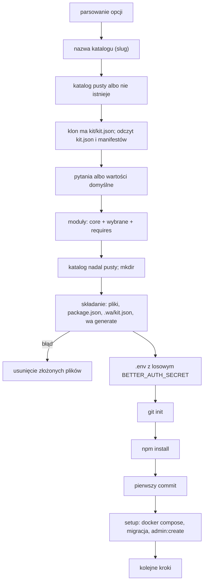
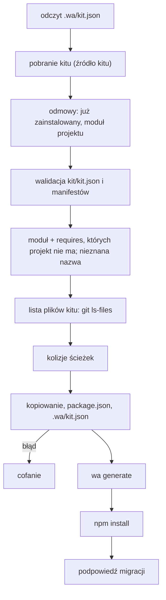

# CLI `wa` w projekcie

Po przeczytaniu będziesz wiedzieć:

- jak założyć projekt one-linerem z GitHuba albo z lokalnego klonu kitu i dlaczego ostrzeżenie gita o tagu nie jest błędem;
- w jakiej kolejności `wa create`, `wa add`, `wa remove` i `wa list` sprawdzają warunki, kiedy pobierają kit i z jakim kodem wyjścia się kończą;
- co CLI cofa po błędzie, a czego nie cofa;
- co zostaje w projekcie, w bazie i w magazynie plików po `wa remove` i jaką migrację wtedy utworzyć;
- jak CLI traktuje moduły projektu (`projectModules`);
- co znaczy każdy komunikat CLI.

Zweryfikowano z kodem: 206ca2e, 2026-11-10 (wersja `uploads` w sekcji [Po `wa add`](#add-po)); pozostałe sekcje: 6c05f1f, 2026-11-05

Źródła:

- `kit/cli/src/bin.ts`
- `kit/cli/src/args.ts`
- `kit/cli/src/commands/create.ts`
- `kit/cli/src/commands/add.ts`
- `kit/cli/src/commands/remove.ts`
- `kit/cli/src/commands/list.ts`
- `kit/cli/src/assemble/` (`copy.ts`, `hash.ts`, `package-json.ts`, `placeholders.ts`, `project-names.ts`, `resolve-modules.ts`)
- `kit/cli/src/kit/source.ts`
- `kit/cli/src/commands/kit-sync.ts`
- `kit/cli/src/generate/targets.ts` (`REGION_FILES`)
- `kit/cli/src/kit/files.ts`
- `kit/cli/src/kit/kit-config.ts`
- `kit/cli/src/manifest/kit-state.ts`
- `kit/cli/src/manifest/schema.ts`
- `kit/cli/src/process/prompter.ts`
- `kit/cli/src/process/runner.ts`
- `kit/cli/src/__tests__/args.test.ts`
- `kit/cli/src/commands/__tests__/` (`create.test.ts`, `add.test.ts`, `add-rollback.test.ts`, `add-fs-failures.test.ts`, `remove.test.ts`, `list.test.ts`)
- `kit/cli/src/kit/__tests__/source.test.ts`
- `kit/kit.json`
- `kit/modules/core.json`, `kit/modules/audit-logs.json`, `kit/modules/api-keys.json`, `kit/modules/uploads.json`
- `kit/README.md`
- `src/shared/lib/env.ts`
- `src/features/api-keys/env.ts`
- `src/features/uploads/env.ts`, `src/features/uploads/services/storage-env.ts`, `docker/uploads.compose.yml`

Ten plik opisuje CLI z perspektywy osoby, która zakłada projekt albo zmienia jego zestaw modułów. Komendę `wa generate` opisuje [02b-rejestr-i-generator.md](02b-rejestr-i-generator.md#wa-generate), a pracę nad samym kitem (manifesty, `wa kit sync`, bundel, wydanie) [16b-rozwoj-kitu.md](16b-rozwoj-kitu.md). Jak moduł po skopiowaniu łączy się z aplikacją, wyjaśnia [12-moduly-kitu.md](12-moduly-kitu.md). Pojęcia moduł, feature i rejestr modułów są w [słowniku](README.md#slownik).

„(sprawdzone)” znaczy tu, że zachowanie potwierdził przebieg z 2026-10-30: bundel `.wa/bin/wa.mjs` z tagu `v0.1.0` sklonowanego z `https://github.com/webamigos/wa-kit.git`, uruchomiony w katalogu tymczasowym, bez Dockera i bez `npm install`. Błędy poleceń zewnętrznych (`npm`, `docker`, `npx`) wywołano atrapami tych poleceń w `PATH`.

<a id="komendy"></a>

## Komendy w skrócie

CLI to jeden plik, `.wa/bin/wa.mjs`, zapisany w repozytorium kitu i w każdym projekcie ([D28](decyzje.md#d28)). W projekcie uruchamia go skrypt `wa` z `package.json` (`node .wa/bin/wa.mjs`), więc każdą komendę wywołujesz jako `npm run wa -- <komenda>`. Nowy projekt zakładasz bundlem z klonu kitu: `node <klon>/.wa/bin/wa.mjs create <katalog>`.

| Komenda | Gdzie | Co robi | Potrzebuje kitu |
| --- | --- | --- | --- |
| `wa create <katalog> [opcje]` | z klonu kitu | Składa nowy projekt: rdzeń i wybrane moduły ([wa create](#wa-create)). | tak, klonu lokalnego |
| `wa add <moduł> [--kit <źródło>] [--no-install]` | w projekcie | Kopiuje pliki modułu kitu i modułów z jego `requires` ([wa add](#wa-add)). | tak, w wersji projektu |
| `wa remove <moduł> [--force] [--no-install]` | w projekcie | Usuwa pliki modułu kitu i jego zależności npm ([wa remove](#wa-remove)). | nie |
| `wa list [--kit <źródło>]` | w projekcie | Wypisuje moduły zainstalowane, dostępne w kicie i moduły projektu ([wa list](#wa-list)). | tylko do listy „Dostępne” |
| `wa generate` | w projekcie i w kicie | Odświeża pliki generowane i regiony `wa:*` ([02b](02b-rejestr-i-generator.md#wa-generate)). | nie |
| `wa kit sync` | tylko w kicie | Przepisuje `.wa/kit.json` kitu z manifestów ([16b](16b-rozwoj-kitu.md)). | działa w kicie |

Każda komenda działa w katalogu bieżącym procesu. Kody wyjścia (`main` w `kit/cli/src/bin.ts`):

- **0:** komenda się udała. Także `wa list`, gdy kitu nie dało się pobrać: wypisuje wtedy stan projektu i linię `Dostępne: nie udało się pobrać kitu (<powód>)` (sprawdzone).
- **1:** każdy błąd. Komunikat trafia na stderr jako jedna linia albo kilka linii (lista plików). Nieznana komenda, brak komendy i samo `wa kit` wypisują linię `Użycie: …` z podsumowaniem komend (sprawdzone).

Polecenia uruchamiane przez CLI (`git clone`, `git init`, `npm install`, `docker compose`, `npx prisma`) piszą wprost do terminala, więc ich wyjście pojawia się nad komunikatem CLI. Listę komunikatów podaje [Referencja](#referencja-komunikaty).

<a id="wa-create"></a>

## `wa create`: nowy projekt

<a id="one-liner"></a>

### Uruchomienie z GitHuba

`create` potrzebuje klonu repozytorium kitu: kopiuje pliki śledzone przez git w tym klonie (`git ls-files` w `listKitFiles`, `kit/cli/src/kit/files.ts`). Kit nie jest publikowany w rejestrze npm ([D28](decyzje.md#d28)), a wersję wskazuje tag gita ([D46](decyzje.md#d46)). Podstawowa droga to jedna linia, która klonuje tag do katalogu tymczasowego i uruchamia bundel z klonu:

```bash
KIT_DIR=$(mktemp -d) && git clone --depth 1 --branch v0.1.0 https://github.com/webamigos/wa-kit.git "$KIT_DIR" && node "$KIT_DIR/.wa/bin/wa.mjs" create <nazwa>
```

`kit/README.md` nazywa tę linię `create-wa-app`; to nazwa w dokumentacji, nie osobny program. Zamiast `v0.1.0` podaj tag wersji, którą chcesz. Wymagany jest `git` z dostępem do `webamigos/wa-kit` i Node.js 22.

Tag `v0.1.0` pyta o moduły i języki tekstem, po przecinku. Listę wyboru opisaną w sekcji [Pytania](#create-pytania) ma dopiero wydanie, które ją zawiera.

`git clone` wypisuje przy tym ostrzeżenie i długą poradę (sprawdzone, `git` 2.56.0, `LC_ALL=C`):

```text
Cloning into '…'...
warning: refs/tags/v0.1.0 14772ce361ec63b4777cb9925802cea0442afd05 is not a commit!
Note: switching to '76ca2d7ccfb23b43d53d4d9d492d1ba59ba3ca88'.

You are in 'detached HEAD' state. You can look around, make experimental
changes and commit them, and you can discard any commits you make in this
state without impacting any branches by switching back to a branch.
…
Turn off this advice by setting config variable advice.detachedHead to false
```

**To nie jest błąd.** `git clone` kończy się kodem 0, a `create` rusza dalej.

- `v0.1.0` to tag z adnotacją: wskazuje obiekt tagu (`14772ce`), a dopiero ten wskazuje commit `76ca2d7`. `--branch` przyjmuje nazwę gałęzi albo tagu, a ref tagu z adnotacją wskazuje obiekt tagu, nie commit, więc git wypisuje `warning: … is not a commit!` i przechodzi do commita, na który wskazuje tag. Ostrzeżenie nie zależy od `--depth 1`: pada też przy pełnym klonie i z `--single-branch`, a przy tagu bez adnotacji go nie ma (sprawdzone na repozytorium testowym, `git` 2.56.0). Klon dostaje właściwy commit.
- Tag nie jest gałęzią, więc klon zostaje na „odłączonym HEAD” (`detached HEAD`). Z klonu tylko czytasz, więc to bez znaczenia.
- Przy polskich ustawieniach języka git pisze te same informacje po polsku: `warning: refs/tags/v0.1.0 … nie jest zapisem!` i `Jesteś w stanie „odłączonego HEAD”.` (sprawdzone).

To samo ostrzeżenie pojawia się nad wynikiem `wa add` i `wa list`, gdy klonują kit z GitHuba ([Źródło kitu](#zrodlo-kitu)); opcja `--quiet`, z którą klonują, go nie wycisza (sprawdzone).

Błąd klonowania (brak dostępu do repozytorium, nieistniejący tag) przerywa linię na `git clone` z komunikatem gita, a `create` się nie uruchamia.

Klon w `$KIT_DIR` zostaje po `create`: nic go nie usuwa (sprawdzone). Możesz go użyć ponownie jako lokalnego klonu (niżej) albo usunąć.

<a id="lokalny-klon"></a>

### Uruchomienie z lokalnego klonu (bez sieci)

Bez dostępu do sieci projekt zakładasz z klonu kitu, który już masz na dysku, na przykład z `$KIT_DIR` po one-linerze albo z klonu, w którym pracujesz nad kitem:

```bash
node <klon>/.wa/bin/wa.mjs create <nazwa>
```

Bez `--kit` CLI bierze kit z katalogu, w którym leży uruchomiony bundel: dwa poziomy nad `.wa/bin/wa.mjs` (`resolve(dirname(…), "../..")` w `bin.ts`). Opcja `--kit <ścieżka>` wskazuje inny klon. `create` nie sprawdza tagu ani commita klonu: projekt dostaje to, co klon ma w drzewie roboczym ([Lokalny klon jako źródło](#lokalny-klon-zrodlo)).

Bundel w projekcie nie ma obok siebie kitu, więc `npm run wa -- create …` w projekcie kończy się błędem `Uruchom create z klonu wa-kit albo podaj --kit <ścieżka>` (sprawdzone).

<a id="create-opcje"></a>

### Nazwa katalogu i opcje

Ostatni człon ścieżki katalogu staje się slugiem projektu i musi pasować do wzorca:

`kit/cli/src/assemble/project-names.ts`

```ts
const SLUG_PATTERN = /^[a-z][a-z0-9-]{1,49}$/;
```

Ze slugu powstają trzy nazwy, które zastępują placeholdery kitu w plikach z listy `placeholderFiles` w `kit/kit.json` ([D32](decyzje.md#d32)):

| Nazwa | Jak powstaje | Dla `acme-app` (sprawdzone) | Przykładowe miejsca |
| --- | --- | --- | --- |
| Nazwa wyświetlana | `--title` albo slug z wielką literą na początku każdego członu | `Acme App` | `src/shared/config/project.ts`, `EMAIL_FROM` w `.env.example`, `project.name` w `.wa/kit.json` |
| Slug | ostatni człon ścieżki | `acme-app` | `name` w `package.json`, `src/shared/config/project.ts`, bucket `acme-app-uploads` modułu `uploads` |
| Snake | slug z `_` zamiast `-` | `acme_app` | baza `acme_app` w `docker-compose.yml` i `.env.example`, `acme_app_test` w testach integracyjnych |

Opcje (`parseCreateArgs` w `kit/cli/src/args.ts`):

| Opcja | Znaczenie | Bez opcji |
| --- | --- | --- |
| `--modules a,b` | Moduły kitu oprócz rdzenia. `--modules ""` i `--modules=` oznaczają sam rdzeń. | Pytanie o moduły; z `--yes` sam rdzeń. |
| `--locales pl,en` | Języki aplikacji: tylko `pl` i `en`, `pl` wymagany, bez powtórzeń ([D33](decyzje.md#d33)). | Pytanie; z `--yes` `pl,en`. |
| `--title <tekst>` | Nazwa wyświetlana. | Pytanie z nazwą ze slugu jako domyślną; z `--yes` nazwa ze slugu. |
| `--admin-email <email>` | Adres pierwszego admina: trafia do `ADMIN_EMAIL` w `.env`, do wypisanego kroku `admin:create` i do `admin:create` przy setupie. | Pytanie (puste = pomiń); z `--yes` brak. |
| `--yes` | Bez pytań: brakujące opcje dostają wartości domyślne. | Pytania w terminalu. |
| `--setup` | Po instalacji uruchamia bazę, migrację i `admin:create` ([D35](decyzje.md#d35)). Nie łączy się z `--no-install`. | Pytanie `[t/N]`, gdy jest instalacja i nie podano `--yes`; z `--yes` bez setupu. |
| `--no-install` | Bez `npm install`. | `npm install` w projekcie. |
| `--no-git` | Bez `git init` i pierwszego commita. Sam `git` jest potrzebny i tak, do odczytu plików kitu. | `git init` i commit. |
| `--kit <ścieżka>` | Klon kitu, z którego powstaje projekt. Pusta wartość to błąd. | Katalog bundla ([wyżej](#lokalny-klon)). |

Wartości `--title` i `--admin-email` nie są walidowane ani escapowane (sprawdzone):

- `--title 'Acme "Q"'` daje w `src/shared/config/project.ts` linię `name: "Acme "Q"",`, która psuje składnię pliku, a w `.env.example` i `.env` linię `EMAIL_FROM="Acme "Q" <noreply@example.com>"` z niezamkniętym cudzysłowem;
- `--title=` daje pustą nazwę (`name: ""`), a `--admin-email=` pustą linię `ADMIN_EMAIL=`;
- tytuł zawierający `wa-app` albo `wa_app` zostanie dodatkowo podmieniony w plikach z placeholderami, bo podmiana slugu idzie po podmianie nazwy (`applyPlaceholders`).

<a id="create-pytania"></a>

### Pytania

Bez `--yes` CLI pyta po kolei o to, czego nie podano w opcjach: moduły, języki, nazwę wyświetlaną, email admina i, gdy jest instalacja, setup. Pytanie o setup pada także wtedy, gdy wszystkie pozostałe opcje są podane, bo `--setup` jest flagą bez wartości „nie”. W skrypcie albo w CI dodaj więc `--yes`.

Moduły i języki wybiera się z listy, tak jak w `create-next-app`. Strzałki przesuwają kursor, spacja zaznacza pozycję, `a` zaznacza wszystkie, `i` odwraca zaznaczenie, a Enter zatwierdza wybór. Lista modułów pokazuje moduły kitu z opisami, bez `core`, i na starcie nic nie ma zaznaczonego. Enter bez zaznaczenia oznacza sam rdzeń. Na liście języków `pl` i `en` są zaznaczone, a `pl` ma dopisek „(wymagany)” i nie da się go odznaczyć (sprawdzone w terminalu). Ponieważ nazwy wybiera się z listy, a nie wpisuje, błędy `Nieznany moduł: …` i `--locales: …` dotyczą tylko opcji `--modules` i `--locales`.

Pytania obsługuje `readlinePrompter` (`kit/cli/src/process/prompter.ts`). Listę rysuje paczka `@inquirer/checkbox` zbudowana w bundel ([D28](decyzje.md#d28)), a pozostałe pytania czyta `node:readline`. Bez terminala (CI, przekierowane wejście) pierwsze pytanie kończy komendę błędem `Brak terminala: użyj --yes`, zanim powstanie katalog projektu (sprawdzone). Ctrl+C na liście kończy komendę błędem `Przerwano`, także zanim powstanie katalog (sprawdzone). Przy pytaniu o setup odpowiedzi `t`, `tak`, `y` i `yes`, bez względu na wielkość liter, oznaczają zgodę. Pusta odpowiedź na pytanie tekstowe przyjmuje wartość domyślną.

<a id="create-przebieg"></a>

### Przebieg i kolejność kontroli



1. **Opcje, nazwa, katalog.** Najpierw parsowanie opcji, potem wzorzec slugu, potem katalog docelowy. Katalog, który istnieje i ma jakikolwiek wpis (także ukryty plik), kończy komendę błędem `Katalog <ścieżka> istnieje i nie jest pusty` (sprawdzone). Pusty istniejący katalog jest akceptowany. Żadne pytanie ani polecenie nie pada przed tymi kontrolami.
2. **Kit.** Brak `kit/kit.json` w klonie daje `Uruchom create z klonu wa-kit albo podaj --kit <ścieżka>` (sprawdzone). Potem CLI czyta `kit/kit.json` i manifesty `kit/modules/*.json`.
3. **Pytania** ([wyżej](#create-pytania)).
4. **Moduły.** Do wybranych modułów CLI dodaje moduły z ich `requires` i zawsze `core` (`resolveModules` w `kit/cli/src/assemble/resolve-modules.ts`). Nieznana nazwa daje `Nieznany moduł: <nazwa>. Dostępne: <lista>`, zanim powstanie katalog (sprawdzone). W wersji `v0.1.0` moduły `audit-logs`, `api-keys` i `uploads` mają puste `requires`.
5. **Składanie.** CLI sprawdza jeszcze raz, czy katalog jest pusty, tworzy go i kopiuje pliki wybranych modułów. Pomija pliki tylko dla kitu (`kitOnly` w `kit/kit.json`: `kit/**`, `docs/**`, `.superpowers/**`, `.claude/handoffs/**`, `.wa/kit.json`, workflowy kitu, `prisma/migrations/.gitignore`) i pliki generowane (`generatedFiles`), które odtwarza generator. Kopia ma te same bity uprawnień co plik w kicie. W plikach z `placeholderFiles` podmienia nazwy, a hash każdego pliku zapisuje w `.wa/kit.json` ([D31](decyzje.md#d31)). `package.json` dostaje slug jako `name`, wersję `0.1.0` i sumę zależności wybranych manifestów ([D30](decyzje.md#d30)). Na końcu CLI zapisuje `.wa/kit.json` i uruchamia `wa generate`.
6. **`.env`.** Kopia `.env.example` z `BETTER_AUTH_SECRET` ustawionym na 32 losowe bajty w base64url (43 znaki) i z `ADMIN_EMAIL`, jeśli podano adres. Plik ma uprawnienia `0600` (sprawdzone). Zmienne modułów (`API_KEY_PEPPER`, `STORAGE_PROVIDER`, `STORAGE_LOCAL_PATH`, `S3_*`) trafiają do `.env` z wartościami przykładowymi z regionu `wa:modules` (sprawdzone; `STORAGE_PROVIDER=local` i `STORAGE_LOCAL_PATH=./volumes/uploads` na projekcie z lokalnego klonu kitu 2026-11-04).
7. **`git init`**, gdy nie podano `--no-git`.
8. **`npm install`**, gdy nie podano `--no-install`. Lockfile jest skopiowany z kitu, a `npm install` dopasowuje go do `package.json` projektu. Z `--no-install` `package-lock.json` ma do pierwszej instalacji `"name": "wa-app"`, `"version": "0.0.0"` i zależności kitu (sprawdzone).
9. **Pierwszy commit** `chore: initial commit from wa-kit v<wersja>`, z `--no-verify`, czyli bez hooków husky. Nieudany commit (na przykład brak `user.name` albo `user.email`) nie przerywa komendy: CLI wypisuje `Uwaga: nie utworzono commita (<powód>). Skonfiguruj git i zrób commit ręcznie.`
10. **Setup** (z `--setup` albo po odpowiedzi „t”): `docker compose up -d --wait`, `npx prisma migrate dev --name init` i, jeśli podano adres, `npm run admin:create -- --email <adres>`.
11. **Kolejne kroki.** Bez setupu CLI wypisuje `cd <ścieżka>`, `docker compose up -d`, `npx prisma migrate dev --name init`, `npm run admin:create -- --email <adres albo twój-email>` i `npm run dev` (sprawdzone). Po setupie tylko `cd <ścieżka>` i `npm run dev`, także wtedy, gdy setup pominął `admin:create` z braku adresu; pierwsze konto założysz wtedy sam ([01-uruchomienie.md](01-uruchomienie.md#admin-create)).

<a id="create-cofanie"></a>

### Cofanie i jego granice

- **Błąd w kroku 5 (składanie)** usuwa katalog projektu, a gdy katalog istniał wcześniej (pusty), usuwa jego zawartość (sprawdzone na kicie bez repozytorium git: nowy katalog znika, istniejący zostaje pusty). Błąd samego sprzątania jest połykany; widzisz tylko pierwotny błąd. Testy: `describe("create: błąd podczas składania")` w `kit/cli/src/commands/__tests__/create.test.ts`.
- **Błąd po składaniu** (zapis `.env`, `git init`, `npm install`, kroki setupu) niczego nie cofa: katalog projektu zostaje, a kolejne kroki się nie wykonują i nie są wypisywane ([D35](decyzje.md#d35)).
  - Błąd `npm install` daje `Projekt utworzony w <ścieżka>, ale npm install się nie powiódł. Uruchom: cd <ścieżka> && npm install` (sprawdzone). Commita i setupu wtedy nie ma.
  - Błąd w setupie przychodzi jako surowy komunikat procesu, na przykład `docker compose up -d --wait zakończone kodem 1` (sprawdzone). Commit (bez `--no-git`) już wtedy istnieje. Usuń przyczynę (zwykle zajęty port, [01-uruchomienie.md](01-uruchomienie.md#zmiana-portow)) i wykonaj pozostałe kroki ręcznie.

<a id="create-wynik"></a>

### Co dostaje projekt

Projekt ma ten sam układ katalogów co kit ([D38](decyzje.md#d38)), z tymi różnicami (sprawdzone na projektach z `--modules audit-logs`, `api-keys`, `uploads` i ze wszystkimi trzema):

| W projekcie | Różnica względem kitu |
| --- | --- |
| `kit/`, `docs/` | Nie ma. Dokumentacja leży tylko w repozytorium kitu. |
| `prisma/migrations/` | Nie ma. Pierwsza migracja projektu trafia do repozytorium projektu ([03b](03b-schemat-i-migracje.md#migracje-w-projekcie), [D13](decyzje.md#d13)). |
| `.wa/kit.json` | `kitVersion` i `kitRepo` kitu, nazwa i slug projektu, języki, wybrane moduły z wersją, manifestem i hashami plików, puste `projectModules`. `package.json` i `package-lock.json` mają w `files` rdzenia znacznik `managed` zamiast hasha. |
| `package.json` | `name` równy slugowi, `version` `0.1.0`, zależności rdzenia i wybranych modułów: `uploads` dodaje `@aws-sdk/client-s3`, `file-type` i `sharp`, `audit-logs` dodaje `better-call` w `devDependencies`, `api-keys` nie dodaje nic. |
| `src/i18n/locales.generated.ts` | Tylko wybrane języki ([D33](decyzje.md#d33)). |
| Regiony `wa:*` | `wa:relations` w `auth.prisma` i `organizations.prisma` z relacjami modułów; `wa:modules` w `.env.example` z `API_KEY_PEPPER` (`api-keys`) oraz `STORAGE_PROVIDER`, `STORAGE_LOCAL_PATH` i zmiennymi `S3_*` (`uploads`, bucket `<slug>-uploads`); `wa:services` w `docker-compose.yml` z usługami `minio` i `minio-init` z profilem `s3` (`uploads`), których `docker compose up -d` nie uruchamia; `wa:ci-integration` w `.github/workflows/ci.yml` z krokami „Start MinIO” i „Create MinIO bucket” (`uploads`). Bez modułów regiony są puste. |
| `.env` | Gotowy do startu, z losowym sekretem i wartościami przykładowymi zmiennych modułów. Wartość `API_KEY_PEPPER` z `.env.example` jest tylko dla dewelopmentu: przy `NODE_ENV=production` schemat `envSchema` w `src/features/api-keys/env.ts` ją odrzuca (`API_KEY_PEPPER: w produkcji nie może być wartością z .env.example`), więc na produkcji ustaw własną, co najmniej 32 znaki. |
| `.wa/bin/wa.mjs` | Ten sam bundel co w kicie: należy do rdzenia, więc projekt uruchamia `wa generate`, `wa add` i `wa remove` bez budowania CLI. |

Po `create` bez setupu postępujesz jak w [01-uruchomienie.md](01-uruchomienie.md#pierwsze-uruchomienie) od sprawdzenia portów; `npm install` i `.env` są gotowe.

<a id="zrodlo-kitu"></a>

## Źródło kitu dla `add` i `list`

`wa add` i `wa list` czytają manifesty i pliki z repozytorium kitu w wersji projektu (`kitVersion` w `.wa/kit.json`). `wa remove` kitu nie potrzebuje. Źródło wybiera `resolveKitSource` (`kit/cli/src/kit/source.ts`), w tej kolejności ([D46](decyzje.md#d46)):

1. opcja `--kit <źródło>`;
2. zmienna środowiskowa `WA_KIT_SOURCE`;
3. `kitRepo` z `.wa/kit.json` (po `create` z kitu `v0.1.0`: `https://github.com/webamigos/wa-kit.git`).

`kit/cli/src/kit/source.ts`

```ts
const REMOTE_PREFIXES = ["https://", "ssh://", "file://", "git@"];
```

- **Źródło zdalne** (zaczyna się jednym z tych prefiksów) CLI klonuje poleceniem `git clone --depth 1 --branch v<kitVersion> --quiet` do katalogu tymczasowego (`wa-add-…` albo `wa-list-…` w katalogu tymczasowym systemu), który znika po komendzie, także po błędzie. Nad wynikiem widać ostrzeżenie gita o tagu z adnotacją, takie jak przy [one-linerze](#one-liner). Nieudany klon daje `Nie udało się pobrać wa-kit v<wersja> z <adres>. Sprawdź dostęp (gh auth status) albo podaj --kit <ścieżka>`, a nad nim wyjście gita, na przykład `fatal: repository '…' not found` (sprawdzone).
- **Ścieżka lokalna** musi wskazywać katalog z `kit/kit.json` (inaczej `Brak kit/kit.json w <ścieżka> — to nie jest repozytorium wa-kit`), a `version` z tego pliku musi być równa `kitVersion` projektu (inaczej `Kit w <ścieżka> ma wersję <x>, projekt używa <y>`).
- **Odrzucane źródła:** wartość zaczynająca się od `-` (żeby nie stała się opcją gita) i wartość z `://` albo `::` spoza listy prefiksów, na przykład `ext::sh`. Komunikat: `Nieprawidłowe źródło wa-kit: <źródło>` (sprawdzone dla `--kit=-x` i `--kit ext::sh`). Dotyczy tylko `add` i `list`: `create` nie korzysta z `resolveKitSource`, tylko z `--kit` jako ścieżki.
- **Pusty `WA_KIT_SOURCE`** (`WA_KIT_SOURCE=`) jest ścieżką lokalną: wskazuje katalog bieżący, czyli zwykle projekt, który nie ma `kit/kit.json` (sprawdzone).

Wymóg równej wersji wynika z modelu kitu: projekt dostaje kod jednej wersji kitu, a przejścia na nowszą wersję CLI nie ma ([README](README.md#plany)). Moduł z nowszego kitu skopiowałby pliki, które zakładają nowszy rdzeń.

<a id="lokalny-klon-zrodlo"></a>

### Lokalny klon jako źródło (bez sieci)

Przy domyślnym `kitRepo` każde `wa add` i `wa list` łączy się z GitHubem. Bez sieci wskaż klon kitu w wersji projektu:

```bash
npm run wa -- add api-keys --kit ~/wa-kit
WA_KIT_SOURCE=~/wa-kit npm run wa -- list
```

Co trzeba wiedzieć o lokalnym klonie:

- CLI porównuje tylko `version` z `kit/kit.json`, nie tag ani commit. Klon na `main` po wydaniu z tą samą wersją też zostanie użyty.
- Lista plików pochodzi z indeksu gita (`git ls-files`), a treść z drzewa roboczego (`copyFiles`). Niezacommitowana zmiana śledzonego pliku trafia do projektu, a nowy plik przed `git add` nie trafia (sprawdzone na klonie ze zmienionym `src/features/api-keys/env.ts` i nowym, nieśledzonym plikiem w katalogu `src/features/api-keys/`).
- `wa add` (i `create`) wymaga, żeby źródło było repozytorium git: katalog z `kit/kit.json` bez `.git` daje `<ścieżka> nie jest repozytorium git`. `wa list` czyta tylko manifesty, więc działa także na takim katalogu (sprawdzone).

<a id="wa-add"></a>

## `wa add`: dodanie modułu kitu

```bash
npm run wa -- add <moduł>
```

<a id="add-kolejnosc"></a>

### Kolejność kontroli



1. **`.wa/kit.json`.** Brak pliku daje `Brak .wa/kit.json w <katalog> — to nie jest projekt wa-kit`. Plik, który nie przechodzi walidacji, daje błąd walidacji ([Referencja](#referencja-komunikaty)).
2. **Pobranie kitu** według [źródła kitu](#zrodlo-kitu). Pobranie idzie **przed** odmowami z następnego kroku (`addFromSource` w `kit/cli/src/commands/add.ts`): `wa add uploads --kit /nie/ma` w projekcie, który ma `uploads`, daje błąd źródła, nie odmowę, a przy domyślnym `kitRepo` nawet odmowa wymaga sieci (sprawdzone).
3. **Odmowy:** moduł zainstalowany (`Moduł <x> jest już zainstalowany`, także dla `core`) i nazwa zajęta przez moduł projektu (`Moduł <x> jest modułem projektu; zmień jego nazwę albo usuń wpis z projectModules`) (sprawdzone).
4. **Kit i manifesty.** Dopiero teraz `add` waliduje schematem `kit/kit.json` i `kit/modules/*.json` (`readKitConfig`, `readKitManifests`). Uszkodzony manifest daje więc błąd dopiero po odmowach.
5. **Zestaw modułów:** moduł i moduły z jego `requires`, których projekt nie ma. Nieznana nazwa daje `Nieznany moduł: <nazwa>. Dostępne: api-keys, audit-logs, uploads` (sprawdzone).
6. **Lista plików kitu** (`assemblableFiles`, `git ls-files`). Tu pada `<ścieżka> nie jest repozytorium git` dla lokalnego kitu bez `.git` i `spawn git ENOENT` bez `git` w `PATH`. Kit bez `.git` przy module już zainstalowanym albo nieznanym daje więc odmowę albo `Nieznany moduł`, a nie błąd repozytorium (sprawdzone).
7. **Kolizje.** Jeśli na ścieżce któregokolwiek pliku z zestawu coś już jest (plik, katalog albo symlink, także wiszący), komenda kończy się błędem `Pliki już istnieją, przerwano bez zmian:` z alfabetyczną listą ścieżek i niczego nie zmienia (sprawdzone). CLI nie nadpisuje plików projektu.
8. **Kopiowanie** z placeholderami według nazw z `.wa/kit.json` projektu, z hashami plików; dopisanie zależności npm do `package.json`; zapis `.wa/kit.json`.
9. **`wa generate`**, potem `npm install` (bez `--no-install`).
10. **Podpowiedź migracji:** ostatnia linia wyjścia to `npx prisma migrate dev --name add-<moduł>`, z nazwą z argumentu, także gdy CLI dodało moduły z `requires`. Migrację tworzysz i commitujesz sam ([03b](03b-schemat-i-migracje.md#migracje-w-projekcie)).

Przebieg w projekcie `acme-app` z modułem `uploads` (sprawdzone, domyślne źródło, wyjście gita skrócone):

```text
$ npm run wa -- add api-keys --no-install
warning: refs/tags/v0.1.0 14772ce361ec63b4777cb9925802cea0442afd05 is not a commit!
Note: switching to '76ca2d7ccfb23b43d53d4d9d492d1ba59ba3ca88'.
…
npx prisma migrate dev --name add-api-keys
```

Zmienione pliki: nowe pliki modułu (`prisma/schema/api-keys.prisma`, `src/features/api-keys/**`, `src/app/api/v1/organization/**`, `src/app/[locale]/(app)/api-keys/**`), a także `.wa/kit.json`, `.env.example` (region `wa:modules`), `prisma/schema/auth.prisma` i `prisma/schema/organizations.prisma` (region `wa:relations`), `src/modules.generated.ts` i `src/modules.client.generated.ts`. `package.json` się nie zmienił, bo `api-keys` nie ma zależności npm.

<a id="add-po"></a>

### Po `wa add`

1. **Uzupełnij `.env`.** `wa add` nie zmienia `.env`: nowe zmienne modułu trafiają tylko do regionu `wa:modules` w `.env.example` (sprawdzone: po `add api-keys` `.env` nie ma `API_KEY_PEPPER`). Moduł z wymaganą zmienną (`api-keys`) bez wpisu w `.env` zatrzymuje start serwera aplikacji: serwer wypisuje raport `Nieprawidłowe zmienne środowiskowe (<liczba problemów>):` i kończy się kodem 1 ([01-uruchomienie.md](01-uruchomienie.md#bledy-env)). `uploads` `0.2.0` bez wpisów startuje w trybie deweloperskim z providerem `local` i katalogiem `./volumes/uploads`, ale przy `NODE_ENV=production` (`npm start`, obraz Docker) raport ma linię `STORAGE_LOCAL_PATH: wymagana w produkcji przy STORAGE_PROVIDER=local: wskaż trwały katalog`, a z `./volumes/uploads` skopiowanym z regionu poza Railway linię `STORAGE_LOCAL_PATH: w produkcji poza Railway musi być ścieżką bezwzględną: wskaż trwały katalog` ([15-modul-uploads.md](15-modul-uploads.md#reguly-produkcyjne)). Tę wersję albo nowszą daje lokalny klon kitu (`--kit <klon>` albo `WA_KIT_SOURCE`), a działa ona na `core` `0.5.0`; z domyślnego źródła `wa add` bierze moduł z tagu `v<kitVersion>`, czyli przy `0.1.0` `uploads` `0.1.0`, który zapisuje pliki tylko w S3 ([źródło kitu](#zrodlo-kitu), [15-modul-uploads.md](15-modul-uploads.md#wersja-core)). Skopiuj zmienne z regionu i ustaw własne wartości.
2. **Migracja:** `npx prisma migrate dev --name add-<moduł>` przy działającej bazie, potem commit migracji.
3. **Usługi:** moduł z `compose` dodaje usługi do `docker-compose.yml`. Usługi `uploads` `0.2.0` (`minio`, `minio-init`) mają profil `s3`: uruchamiasz je przez `docker compose --profile s3 up -d` tylko przy `STORAGE_PROVIDER=s3`, a przy `local` niczego nie uruchamiasz ([15-modul-uploads.md](15-modul-uploads.md#minio)).
4. Bez `npm install` w trakcie `add` (`--no-install`) zainstaluj zależności sam.

<a id="add-zaleznosci"></a>

### Zależności npm

Zależność, którą projekt ma już w tej samej sekcji w innej wersji, zostaje w wersji projektu, a CLI wypisuje ostrzeżenie ([D30](decyzje.md#d30)):

```text
Uwaga: <pakiet> (<sekcja>) ma w projekcie <wersja>, moduł <moduł> wymaga <wersja>; zostaje wersja projektu
```

Ostrzeżenie nie przerywa komendy: sprawdź sam, czy moduł działa z wersją projektu. Przy kilku modułach w jednym wywołaniu każdy jest porównywany z `package.json` po dodaniu poprzednich. Zależność, którą projekt ma w innej sekcji (na przykład w `devDependencies`, a moduł chce jej w `dependencies`), nie jest konfliktem: trafia do obu sekcji bez ostrzeżenia.

<a id="add-cofanie"></a>

### Cofanie i jego granice

- **Błąd przed kopiowaniem** (kroki 1–7) niczego nie zmienia w projekcie.
- **Błąd w kroku 8** (na przykład brak miejsca na dysku, plik tylko do odczytu, plik w miejscu katalogu modułu) cofa zmiany (`rollbackAdd`): usuwa pliki modułu, usuwa katalogi, które `add` utworzył, jeśli zostały puste, i przywraca `package.json` oraz `.wa/kit.json`, jeśli ich treść się zmieniła. Pierwotny błąd to zwykle surowy komunikat Node po angielsku, na przykład `ENOTDIR: not a directory, mkdir '…/src/features/api-keys/__tests__'`, gdy w miejscu katalogu `src/features/api-keys` leży zwykły plik (sprawdzone: po błędzie w projekcie został tylko ten plik), albo `EEXIST: file already exists, mkdir …` w podobnej sytuacji głębiej w drzewie.
- Każdy krok sprzątania działa niezależnie. Krok, który się nie uda, CLI wypisuje jako `Nie udało się posprzątać: <ścieżka> (<kod błędu albo komunikat>)` i idzie dalej, a na końcu rzuca pierwotny błąd. Typowy przypadek: w katalogu, który utworzył `add`, pojawił się obcy plik, więc katalog nie jest pusty (`Nie udało się posprzątać: src/features/demo/i18n (ENOTEMPTY)` w teście „rzuca oryginalny błąd, usuwa plik modułu, zostawia obcy plik i loguje oba katalogi” w `kit/cli/src/commands/__tests__/add-rollback.test.ts`).
- **Błąd w `wa generate` albo `npm install`** (krok 9) nie cofa zmian: pliki są skopiowane, a `.wa/kit.json` je opisuje. Powtórz `npm run wa -- generate` albo `npm install`. Przy błędzie instalacji komunikat to `Moduł dodany, ale npm install się nie powiódł. Uruchom: npm install`.

<a id="wa-remove"></a>

## `wa remove`: usunięcie modułu kitu

```bash
npm run wa -- remove <moduł>
```

`wa remove` nie potrzebuje kitu ani sieci: wszystko, czego używa (pliki, hashe, manifest, zależności), jest w `.wa/kit.json` projektu.

<a id="remove-kolejnosc"></a>

### Kolejność kontroli

Wszystkie kontrole idą przed usunięciem czegokolwiek ([D34](decyzje.md#d34)):

1. **`.wa/kit.json`** jak w `add`.
2. **Odmowy** (`assertRemovable`, sprawdzone):
   - `core`: `Nie można usunąć rdzenia`;
   - moduł projektu: `Moduł <x> należy do projektu; wa remove usuwa tylko moduły kitu. Usuń jego pliki i wpis w projectModules ręcznie`;
   - moduł niezainstalowany: `Moduł <x> nie jest zainstalowany`;
   - moduł wymagany przez inny moduł kitu albo moduł projektu: `Moduł <x> jest wymagany przez: <lista>`, na przykład `Moduł audit-logs jest wymagany przez: notes`, gdy moduł projektu `notes` ma `audit-logs` w `requires`.
3. **Ścieżki poza projektem.** Każda ścieżka z `files` modułu, która po rozwiązaniu symlinków wychodzi poza katalog projektu, daje `Ścieżka poza projektem: <ścieżka>`.
4. **Zmienione pliki.** CLI liczy hash każdego istniejącego pliku modułu i porównuje go z hashem z `.wa/kit.json` ([D31](decyzje.md#d31)). Jeśli choć jeden się różni, bez `--force` komenda kończy się błędem z listą plików i niczego nie usuwa. Plik, którego już nie ma, nie blokuje komendy. Hash pomija treść regionów `wa:*` tylko w plikach z regionami, a te należą do `core`, więc w plikach usuwanego modułu liczy się każda zmiana bajtu.
5. **`package.json`** musi dać się odczytać jako JSON; inaczej komenda kończy się surowym błędem parsera przed usunięciem plików.

Przebieg z dwoma zmienionymi plikami (sprawdzone):

```text
$ npm run wa -- remove api-keys --no-install
Zmienione pliki modułu api-keys (użyj --force):
  src/features/api-keys/i18n/pl.json
  src/features/api-keys/services/api-scopes.ts
```

`--force` usuwa pliki modułu razem z lokalnymi zmianami (sprawdzone). Zmiany, które chcesz zachować, przenieś wcześniej, na przykład do własnej funkcji projektu.

<a id="remove-co-robi"></a>

### Co usuwa

1. Pliki z `files` modułu i puste katalogi nad nimi, aż do pierwszego niepustego. Sprzątanie katalogów nie przechodzi przez symlinki i nigdy nie usuwa katalogu projektu.
2. Z `package.json` zależności modułu, których nie deklaruje żaden pozostały moduł kitu ani moduł projektu ([D30](decyzje.md#d30)). Sekcje liczone są osobno (`removeDependencies`): zależność z `dependencies` usuwanego modułu chroni tylko deklaracja w `dependencies` innego manifestu, a z `devDependencies` tylko w `devDependencies`. Usuwa je także wtedy, gdy projekt miał tę zależność przed `add` albo zmienił jej wersję.
3. Wpis modułu w `.wa/kit.json`; potem `wa generate` czyści regiony `wa:*` z wpisów modułu i rejestr.
4. `npm install` (bez `--no-install`) i na końcu linia `npx prisma migrate dev --name remove-<moduł>`.

`wa add api-keys`, a potem `wa remove api-keys` dają drzewo projektu bajt w bajt równe stanowi sprzed `add` (sprawdzone na projekcie z `uploads`, porównanie `git diff`). Po `wa remove uploads` w projekcie z modułem projektu, który deklaruje `sharp`, z `package.json` zniknęły `@aws-sdk/client-s3` i `file-type`, a `sharp` został; regiony `wa:modules`, `wa:services` i `wa:ci-integration` są puste, a pliki `docker/uploads.compose.yml` i `ci/uploads.integration-steps.yml` usunięte razem z katalogami (sprawdzone).

<a id="remove-co-zostaje"></a>

### Co zostaje i jaką migrację utworzyć

`wa remove` zmienia tylko pliki projektu. Nie dotyka bazy, magazynu plików ani `.env`:

| Co | Po `wa remove` | Co zrobić |
| --- | --- | --- |
| Tabele modułu w bazie (`audit_logs`, `api_keys`, `uploads`) i ich dane | Zostają, dopóki nie zastosujesz migracji. Schemat w `prisma/schema/` już ich nie opisuje, a aplikacja ich nie używa. | Jeśli dane są potrzebne, zrób kopię tabeli. Potem `npx prisma migrate dev --name remove-<moduł>`: migracja wygenerowana ze schematu bez pliku modułu usuwa tabelę modułu razem z danymi. Zacommituj ją ([03b](03b-schemat-i-migracje.md#migracje-w-projekcie)); na produkcji zastosuje ją `npx prisma migrate deploy` przy wdrożeniu ([10](10-wdrozenie.md)). |
| Pliki w magazynie (`uploads`) | Zostają: przy `local` pliki w katalogu `STORAGE_LOCAL_PATH` (lokalnie `volumes/uploads`), przy `s3` obiekty w buckecie. Usunięcie tabeli `uploads` nie usuwa plików, a po nim nie ma już listy kluczy. | Przed migracją wypisz klucze z tabeli `uploads`. Potem usuń katalog albo opróżnij bucket narzędziem dostawcy S3. |
| Dane lokalnego MinIO (`volumes/minio`) | Zostają na dysku; katalog jest w `.gitignore`. Usługi `minio` i `minio-init` znikają z `docker-compose.yml`, ale uruchomiony wcześniej kontener `minio` działa dalej jako osierocony. | `docker compose up -d --remove-orphans` zatrzymuje i usuwa kontenery usług, których nie ma już w `docker-compose.yml`. Potem usuń katalog ręcznie, jeśli dane nie są potrzebne. |
| Zmienne modułu w `.env` (`API_KEY_PEPPER`, `STORAGE_*`, `S3_*`) | Zostają w `.env` (sprawdzone dla `API_KEY_PEPPER` i `S3_*`); znikają tylko z `.env.example`. Nie szkodzą. | Usuń je z `.env` i ze zmiennych środowiska produkcji. |
| Zależności npm | Usunięte według reguły z [Co usuwa](#remove-co-robi), także te, których projekt używa we własnym kodzie, jeśli żaden manifest ich nie deklaruje. | Dopisz zależność, której używasz, do `package.json` i do manifestu modułu projektu, w tej samej sekcji co moduł kitu. |
| Kod projektu, który importuje pliki modułu | Zostaje. `wa remove` nie szuka importów, więc build i typecheck przestaną przechodzić. | Usuń te importy albo przenieś potrzebny kod do projektu przed `remove`. |
| `node_modules` | Z `--no-install` zawiera pakiety usuniętych zależności do następnego `npm install`. | `npm install`. |

Zachowanie kodu projektu bez modułu (na przykład `trackAudit` bez `audit-logs`) opisują pliki modułów: [13-modul-audit-logs.md](13-modul-audit-logs.md), [14-modul-api-keys.md](14-modul-api-keys.md) i [15-modul-uploads.md](15-modul-uploads.md).

<a id="remove-cofanie"></a>

### Cofanie i jego granice

`wa remove` nie ma cofania. „Wszystko albo nic” dotyczy kontroli: błąd w krokach z [Kolejności kontroli](#remove-kolejnosc) niczego nie zmienia (sprawdzone dla odmów i zmienionych plików). Błąd w trakcie usuwania (na przykład uprawnienia) zostawia stan częściowy: część plików usunięta, `.wa/kit.json` jeszcze z modułem. Usuń przyczynę i uruchom `wa remove` ponownie; brakujące pliki nie blokują komendy. Błąd `npm install` na końcu daje `Moduł usunięty, ale npm install się nie powiódł. Uruchom: npm install`, a moduł jest już usunięty ze stanu i z dysku.

Wpis w `files` uszkodzonego `.wa/kit.json` też zatrzymuje komendę przed usuwaniem: katalog daje surowy błąd `EISDIR`, a ścieżka pod zwykłym plikiem błąd `ENOTDIR: not a directory, realpath …` (testy w `kit/cli/src/commands/__tests__/remove.test.ts`).

<a id="remove-bezpieczenstwo"></a>

### Bezpieczeństwo

- `wa remove` ufa treści `.wa/kit.json`: usunie każdy plik z `files` modułu, którego hash zgadza się z zapisanym, a z `--force` każdy plik z `files`. `.wa/kit.json` z niezaufanego źródła (cudzy pull request, archiwum) przejrzyj przed użyciem komendy.
- Usuwa wyłącznie pliki leżące wewnątrz projektu po rozwiązaniu symlinków (`insideProject`). Plik modułu, który sam jest symlinkiem, znika jak zwykły plik: usunięty zostaje link, a nie jego cel. Sprzątanie pustych katalogów nie usuwa symlinków i nie przechodzi przez nie.
- Komenda nie jest odporna na równoległe zmiany katalogu projektu przez inny proces: między sprawdzeniem a usunięciem nie ma blokady.

<a id="wa-list"></a>

## `wa list`: stan modułów

```bash
npm run wa -- list
```

Wynik w projekcie z modułem `uploads` (sprawdzone, domyślne źródło, wyjście gita pominięte):

```text
Zainstalowane:
  core 0.4.0
  uploads 0.1.0
Dostępne:
  api-keys 0.1.0 — Klucze API organizacji: model ApiKey, sekret z pepperem i zakresy
  audit-logs 0.1.0 — Dziennik zdarzen organizacji: model AuditLog, sink i redakcja danych wrazliwych
```

- **Zainstalowane:** moduły kitu z `.wa/kit.json` z wersjami, `core` pierwszy, reszta alfabetycznie. Wersje pochodzą z projektu, nie z kitu.
- **Dostępne:** moduły z manifestów kitu w wersji projektu, których projekt nie ma, alfabetycznie, z opisem i sufiksem `(wymaga: …)`, gdy manifest ma `requires`. Gdy nic nie zostało, linia brzmi `Dostępne: brak`.
- **Projektu:** moduły z `projectModules` z opisem, na przykład `notes — Notatki projektu`. Sekcja pojawia się tylko wtedy, gdy projekt je ma.

Gdy kitu nie da się pobrać (zła ścieżka, odrzucone źródło, nieudany klon, pusty `WA_KIT_SOURCE`), zamiast listy „Dostępne” pada linia `Dostępne: nie udało się pobrać kitu (<powód>)` na stdout, a komenda kończy się kodem 0, bo stan projektu wypisała (`listCommand` w `kit/cli/src/bin.ts`). Przebieg (sprawdzone):

```text
$ npm run wa -- list --kit /nie/ma
Zainstalowane:
  core 0.4.0
  uploads 0.1.0
Dostępne: nie udało się pobrać kitu (Brak kit/kit.json w /nie/ma — to nie jest repozytorium wa-kit)
```

W skrypcie sprawdzaj więc tę linię, a nie kod wyjścia. Błędy przed pobraniem kitu (opcje, brak albo uszkodzony `.wa/kit.json`) kończą `list` kodem 1 jak każdą komendę.

<a id="moduly-projektu"></a>

## Moduły projektu a CLI

Funkcja napisana w projekcie ma wpis w `projectModules` w `.wa/kit.json`: sam manifest, bez wersji wpisu i bez hashy ([D36](decyzje.md#d36), [krok 3 tutorialu](09-nowy-modul.md#krok-3)). Każda komenda, która czyta `.wa/kit.json`, najpierw sprawdza te wpisy (`validateProjectModules` w `kit/cli/src/manifest/kit-state.ts`): `name` równe kluczowi, brak modułu kitu o tej nazwie, wszystkie `requires` zainstalowane, `files` z wzorcem zaczynającym się od `src/features/<klucz>/`. Błędny wpis zatrzymuje każdą komendę w projekcie ([komunikaty](#referencja-komunikaty)).

| Komenda | Moduł projektu |
| --- | --- |
| `wa generate` | Rejestruje go po modułach kitu i wypełnia jego regiony ([02b](02b-rejestr-i-generator.md#wa-generate)). |
| `wa add` | Odmawia dodania modułu kitu o tej samej nazwie (sprawdzone). |
| `wa remove` | Odmawia usunięcia modułu projektu; jego pliki i wpis usuwasz ręcznie. Nie usuwa modułu kitu, którego moduł projektu wymaga w `requires`, ani zależności npm, które moduł projektu deklaruje w tej samej sekcji (sprawdzone). |
| `wa list` | Wypisuje go w sekcji „Projektu”, także gdy kitu nie dało się pobrać. |
| `wa kit sync` | Zachowuje wpisy bez zmian ([16b](16b-rozwoj-kitu.md)). |

Zależność npm, której używa tylko moduł projektu, wpisz w jego manifeście w tej samej sekcji (`dependencies` albo `devDependencies`), w której deklaruje ją moduł kitu. Bez tego `wa remove` modułu kitu, który deklaruje tę samą zależność, usunie ją z `package.json`: deklaracja w drugiej sekcji jej nie chroni.

<a id="referencja"></a>

## Referencja

<a id="referencja-opcje"></a>

### Opcje i argumenty

Opcje parsuje `parseArgs` z `node:util`; jego błędy CLI tłumaczy na polskie komunikaty (`translateParseError` w `kit/cli/src/args.ts`).

| Komenda | Argumenty pozycyjne | Opcje z wartością | Opcje bez wartości |
| --- | --- | --- | --- |
| `create` | dokładnie 1: katalog | `--modules`, `--locales`, `--title`, `--admin-email`, `--kit` | `--yes`, `--setup`, `--no-install`, `--no-git` |
| `add` | dokładnie 1: moduł | `--kit` | `--no-install` |
| `remove` | dokładnie 1: moduł | brak | `--force`, `--no-install` |
| `list` | 0 | `--kit` | brak |
| `generate` | 0; nadmiarowe argumenty i opcje są pomijane | brak | brak |
| `kit sync` | 0; nadmiarowe argumenty i opcje są pomijane | brak | brak |

Puste i brakujące wartości (sprawdzone):

| Zapis | Wynik |
| --- | --- |
| `--kit=`, `--kit ""` | `Opcja --kit wymaga wartości`; pusta wartość jest błędem tylko dla `--kit` (`optionalValue`). |
| `--kit` na końcu, `--title --yes`, `--kit -x` | `Opcja <opcja> wymaga wartości`: po opcji nie ma wartości albo stoi inna opcja lub wartość zaczynająca się od `-`. |
| `--kit=-x` | Wartość przyjęta. W `add` i `list` potem `Nieprawidłowe źródło wa-kit: -x`; w `create` ścieżka `-x` nie ma `kit/kit.json`, więc `Uruchom create z klonu wa-kit albo podaj --kit <ścieżka>` (sprawdzone). |
| `--modules=` | Sam rdzeń. |
| `--locales=` | `--locales: dozwolone pl,en; pl jest wymagany`. |
| `--title=` | Pusta nazwa wyświetlana. |
| `--admin-email=` | Pusta linia `ADMIN_EMAIL=` w `.env`. |

Zmienna środowiskowa `WA_KIT_SOURCE` działa jak `--kit` w `add` i `list`, gdy opcji nie podano. W `create` nie działa.

<a id="referencja-kody"></a>

### Kody wyjścia

| Kod | Kiedy |
| --- | --- |
| 0 | Komenda się udała, także z liniami `Uwaga: …`. `wa list`, także gdy kitu nie dało się pobrać. |
| 1 | Każdy komunikat z tabeli niżej, każdy surowy błąd (Node, Zod, JSON, proces) i linia `Użycie: …`. |

`npm run wa -- …` kończy się tym samym kodem co bundel (sprawdzone dla kodu 1 z npm 11.21.1).

<a id="referencja-komunikaty"></a>

### Komunikaty

Każdy komunikat z tej tabeli trafia na stderr i kończy komendę kodem 1. Komunikaty `wa generate` są w [02b](02b-rejestr-i-generator.md#referencja-komunikaty).

| Komenda | Sytuacja | Komunikat |
| --- | --- | --- |
| każda | brak komendy, nieznana komenda, `wa kit` bez `sync` | `Użycie: wa generate \| wa kit sync \| wa create <katalog> [opcje] \| …` (jedna linia z wszystkimi komendami) |
| `create`, `add`, `remove` | brak argumentu pozycyjnego | `Podaj katalog projektu` (`create`), `Podaj nazwę modułu` (`add`, `remove`) |
| `create`, `add`, `remove`, `list` | nadmiarowy argument | `Nieoczekiwany argument: <wartość>` |
| `create`, `add`, `remove`, `list` | nieznana opcja | `Nieznana opcja: <opcja>` |
| `create`, `add`, `list` | opcja z wartością bez wartości ([wyżej](#referencja-opcje)) | `Opcja <opcja> wymaga wartości` |
| `create`, `add`, `remove` | wartość przy opcji bez wartości, na przykład `--force=1` | `Opcja <opcja> nie przyjmuje wartości` |
| `add`, `remove`, `list`, `generate` | brak `.wa/kit.json` w katalogu | `Brak .wa/kit.json w <katalog> — to nie jest projekt wa-kit` |
| `add`, `remove`, `list`, `generate` | `.wa/kit.json` nie jest poprawnym JSON-em albo nie przechodzi schematu `kitStateSchema` | surowy błąd parsera JSON albo Zod (lista problemów w formacie JSON) |
| `add`, `remove`, `list`, `generate` | wpis `projectModules` z inną nazwą niż klucz | `projectModules.<klucz>: name "<nazwa>" nie zgadza się z kluczem` |
| `add`, `remove`, `list`, `generate` | ta sama nazwa w `modules` i `projectModules` | `Moduł <x> jest jednocześnie modułem kitu i modułem projektu` |
| `add`, `remove`, `list`, `generate` | moduł projektu wymaga modułu, którego nie ma | `Moduł projektu <x> wymaga niezainstalowanego modułu: <y>` |
| `add`, `remove`, `list`, `generate` | `files` modułu projektu bez katalogu feature | `Moduł projektu <x>: files musi obejmować src/features/<x>/**` |
| `create` | niepoprawne `--locales` albo odpowiedź o języki | `--locales: dozwolone pl,en; pl jest wymagany` |
| `create` | `--setup` z `--no-install` | `--setup wymaga instalacji zależności (bez --no-install)` |
| `create` | zła nazwa katalogu | `Nazwa projektu "<slug>": dozwolone małe litery, cyfry i myślniki, pierwsza litera, 2–50 znaków` |
| `create` | niepusty katalog | `Katalog <ścieżka> istnieje i nie jest pusty` |
| `create` | brak `kit/kit.json` w katalogu kitu | `Uruchom create z klonu wa-kit albo podaj --kit <ścieżka>` |
| `create` | pytanie bez terminala | `Brak terminala: użyj --yes` |
| `create`, `add` | nieznany moduł | `Nieznany moduł: <nazwa>. Dostępne: <lista>` |
| `create`, `add`, `list` | `kit/kit.json` albo manifest kitu nie przechodzi schematu | surowy błąd Zod; w `list` jako powód w linii `Dostępne: …` |
| `create`, `add`, `list` | `name` w `kit/modules/<plik>` inne niż nazwa pliku | `kit/modules/<plik>: name "<nazwa>" nie zgadza się z nazwą pliku`; w `list` jako powód |
| `create`, `add` | katalog kitu nie jest repozytorium git | `<ścieżka> nie jest repozytorium git` |
| `create`, `add` | brak `git` w `PATH` | `spawn git ENOENT`: w `create` już przy odczycie plików kitu, także z `--no-git`; w `add` przy lokalnym źródle (przy zdalnym pada błąd pobrania kitu) |
| `create` | błąd `npm install` | `Projekt utworzony w <ścieżka>, ale npm install się nie powiódł. Uruchom: cd <ścieżka> && npm install` |
| `create` | `git init` albo krok setupu kończy się kodem różnym od 0 | `<polecenie z argumentami> zakończone kodem <n>`, na przykład `docker compose up -d --wait zakończone kodem 1` |
| `create` | brak `docker` albo `npx` w `PATH` przy setupie | `spawn <polecenie> ENOENT`, na przykład `spawn npx ENOENT` |
| `add`, `list` | źródło kitu nie do przyjęcia | `Nieprawidłowe źródło wa-kit: <źródło>` |
| `add`, `list` | nieudany `git clone` | `Nie udało się pobrać wa-kit v<wersja> z <adres>. Sprawdź dostęp (gh auth status) albo podaj --kit <ścieżka>` |
| `add`, `list` | ścieżka bez `kit/kit.json` | `Brak kit/kit.json w <ścieżka> — to nie jest repozytorium wa-kit` |
| `add`, `list` | inna wersja lokalnego kitu | `Kit w <ścieżka> ma wersję <x>, projekt używa <y>` |
| `add` | moduł zainstalowany | `Moduł <x> jest już zainstalowany` |
| `add` | nazwa zajęta przez moduł projektu | `Moduł <x> jest modułem projektu; zmień jego nazwę albo usuń wpis z projectModules` |
| `add` | kolizja plików | `Pliki już istnieją, przerwano bez zmian:` i lista ścieżek, po jednej w linii |
| `add` | błąd zapisu w trakcie kopiowania | surowy błąd Node, na przykład `ENOTDIR: not a directory, mkdir '<ścieżka>'` albo `EEXIST: file already exists, mkdir '<ścieżka>'`; przed nim ewentualne linie `Nie udało się posprzątać: …` |
| `add` | błąd `npm install` | `Moduł dodany, ale npm install się nie powiódł. Uruchom: npm install` |
| `remove` | rdzeń | `Nie można usunąć rdzenia` |
| `remove` | moduł projektu | `Moduł <x> należy do projektu; wa remove usuwa tylko moduły kitu. Usuń jego pliki i wpis w projectModules ręcznie` |
| `remove` | moduł niezainstalowany | `Moduł <x> nie jest zainstalowany` |
| `remove` | moduł wymagany | `Moduł <x> jest wymagany przez: <lista>` |
| `remove` | ścieżka poza projektem | `Ścieżka poza projektem: <ścieżka>` |
| `remove` | zmienione pliki bez `--force` | `Zmienione pliki modułu <x> (użyj --force):` i lista plików, po jednym w linii |
| `remove` | wpis `files` wskazuje katalog albo ścieżkę pod zwykłym plikiem | surowy błąd Node z `EISDIR` albo `ENOTDIR` |
| `remove` | `package.json` nie jest poprawnym JSON-em albo go nie ma | surowy błąd parsera JSON albo Node (`ENOENT`) |
| `remove` | błąd `npm install` | `Moduł usunięty, ale npm install się nie powiódł. Uruchom: npm install` |

Linie, które nie kończą komendy błędem (stdout):

| Komenda | Linia | Kiedy |
| --- | --- | --- |
| `create` | `Uwaga: nie utworzono commita (<powód>). Skonfiguruj git i zrób commit ręcznie.` | `git add` albo `git commit` się nie udał. |
| `create` | `cd <ścieżka>`, `docker compose up -d`, … `npm run dev` | Sukces: kolejne kroki ([Przebieg](#create-przebieg), krok 11). |
| `add` | `Uwaga: <pakiet> (<sekcja>) ma w projekcie <wersja>, moduł <x> wymaga <wersja>; zostaje wersja projektu` | Konflikt wersji zależności. |
| `add` | `Nie udało się posprzątać: <ścieżka> (<kod albo komunikat>)` | Nieudany krok cofania; po nich pada pierwotny błąd z kodem 1. |
| `add` | `npx prisma migrate dev --name add-<moduł>` | Sukces. |
| `remove` | `npx prisma migrate dev --name remove-<moduł>` | Sukces. |
| `list` | `Dostępne: nie udało się pobrać kitu (<powód>)` | Kitu nie da się pobrać; kod wyjścia 0. |
