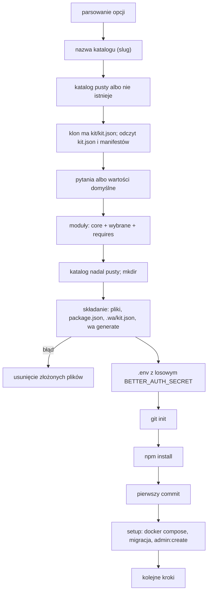
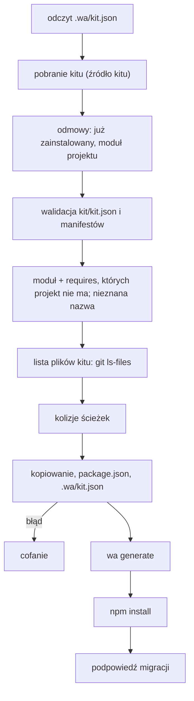

# CLI `wa` w projekcie

Po przeczytaniu będziesz wiedzieć:

- jak założyć projekt one-linerem z GitHuba albo z lokalnego klonu kitu i dlaczego ostrzeżenie gita o tagu nie jest błędem;
- w jakiej kolejności `wa create`, `wa add`, `wa remove`, `wa list` i `wa update` sprawdzają warunki, kiedy pobierają kit i z jakim kodem wyjścia się kończą;
- jak przenieść projekt na nowszą wersję kitu (`wa update`), co dzieje się z lokalnymi zmianami i jak rozwiązać konflikt;
- co CLI cofa po błędzie, a czego nie cofa;
- co zostaje w projekcie, w bazie i w magazynie S3 po `wa remove` i jaką migrację wtedy utworzyć;
- jak CLI traktuje moduły projektu (`projectModules`);
- co znaczy każdy komunikat CLI.

Zweryfikowano z kodem: cdf13ba, 2026-11-03 (sekcja [`wa update`](#wa-update) i miejsca, które się do niej odwołują); pozostałe sekcje: 6e6d49d, 2026-10-30

Źródła:

- `kit/cli/src/bin.ts`
- `kit/cli/src/args.ts`
- `kit/cli/src/commands/create.ts`
- `kit/cli/src/commands/add.ts`
- `kit/cli/src/commands/remove.ts`
- `kit/cli/src/commands/list.ts`
- `kit/cli/src/commands/update.ts`
- `kit/cli/src/update/` (`plan.ts`, `merge.ts`, `snapshot.ts`, `version.ts`, `report.ts`)
- `kit/cli/src/assemble/` (`copy.ts`, `hash.ts`, `package-json.ts`, `placeholders.ts`, `project-names.ts`, `resolve-modules.ts`)
- `kit/cli/src/kit/source.ts`
- `kit/cli/src/commands/kit-sync.ts`
- `kit/cli/src/generate/targets.ts` (`REGION_FILES`)
- `kit/cli/src/kit/files.ts`
- `kit/cli/src/kit/kit-config.ts`
- `kit/cli/src/manifest/kit-state.ts`
- `kit/cli/src/manifest/schema.ts`
- `kit/cli/src/process/prompter.ts`
- `kit/cli/src/process/runner.ts`
- `kit/cli/src/__tests__/args.test.ts`
- `kit/cli/src/commands/__tests__/` (`create.test.ts`, `add.test.ts`, `add-rollback.test.ts`, `add-fs-failures.test.ts`, `remove.test.ts`, `list.test.ts`, `update.test.ts`, `update-rollback.test.ts`, `update-source.test.ts`)
- `kit/cli/src/update/__tests__/` (`plan.test.ts`, `merge.test.ts`, `snapshot.test.ts`, `version.test.ts`)
- `kit/cli/src/kit/__tests__/source.test.ts`
- `kit/kit.json`
- `kit/modules/core.json`, `kit/modules/audit-logs.json`, `kit/modules/api-keys.json`, `kit/modules/uploads.json`
- `kit/README.md`
- `src/shared/lib/env.ts`
- `src/features/api-keys/env.ts`

Ten plik opisuje CLI z perspektywy osoby, która zakłada projekt, zmienia jego zestaw modułów albo przenosi go na nowszą wersję kitu. Komendę `wa generate` opisuje [02b-rejestr-i-generator.md](02b-rejestr-i-generator.md#wa-generate), a pracę nad samym kitem (manifesty, `wa kit sync`, bundel, wydanie) [16b-rozwoj-kitu.md](16b-rozwoj-kitu.md). Jak moduł po skopiowaniu łączy się z aplikacją, wyjaśnia [12-moduly-kitu.md](12-moduly-kitu.md). Pojęcia moduł, feature i rejestr modułów są w [słowniku](README.md#slownik).

„(sprawdzone)” znaczy tu, że zachowanie potwierdził przebieg z 2026-10-30: bundel `.wa/bin/wa.mjs` z tagu `v0.1.0` sklonowanego z `https://github.com/webamigos/wa-kit.git`, uruchomiony w katalogu tymczasowym, bez Dockera i bez `npm install`. Błędy poleceń zewnętrznych (`npm`, `docker`, `npx`) wywołano atrapami tych poleceń w `PATH`.

W sekcji [`wa update`](#wa-update) „(sprawdzone)” znaczy przebieg z 2026-11-03: lokalny klon tego repozytorium na commicie `cdf13ba` z tagami `v0.2.0` i `v0.3.0` dopisanymi w klonie (podbita `version` w `kit/kit.json` i zmiany w `src/shared/lib/utils.ts` oraz `prisma/schema/auth.prisma`), projekt złożony bundlem z tagu `v0.1.0` z `--yes --no-install`, źródło kitu podane jako `--kit <ścieżka klonu>`, `git` 2.56.0. Tagi `v0.2.0` i `v0.3.0` istniały tylko w tym klonie.

<a id="komendy"></a>

## Komendy w skrócie

CLI to jeden plik, `.wa/bin/wa.mjs`, zapisany w repozytorium kitu i w każdym projekcie ([D28](decyzje.md#d28)). W projekcie uruchamia go skrypt `wa` z `package.json` (`node .wa/bin/wa.mjs`), więc każdą komendę wywołujesz jako `npm run wa -- <komenda>`. Nowy projekt zakładasz bundlem z klonu kitu: `node <klon>/.wa/bin/wa.mjs create <katalog>`.

| Komenda | Gdzie | Co robi | Potrzebuje kitu |
| --- | --- | --- | --- |
| `wa create <katalog> [opcje]` | z klonu kitu | Składa nowy projekt: rdzeń i wybrane moduły ([wa create](#wa-create)). | tak, klonu lokalnego |
| `wa add <moduł> [--kit <źródło>] [--no-install]` | w projekcie | Kopiuje pliki modułu kitu i modułów z jego `requires` ([wa add](#wa-add)). | tak, w wersji projektu |
| `wa remove <moduł> [--force] [--no-install]` | w projekcie | Usuwa pliki modułu kitu i jego zależności npm ([wa remove](#wa-remove)). | nie |
| `wa list [--kit <źródło>]` | w projekcie | Wypisuje moduły zainstalowane, dostępne w kicie i moduły projektu ([wa list](#wa-list)). | tylko do listy „Dostępne” |
| `wa update <wersja> [--kit <źródło>] [--dry-run] [--no-install]` | w projekcie | Przenosi rdzeń i wszystkie moduły kitu na wersję `<wersja>`, scalając zmiany kitu z lokalnymi zmianami projektu ([wa update](#wa-update)). | tak, w wersji projektu i w wersji docelowej |
| `wa generate` | w projekcie i w kicie | Odświeża pliki generowane i regiony `wa:*` ([02b](02b-rejestr-i-generator.md#wa-generate)). | nie |
| `wa kit sync` | tylko w kicie | Przepisuje `.wa/kit.json` kitu z manifestów ([16b](16b-rozwoj-kitu.md)). | działa w kicie |

Każda komenda działa w katalogu bieżącym procesu. Kody wyjścia (`main` w `kit/cli/src/bin.ts`):

- **0:** komenda się udała. Także `wa list`, gdy kitu nie dało się pobrać: wypisuje wtedy stan projektu i linię `Dostępne: nie udało się pobrać kitu (<powód>)` (sprawdzone).
- **1:** każdy błąd, a także `wa update` zakończone konfliktem albo plikiem „do decyzji” ([Konflikty](#update-konflikty)). Komunikat błędu trafia na stderr jako jedna linia albo kilka linii (lista plików). Nieznana komenda, brak komendy i samo `wa kit` wypisują linię `Użycie: …` z podsumowaniem komend (sprawdzone).

Polecenia uruchamiane przez CLI (`git clone`, `git init`, `npm install`, `docker compose`, `npx prisma`, a w `wa update` także bundel wersji docelowej) piszą wprost do terminala, więc ich wyjście pojawia się nad komunikatem CLI. Listę komunikatów podaje [Referencja](#referencja-komunikaty).

<a id="wa-create"></a>

## `wa create`: nowy projekt

<a id="one-liner"></a>

### Uruchomienie z GitHuba

`create` potrzebuje klonu repozytorium kitu: kopiuje pliki śledzone przez git w tym klonie (`git ls-files` w `listKitFiles`, `kit/cli/src/kit/files.ts`). Kit nie jest publikowany w rejestrze npm ([D28](decyzje.md#d28)), a wersję wskazuje tag gita ([D46](decyzje.md#d46)). Podstawowa droga to jedna linia, która klonuje tag do katalogu tymczasowego i uruchamia bundel z klonu:

```bash
KIT_DIR=$(mktemp -d) && git clone --depth 1 --branch v0.1.0 https://github.com/webamigos/wa-kit.git "$KIT_DIR" && node "$KIT_DIR/.wa/bin/wa.mjs" create <nazwa>
```

`kit/README.md` nazywa tę linię `create-wa-app`; to nazwa w dokumentacji, nie osobny program. Zamiast `v0.1.0` podaj tag wersji, którą chcesz. Wymagany jest `git` z dostępem do `webamigos/wa-kit` i Node.js 22.

`git clone` wypisuje przy tym ostrzeżenie i długą poradę (sprawdzone, `git` 2.56.0, `LC_ALL=C`):

```text
Cloning into '…'...
warning: refs/tags/v0.1.0 14772ce361ec63b4777cb9925802cea0442afd05 is not a commit!
Note: switching to '76ca2d7ccfb23b43d53d4d9d492d1ba59ba3ca88'.

You are in 'detached HEAD' state. You can look around, make experimental
changes and commit them, and you can discard any commits you make in this
state without impacting any branches by switching back to a branch.
…
Turn off this advice by setting config variable advice.detachedHead to false
```

**To nie jest błąd.** `git clone` kończy się kodem 0, a `create` rusza dalej.

- `v0.1.0` to tag z adnotacją: wskazuje obiekt tagu (`14772ce`), a dopiero ten wskazuje commit `76ca2d7`. `--branch` przyjmuje nazwę gałęzi albo tagu, a ref tagu z adnotacją wskazuje obiekt tagu, nie commit, więc git wypisuje `warning: … is not a commit!` i przechodzi do commita, na który wskazuje tag. Ostrzeżenie nie zależy od `--depth 1`: pada też przy pełnym klonie i z `--single-branch`, a przy tagu bez adnotacji go nie ma (sprawdzone na repozytorium testowym, `git` 2.56.0). Klon dostaje właściwy commit.
- Tag nie jest gałęzią, więc klon zostaje na „odłączonym HEAD” (`detached HEAD`). Z klonu tylko czytasz, więc to bez znaczenia.
- Przy polskich ustawieniach języka git pisze te same informacje po polsku: `warning: refs/tags/v0.1.0 … nie jest zapisem!` i `Jesteś w stanie „odłączonego HEAD”.` (sprawdzone).

To samo ostrzeżenie pojawia się nad wynikiem `wa add` i `wa list`, gdy klonują kit z GitHuba ([Źródło kitu](#zrodlo-kitu)); opcja `--quiet`, z którą klonują, go nie wycisza (sprawdzone). Porady o odłączonym HEAD tam nie ma: CLI klonuje z `-c advice.detachedHead=false`.

Błąd klonowania (brak dostępu do repozytorium, nieistniejący tag) przerywa linię na `git clone` z komunikatem gita, a `create` się nie uruchamia.

Klon w `$KIT_DIR` zostaje po `create`: nic go nie usuwa (sprawdzone). Możesz go użyć ponownie jako lokalnego klonu (niżej) albo usunąć.

<a id="lokalny-klon"></a>

### Uruchomienie z lokalnego klonu (bez sieci)

Bez dostępu do sieci projekt zakładasz z klonu kitu, który już masz na dysku, na przykład z `$KIT_DIR` po one-linerze albo z klonu, w którym pracujesz nad kitem:

```bash
node <klon>/.wa/bin/wa.mjs create <nazwa>
```

Bez `--kit` CLI bierze kit z katalogu, w którym leży uruchomiony bundel: dwa poziomy nad `.wa/bin/wa.mjs` (`resolve(dirname(…), "../..")` w `bin.ts`). Opcja `--kit <ścieżka>` wskazuje inny klon. `create` nie sprawdza tagu ani commita klonu: projekt dostaje to, co klon ma w drzewie roboczym ([Lokalny klon jako źródło](#lokalny-klon-zrodlo)).

Bundel w projekcie nie ma obok siebie kitu, więc `npm run wa -- create …` w projekcie kończy się błędem `Uruchom create z klonu wa-kit albo podaj --kit <ścieżka>` (sprawdzone).

<a id="create-opcje"></a>

### Nazwa katalogu i opcje

Ostatni człon ścieżki katalogu staje się slugiem projektu i musi pasować do wzorca:

`kit/cli/src/assemble/project-names.ts`

```ts
const SLUG_PATTERN = /^[a-z][a-z0-9-]{1,49}$/;
```

Ze slugu powstają trzy nazwy, które zastępują placeholdery kitu w plikach z listy `placeholderFiles` w `kit/kit.json` ([D32](decyzje.md#d32)):

| Nazwa | Jak powstaje | Dla `acme-app` (sprawdzone) | Przykładowe miejsca |
| --- | --- | --- | --- |
| Nazwa wyświetlana | `--title` albo slug z wielką literą na początku każdego członu | `Acme App` | `src/shared/config/project.ts`, `EMAIL_FROM` w `.env.example`, `project.name` w `.wa/kit.json` |
| Slug | ostatni człon ścieżki | `acme-app` | `name` w `package.json`, `src/shared/config/project.ts`, bucket `acme-app-uploads` modułu `uploads` |
| Snake | slug z `_` zamiast `-` | `acme_app` | baza `acme_app` w `docker-compose.yml` i `.env.example`, `acme_app_test` w testach integracyjnych |

Opcje (`parseCreateArgs` w `kit/cli/src/args.ts`):

| Opcja | Znaczenie | Bez opcji |
| --- | --- | --- |
| `--modules a,b` | Moduły kitu oprócz rdzenia. `--modules ""` i `--modules=` oznaczają sam rdzeń. | Pytanie o moduły; z `--yes` sam rdzeń. |
| `--locales pl,en` | Języki aplikacji: tylko `pl` i `en`, `pl` wymagany, bez powtórzeń ([D33](decyzje.md#d33)). | Pytanie; z `--yes` `pl,en`. |
| `--title <tekst>` | Nazwa wyświetlana. | Pytanie z nazwą ze slugu jako domyślną; z `--yes` nazwa ze slugu. |
| `--admin-email <email>` | Adres pierwszego admina: trafia do `ADMIN_EMAIL` w `.env`, do wypisanego kroku `admin:create` i do `admin:create` przy setupie. | Pytanie (puste = pomiń); z `--yes` brak. |
| `--yes` | Bez pytań: brakujące opcje dostają wartości domyślne. | Pytania w terminalu. |
| `--setup` | Po instalacji uruchamia bazę, migrację i `admin:create` ([D35](decyzje.md#d35)). Nie łączy się z `--no-install`. | Pytanie `[t/N]`, gdy jest instalacja i nie podano `--yes`; z `--yes` bez setupu. |
| `--no-install` | Bez `npm install`. | `npm install` w projekcie. |
| `--no-git` | Bez `git init` i pierwszego commita. Sam `git` jest potrzebny i tak, do odczytu plików kitu. | `git init` i commit. |
| `--kit <ścieżka>` | Klon kitu, z którego powstaje projekt. Pusta wartość to błąd. | Katalog bundla ([wyżej](#lokalny-klon)). |

Wartości `--title` i `--admin-email` nie są walidowane ani escapowane (sprawdzone):

- `--title 'Acme "Q"'` daje w `src/shared/config/project.ts` linię `name: "Acme "Q"",`, która psuje składnię pliku, a w `.env.example` i `.env` linię `EMAIL_FROM="Acme "Q" <noreply@example.com>"` z niezamkniętym cudzysłowem;
- `--title=` daje pustą nazwę (`name: ""`), a `--admin-email=` pustą linię `ADMIN_EMAIL=`;
- tytuł zawierający `wa-app` albo `wa_app` zostanie dodatkowo podmieniony w plikach z placeholderami, bo podmiana slugu idzie po podmianie nazwy (`applyPlaceholders`).

<a id="create-pytania"></a>

### Pytania

Bez `--yes` CLI pyta po kolei o to, czego nie podano w opcjach: moduły (z listą modułów kitu i ich opisami), języki, nazwę wyświetlaną, email admina i, gdy jest instalacja, setup. Pytanie o setup pada także wtedy, gdy wszystkie pozostałe opcje są podane, bo `--setup` jest flagą bez wartości „nie”. W skrypcie albo w CI dodaj więc `--yes`.

Pytania czyta `readlinePrompter` (`kit/cli/src/process/prompter.ts`). Bez terminala (CI, przekierowane wejście) pierwsze pytanie kończy komendę błędem `Brak terminala: użyj --yes`, zanim powstanie katalog projektu (sprawdzone). Odpowiedzi `t`, `tak`, `y` i `yes`, bez względu na wielkość liter, oznaczają zgodę; pusta odpowiedź przyjmuje wartość domyślną. Zła odpowiedź na pytanie o języki kończy komendę błędem `--locales: …` bez ponownego pytania.

<a id="create-przebieg"></a>

### Przebieg i kolejność kontroli



1. **Opcje, nazwa, katalog.** Najpierw parsowanie opcji, potem wzorzec slugu, potem katalog docelowy. Katalog, który istnieje i ma jakikolwiek wpis (także ukryty plik), kończy komendę błędem `Katalog <ścieżka> istnieje i nie jest pusty` (sprawdzone). Pusty istniejący katalog jest akceptowany. Żadne pytanie ani polecenie nie pada przed tymi kontrolami.
2. **Kit.** Brak `kit/kit.json` w klonie daje `Uruchom create z klonu wa-kit albo podaj --kit <ścieżka>` (sprawdzone). Potem CLI czyta `kit/kit.json` i manifesty `kit/modules/*.json`.
3. **Pytania** ([wyżej](#create-pytania)).
4. **Moduły.** Do wybranych modułów CLI dodaje moduły z ich `requires` i zawsze `core` (`resolveModules` w `kit/cli/src/assemble/resolve-modules.ts`). Nieznana nazwa daje `Nieznany moduł: <nazwa>. Dostępne: <lista>`, zanim powstanie katalog (sprawdzone). W wersji `v0.1.0` moduły `audit-logs`, `api-keys` i `uploads` mają puste `requires`.
5. **Składanie.** CLI sprawdza jeszcze raz, czy katalog jest pusty, tworzy go i kopiuje pliki wybranych modułów. Pomija pliki tylko dla kitu (`kitOnly` w `kit/kit.json`: `kit/**`, `docs/**`, `.superpowers/**`, `.claude/handoffs/**`, `.wa/kit.json`, workflowy kitu, `prisma/migrations/.gitignore`) i pliki generowane (`generatedFiles`), które odtwarza generator. Kopia ma te same bity uprawnień co plik w kicie. W plikach z `placeholderFiles` podmienia nazwy, a hash każdego pliku zapisuje w `.wa/kit.json` ([D31](decyzje.md#d31)). `package.json` dostaje slug jako `name`, wersję `0.1.0` i sumę zależności wybranych manifestów ([D30](decyzje.md#d30)). Na końcu CLI zapisuje `.wa/kit.json` i uruchamia `wa generate`.
6. **`.env`.** Kopia `.env.example` z `BETTER_AUTH_SECRET` ustawionym na 32 losowe bajty w base64url (43 znaki) i z `ADMIN_EMAIL`, jeśli podano adres. Plik ma uprawnienia `0600` (sprawdzone). Zmienne modułów (`API_KEY_PEPPER`, `S3_*`) trafiają do `.env` z wartościami przykładowymi z regionu `wa:modules` (sprawdzone).
7. **`git init`**, gdy nie podano `--no-git`.
8. **`npm install`**, gdy nie podano `--no-install`. Lockfile jest skopiowany z kitu, a `npm install` dopasowuje go do `package.json` projektu. Z `--no-install` `package-lock.json` ma do pierwszej instalacji `"name": "wa-app"`, `"version": "0.0.0"` i zależności kitu (sprawdzone).
9. **Pierwszy commit** `chore: initial commit from wa-kit v<wersja>`, z `--no-verify`, czyli bez hooków husky. Nieudany commit (na przykład brak `user.name` albo `user.email`) nie przerywa komendy: CLI wypisuje `Uwaga: nie utworzono commita (<powód>). Skonfiguruj git i zrób commit ręcznie.`
10. **Setup** (z `--setup` albo po odpowiedzi „t”): `docker compose up -d --wait`, `npx prisma migrate dev --name init` i, jeśli podano adres, `npm run admin:create -- --email <adres>`.
11. **Kolejne kroki.** Bez setupu CLI wypisuje `cd <ścieżka>`, `docker compose up -d`, `npx prisma migrate dev --name init`, `npm run admin:create -- --email <adres albo twój-email>` i `npm run dev` (sprawdzone). Po setupie tylko `cd <ścieżka>` i `npm run dev`, także wtedy, gdy setup pominął `admin:create` z braku adresu; pierwsze konto założysz wtedy sam ([01-uruchomienie.md](01-uruchomienie.md#admin-create)).

<a id="create-cofanie"></a>

### Cofanie i jego granice

- **Błąd w kroku 5 (składanie)** usuwa katalog projektu, a gdy katalog istniał wcześniej (pusty), usuwa jego zawartość (sprawdzone na kicie bez repozytorium git: nowy katalog znika, istniejący zostaje pusty). Błąd samego sprzątania jest połykany; widzisz tylko pierwotny błąd. Testy: `describe("create: błąd podczas składania")` w `kit/cli/src/commands/__tests__/create.test.ts`.
- **Błąd po składaniu** (zapis `.env`, `git init`, `npm install`, kroki setupu) niczego nie cofa: katalog projektu zostaje, a kolejne kroki się nie wykonują i nie są wypisywane ([D35](decyzje.md#d35)).
  - Błąd `npm install` daje `Projekt utworzony w <ścieżka>, ale npm install się nie powiódł. Uruchom: cd <ścieżka> && npm install` (sprawdzone). Commita i setupu wtedy nie ma.
  - Błąd w setupie przychodzi jako surowy komunikat procesu, na przykład `docker compose up -d --wait zakończone kodem 1` (sprawdzone). Commit (bez `--no-git`) już wtedy istnieje. Usuń przyczynę (zwykle zajęty port, [01-uruchomienie.md](01-uruchomienie.md#zmiana-portow)) i wykonaj pozostałe kroki ręcznie.

<a id="create-wynik"></a>

### Co dostaje projekt

Projekt ma ten sam układ katalogów co kit ([D38](decyzje.md#d38)), z tymi różnicami (sprawdzone na projektach z `--modules audit-logs`, `api-keys`, `uploads` i ze wszystkimi trzema):

| W projekcie | Różnica względem kitu |
| --- | --- |
| `kit/`, `docs/` | Nie ma. Dokumentacja leży tylko w repozytorium kitu. |
| `prisma/migrations/` | Nie ma. Pierwsza migracja projektu trafia do repozytorium projektu ([03b](03b-schemat-i-migracje.md#migracje-w-projekcie), [D13](decyzje.md#d13)). |
| `.wa/kit.json` | `kitVersion` i `kitRepo` kitu, nazwa i slug projektu, języki, wybrane moduły z wersją, manifestem i hashami plików, puste `projectModules`. `package.json` i `package-lock.json` mają w `files` rdzenia znacznik `managed` zamiast hasha. |
| `package.json` | `name` równy slugowi, `version` `0.1.0`, zależności rdzenia i wybranych modułów: `uploads` dodaje `@aws-sdk/client-s3`, `file-type` i `sharp`, `audit-logs` dodaje `better-call` w `devDependencies`, `api-keys` nie dodaje nic. |
| `src/i18n/locales.generated.ts` | Tylko wybrane języki ([D33](decyzje.md#d33)). |
| Regiony `wa:*` | `wa:relations` w `auth.prisma` i `organizations.prisma` z relacjami modułów; `wa:modules` w `.env.example` z `API_KEY_PEPPER` (`api-keys`) i zmiennymi `S3_*` (`uploads`, bucket `<slug>-uploads`); `wa:services` w `docker-compose.yml` z usługami `minio` i `minio-init` (`uploads`); `wa:ci-integration` w `.github/workflows/ci.yml` z krokami „Start MinIO” i „Create MinIO bucket” (`uploads`). Bez modułów regiony są puste. |
| `.env` | Gotowy do startu, z losowym sekretem i wartościami przykładowymi zmiennych modułów. Wartość `API_KEY_PEPPER` z `.env.example` jest tylko dla dewelopmentu: przy `NODE_ENV=production` schemat `envSchema` w `src/features/api-keys/env.ts` ją odrzuca (`API_KEY_PEPPER: w produkcji nie może być wartością z .env.example`), więc na produkcji ustaw własną, co najmniej 32 znaki. |
| `.wa/bin/wa.mjs` | Ten sam bundel co w kicie: należy do rdzenia, więc projekt uruchamia `wa generate`, `wa add` i `wa remove` bez budowania CLI. |

Po `create` bez setupu postępujesz jak w [01-uruchomienie.md](01-uruchomienie.md#pierwsze-uruchomienie) od sprawdzenia portów; `npm install` i `.env` są gotowe.

<a id="zrodlo-kitu"></a>

## Źródło kitu dla `add` i `list`

`wa add` i `wa list` czytają manifesty i pliki z repozytorium kitu w wersji projektu (`kitVersion` w `.wa/kit.json`). `wa remove` kitu nie potrzebuje. Źródło wybiera `resolveKitSource` (`kit/cli/src/kit/source.ts`), w tej kolejności ([D46](decyzje.md#d46)):

1. opcja `--kit <źródło>`;
2. zmienna środowiskowa `WA_KIT_SOURCE`;
3. `kitRepo` z `.wa/kit.json` (po `create` z kitu `v0.1.0`: `https://github.com/webamigos/wa-kit.git`).

`kit/cli/src/kit/source.ts`

```ts
const REMOTE_PREFIXES = ["https://", "ssh://", "file://", "git@"];
```

- **Źródło zdalne** (zaczyna się jednym z tych prefiksów) CLI klonuje poleceniem `git -c advice.detachedHead=false clone --depth 1 --branch v<kitVersion> --quiet` do katalogu tymczasowego (`wa-add-…` albo `wa-list-…` w katalogu tymczasowym systemu), który znika po komendzie, także po błędzie. Nad wynikiem widać jedną linię gita: ostrzeżenie o tagu z adnotacją, takie jak przy [one-linerze](#one-liner) (`warning: refs/tags/v<kitVersion> <sha> is not a commit!`). Porady o odłączonym HEAD nie ma, bo wyłącza ją `-c advice.detachedHead=false`. Nieudany klon daje `Nie udało się pobrać wa-kit v<wersja> z <adres>. Sprawdź dostęp (gh auth status) albo podaj --kit <ścieżka>`, a nad nim wyjście gita, na przykład `fatal: repository '…' not found` (sprawdzone).
- **Ścieżka lokalna** musi wskazywać katalog z `kit/kit.json` (inaczej `Brak kit/kit.json w <ścieżka> — to nie jest repozytorium wa-kit`), a `version` z tego pliku musi być równa `kitVersion` projektu (inaczej `Kit w <ścieżka> ma wersję <x>, projekt używa <y>`).
- **Odrzucane źródła:** wartość zaczynająca się od `-` (żeby nie stała się opcją gita) i wartość z `://` albo `::` spoza listy prefiksów, na przykład `ext::sh`. Komunikat: `Nieprawidłowe źródło wa-kit: <źródło>` (sprawdzone dla `--kit=-x` i `--kit ext::sh`). Dotyczy tylko `add` i `list`: `create` nie korzysta z `resolveKitSource`, tylko z `--kit` jako ścieżki.
- **Pusty `WA_KIT_SOURCE`** (`WA_KIT_SOURCE=`) jest ścieżką lokalną: wskazuje katalog bieżący, czyli zwykle projekt, który nie ma `kit/kit.json` (sprawdzone).

Wymóg równej wersji wynika z modelu kitu: projekt dostaje kod jednej wersji kitu. Moduł z nowszego kitu skopiowałby pliki, które zakładają nowszy rdzeń. Na nowszą wersję przenosi projekt [`wa update`](#wa-update), a dopiero potem `wa add` dodaje moduły tej wersji.

<a id="lokalny-klon-zrodlo"></a>

### Lokalny klon jako źródło (bez sieci)

Przy domyślnym `kitRepo` każde `wa add` i `wa list` łączy się z GitHubem. Bez sieci wskaż klon kitu w wersji projektu:

```bash
npm run wa -- add api-keys --kit ~/wa-kit
WA_KIT_SOURCE=~/wa-kit npm run wa -- list
```

Co trzeba wiedzieć o lokalnym klonie:

- CLI porównuje tylko `version` z `kit/kit.json`, nie tag ani commit. Klon na `main` po wydaniu z tą samą wersją też zostanie użyty.
- Lista plików pochodzi z indeksu gita (`git ls-files`), a treść z drzewa roboczego (`copyFiles`). Niezacommitowana zmiana śledzonego pliku trafia do projektu, a nowy plik przed `git add` nie trafia (sprawdzone na klonie ze zmienionym `src/features/api-keys/env.ts` i nowym, nieśledzonym plikiem w katalogu `src/features/api-keys/`).
- `wa add` (i `create`) wymaga, żeby źródło było repozytorium git: katalog z `kit/kit.json` bez `.git` daje `<ścieżka> nie jest repozytorium git`. `wa list` czyta tylko manifesty, więc działa także na takim katalogu (sprawdzone).

<a id="wa-add"></a>

## `wa add`: dodanie modułu kitu

```bash
npm run wa -- add <moduł>
```

<a id="add-kolejnosc"></a>

### Kolejność kontroli



1. **`.wa/kit.json`.** Brak pliku daje `Brak .wa/kit.json w <katalog> — to nie jest projekt wa-kit`. Plik, który nie przechodzi walidacji, daje błąd walidacji ([Referencja](#referencja-komunikaty)).
2. **Pobranie kitu** według [źródła kitu](#zrodlo-kitu). Pobranie idzie **przed** odmowami z następnego kroku (`addFromSource` w `kit/cli/src/commands/add.ts`): `wa add uploads --kit /nie/ma` w projekcie, który ma `uploads`, daje błąd źródła, nie odmowę, a przy domyślnym `kitRepo` nawet odmowa wymaga sieci (sprawdzone).
3. **Odmowy:** moduł zainstalowany (`Moduł <x> jest już zainstalowany`, także dla `core`) i nazwa zajęta przez moduł projektu (`Moduł <x> jest modułem projektu; zmień jego nazwę albo usuń wpis z projectModules`) (sprawdzone).
4. **Kit i manifesty.** Dopiero teraz `add` waliduje schematem `kit/kit.json` i `kit/modules/*.json` (`readKitConfig`, `readKitManifests`). Uszkodzony manifest daje więc błąd dopiero po odmowach.
5. **Zestaw modułów:** moduł i moduły z jego `requires`, których projekt nie ma. Nieznana nazwa daje `Nieznany moduł: <nazwa>. Dostępne: api-keys, audit-logs, uploads` (sprawdzone).
6. **Lista plików kitu** (`assemblableFiles`, `git ls-files`). Tu pada `<ścieżka> nie jest repozytorium git` dla lokalnego kitu bez `.git` i `spawn git ENOENT` bez `git` w `PATH`. Kit bez `.git` przy module już zainstalowanym albo nieznanym daje więc odmowę albo `Nieznany moduł`, a nie błąd repozytorium (sprawdzone).
7. **Kolizje.** Jeśli na ścieżce któregokolwiek pliku z zestawu coś już jest (plik, katalog albo symlink, także wiszący), komenda kończy się błędem `Pliki już istnieją, przerwano bez zmian:` z alfabetyczną listą ścieżek i niczego nie zmienia (sprawdzone). CLI nie nadpisuje plików projektu.
8. **Kopiowanie** z placeholderami według nazw z `.wa/kit.json` projektu, z hashami plików; dopisanie zależności npm do `package.json`; zapis `.wa/kit.json`.
9. **`wa generate`**, potem `npm install` (bez `--no-install`).
10. **Podpowiedź migracji:** ostatnia linia wyjścia to `npx prisma migrate dev --name add-<moduł>`, z nazwą z argumentu, także gdy CLI dodało moduły z `requires`. Migrację tworzysz i commitujesz sam ([03b](03b-schemat-i-migracje.md#migracje-w-projekcie)).

Przebieg w projekcie `acme-app` z modułem `uploads` (sprawdzone, domyślne źródło, wyjście skrócone):

```text
$ npm run wa -- add api-keys --no-install
warning: refs/tags/v0.1.0 14772ce361ec63b4777cb9925802cea0442afd05 is not a commit!
…
npx prisma migrate dev --name add-api-keys
```

Zmienione pliki: nowe pliki modułu (`prisma/schema/api-keys.prisma`, `src/features/api-keys/**`, `src/app/api/v1/organization/**`, `src/app/[locale]/(app)/api-keys/**`), a także `.wa/kit.json`, `.env.example` (region `wa:modules`), `prisma/schema/auth.prisma` i `prisma/schema/organizations.prisma` (region `wa:relations`), `src/modules.generated.ts` i `src/modules.client.generated.ts`. `package.json` się nie zmienił, bo `api-keys` nie ma zależności npm.

<a id="add-po"></a>

### Po `wa add`

1. **Uzupełnij `.env`.** `wa add` nie zmienia `.env`: nowe zmienne modułu trafiają tylko do regionu `wa:modules` w `.env.example` (sprawdzone: po `add api-keys` `.env` nie ma `API_KEY_PEPPER`). Moduł z wymaganą zmienną (`api-keys`, `uploads`) bez wpisu w `.env` kończy się przy pierwszym odczycie `env` błędem `Nieprawidłowe zmienne środowiskowe: …` ([01-uruchomienie.md](01-uruchomienie.md#bledy-env)). Skopiuj zmienne z regionu i ustaw własne wartości.
2. **Migracja:** `npx prisma migrate dev --name add-<moduł>` przy działającej bazie, potem commit migracji.
3. **Usługi:** moduł z `compose` (`uploads`) dodaje usługi do `docker-compose.yml`; uruchom `docker compose up -d`.
4. Bez `npm install` w trakcie `add` (`--no-install`) zainstaluj zależności sam.

<a id="add-zaleznosci"></a>

### Zależności npm

Zależność, którą projekt ma już w tej samej sekcji w innej wersji, zostaje w wersji projektu, a CLI wypisuje ostrzeżenie ([D30](decyzje.md#d30)):

```text
Uwaga: <pakiet> (<sekcja>) ma w projekcie <wersja>, moduł <moduł> wymaga <wersja>; zostaje wersja projektu
```

Ostrzeżenie nie przerywa komendy: sprawdź sam, czy moduł działa z wersją projektu. Przy kilku modułach w jednym wywołaniu każdy jest porównywany z `package.json` po dodaniu poprzednich. Zależność, którą projekt ma w innej sekcji (na przykład w `devDependencies`, a moduł chce jej w `dependencies`), nie jest konfliktem: trafia do obu sekcji bez ostrzeżenia.

<a id="add-cofanie"></a>

### Cofanie i jego granice

- **Błąd przed kopiowaniem** (kroki 1–7) niczego nie zmienia w projekcie.
- **Błąd w kroku 8** (na przykład brak miejsca na dysku, plik tylko do odczytu, plik w miejscu katalogu modułu) cofa zmiany (`rollbackAdd`): usuwa pliki modułu, usuwa katalogi, które `add` utworzył, jeśli zostały puste, i przywraca `package.json` oraz `.wa/kit.json`, jeśli ich treść się zmieniła. Pierwotny błąd to zwykle surowy komunikat Node po angielsku, na przykład `ENOTDIR: not a directory, mkdir '…/src/features/api-keys/__tests__'`, gdy w miejscu katalogu `src/features/api-keys` leży zwykły plik (sprawdzone: po błędzie w projekcie został tylko ten plik), albo `EEXIST: file already exists, mkdir …` w podobnej sytuacji głębiej w drzewie.
- Każdy krok sprzątania działa niezależnie. Krok, który się nie uda, CLI wypisuje jako `Nie udało się posprzątać: <ścieżka> (<kod błędu albo komunikat>)` i idzie dalej, a na końcu rzuca pierwotny błąd. Typowy przypadek: w katalogu, który utworzył `add`, pojawił się obcy plik, więc katalog nie jest pusty (`Nie udało się posprzątać: src/features/demo/i18n (ENOTEMPTY)` w teście „rzuca oryginalny błąd, usuwa plik modułu, zostawia obcy plik i loguje oba katalogi” w `kit/cli/src/commands/__tests__/add-rollback.test.ts`).
- **Błąd w `wa generate` albo `npm install`** (krok 9) nie cofa zmian: pliki są skopiowane, a `.wa/kit.json` je opisuje. Powtórz `npm run wa -- generate` albo `npm install`. Przy błędzie instalacji komunikat to `Moduł dodany, ale npm install się nie powiódł. Uruchom: npm install`.

<a id="wa-remove"></a>

## `wa remove`: usunięcie modułu kitu

```bash
npm run wa -- remove <moduł>
```

`wa remove` nie potrzebuje kitu ani sieci: wszystko, czego używa (pliki, hashe, manifest, zależności), jest w `.wa/kit.json` projektu.

<a id="remove-kolejnosc"></a>

### Kolejność kontroli

Wszystkie kontrole idą przed usunięciem czegokolwiek ([D34](decyzje.md#d34)):

1. **`.wa/kit.json`** jak w `add`.
2. **Odmowy** (`assertRemovable`, sprawdzone):
   - `core`: `Nie można usunąć rdzenia`;
   - moduł projektu: `Moduł <x> należy do projektu; wa remove usuwa tylko moduły kitu. Usuń jego pliki i wpis w projectModules ręcznie`;
   - moduł niezainstalowany: `Moduł <x> nie jest zainstalowany`;
   - moduł wymagany przez inny moduł kitu albo moduł projektu: `Moduł <x> jest wymagany przez: <lista>`, na przykład `Moduł audit-logs jest wymagany przez: notes`, gdy moduł projektu `notes` ma `audit-logs` w `requires`.
3. **Ścieżki poza projektem.** Każda ścieżka z `files` modułu, która po rozwiązaniu symlinków wychodzi poza katalog projektu, daje `Ścieżka poza projektem: <ścieżka>`.
4. **Zmienione pliki.** CLI liczy hash każdego istniejącego pliku modułu i porównuje go z hashem z `.wa/kit.json` ([D31](decyzje.md#d31)). Jeśli choć jeden się różni, bez `--force` komenda kończy się błędem z listą plików i niczego nie usuwa. Plik, którego już nie ma, nie blokuje komendy. Hash pomija treść regionów `wa:*` tylko w plikach z regionami, a te należą do `core`, więc w plikach usuwanego modułu liczy się każda zmiana bajtu.
5. **`package.json`** musi dać się odczytać jako JSON; inaczej komenda kończy się surowym błędem parsera przed usunięciem plików.

Przebieg z dwoma zmienionymi plikami (sprawdzone):

```text
$ npm run wa -- remove api-keys --no-install
Zmienione pliki modułu api-keys (użyj --force):
  src/features/api-keys/i18n/pl.json
  src/features/api-keys/services/api-scopes.ts
```

`--force` usuwa pliki modułu razem z lokalnymi zmianami (sprawdzone). Zmiany, które chcesz zachować, przenieś wcześniej, na przykład do własnej funkcji projektu.

<a id="remove-co-robi"></a>

### Co usuwa

1. Pliki z `files` modułu i puste katalogi nad nimi, aż do pierwszego niepustego. Sprzątanie katalogów nie przechodzi przez symlinki i nigdy nie usuwa katalogu projektu.
2. Z `package.json` zależności modułu, których nie deklaruje żaden pozostały moduł kitu ani moduł projektu ([D30](decyzje.md#d30)). Sekcje liczone są osobno (`removeDependencies`): zależność z `dependencies` usuwanego modułu chroni tylko deklaracja w `dependencies` innego manifestu, a z `devDependencies` tylko w `devDependencies`. Usuwa je także wtedy, gdy projekt miał tę zależność przed `add` albo zmienił jej wersję.
3. Wpis modułu w `.wa/kit.json`; potem `wa generate` czyści regiony `wa:*` z wpisów modułu i rejestr.
4. `npm install` (bez `--no-install`) i na końcu linia `npx prisma migrate dev --name remove-<moduł>`.

`wa add api-keys`, a potem `wa remove api-keys` dają drzewo projektu bajt w bajt równe stanowi sprzed `add` (sprawdzone na projekcie z `uploads`, porównanie `git diff`). Po `wa remove uploads` w projekcie z modułem projektu, który deklaruje `sharp`, z `package.json` zniknęły `@aws-sdk/client-s3` i `file-type`, a `sharp` został; regiony `wa:modules`, `wa:services` i `wa:ci-integration` są puste, a pliki `docker/uploads.compose.yml` i `ci/uploads.integration-steps.yml` usunięte razem z katalogami (sprawdzone).

<a id="remove-co-zostaje"></a>

### Co zostaje i jaką migrację utworzyć

`wa remove` zmienia tylko pliki projektu. Nie dotyka bazy, magazynu S3 ani `.env`:

| Co | Po `wa remove` | Co zrobić |
| --- | --- | --- |
| Tabele modułu w bazie (`audit_logs`, `api_keys`, `uploads`) i ich dane | Zostają, dopóki nie zastosujesz migracji. Schemat w `prisma/schema/` już ich nie opisuje, a aplikacja ich nie używa. | Jeśli dane są potrzebne, zrób kopię tabeli. Potem `npx prisma migrate dev --name remove-<moduł>`: migracja wygenerowana ze schematu bez pliku modułu usuwa tabelę modułu razem z danymi. Zacommituj ją ([03b](03b-schemat-i-migracje.md#migracje-w-projekcie)); na produkcji zastosuje ją `npx prisma migrate deploy` przy wdrożeniu ([10](10-wdrozenie.md)). |
| Obiekty w magazynie S3 (`uploads`) | Zostają w buckecie. Usunięcie tabeli `uploads` nie usuwa obiektów, a po nim nie ma już listy kluczy. | Przed migracją wypisz klucze z tabeli `uploads` albo opróżnij bucket narzędziem dostawcy S3. |
| Dane lokalnego MinIO (`volumes/minio`) | Zostają na dysku; katalog jest w `.gitignore`. Usługi `minio` i `minio-init` znikają z `docker-compose.yml`, ale uruchomiony wcześniej kontener `minio` działa dalej jako osierocony. | `docker compose up -d --remove-orphans` zatrzymuje i usuwa kontenery usług, których nie ma już w `docker-compose.yml`. Potem usuń katalog ręcznie, jeśli dane nie są potrzebne. |
| Zmienne modułu w `.env` (`API_KEY_PEPPER`, `S3_*`) | Zostają w `.env` (sprawdzone); znikają tylko z `.env.example`. Nie szkodzą. | Usuń je z `.env` i ze zmiennych środowiska produkcji. |
| Zależności npm | Usunięte według reguły z [Co usuwa](#remove-co-robi), także te, których projekt używa we własnym kodzie, jeśli żaden manifest ich nie deklaruje. | Dopisz zależność, której używasz, do `package.json` i do manifestu modułu projektu, w tej samej sekcji co moduł kitu. |
| Kod projektu, który importuje pliki modułu | Zostaje. `wa remove` nie szuka importów, więc build i typecheck przestaną przechodzić. | Usuń te importy albo przenieś potrzebny kod do projektu przed `remove`. |
| `node_modules` | Z `--no-install` zawiera pakiety usuniętych zależności do następnego `npm install`. | `npm install`. |

Zachowanie kodu projektu bez modułu (na przykład `trackAudit` bez `audit-logs`) opisują pliki modułów: [13-modul-audit-logs.md](13-modul-audit-logs.md), [14-modul-api-keys.md](14-modul-api-keys.md) i [15-modul-uploads.md](15-modul-uploads.md).

<a id="remove-cofanie"></a>

### Cofanie i jego granice

`wa remove` nie ma cofania. „Wszystko albo nic” dotyczy kontroli: błąd w krokach z [Kolejności kontroli](#remove-kolejnosc) niczego nie zmienia (sprawdzone dla odmów i zmienionych plików). Błąd w trakcie usuwania (na przykład uprawnienia) zostawia stan częściowy: część plików usunięta, `.wa/kit.json` jeszcze z modułem. Usuń przyczynę i uruchom `wa remove` ponownie; brakujące pliki nie blokują komendy. Błąd `npm install` na końcu daje `Moduł usunięty, ale npm install się nie powiódł. Uruchom: npm install`, a moduł jest już usunięty ze stanu i z dysku.

Wpis w `files` uszkodzonego `.wa/kit.json` też zatrzymuje komendę przed usuwaniem: katalog daje surowy błąd `EISDIR`, a ścieżka pod zwykłym plikiem błąd `ENOTDIR: not a directory, realpath …` (testy w `kit/cli/src/commands/__tests__/remove.test.ts`).

<a id="remove-bezpieczenstwo"></a>

### Bezpieczeństwo

- `wa remove` ufa treści `.wa/kit.json`: usunie każdy plik z `files` modułu, którego hash zgadza się z zapisanym, a z `--force` każdy plik z `files`. `.wa/kit.json` z niezaufanego źródła (cudzy pull request, archiwum) przejrzyj przed użyciem komendy.
- Usuwa wyłącznie pliki leżące wewnątrz projektu po rozwiązaniu symlinków (`insideProject`). Plik modułu, który sam jest symlinkiem, znika jak zwykły plik: usunięty zostaje link, a nie jego cel. Sprzątanie pustych katalogów nie usuwa symlinków i nie przechodzi przez nie.
- Komenda nie jest odporna na równoległe zmiany katalogu projektu przez inny proces: między sprawdzeniem a usunięciem nie ma blokady.

<a id="wa-list"></a>

## `wa list`: stan modułów

```bash
npm run wa -- list
```

Wynik w projekcie z modułem `uploads` (sprawdzone, domyślne źródło, wyjście gita pominięte):

```text
Zainstalowane:
  core 0.4.0
  uploads 0.1.0
Dostępne:
  api-keys 0.1.0 — Klucze API organizacji: model ApiKey, sekret z pepperem i zakresy
  audit-logs 0.1.0 — Dziennik zdarzen organizacji: model AuditLog, sink i redakcja danych wrazliwych
```

- **Zainstalowane:** moduły kitu z `.wa/kit.json` z wersjami, `core` pierwszy, reszta alfabetycznie. Wersje pochodzą z projektu, nie z kitu.
- **Dostępne:** moduły z manifestów kitu w wersji projektu, których projekt nie ma, alfabetycznie, z opisem i sufiksem `(wymaga: …)`, gdy manifest ma `requires`. Gdy nic nie zostało, linia brzmi `Dostępne: brak`.
- **Projektu:** moduły z `projectModules` z opisem, na przykład `notes — Notatki projektu`. Sekcja pojawia się tylko wtedy, gdy projekt je ma.

Gdy kitu nie da się pobrać (zła ścieżka, odrzucone źródło, nieudany klon, pusty `WA_KIT_SOURCE`), zamiast listy „Dostępne” pada linia `Dostępne: nie udało się pobrać kitu (<powód>)` na stdout, a komenda kończy się kodem 0, bo stan projektu wypisała (`listCommand` w `kit/cli/src/bin.ts`). Przebieg (sprawdzone):

```text
$ npm run wa -- list --kit /nie/ma
Zainstalowane:
  core 0.4.0
  uploads 0.1.0
Dostępne: nie udało się pobrać kitu (Brak kit/kit.json w /nie/ma — to nie jest repozytorium wa-kit)
```

W skrypcie sprawdzaj więc tę linię, a nie kod wyjścia. Błędy przed pobraniem kitu (opcje, brak albo uszkodzony `.wa/kit.json`) kończą `list` kodem 1 jak każdą komendę.

<a id="wa-update"></a>

## `wa update`: przejście na nowszą wersję kitu

```bash
npm run wa -- update <wersja> [--kit <źródło>] [--dry-run] [--no-install]
```

`wa update` przenosi projekt z wersji kitu zapisanej w `kitVersion` w `.wa/kit.json` na tag `v<wersja>`: nakłada na projekt różnicę kitu między tymi dwiema wersjami i zachowuje lokalne zmiany projektu ([D47](decyzje.md#d47)). Zmienia rdzeń i wszystkie zainstalowane moduły kitu naraz; pojedynczego modułu nie zaktualizujesz. Wynik przeglądasz w `git diff` i commitujesz sam.

| Argument albo opcja | Znaczenie |
| --- | --- |
| `<wersja>` | Wersja docelowa bez `v`, na przykład `0.2.0`: trzy liczby bez zer wiodących, opcjonalnie z sufiksem prerelease (`0.2.0-rc.1`). Obowiązkowa; domyślnej „najnowszej” nie ma. Musi być wyższa od `kitVersion` projektu (porównanie semver, więc `0.10.0` jest nowsza niż `0.9.0`). |
| `--kit <źródło>` | Źródło kitu jak w `add` i `list` ([Źródło kitu](#zrodlo-kitu)): bez opcji `WA_KIT_SOURCE`, potem `kitRepo`. Inaczej niż w `add`, także ścieżkę lokalną CLI klonuje z tagu, więc treść kitu pochodzi zawsze z tagów `v<kitVersion>` i `v<wersja>`, nigdy z drzewa roboczego. |
| `--dry-run` | Wypisuje plan i kończy się kodem 0 bez zmian w projekcie, także gdy plan przewiduje konflikty. Nie wymaga czystego drzewa git, ale klonuje obie wersje kitu. |
| `--no-install` | Bez `npm install` na końcu. |

Nie ma `--force`: konflikt jest miejscem do ręcznego scalenia, nie błędem do obejścia. Opcja `--from-kit <katalog>` jest wewnętrzna (bundel projektu przekazuje nią pracę bundlowi wersji docelowej, [niżej](#update-delegacja)) i nie ma jej w linii `Użycie: …`.

<a id="update-pierwsza"></a>

### Pierwsza aktualizacja projektu z `v0.1.0`

Bundel `v0.1.0` nie zna komendy `update`: `npm run wa -- update 0.2.0` w takim projekcie wypisuje linię `Użycie: …` bez `wa update` i kończy się kodem 1 (sprawdzone). Pierwszą aktualizację uruchamiasz więc bundlem z klonu tagu docelowego, w katalogu projektu, tak jak [one-liner](#one-liner) przy `create`:

```bash
KIT_DIR=$(mktemp -d) && git clone --depth 1 --branch v<wersja> https://github.com/webamigos/wa-kit.git "$KIT_DIR" && node "$KIT_DIR/.wa/bin/wa.mjs" update <wersja>
```

Opcje (`--kit`, `--dry-run`, `--no-install`) dopisujesz na końcu. Bundel z klonu sprawdza tylko, że `version` w `kit/kit.json` jego klonu równa się `<wersja>` (inaczej `Bundel pochodzi z wa-kit <x>, a aktualizacja prowadzi do <wersja>`), a potem pracuje sam. Wersję docelową i tak klonuje jeszcze raz ze [źródła kitu](#zrodlo-kitu) projektu, więc nad wynikiem widać trzy przebiegi `git clone` (sprawdzone). Bundel `.wa/bin/wa.mjs` należy do `core`, więc aktualizacja wymienia go w projekcie na wersję docelową, a kolejne aktualizacje działają już przez `npm run wa -- update <wersja>`.

<a id="update-delegacja"></a>

### Kto liczy aktualizację

Plan aktualizacji zależy od reguł wersji docelowej: listy plików z regionami, schematów `kit/kit.json` i `.wa/kit.json`, budowy `package.json` i generatora. Starszy bundel nie policzyłby go poprawnie, więc bundel projektu robi tylko kontrole wstępne, klonuje tag docelowy i uruchamia bundel z klonu:

```text
node <klon>/.wa/bin/wa.mjs update <wersja> --from-kit <klon> --kit <źródło> [--dry-run] [--no-install]
```

Proces potomny działa w katalogu projektu, z wyjściem wprost w terminalu. Gdy kończy się kodem różnym od 0, bundel projektu kończy się kodem 1 bez własnego komunikatu (błąd wypisał już proces potomny). Bundel rozpoznaje, czy pochodzi z projektu, po braku `kit/kit.json` dwa poziomy nad sobą (`updateFromSource` w `kit/cli/src/commands/update.ts`).

<a id="update-kolejnosc"></a>

### Kolejność kontroli

Wszystkie kontrole i całe scalanie idą w pamięci, przed pierwszym zapisem.

1. **Opcje i wersja.** Brak wersji: `Podaj wersję kitu`; zły format, na przykład `v0.3.0`: `Nieprawidłowa wersja: v0.3.0; podaj na przykład 0.2.0` (sprawdzone).
2. **`.wa/kit.json`** jak w `add`.
3. **Wersja docelowa.** Równa `kitVersion`: linia `Projekt ma już wa-kit <wersja>` i kod 0, także na brudnym drzewie i bez sieci (sprawdzone). Niższa: `Projekt ma wa-kit <x>, nowszą niż <wersja>; wa update nie obniża wersji` (sprawdzone).
4. **Czyste drzewo git** (bez `--dry-run`): `git status --porcelain` musi być pusty; pliki ignorowane się nie liczą, nieśledzone tak. Brudne drzewo: `Niezacommitowane zmiany w projekcie; zrób commit albo stash przed wa update` (sprawdzone). Katalog poza repozytorium git: `<katalog> nie jest repozytorium git; wa update wymaga gita, żeby dało się cofnąć zmiany`.
5. **Źródło kitu:** `Nieprawidłowe źródło wa-kit: <źródło>` jak w `add`.
6. **Bundel z klonu** (one-liner): wersja jego kitu równa `<wersja>` ([wyżej](#update-pierwsza)).
7. **Pobranie wersji docelowej i bazowej:** `git -c advice.detachedHead=false clone --depth 1 --branch v<wersja> --quiet` (dla ścieżki lokalnej bez `--depth 1`) do katalogu tymczasowego `wa-update-…`, który znika po komendzie, także po błędzie. Brak tagu: `Nie udało się pobrać wa-kit v<wersja> z <źródło>. Sprawdź dostęp (gh auth status) albo podaj --kit <ścieżka>`, a nad nim linia gita (sprawdzone; przy polskich ustawieniach `fatal: Nie znaleziono zdalnej gałęzi v0.4.0 w repozytorium origin`). Tag z inną `version` w `kit/kit.json`: `Kit w <klon> ma wersję <x>, oczekiwano <wersja>`. Bundel projektu klonuje tu wersję docelową i przekazuje pracę ([wyżej](#update-delegacja)); proces potomny powtarza kroki 2–5 i klonuje wersję bazową `v<kitVersion>`.
8. **Odczyt obu wersji**, najpierw bazowej (`readKitSnapshot` w `kit/cli/src/update/snapshot.ts`): `kit/kit.json` i manifesty (błąd schematu to surowy błąd Zod), potem moduły. Każdy moduł kitu z `.wa/kit.json` musi istnieć w obu wersjach: `Moduł <x> nie istnieje w wa-kit <wersja>` (moduł usunięty albo przemianowany w kicie wymaga ręcznej decyzji). Kit wskazany przez `--from-kit` w innej wersji niż docelowa: `Kit docelowy ma wersję <x>, oczekiwano <wersja>`.
9. **`requires`** modułów w wersji docelowej muszą być zainstalowane: `Moduł <x> w wa-kit <wersja> wymaga niezainstalowanych modułów: <lista>`. Komenda nie dodaje modułów sama. `projectModules` zostają bez zmian, a ich `requires` sprawdza odczyt `.wa/kit.json` jak w każdej komendzie.
10. **Plan dla każdego pliku** ([niżej](#update-plan)), razem ze scaleniem treści. Ścieżka, która po rozwiązaniu symlinków wychodzi poza projekt, daje `Ścieżka poza projektem: <ścieżka>`; błąd `git merge-file` daje `git merge-file: <komunikat gita>`.
11. **`--dry-run`:** wypisanie planu i kod 0.
12. **Zapis** plików według planu, potem `.wa/kit.json` ([Co zapisuje](#update-zapis)). Błąd zapisu cofa zmiany ([Cofanie](#update-cofanie)).
13. **Bez konfliktów:** `wa generate` w procesie, podpowiedzi ([Po `wa update`](#update-po)) i `npm install` (bez `--no-install`). **Z konfliktami:** wszystkie trzy pominięte ([Konflikty](#update-konflikty)).

<a id="update-plan"></a>

### Plan dla pliku

Plan obejmuje pliki zainstalowanych modułów kitu w wersji bazowej i w wersji docelowej (bez `kitOnly`, plików generowanych i `package-lock.json`) oraz `package.json`. Każda ścieżka ma trzy strony:

- **baza:** plik z tagu `v<kitVersion>` po podmianie placeholderów nazwami projektu z `.wa/kit.json`;
- **kit:** to samo dla tagu `v<wersja>`;
- **projekt:** plik na dysku.

Dla `package.json` baza i kit to `package.json` złożony tak jak przy `create` z manifestów zainstalowanych modułów danej wersji ([D30](decyzje.md#d30)), więc zmiana zależności albo skryptu w kicie scala się z własnymi skryptami i zależnościami projektu.

| Baza | Kit | Projekt | Wynik | Linia w wyjściu |
| --- | --- | --- | --- | --- |
| jest | równy bazie | dowolny | bez zmian | — |
| jest | inny | równy bazie | treść kitu | `zaktualizowano` |
| jest | inny | równy kitowi | bez zmian | — |
| jest | inny | inny niż oba | scalenie trójstronne | `scalono` albo `konflikt`; gdy wynik scalenia równa się projektowi, bez linii |
| jest | inny | brak | plik nie wraca | `do decyzji … (usunięty w projekcie, zmieniony w kicie)` |
| jest | brak | równy bazie | usunięcie, razem z pustymi katalogami | `usunięto` |
| jest | brak | inny niż baza | plik zostaje | `do decyzji … (zmieniony w projekcie, usunięty w kicie)` |
| jest | brak | brak | bez zmian | — |
| brak | jest | brak | dodanie | `dodano` |
| brak | jest | równy kitowi | bez zmian | — |
| brak | jest | inny | zostaje treść projektu | `konflikt … (plik projektu na ścieżce nowego pliku kitu)` |

Szczegóły (`planUpdate` w `kit/cli/src/update/plan.ts`):

- **Równość** liczona jest jak hash w `.wa/kit.json` ([D31](decyzje.md#d31)): w plikach z regionami (`REGION_FILES`) bez treści regionów `wa:*`, w pozostałych bajt w bajt.
- **Baza niezgodna z hashem.** Projekt mógł powstać z drzewa roboczego klonu, a nie z tagu (`create` i `add --kit <ścieżka>` tagu nie sprawdzają). „Projekt równy bazie” wymaga więc dwóch warunków: plik projektu równy bazie z tagu i hash zapisany w `.wa/kit.json` równy hashowi bazy (albo brak hasha lub znacznik `managed`). Plik, którego hash zgadza się z zapisanym, ale baza z tagu jest inna, idzie ścieżką „inny niż baza” (scalenie albo „do decyzji”), nigdy nadpisaniem ani usunięciem. Takie pliki z pozycją w planie komenda liczy w linii `Uwaga: <n> plików różni się od v<kitVersion> z tagu; potraktowano je jak zmienione w projekcie`.
- **Scalenie:** `git merge-file -p --diff3` na trzech plikach tymczasowych, z etykietami `projekt`, `v<kitVersion>` i `v<wersja>` (`mergeFile` w `kit/cli/src/update/merge.ts`).
- **Pliki z regionami:** przed scaleniem treść między markerami `wa:*` jest czyszczona we wszystkich trzech wersjach, więc różnice regionów nie dają konfliktów. Regiony wypełnia `wa generate`, który przy konfliktach się nie uruchamia.
- **Pliki binarne** (bajt NUL w którejś wersji) nie są scalane: zmiana po obu stronach daje `konflikt … (plik binarny zmieniony w projekcie i w kicie)`, a plik zostaje w wersji projektu.
- **Bity uprawnień:** plik zaktualizowany, dodany, scalony albo z markerami konfliktu dostaje bity z wersji docelowej kitu.
- Plik, który w nowej wersji należy do innego modułu, nie jest zmianą: liczy się tylko treść.

<a id="update-wyjscie"></a>

### Wyjście

Na stdout nagłówek i po jednej linii na plik z pozycją w planie. Kategorie idą w kolejności `zaktualizowano`, `scalono`, `dodano`, `usunięto`, `konflikt`, `do decyzji`, a w kategorii alfabetycznie po ścieżce. Nazwa akcji ma stałą szerokość 14 znaków. Przykład z wszystkimi kategoriami (format z `planReport` w `kit/cli/src/update/report.ts`, ścieżki przykładowe):

```text
Aktualizacja wa-kit 0.1.0 → 0.2.0
  zaktualizowano src/shared/lib/auth/org-context.ts
  scalono        src/shared/lib/env.ts
  dodano         src/shared/lib/rate-limit.ts
  usunięto       src/shared/lib/legacy.ts
  konflikt       src/features/uploads/services/upload-purposes.ts
  do decyzji     src/shared/lib/old-helper.ts (zmieniony w projekcie, usunięty w kicie)
Uwaga: 2 pliki różnią się od v0.1.0 z tagu; potraktowano je jak zmienione w projekcie
```

- `--dry-run` zaczyna od `Plan aktualizacji wa-kit <x> → <wersja> (bez zmian w projekcie)` (sprawdzone).
- Gdy kit nie zmienił żadnego pliku projektu, pod nagłówkiem stoi `  bez zmian w plikach`, a `.wa/kit.json` i tak dostaje nową wersję.
- Bez `--dry-run` plan pojawia się dopiero po udanym zapisie; przy błędzie zapisu widać tylko błąd.
- Nad wynikiem jest wyjście `git clone`: jedna linia na każdy klon (dwa przy `npm run wa -- update`, trzy przy one-linerze, licząc klon z samego one-linera), ostrzeżenie o tagu z adnotacją `warning: refs/tags/v<wersja> <sha> is not a commit!` (po polsku `… nie jest zapisem!`). Porady o odłączonym HEAD nie ma (CLI klonuje z `-c advice.detachedHead=false`; one-liner, który klonuje bez tej opcji, ją wypisuje), a ścieżkę lokalną CLI klonuje bez `--depth 1`, więc nie ma też ostrzeżenia `--depth is ignored in local clones` (sprawdzone na git 2.56 dla ścieżki lokalnej i `file://`). To nie są błędy.

Przebieg z konfliktem (sprawdzone, wyjście gita pominięte):

```text
$ npm run wa -- update 0.3.0 --kit ~/wa-kit --no-install
Aktualizacja wa-kit 0.2.0 → 0.3.0
  zaktualizowano prisma/schema/auth.prisma
  konflikt       src/shared/lib/utils.ts
Rozwiąż konflikty, potem: npm run wa -- generate && npm install
Cofnięcie całej aktualizacji: git restore . && git clean -fd
```

<a id="update-konflikty"></a>

### Konflikty i pliki „do decyzji”

Konflikt tekstowy zostawia w pliku markery w stylu `diff3`, z wersją bazową w środku (sprawdzone):

```text
<<<<<<< projekt
export const kitMarker = "projekt";
||||||| v0.2.0
export const kitMarker = "v0.2.0";
=======
export const kitMarker = "v0.3.0";
>>>>>>> v0.3.0
```

| Sytuacja po zapisie | `.wa/kit.json` | `wa generate`, podpowiedzi, `npm install` | Kod wyjścia | Ostatnie linie |
| --- | --- | --- | --- | --- |
| Bez konfliktów i bez „do decyzji” | nowa wersja | wykonane | 0 | podpowiedzi albo plan |
| Tylko pliki „do decyzji” | nowa wersja | wykonane | 1 | podpowiedzi albo plan; bez osobnego komunikatu |
| Co najmniej jeden konflikt | nowa wersja | pominięte | 1 | `Rozwiąż konflikty, potem: npm run wa -- generate && npm install` i `Cofnięcie całej aktualizacji: git restore . && git clean -fd` |

- `.wa/kit.json` jest zapisywany także przy konfliktach: po rozwiązaniu markerów projekt jest w wersji docelowej. Ponowne `wa update <wersja>` mówi już `Projekt ma już wa-kit <wersja>`, więc konfliktów nie rozwiążesz drugim przebiegiem.
- Przy konfliktach `wa generate` i `npm install` się nie wykonują, bo markery mogą psuć regiony i `package.json`. Do czasu `wa generate` pliki generowane i regiony w zaktualizowanych albo scalonych plikach z regionami nie odpowiadają modułom projektu. Podpowiedzi migracji i zmiennych też nie ma: sprawdź `git diff -- prisma/schema .env.example` sam.
- Pliki „do decyzji” nie mają markerów, więc `wa generate` i `npm install` się wykonują, ale kod wyjścia i tak wynosi 1: skrypt i agent dostają ten sam sygnał „wymaga człowieka” co przy konflikcie. Taki plik nie ma wpisu w `files` modułu w `.wa/kit.json`.
- Plik usunięty w projekcie nie wraca. Plik projektu na ścieżce nowego pliku kitu nie jest nadpisywany: zostaje treść projektu, a plik kitu przenosisz ręcznie z klonu tagu `v<wersja>` (pliki z `placeholderFiles` mają tam jeszcze nazwy kitu, na przykład `wa-app`, zamiast nazw projektu).

Po konfliktach:

1. Rozwiąż markery w plikach z linią `konflikt` i zdecyduj o plikach `do decyzji` (usuń je, zostaw jako kod projektu albo przenieś zmiany).
2. `npm run wa -- generate`, potem `npm install`.
3. Migracja i zmienne, jak w [Po `wa update`](#update-po).
4. Commit. Cofnięcie całości przed commitem: `git restore . && git clean -fd`; pojedynczy plik: `git restore <plik>`.

<a id="update-zapis"></a>

### Co zapisuje

- Pliki według planu: dodane, zaktualizowane, scalone, z markerami konfliktu, usunięte (z pustymi katalogami nad nimi, jak w `remove`). Konflikt binarny i konflikt na ścieżce nowego pliku kitu zostawiają plik projektu bez zmian.
- `package.json` według planu, jak każdy plik.
- `.wa/kit.json`: `kitVersion` równa wersji docelowej, a dla każdego modułu kitu `version` i `manifest` z wersji docelowej i `files` z hashami treści **kitu** (nie scalonej treści) wszystkich plików modułu w tej wersji. `package.json` i `package-lock.json` zachowują znacznik `managed`. Pliki „do decyzji” i pliki nieobecne w wersji docelowej nie mają wpisu. `kitRepo`, `project`, `locales` i `projectModules` zostają bez zmian. Dzięki hashom z treści kitu plik scalony z lokalnymi zmianami dalej liczy się w `wa remove` jako zmieniony, a kolejne `wa update` ma właściwą bazę.

Komenda nie zmienia `.env` ani `package-lock.json`: lockfile zmienia dopiero `npm install`, więc z `--no-install` albo przy konfliktach `package-lock.json` zostaje stary do pierwszej instalacji.

<a id="update-po"></a>

### Po `wa update`

Bez konfliktów, po `wa generate`, CLI wypisuje podpowiedzi (`successHints` w `kit/cli/src/update/report.ts`):

| Linia | Kiedy |
| --- | --- |
| `npx prisma migrate dev --name kit-<wersja>` | Kit zmienił, dodał albo usunął któryś plik `prisma/schema/**` zainstalowanych modułów (porównanie wersji kitu, nie projektu) (sprawdzone). |
| `Nowe zmienne w .env.example: <lista>; uzupełnij .env` | Manifesty zainstalowanych modułów w wersji docelowej mają zmienne `env`, których nie było w wersji bazowej; lista alfabetyczna, rozdzielona `, `. |

Potem:

1. **Migracja:** uruchom podaną komendę przy działającej bazie i zacommituj migrację ([03b](03b-schemat-i-migracje.md#migracje-w-projekcie)). Kit nie dostarcza migracji ([D13](decyzje.md#d13)).
2. **`.env`:** skopiuj nowe zmienne z regionu `wa:modules` w `.env.example` i ustaw wartości; `wa update` nie zmienia `.env`.
3. **Przegląd:** `git diff`, `npm run verify`, commit.
4. Z `--no-install` zainstaluj zależności sam (`npm install`), co zaktualizuje też `package-lock.json`.

<a id="update-cofanie"></a>

### Cofanie i jego granice

- **Błąd przed zapisem** (kroki 1–11 z [Kolejności](#update-kolejnosc)) niczego nie zmienia: treść każdego pliku, łącznie ze scaleniem, powstaje w pamięci.
- **Błąd zapisu** (krok 12, na przykład brak miejsca na dysku albo plik w miejscu katalogu) cofa zmiany: przywraca oryginalną treść i bity uprawnień zmienionych i usuniętych plików (zapamiętane jako bajty przed zapisem), usuwa dodane pliki i katalogi utworzone przez komendę i przywraca `.wa/kit.json`. Nieudany krok sprzątania daje linię `Nie udało się posprzątać: <ścieżka> (<kod albo komunikat>)` na stdout, a na końcu pada pierwotny błąd z drugą linią `Sprawdź git status; całość cofa: git restore . && git clean -fd` (testy w `kit/cli/src/commands/__tests__/update-rollback.test.ts`). Czyste drzewo git na starcie jest siatką bezpieczeństwa: te dwie komendy przywracają projekt sprzed `wa update`.
- **Błąd `wa generate`** (krok 13) nie cofa zmian: pliki i `.wa/kit.json` są już w nowej wersji, a komenda kończy się komunikatem `Zaktualizowano do wa-kit <wersja>, ale wa generate się nie powiódł. Uruchom: npm run wa -- generate`, kod 1 (błąd generatora jest w `cause`). Podpowiedzi i `npm install` się wtedy nie wykonują. Usuń przyczynę, uruchom `npm run wa -- generate`, potem `npm install`.
- **Błąd `npm install`** nie cofa zmian: `Zaktualizowano do wa-kit <wersja>, ale npm install się nie powiódł. Uruchom: npm install`, kod 1. Podpowiedzi są wtedy wypisane przed błędem.
- **Konflikt** nie jest błędem zapisu i niczego nie cofa.

<a id="moduly-projektu"></a>

## Moduły projektu a CLI

Funkcja napisana w projekcie ma wpis w `projectModules` w `.wa/kit.json`: sam manifest, bez wersji wpisu i bez hashy ([D36](decyzje.md#d36), [krok 3 tutorialu](09-nowy-modul.md#krok-3)). Każda komenda, która czyta `.wa/kit.json`, najpierw sprawdza te wpisy (`validateProjectModules` w `kit/cli/src/manifest/kit-state.ts`): `name` równe kluczowi, brak modułu kitu o tej nazwie, wszystkie `requires` zainstalowane, `files` z wzorcem zaczynającym się od `src/features/<klucz>/`. Błędny wpis zatrzymuje każdą komendę w projekcie ([komunikaty](#referencja-komunikaty)).

| Komenda | Moduł projektu |
| --- | --- |
| `wa generate` | Rejestruje go po modułach kitu i wypełnia jego regiony ([02b](02b-rejestr-i-generator.md#wa-generate)). |
| `wa add` | Odmawia dodania modułu kitu o tej samej nazwie (sprawdzone). |
| `wa remove` | Odmawia usunięcia modułu projektu; jego pliki i wpis usuwasz ręcznie. Nie usuwa modułu kitu, którego moduł projektu wymaga w `requires`, ani zależności npm, które moduł projektu deklaruje w tej samej sekcji (sprawdzone). |
| `wa list` | Wypisuje go w sekcji „Projektu”, także gdy kitu nie dało się pobrać. |
| `wa update` | Zostawia jego wpis i pliki bez zmian. Plik kitu zmieniony w projekcie scala jak każdą lokalną zmianę ([Plan dla pliku](#update-plan)). |
| `wa kit sync` | Zachowuje wpisy bez zmian ([16b](16b-rozwoj-kitu.md)). |

Zależność npm, której używa tylko moduł projektu, wpisz w jego manifeście w tej samej sekcji (`dependencies` albo `devDependencies`), w której deklaruje ją moduł kitu. Bez tego `wa remove` modułu kitu, który deklaruje tę samą zależność, usunie ją z `package.json`: deklaracja w drugiej sekcji jej nie chroni.

<a id="referencja"></a>

## Referencja

<a id="referencja-opcje"></a>

### Opcje i argumenty

Opcje parsuje `parseArgs` z `node:util`; jego błędy CLI tłumaczy na polskie komunikaty (`translateParseError` w `kit/cli/src/args.ts`).

| Komenda | Argumenty pozycyjne | Opcje z wartością | Opcje bez wartości |
| --- | --- | --- | --- |
| `create` | dokładnie 1: katalog | `--modules`, `--locales`, `--title`, `--admin-email`, `--kit` | `--yes`, `--setup`, `--no-install`, `--no-git` |
| `add` | dokładnie 1: moduł | `--kit` | `--no-install` |
| `remove` | dokładnie 1: moduł | brak | `--force`, `--no-install` |
| `list` | 0 | `--kit` | brak |
| `update` | dokładnie 1: wersja | `--kit`, `--from-kit` (wewnętrzna) | `--dry-run`, `--no-install` |
| `generate` | 0; nadmiarowe argumenty i opcje są pomijane | brak | brak |
| `kit sync` | 0; nadmiarowe argumenty i opcje są pomijane | brak | brak |

Puste i brakujące wartości (sprawdzone):

| Zapis | Wynik |
| --- | --- |
| `--kit=`, `--kit ""` | `Opcja --kit wymaga wartości`; pusta wartość jest błędem tylko dla `--kit` i `--from-kit` (`optionalValue`). |
| `--kit` na końcu, `--title --yes`, `--kit -x` | `Opcja <opcja> wymaga wartości`: po opcji nie ma wartości albo stoi inna opcja lub wartość zaczynająca się od `-`. |
| `--kit=-x` | Wartość przyjęta. W `add` i `list` potem `Nieprawidłowe źródło wa-kit: -x`; w `create` ścieżka `-x` nie ma `kit/kit.json`, więc `Uruchom create z klonu wa-kit albo podaj --kit <ścieżka>` (sprawdzone). |
| `--modules=` | Sam rdzeń. |
| `--locales=` | `--locales: dozwolone pl,en; pl jest wymagany`. |
| `--title=` | Pusta nazwa wyświetlana. |
| `--admin-email=` | Pusta linia `ADMIN_EMAIL=` w `.env`. |

Zmienna środowiskowa `WA_KIT_SOURCE` działa jak `--kit` w `add`, `list` i `update`, gdy opcji nie podano. W `create` nie działa.

<a id="referencja-kody"></a>

### Kody wyjścia

| Kod | Kiedy |
| --- | --- |
| 0 | Komenda się udała, także z liniami `Uwaga: …`. `wa list`, także gdy kitu nie dało się pobrać. `wa update` bez konfliktów i bez plików „do decyzji”, `wa update --dry-run` (także z konfliktami w planie) i `wa update` do wersji, którą projekt już ma. |
| 1 | Każdy komunikat z tabeli niżej, każdy surowy błąd (Node, Zod, JSON, proces) i linia `Użycie: …`. `wa update` z konfliktem albo plikiem „do decyzji”, mimo zapisanych zmian (sprawdzone dla konfliktu). |

`npm run wa -- …` kończy się tym samym kodem co bundel (sprawdzone dla kodu 1 z npm 11.21.1).

<a id="referencja-komunikaty"></a>

### Komunikaty

Każdy komunikat z tej tabeli trafia na stderr i kończy komendę kodem 1. Komunikaty `wa generate` są w [02b](02b-rejestr-i-generator.md#referencja-komunikaty).

| Komenda | Sytuacja | Komunikat |
| --- | --- | --- |
| każda | brak komendy, nieznana komenda, `wa kit` bez `sync` | `Użycie: wa generate \| wa kit sync \| wa create <katalog> [opcje] \| …` (jedna linia z wszystkimi komendami) |
| `create`, `add`, `remove`, `update` | brak argumentu pozycyjnego | `Podaj katalog projektu` (`create`), `Podaj nazwę modułu` (`add`, `remove`), `Podaj wersję kitu` (`update`, sprawdzone) |
| `create`, `add`, `remove`, `list`, `update` | nadmiarowy argument | `Nieoczekiwany argument: <wartość>` |
| `create`, `add`, `remove`, `list`, `update` | nieznana opcja | `Nieznana opcja: <opcja>` |
| `create`, `add`, `list`, `update` | opcja z wartością bez wartości ([wyżej](#referencja-opcje)) | `Opcja <opcja> wymaga wartości` |
| `create`, `add`, `remove`, `update` | wartość przy opcji bez wartości, na przykład `--force=1` | `Opcja <opcja> nie przyjmuje wartości` |
| `add`, `remove`, `list`, `generate`, `update` | brak `.wa/kit.json` w katalogu | `Brak .wa/kit.json w <katalog> — to nie jest projekt wa-kit` |
| `add`, `remove`, `list`, `generate`, `update` | `.wa/kit.json` nie jest poprawnym JSON-em albo nie przechodzi schematu `kitStateSchema` | surowy błąd parsera JSON albo Zod (lista problemów w formacie JSON) |
| `add`, `remove`, `list`, `generate`, `update` | wpis `projectModules` z inną nazwą niż klucz | `projectModules.<klucz>: name "<nazwa>" nie zgadza się z kluczem` |
| `add`, `remove`, `list`, `generate`, `update` | ta sama nazwa w `modules` i `projectModules` | `Moduł <x> jest jednocześnie modułem kitu i modułem projektu` |
| `add`, `remove`, `list`, `generate`, `update` | moduł projektu wymaga modułu, którego nie ma | `Moduł projektu <x> wymaga niezainstalowanego modułu: <y>` |
| `add`, `remove`, `list`, `generate`, `update` | `files` modułu projektu bez katalogu feature | `Moduł projektu <x>: files musi obejmować src/features/<x>/**` |
| `create` | niepoprawne `--locales` albo odpowiedź o języki | `--locales: dozwolone pl,en; pl jest wymagany` |
| `create` | `--setup` z `--no-install` | `--setup wymaga instalacji zależności (bez --no-install)` |
| `create` | zła nazwa katalogu | `Nazwa projektu "<slug>": dozwolone małe litery, cyfry i myślniki, pierwsza litera, 2–50 znaków` |
| `create` | niepusty katalog | `Katalog <ścieżka> istnieje i nie jest pusty` |
| `create` | brak `kit/kit.json` w katalogu kitu | `Uruchom create z klonu wa-kit albo podaj --kit <ścieżka>` |
| `create` | pytanie bez terminala | `Brak terminala: użyj --yes` |
| `create`, `add` | nieznany moduł | `Nieznany moduł: <nazwa>. Dostępne: <lista>` |
| `create`, `add`, `list` | `kit/kit.json` albo manifest kitu nie przechodzi schematu | surowy błąd Zod; w `list` jako powód w linii `Dostępne: …` |
| `create`, `add`, `list` | `name` w `kit/modules/<plik>` inne niż nazwa pliku | `kit/modules/<plik>: name "<nazwa>" nie zgadza się z nazwą pliku`; w `list` jako powód |
| `create`, `add` | katalog kitu nie jest repozytorium git | `<ścieżka> nie jest repozytorium git` |
| `create`, `add` | brak `git` w `PATH` | `spawn git ENOENT`: w `create` już przy odczycie plików kitu, także z `--no-git`; w `add` przy lokalnym źródle (przy zdalnym pada błąd pobrania kitu) |
| `create` | błąd `npm install` | `Projekt utworzony w <ścieżka>, ale npm install się nie powiódł. Uruchom: cd <ścieżka> && npm install` |
| `create` | `git init` albo krok setupu kończy się kodem różnym od 0 | `<polecenie z argumentami> zakończone kodem <n>`, na przykład `docker compose up -d --wait zakończone kodem 1` |
| `create` | brak `docker` albo `npx` w `PATH` przy setupie | `spawn <polecenie> ENOENT`, na przykład `spawn npx ENOENT` |
| `add`, `list`, `update` | źródło kitu nie do przyjęcia | `Nieprawidłowe źródło wa-kit: <źródło>` |
| `add`, `list`, `update` | nieudany `git clone` (w `update` także brak tagu wersji bazowej albo docelowej, sprawdzone) | `Nie udało się pobrać wa-kit v<wersja> z <adres>. Sprawdź dostęp (gh auth status) albo podaj --kit <ścieżka>` |
| `add`, `list` | ścieżka bez `kit/kit.json` | `Brak kit/kit.json w <ścieżka> — to nie jest repozytorium wa-kit` |
| `add`, `list` | inna wersja lokalnego kitu | `Kit w <ścieżka> ma wersję <x>, projekt używa <y>` |
| `add` | moduł zainstalowany | `Moduł <x> jest już zainstalowany` |
| `add` | nazwa zajęta przez moduł projektu | `Moduł <x> jest modułem projektu; zmień jego nazwę albo usuń wpis z projectModules` |
| `add` | kolizja plików | `Pliki już istnieją, przerwano bez zmian:` i lista ścieżek, po jednej w linii |
| `add` | błąd zapisu w trakcie kopiowania | surowy błąd Node, na przykład `ENOTDIR: not a directory, mkdir '<ścieżka>'` albo `EEXIST: file already exists, mkdir '<ścieżka>'`; przed nim ewentualne linie `Nie udało się posprzątać: …` |
| `add` | błąd `npm install` | `Moduł dodany, ale npm install się nie powiódł. Uruchom: npm install` |
| `remove` | rdzeń | `Nie można usunąć rdzenia` |
| `remove` | moduł projektu | `Moduł <x> należy do projektu; wa remove usuwa tylko moduły kitu. Usuń jego pliki i wpis w projectModules ręcznie` |
| `remove` | moduł niezainstalowany | `Moduł <x> nie jest zainstalowany` |
| `remove` | moduł wymagany | `Moduł <x> jest wymagany przez: <lista>` |
| `remove` | ścieżka poza projektem | `Ścieżka poza projektem: <ścieżka>` |
| `remove` | zmienione pliki bez `--force` | `Zmienione pliki modułu <x> (użyj --force):` i lista plików, po jednym w linii |
| `remove` | wpis `files` wskazuje katalog albo ścieżkę pod zwykłym plikiem | surowy błąd Node z `EISDIR` albo `ENOTDIR` |
| `remove` | `package.json` nie jest poprawnym JSON-em albo go nie ma | surowy błąd parsera JSON albo Node (`ENOENT`) |
| `remove` | błąd `npm install` | `Moduł usunięty, ale npm install się nie powiódł. Uruchom: npm install` |
| `update` | zły format wersji | `Nieprawidłowa wersja: <wartość>; podaj na przykład 0.2.0` (sprawdzone) |
| `update` | wersja niższa niż `kitVersion` | `Projekt ma wa-kit <x>, nowszą niż <wersja>; wa update nie obniża wersji` (sprawdzone) |
| `update` | projekt poza repozytorium git (bez `--dry-run`) | `<katalog> nie jest repozytorium git; wa update wymaga gita, żeby dało się cofnąć zmiany` |
| `update` | niezacommitowane albo nieśledzone pliki (bez `--dry-run`) | `Niezacommitowane zmiany w projekcie; zrób commit albo stash przed wa update` (sprawdzone) |
| `update` | one-liner z klonem innej wersji niż `<wersja>` | `Bundel pochodzi z wa-kit <x>, a aktualizacja prowadzi do <wersja>` |
| `update` | tag kitu ma w `kit/kit.json` inną wersję niż w nazwie | `Kit w <klon> ma wersję <x>, oczekiwano <wersja>` |
| `update` | `--from-kit` wskazuje kit w innej wersji | `Kit docelowy ma wersję <x>, oczekiwano <wersja>` |
| `update` | zainstalowany moduł kitu nie istnieje w wersji bazowej albo docelowej | `Moduł <x> nie istnieje w wa-kit <wersja>` |
| `update` | niespełnione `requires` w wersji docelowej | `Moduł <x> w wa-kit <wersja> wymaga niezainstalowanych modułów: <lista>` |
| `update` | ścieżka z planu wychodzi poza projekt | `Ścieżka poza projektem: <ścieżka>` |
| `update` | błąd `git merge-file` inny niż konflikt | `git merge-file: <komunikat gita>` |
| `update` | błąd zapisu | pierwotny błąd (zwykle surowy błąd Node) i druga linia `Sprawdź git status; całość cofa: git restore . && git clean -fd`; przed nim ewentualne linie `Nie udało się posprzątać: …` |
| `update` | błąd `wa generate` | `Zaktualizowano do wa-kit <wersja>, ale wa generate się nie powiódł. Uruchom: npm run wa -- generate` |
| `update` | błąd `npm install` | `Zaktualizowano do wa-kit <wersja>, ale npm install się nie powiódł. Uruchom: npm install` |
| `update` | błąd procesu bundla wersji docelowej | brak własnego komunikatu: błąd wypisał proces potomny |

Linie, które nie kończą komendy błędem (stdout):

| Komenda | Linia | Kiedy |
| --- | --- | --- |
| `create` | `Uwaga: nie utworzono commita (<powód>). Skonfiguruj git i zrób commit ręcznie.` | `git add` albo `git commit` się nie udał. |
| `create` | `cd <ścieżka>`, `docker compose up -d`, … `npm run dev` | Sukces: kolejne kroki ([Przebieg](#create-przebieg), krok 11). |
| `add` | `Uwaga: <pakiet> (<sekcja>) ma w projekcie <wersja>, moduł <x> wymaga <wersja>; zostaje wersja projektu` | Konflikt wersji zależności. |
| `add` | `Nie udało się posprzątać: <ścieżka> (<kod albo komunikat>)` | Nieudany krok cofania; po nich pada pierwotny błąd z kodem 1. |
| `add` | `npx prisma migrate dev --name add-<moduł>` | Sukces. |
| `remove` | `npx prisma migrate dev --name remove-<moduł>` | Sukces. |
| `list` | `Dostępne: nie udało się pobrać kitu (<powód>)` | Kitu nie da się pobrać; kod wyjścia 0. |
| `update` | `Projekt ma już wa-kit <wersja>` | Wersja docelowa równa `kitVersion`; kod 0 (sprawdzone). |
| `update` | `Aktualizacja wa-kit <x> → <wersja>` i linie plików | Po zapisie ([Wyjście](#update-wyjscie)). |
| `update` | `Plan aktualizacji wa-kit <x> → <wersja> (bez zmian w projekcie)` i linie plików | `--dry-run`; kod 0. |
| `update` | `  bez zmian w plikach` | Plan bez pozycji. |
| `update` | `Uwaga: <n> plików różni się od v<x> z tagu; potraktowano je jak zmienione w projekcie`; dla 1: `Uwaga: 1 plik różni się od v<x> z tagu; potraktowano go jak zmieniony w projekcie`, dla 2–4 (22–24…, bez 12–14): `Uwaga: <n> pliki różnią się od v<x> z tagu; potraktowano je jak zmienione w projekcie` | Baza z tagu inna niż hash w `.wa/kit.json` ([Plan dla pliku](#update-plan)). |
| `update` | `Rozwiąż konflikty, potem: npm run wa -- generate && npm install` i `Cofnięcie całej aktualizacji: git restore . && git clean -fd` | Konflikt; kod 1 (sprawdzone). |
| `update` | `npx prisma migrate dev --name kit-<wersja>` | Bez konfliktów, kit zmienił `prisma/schema/**` (sprawdzone). |
| `update` | `Nowe zmienne w .env.example: <lista>; uzupełnij .env` | Bez konfliktów, nowe zmienne `env` w manifestach. |
| `update` | `Nie udało się posprzątać: <ścieżka> (<kod albo komunikat>)` | Nieudany krok cofania; po nich pada pierwotny błąd z kodem 1. |
