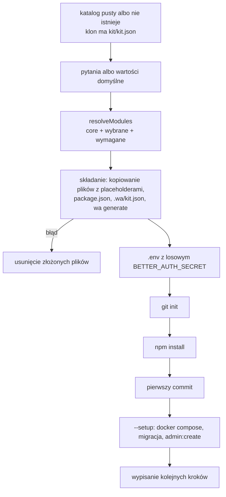

# CLI `wa`: tworzenie projektu i moduły

Po przeczytaniu będziesz wiedzieć:

- jak założyć nowy projekt z kitu komendą `wa create` i co dzieje się po kolei w trakcie składania;
- jak dodać, usunąć i wypisać moduły kitu w istniejącym projekcie (`wa add`, `wa remove`, `wa list`);
- skąd CLI bierze kod kitu i dlaczego wersja kitu musi się zgadzać z wersją projektu;
- co chroni projekt przed częściowo wykonaną komendą i czego CLI nie chroni;
- jak odczytać komunikaty błędów CLI.

Zweryfikowano z kodem: 5b2d308, 2026-10-29

Źródła:

- `kit/cli/src/bin.ts`
- `kit/cli/src/args.ts`
- `kit/cli/src/commands/create.ts`
- `kit/cli/src/commands/add.ts`
- `kit/cli/src/commands/remove.ts`
- `kit/cli/src/commands/list.ts`
- `kit/cli/src/assemble/` (kopiowanie, hashe, placeholdery, `package.json`, nazwy projektu, zależności modułów)
- `kit/cli/src/kit/source.ts`
- `kit/cli/src/kit/files.ts`
- `kit/cli/src/kit/kit-config.ts`
- `kit/cli/src/manifest/kit-state.ts`
- `kit/cli/src/process/prompter.ts`
- `kit/cli/src/process/runner.ts`
- `kit/cli/src/commands/__tests__/` (testy komend)
- `kit/kit.json`
- `kit/modules/core.json`
- `kit/README.md`
- `package.json`

Ten plik opisuje CLI z perspektywy osoby, która zakłada projekt albo zmienia jego zestaw modułów. Jak zbudowane są manifesty, `kit/kit.json`, hashe i bundel CLI oraz jak rozwijać samo CLI, opisuje [12b-rozwoj-kitu.md](12b-rozwoj-kitu.md). Komendę `wa generate` opisuje [02b-rejestr-i-generator.md](02b-rejestr-i-generator.md#wa-generate). Pojęcia moduł, feature, manifest i rejestr modułów wyjaśnia [słownik](README.md#slownik).

„(sprawdzone)” znaczy tu, że zachowanie potwierdził przebieg bundla `.wa/bin/wa.mjs` z commitu z nagłówka na kopii kitu albo na fiksturze `kit/cli/src/__tests__/fixtures/kit` zapisanej jako repozytorium git w katalogu tymczasowym.

<a id="komendy"></a>

## Komendy w skrócie

CLI to jeden plik, `.wa/bin/wa.mjs`, zapisany w repozytorium kitu i w każdym projekcie. W projekcie uruchamia go skrypt `wa` z `package.json` (`node .wa/bin/wa.mjs`), więc każdą komendę wywołujesz jako `npm run wa -- <komenda>`. Poza projektem, przy zakładaniu nowego, uruchamiasz bundel bezpośrednio z klonu kitu: `node <klon>/.wa/bin/wa.mjs create <katalog>`.

| Komenda | Gdzie | Co robi |
| --- | --- | --- |
| `wa create <katalog> [opcje]` | z klonu kitu | Składa nowy projekt: rdzeń i wybrane moduły ([wa create](#wa-create)). |
| `wa add <moduł> [--kit <źródło>] [--no-install]` | w projekcie | Kopiuje pliki modułu kitu i modułów, których wymaga ([wa add](#wa-add)). |
| `wa remove <moduł> [--force] [--no-install]` | w projekcie | Usuwa pliki modułu kitu i jego zależności npm ([wa remove](#wa-remove)). |
| `wa list [--kit <źródło>]` | w projekcie | Wypisuje moduły zainstalowane, dostępne w kicie i moduły projektu ([wa list](#wa-list)). |
| `wa generate` | w projekcie i w kicie | Odświeża pliki generowane ([02b](02b-rejestr-i-generator.md#wa-generate)). |
| `wa kit sync` | tylko w kicie | Przepisuje `.wa/kit.json` kitu z manifestów ([12b](12b-rozwoj-kitu.md#kit-sync)). |

Każda komenda działa w katalogu bieżącym procesu. Każdy błąd kończy się wypisaniem komunikatu na stderr i kodem wyjścia 1; lista komunikatów jest w [Referencji](#referencja-komunikaty). Nieznana komenda wypisuje linię `Użycie: …` z podsumowaniem wszystkich komend (sprawdzone).

<a id="wa-create"></a>

## `wa create`: nowy projekt

### Uruchomienie

`create` potrzebuje klonu repozytorium kitu, bo kopiuje pliki śledzone przez git w tym klonie (`git ls-files`). Kit nie jest publikowany w rejestrze npm ([D28](decyzje.md#d28)), więc projekt zakładasz jedną linią, która klonuje wybrany tag i uruchamia bundel z klonu:

```bash
KIT_DIR=$(mktemp -d) && git clone --depth 1 --branch v0.1.0 https://github.com/webamigos/wa-kit.git "$KIT_DIR" && node "$KIT_DIR/.wa/bin/wa.mjs" create <nazwa>
```

`kit/README.md` nazywa tę linię `create-wa-app`; to nazwa w dokumentacji, nie osobny program. Zamiast `v0.1.0` podaj tag wersji, którą chcesz. Tag ustawia człowiek po scaleniu wydania do `main` ([12b](12b-rozwoj-kitu.md#wydanie)); zanim powstanie, `git clone` kończy się błędem, a projekt założysz z lokalnego klonu kitu opcją `--kit` ([znane-ograniczenia.md](znane-ograniczenia.md#tagi-kitu)).

Bez `--kit` CLI bierze kit z katalogu, w którym leży uruchomiony bundel (dwa poziomy nad `.wa/bin/wa.mjs`). Bundel z projektu nie ma obok siebie kitu, więc `npm run wa -- create …` w projekcie kończy się błędem `Uruchom create z klonu wa-kit albo podaj --kit <ścieżka>`.

### Nazwa katalogu i opcje

Ostatni człon ścieżki katalogu staje się slugiem projektu. Musi pasować do wzorca:

`kit/cli/src/assemble/project-names.ts`

```ts
const SLUG_PATTERN = /^[a-z][a-z0-9-]{1,49}$/;
```

Ze slugu powstają trzy nazwy, które zastępują placeholdery kitu ([12b](12b-rozwoj-kitu.md#placeholdery)):

| Nazwa | Jak powstaje | Przykład dla `acme-app` | Przykładowe miejsca |
| --- | --- | --- | --- |
| Nazwa wyświetlana | `--title` albo slug z wielką literą na początku każdego członu | `Acme App` | `src/shared/config/project.ts`, nadawca w `EMAIL_FROM` w `.env.example`, `.wa/kit.json` (`project.name`) |
| Slug | ostatni człon ścieżki | `acme-app` | `package.json` (`name`), `src/shared/config/project.ts`, `.wa/kit.json` (`project.slug`) |
| Snake | slug z `_` zamiast `-` | `acme_app` | nazwy baz: `acme_app` (`docker-compose.yml`, `.env.example`), `acme_app_test` (testy integracyjne), `acme_app_e2e` (e2e) |

Dzięki temu każdy projekt na tej samej maszynie ma własne bazy, a nie wspólne `wa_app_test` ([D35](decyzje.md#d35)). Pełną listę plików z placeholderami podaje `placeholderFiles` w `kit/kit.json`.

Opcje (`parseCreateArgs` w `kit/cli/src/args.ts`):

| Opcja | Znaczenie | Bez opcji |
| --- | --- | --- |
| `--modules a,b` | Moduły kitu oprócz rdzenia. `--modules ""` oznacza tylko rdzeń. | Pytanie o moduły; z `--yes` tylko rdzeń. |
| `--locales pl,en` | Języki aplikacji. Dozwolone `pl` i `en`, `pl` jest wymagany, bez powtórzeń. | Pytanie; z `--yes` `pl,en`. |
| `--title <tekst>` | Nazwa wyświetlana. | Pytanie z nazwą ze slugu jako domyślną; z `--yes` nazwa ze slugu. |
| `--admin-email <email>` | Adres pierwszego admina: trafia do `ADMIN_EMAIL` w `.env` i do `admin:create` przy `--setup`. | Pytanie (puste = pomiń); z `--yes` brak. |
| `--yes` | Bez pytań: brakujące opcje dostają wartości domyślne. | Pytania w terminalu. |
| `--setup` | Po instalacji uruchamia bazę, migrację i `admin:create`. | Pytanie `[t/N]`, zadawane tylko wtedy, gdy jest instalacja; z `--yes` bez setupu. |
| `--no-install` | Bez `npm install`. Nie łączy się z `--setup`. | `npm install` w projekcie. |
| `--no-git` | Bez `git init` i pierwszego commita. | `git init` i commit. |
| `--kit <ścieżka>` | Klon kitu, z którego powstaje projekt. Pusta wartość to błąd. | Katalog bundla ([wyżej](#wa-create)). |

Pytania czyta `readlinePrompter` z `kit/cli/src/process/prompter.ts`. Bez terminala (na przykład w CI albo z przekierowanym wejściem) pierwsze pytanie kończy się błędem `Brak terminala: użyj --yes`, a katalog projektu nie powstaje (sprawdzone). Odpowiedzi `t`, `tak`, `y` i `yes` (bez względu na wielkość liter) oznaczają zgodę.

Moduł z `--modules` ciągnie za sobą moduły z pola `requires` swojego manifestu, a rdzeń jest dodawany zawsze (`resolveModules` w `kit/cli/src/assemble/resolve-modules.ts`). Nieznana nazwa kończy się błędem `Nieznany moduł: <nazwa>. Dostępne: <lista>` przed utworzeniem czegokolwiek. Kit w wersji z nagłówka ma tylko moduł `core`, więc lista po `Dostępne:` jest pusta (sprawdzone).

<a id="create-przebieg"></a>

### Przebieg



1. **Katalog docelowy.** Katalog, który istnieje i ma jakikolwiek wpis (także ukryty plik), kończy komendę błędem `Katalog <ścieżka> istnieje i nie jest pusty`, zanim padnie pytanie albo uruchomi się jakiekolwiek polecenie. Pusty istniejący katalog jest akceptowany. Sprawdzenie powtarza się po pytaniach, więc plik, który pojawi się w trakcie odpowiadania, też przerwie komendę.
2. **Składanie.** CLI kopiuje pliki wybranych modułów z klonu kitu. Pomija pliki tylko dla kitu (`kitOnly` w `kit/kit.json`: `kit/`, `docs/`, `.wa/kit.json`, `prisma/migrations/.gitignore`, workflowy kitu) i pliki generowane, bo te odtwarza generator. W plikach z listy `placeholderFiles` podmienia placeholdery na nazwy projektu i zapisuje hash każdego skopiowanego pliku ([12b](12b-rozwoj-kitu.md#hashe)). `package.json` dostaje slug jako `name`, wersję `0.1.0` i zależności będące sumą zależności wybranych manifestów ([D29](decyzje.md#d29)). Na końcu CLI zapisuje `.wa/kit.json` z wersją kitu, adresem repozytorium, nazwami, językami i pustym `projectModules`, a potem uruchamia `wa generate`.
3. **Błąd w trakcie składania** usuwa katalog projektu, a gdy katalog istniał wcześniej (pusty), usuwa jego zawartość. Test: „nieznany moduł kończy się błędem i nie zostawia katalogu” w `kit/cli/src/commands/__tests__/create.test.ts`.
4. **`.env`.** Kopia `.env.example` z `BETTER_AUTH_SECRET` ustawionym na 32 losowe bajty w base64url (43 znaki) i z `ADMIN_EMAIL`, jeśli podano adres. Plik ma uprawnienia `0600` (sprawdzone). `.env.example` zostaje bez sekretu.
5. **`git init`**, gdy nie podano `--no-git`.
6. **`npm install`**, gdy nie podano `--no-install`. Lockfile jest skopiowany z kitu, a `npm install` dopasowuje go do `package.json` projektu. Błąd instalacji kończy komendę komunikatem `Projekt utworzony w <ścieżka>, ale npm install się nie powiódł. Uruchom: cd <ścieżka> && npm install`, a katalog zostaje.
7. **Pierwszy commit** `chore: initial commit from wa-kit v<wersja>` (z `--no-verify`, czyli bez hooków husky). Brak `user.name` albo `user.email` w konfiguracji gita nie przerywa komendy: CLI wypisuje `Uwaga: nie utworzono commita (…). Skonfiguruj git i zrób commit ręcznie.`
8. **`--setup`** (albo odpowiedź „t” na pytanie): `docker compose up -d --wait`, `npx prisma migrate dev --name init` i, jeśli podano adres admina, `npm run admin:create -- --email <adres>`. Domyślnie setupu nie ma, bo na maszynach deweloperów porty Postgresa i mailpit bywają zajęte ([D33](decyzje.md#d33), [01-uruchomienie.md](01-uruchomienie.md#typowe-problemy)).
9. **Kolejne kroki.** CLI wypisuje polecenia do uruchomienia: `cd <ścieżka>`, bez setupu także `docker compose up -d`, `npx prisma migrate dev --name init` i `npm run admin:create -- --email <adres albo twój-email>`, a na końcu `npm run dev`.

### Co dostaje projekt

Projekt ma ten sam układ katalogów co kit ([D02](decyzje.md#d02)), z tymi różnicami (sprawdzone na projekcie `acme-app`):

| W projekcie | Różnica względem kitu |
| --- | --- |
| `kit/`, `docs/` | Nie ma. Dokumentacja leży tylko w repozytorium kitu, a projekt wskazuje ją tekstem w `README.md` i `AGENTS.md`. |
| `prisma/migrations/` | Nie ma katalogu ani pliku `.gitignore`, który w kicie ignoruje migracje. Pierwsza migracja projektu trafia do repozytorium ([03b](03b-schemat-i-migracje.md#migracje-w-projekcie), [D13](decyzje.md#d13)). |
| `.wa/kit.json` | Nazwa i slug projektu, wybrane języki, wybrane moduły z hashami plików w `files` ([12b](12b-rozwoj-kitu.md#hashe)). |
| `package.json` | `name` równy slugowi, `version` `0.1.0`, zależności wybranych modułów. |
| `src/i18n/locales.generated.ts` | Tylko wybrane języki. Przy `--locales pl` pliki `en.json` zostają w projekcie, ale aplikacja ich nie ładuje ([D32](decyzje.md#d32)). |
| `.env` | Gotowy do startu, z losowym sekretem. |
| `.wa/bin/wa.mjs` | Ten sam bundel co w kicie: należy do rdzenia, więc projekt uruchamia generator i `wa add` bez budowania CLI. |

Po `create` dalej postępujesz jak w [01-uruchomienie.md](01-uruchomienie.md#pierwsze-uruchomienie) od kroku z Dockerem; `npm install` i `.env` są już gotowe.

<a id="zrodlo-kitu"></a>

## Źródło kitu dla `add` i `list`

`wa add` i `wa list` czytają manifesty i pliki z repozytorium kitu w wersji projektu. Źródło wybiera `resolveKitSource` w `kit/cli/src/kit/source.ts`, w tej kolejności:

1. opcja `--kit <źródło>`;
2. zmienna środowiskowa `WA_KIT_SOURCE`;
3. `kitRepo` z `.wa/kit.json` projektu (domyślnie `https://github.com/webamigos/wa-kit.git`).

`kit/cli/src/kit/source.ts`

```ts
const REMOTE_PREFIXES = ["https://", "ssh://", "file://", "git@"];
```

- **Źródło zdalne** (zaczyna się od jednego z prefiksów) CLI klonuje do katalogu tymczasowego poleceniem `git clone --depth 1 --branch v<kitVersion>`, gdzie `kitVersion` pochodzi z `.wa/kit.json`. Katalog tymczasowy znika po komendzie. Brak dostępu albo brak tagu daje komunikat `Nie udało się pobrać wa-kit v<wersja> z <adres>. Sprawdź dostęp (gh auth status) albo podaj --kit <ścieżka>`. Nad nim zostaje wyjście gita, na przykład `fatal: … v0.1.0 …`, bo polecenia potomne piszą wprost do terminala (sprawdzone).
- **Ścieżka lokalna** musi wskazywać klon kitu z `kit/kit.json`, a jego `version` musi być równa `kitVersion` projektu. Inna wersja kończy się błędem `Kit w <ścieżka> ma wersję <x>, projekt używa <y>`.
- **Odrzucane źródła:** wartość zaczynająca się od `-` (żeby nie stała się opcją gita) i wartość z `://` albo `::` spoza listy prefiksów, na przykład `ext::sh`. Komunikat: `Nieprawidłowe źródło wa-kit: <źródło>`.

Wymóg równej wersji wynika z modelu kitu: projekt dostaje kod jednej wersji kitu, a narzędzia do przejścia na nowszą wersję w CLI nie ma ([README](README.md#plany)). Moduł z nowszego kitu skopiowałby pliki, które zakładają nowszy rdzeń.

<a id="wa-add"></a>

## `wa add`: dodanie modułu kitu

```bash
npm run wa -- add <moduł>
```

1. **Odmowy przed zmianami.** Moduł już zainstalowany (`Moduł <x> jest już zainstalowany`), nazwa zajęta przez moduł projektu (`Moduł <x> jest modułem projektu; zmień jego nazwę albo usuń wpis z projectModules`), nieznana nazwa (`Nieznany moduł: …`).
2. **Zestaw modułów.** Moduł i wszystkie moduły z jego `requires`, których projekt nie ma.
3. **Kolizje.** Jeśli na ścieżce któregokolwiek pliku z zestawu coś już jest (plik, katalog albo symlink, także wiszący), komenda kończy się błędem `Pliki już istnieją, przerwano bez zmian:` z listą ścieżek i niczego nie zmienia (sprawdzone). CLI nie nadpisuje plików projektu.
4. **Kopiowanie** z placeholderami według nazw z `.wa/kit.json` projektu i z hashami plików, dopisanie zależności npm do `package.json`, zapis `.wa/kit.json`.
5. **`wa generate`**, potem `npm install` (bez `--no-install`).
6. **Podpowiedź migracji:** ostatnia linia wyjścia to `npx prisma migrate dev --name add-<moduł>`. Migrację tworzysz i commitujesz sam, bo moduł może dodać plik schematu i relacje w regionach ([03b](03b-schemat-i-migracje.md#migracje-w-projekcie)).

**Zależność, którą projekt już ma w innej wersji,** zostaje w wersji projektu. CLI wypisuje wtedy ostrzeżenie (sprawdzone):

```text
Uwaga: left-pad (dependencies) ma w projekcie ^1.0.0, moduł demo wymaga ^1.3.0; zostaje wersja projektu
```

Wersje porównywane są osobno w `dependencies` i `devDependencies`. Przy kilku modułach w jednym wywołaniu każdy jest porównywany z `package.json` po dodaniu poprzednich. Ostrzeżenie nie przerywa komendy: sprawdź, czy moduł działa z wersją projektu.

**Błąd w trakcie kroku 4** (na przykład brak miejsca na dysku, plik tylko do odczytu, plik w miejscu katalogu modułu) cofa zmiany: CLI usuwa skopiowane pliki i katalogi, które sam utworzył, jeśli zostały puste, oraz przywraca `package.json` i `.wa/kit.json`, jeśli ich treść różni się od oryginału. Każdy krok sprzątania działa niezależnie; krok, który się nie uda, CLI wypisuje jako `Nie udało się posprzątać: <ścieżka> (<kod błędu>)` i na końcu rzuca pierwotny błąd. Testy: `kit/cli/src/commands/__tests__/add-rollback.test.ts` i `add-fs-failures.test.ts`.

**Błąd w `wa generate` albo `npm install`** nie cofa zmian, bo stan jest już spójny: pliki są skopiowane, a `.wa/kit.json` je opisuje. Powtórz `npm run wa -- generate` albo `npm install`. Przy błędzie instalacji komunikat to `Moduł dodany, ale npm install się nie powiódł. Uruchom: npm install`.

<a id="wa-remove"></a>

## `wa remove`: usunięcie modułu kitu

```bash
npm run wa -- remove <moduł>
```

1. **Odmowy przed zmianami:**
   - `core`: `Nie można usunąć rdzenia`;
   - moduł projektu: `Moduł <x> należy do projektu; wa remove usuwa tylko moduły kitu. Usuń jego pliki i wpis w projectModules ręcznie`;
   - moduł niezainstalowany: `Moduł <x> nie jest zainstalowany`;
   - moduł wymagany przez inny moduł kitu albo projektu: `Moduł <x> jest wymagany przez: <lista>` (sprawdzone).
2. **Ścieżki poza projektem.** Każda ścieżka z `files` modułu, która po rozwiązaniu symlinków wychodzi poza katalog projektu, kończy komendę błędem `Ścieżka poza projektem: <ścieżka>` przed usunięciem czegokolwiek.
3. **Zmienione pliki.** CLI liczy hash każdego pliku modułu i porównuje go z hashem z `.wa/kit.json`. Jeśli choć jeden się różni, bez `--force` komenda kończy się błędem `Zmienione pliki modułu <x> (użyj --force):` z listą plików i niczego nie usuwa ([D31](decyzje.md#d31)). Zmiana wyłącznie wewnątrz regionu `wa:*` nie liczy się jako zmiana, bo hash pomija treść regionów. Plik, którego już nie ma, nie blokuje komendy.
4. **Usunięcie** plików modułu i pustych katalogów nad nimi, aż do pierwszego niepustego. Sprzątanie katalogów nie przechodzi przez symlinki i nigdy nie usuwa katalogu projektu.
5. **`package.json`.** Znikają zależności usuwanego modułu, których nie deklaruje żaden pozostały moduł kitu ani moduł projektu.
6. **Zapis `.wa/kit.json`** bez modułu, `wa generate`, `npm install` (bez `--no-install`) i ostatnia linia `npx prisma migrate dev --name remove-<moduł>`.

`--force` usuwa pliki modułu razem z lokalnymi zmianami. Zanim go użyjesz, przenieś zmiany, które chcesz zachować.

**Bezpieczeństwo.** `wa remove` ufa treści `.wa/kit.json`: usunie każdy plik z `files` modułu, którego hash zgadza się z zapisanym. `.wa/kit.json` z niezaufanego źródła przejrzyj przed użyciem komendy. Komenda nie jest odporna na równoległe zmiany katalogu projektu przez inny proces. Plik modułu, który sam jest symlinkiem, znika jak zwykły plik: usunięty zostaje link, a nie jego cel.

<a id="wa-list"></a>

## `wa list`: stan modułów

```bash
npm run wa -- list
```

Wynik dla projektu z kitu, który ma tylko rdzeń (sprawdzone):

```text
Zainstalowane:
  core 0.1.0
Dostępne: brak
```

- **Zainstalowane:** moduły kitu z `.wa/kit.json` z wersjami, `core` pierwszy.
- **Dostępne:** moduły z manifestów kitu w wersji projektu, których projekt nie ma, z opisem i listą `requires`. Gdy kitu nie da się pobrać, linia brzmi `Dostępne: nie udało się pobrać kitu (<powód>)`, a komenda i tak kończy się kodem 0, bo stan projektu wypisała.
- **Projektu:** moduły z `projectModules` z opisem. Sekcja pojawia się tylko wtedy, gdy projekt je ma ([09](09-nowy-modul.md#krok-3)).

<a id="moduly-projektu"></a>

## Moduły projektu a CLI

Funkcja napisana w projekcie ma wpis w `projectModules` w `.wa/kit.json` ([krok 3 tutorialu](09-nowy-modul.md#krok-3), [D34](decyzje.md#d34)). Komendy traktują ją tak:

| Komenda | Moduł projektu |
| --- | --- |
| `wa generate` | Rejestruje go po modułach kitu, alfabetycznie, i wypełnia jego regiony. |
| `wa add` | Odmawia dodania modułu kitu o tej samej nazwie. |
| `wa remove` | Odmawia usunięcia; plikami i wpisem zajmujesz się ręcznie. Nie usuwa modułu kitu, którego moduł projektu wymaga w `requires`, ani zależności npm, które moduł projektu deklaruje. |
| `wa list` | Wypisuje go w sekcji „Projektu”. |
| `wa kit sync` | Zachowuje wpisy bez zmian. |

<a id="referencja"></a>

## Referencja

<a id="referencja-opcje"></a>

### Opcje i argumenty

Każda komenda przyjmuje dokładnie tyle argumentów pozycyjnych, ile podaje tabela. Opcje parsuje `node:util` `parseArgs`; jego błędy CLI tłumaczy na polskie komunikaty (`translateParseError` w `kit/cli/src/args.ts`).

| Komenda | Argumenty pozycyjne | Opcje z wartością | Opcje bez wartości |
| --- | --- | --- | --- |
| `create` | 1: katalog | `--modules`, `--locales`, `--title`, `--admin-email`, `--kit` | `--yes`, `--setup`, `--no-install`, `--no-git` |
| `add` | 1: moduł | `--kit` | `--no-install` |
| `remove` | 1: moduł | brak | `--force`, `--no-install` |
| `list` | 0 | `--kit` | brak |
| `generate` | 0 (nadmiarowe są pomijane) | brak | brak |
| `kit sync` | 0 (nadmiarowe są pomijane) | brak | brak |

Zmienna środowiskowa `WA_KIT_SOURCE` działa jak `--kit` w `add` i `list`, gdy opcji nie podano. W `create` nie działa.

<a id="referencja-komunikaty"></a>

### Komunikaty

Każdy komunikat z tej tabeli kończy komendę kodem 1. Komunikaty `wa generate` są w [02b](02b-rejestr-i-generator.md#referencja-komunikaty).

| Komenda | Sytuacja | Komunikat |
| --- | --- | --- |
| każda | brak argumentu pozycyjnego | `Podaj katalog projektu` (`create`), `Podaj nazwę modułu` (`add`, `remove`) |
| każda | nadmiarowy argument | `Nieoczekiwany argument: <wartość>` |
| każda | nieznana opcja | `Nieznana opcja: <opcja>` |
| każda | opcja z wartością bez wartości, także `--kit=` i `--kit ""` | `Opcja <opcja> wymaga wartości` |
| każda | wartość przy opcji bez wartości, na przykład `--force=1` | `Opcja <opcja> nie przyjmuje wartości` |
| `add`, `remove`, `list` | brak `.wa/kit.json` w katalogu | `Brak .wa/kit.json w <katalog> — to nie jest projekt wa-kit` |
| `create` | niepoprawne `--locales` | `--locales: dozwolone pl,en; pl jest wymagany` |
| `create` | `--setup` z `--no-install` | `--setup wymaga instalacji zależności (bez --no-install)` |
| `create` | zła nazwa katalogu | `Nazwa projektu "<slug>": dozwolone małe litery, cyfry i myślniki, pierwsza litera, 2–50 znaków` |
| `create` | niepusty katalog | `Katalog <ścieżka> istnieje i nie jest pusty` |
| `create` | brak klonu kitu | `Uruchom create z klonu wa-kit albo podaj --kit <ścieżka>` |
| `create` | pytanie bez terminala | `Brak terminala: użyj --yes` |
| `create`, `add` | nieznany moduł | `Nieznany moduł: <nazwa>. Dostępne: <lista>` |
| `create` | błąd `npm install` | `Projekt utworzony w <ścieżka>, ale npm install się nie powiódł. Uruchom: cd <ścieżka> && npm install` |
| `add`, `list` | źródło kitu nie do przyjęcia | `Nieprawidłowe źródło wa-kit: <źródło>` |
| `add`, `list` | nieudany `git clone` | `Nie udało się pobrać wa-kit v<wersja> z <adres>. Sprawdź dostęp (gh auth status) albo podaj --kit <ścieżka>` |
| `add`, `list` | ścieżka bez `kit/kit.json` | `Brak kit/kit.json w <ścieżka> — to nie jest repozytorium wa-kit` |
| `add`, `list` | inna wersja lokalnego kitu | `Kit w <ścieżka> ma wersję <x>, projekt używa <y>` |
| `add` | moduł zainstalowany | `Moduł <x> jest już zainstalowany` |
| `add` | nazwa zajęta przez moduł projektu | `Moduł <x> jest modułem projektu; zmień jego nazwę albo usuń wpis z projectModules` |
| `add` | kolizja plików | `Pliki już istnieją, przerwano bez zmian:` i lista ścieżek |
| `add` | błąd `npm install` | `Moduł dodany, ale npm install się nie powiódł. Uruchom: npm install` |
| `remove` | rdzeń | `Nie można usunąć rdzenia` |
| `remove` | moduł projektu | `Moduł <x> należy do projektu; wa remove usuwa tylko moduły kitu. Usuń jego pliki i wpis w projectModules ręcznie` |
| `remove` | moduł niezainstalowany | `Moduł <x> nie jest zainstalowany` |
| `remove` | moduł wymagany | `Moduł <x> jest wymagany przez: <lista>` |
| `remove` | ścieżka poza projektem | `Ścieżka poza projektem: <ścieżka>` |
| `remove` | zmienione pliki bez `--force` | `Zmienione pliki modułu <x> (użyj --force):` i lista plików |
| `remove` | błąd `npm install` | `Moduł usunięty, ale npm install się nie powiódł. Uruchom: npm install` |

Linie, które nie kończą komendy błędem:

| Komenda | Linia | Kiedy |
| --- | --- | --- |
| `create` | `Uwaga: nie utworzono commita (<powód>). Skonfiguruj git i zrób commit ręcznie.` | `git commit` się nie udał. |
| `add` | `Uwaga: <pakiet> (<sekcja>) ma w projekcie <wersja>, moduł <x> wymaga <wersja>; zostaje wersja projektu` | Konflikt wersji zależności. |
| `add` | `Nie udało się posprzątać: <ścieżka> (<kod albo komunikat>)` | Nieudany krok cofania; po nich pada pierwotny błąd. |
| `add` | `npx prisma migrate dev --name add-<moduł>` | Sukces. |
| `remove` | `npx prisma migrate dev --name remove-<moduł>` | Sukces. |
| `list` | `Dostępne: nie udało się pobrać kitu (<powód>)` | Kitu nie da się pobrać; kod wyjścia 0. |
